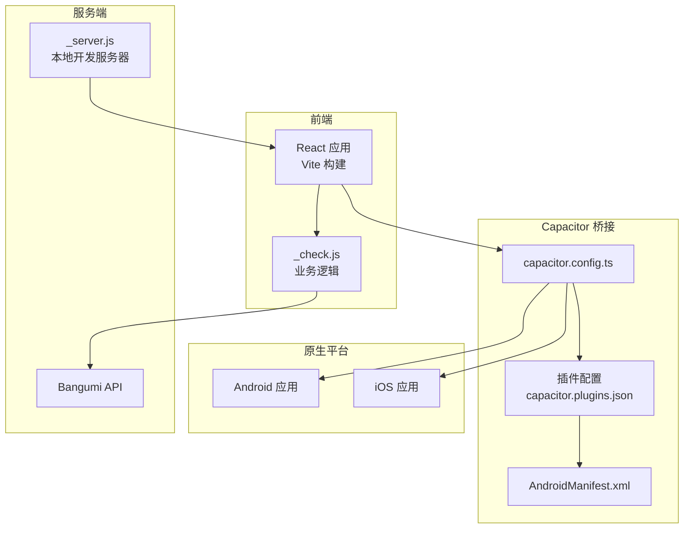
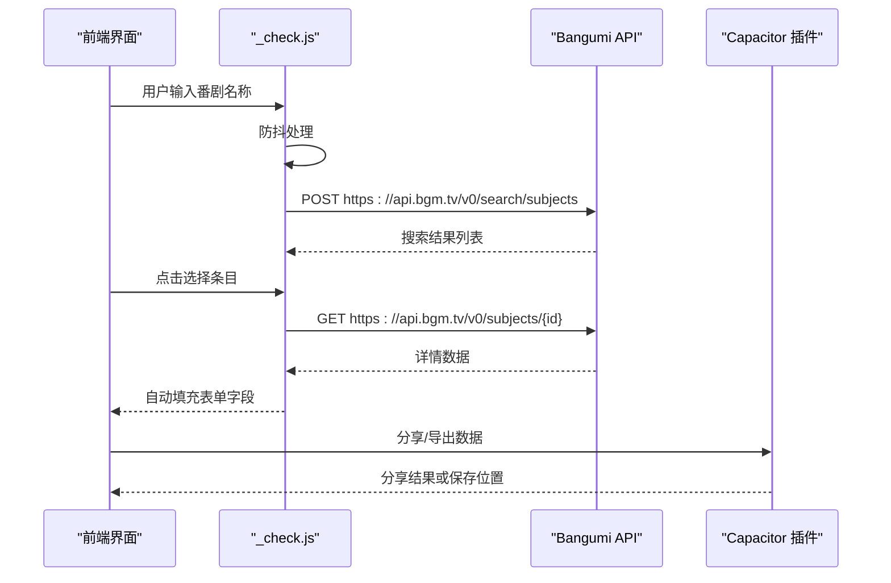
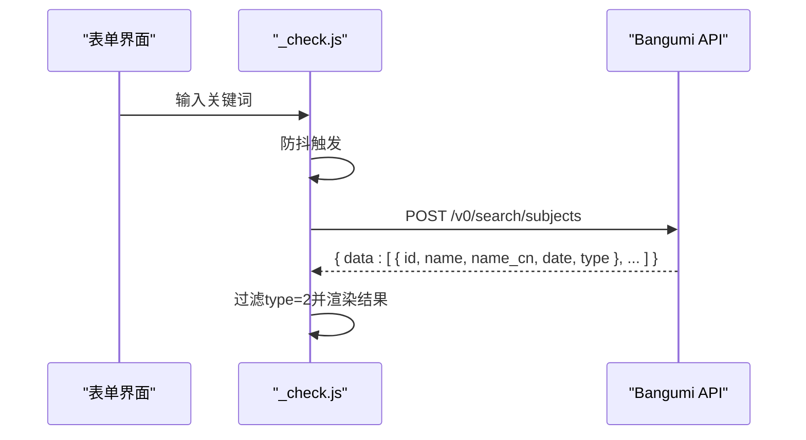
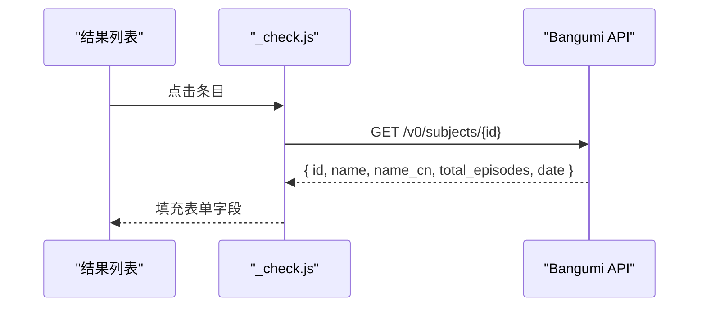
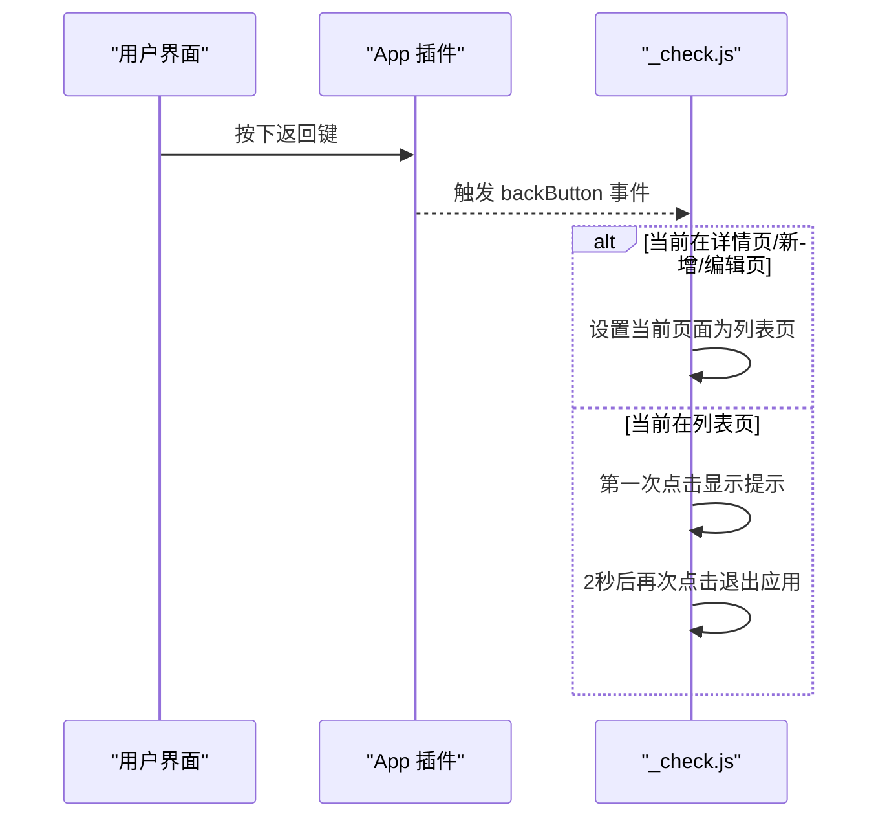
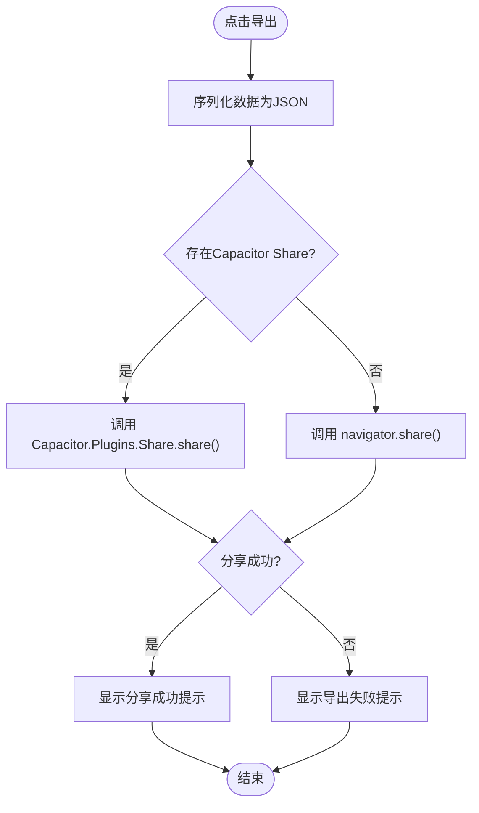
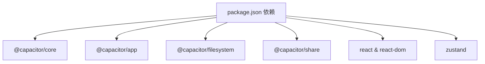

# API参考文档

<cite>
**本文档引用的文件**
- [capacitor.config.ts](file://capacitor.config.ts)
- [package.json](file://package.json)
- [android\app\src\main\assets\capacitor.config.json](file://android\app\src\main\assets\capacitor.config.json)
- [android\app\src\main\assets\capacitor.plugins.json](file://android\app\src\main\assets\capacitor.plugins.json)
- [android\app\src\main\AndroidManifest.xml](file://android\app\src\main\AndroidManifest.xml)
- [_check.js](file://_check.js)
- [_server.js](file://_server.js)
- [android\app\capacitor.build.gradle](file://android\app\capacitor.build.gradle)
- [android\capacitor.settings.gradle](file://android\capacitor.settings.gradle)
</cite>

## 目录
1. [简介](#简介)
2. [项目结构](#项目结构)
3. [核心组件](#核心组件)
4. [架构概览](#架构概览)
5. [详细组件分析](#详细组件分析)
6. [依赖关系分析](#依赖关系分析)
7. [性能考虑](#性能考虑)
8. [故障排除指南](#故障排除指南)
9. [结论](#结论)
10. [附录](#附录)

## 简介
本文件为Anime Tracker应用的API参考文档，涵盖以下内容：
- Bangumi API集成：搜索接口、详情获取、自动填充功能的HTTP方法、URL模式、请求响应格式
- Capacitor插件API：文件系统、分享、应用生命周期等原生功能的接口规范
- 参数说明、返回值定义、错误处理策略与使用示例
- API版本信息、兼容性说明与迁移指南

## 项目结构
该应用采用React + Capacitor混合架构，前端通过Vite构建，Capacitor桥接原生能力。核心目录与文件如下：
- 配置层：Capacitor配置、Android清单与插件映射
- 前端逻辑：Bangumi搜索与自动填充、本地存储、导出导入、应用生命周期事件
- 开发工具：本地静态服务器用于开发调试

**图表来源**
- [capacitor.config.ts:1-22](file://capacitor.config.ts#L1-L22)
- [android\app\src\main\assets\capacitor.plugins.json:1-15](file://android\app\src\main\assets\capacitor.plugins.json#L1-L15)
- [android\app\src\main\AndroidManifest.xml:1-47](file://android\app\src\main\AndroidManifest.xml#L1-L47)
- [_check.js:920-935](file://_check.js#L920-L935)
- [_server.js:1-32](file://_server.js#L1-L32)

**章节来源**
- [capacitor.config.ts:1-22](file://capacitor.config.ts#L1-L22)
- [package.json:1-38](file://package.json#L1-L38)
- [android\app\src\main\assets\capacitor.config.json:1-18](file://android\app\src\main\assets\capacitor.config.json#L1-L18)
- [android\app\src\main\assets\capacitor.plugins.json:1-15](file://android\app\src\main\assets\capacitor.plugins.json#L1-L15)
- [android\app\src\main\AndroidManifest.xml:1-47](file://android\app\src\main\AndroidManifest.xml#L1-L47)
- [_check.js:920-935](file://_check.js#L920-L935)
- [_server.js:1-32](file://_server.js#L1-L32)

## 核心组件
- Bangumi搜索与详情API：封装了POST搜索与GET详情两个核心接口，支持防抖搜索、结果展示与自动填充
- 导出导入功能：基于浏览器File API与Capacitor Share插件，支持数据导出与分享
- 应用生命周期：监听返回键事件，实现多级页面导航与双击退出
- 本地存储：基于localStorage持久化用户数据

**章节来源**
- [_check.js:920-935](file://_check.js#L920-L935)
- [_check.js:754-800](file://_check.js#L754-L800)
- [_check.js:1329-1345](file://_check.js#L1329-L1345)

## 架构概览
应用通过Capacitor桥接到原生平台，前端通过fetch调用Bangumi API，同时利用Capacitor插件扩展原生能力。

**图表来源**
- [_check.js:1118-1193](file://_check.js#L1118-L1193)
- [_check.js:920-935](file://_check.js#L920-L935)
- [_check.js:754-800](file://_check.js#L754-L800)

## 详细组件分析

### Bangumi API集成

#### 搜索接口
- 方法：POST
- URL：https://api.bgm.tv/v0/search/subjects
- 请求头：Content-Type: application/json
- 请求体参数：
  - keyword: 搜索关键词（字符串）
  - filter: 类型过滤器（对象），type数组仅包含2（动漫类型）
  - limit: 结果数量限制（整数）
- 成功响应：包含data字段的数组，每个元素为subject对象，需筛选type为2
- 失败处理：非200状态码时返回空数组

**图表来源**
- [_check.js:1118-1140](file://_check.js#L1118-L1140)
- [_check.js:920-929](file://_check.js#L920-L929)

**章节来源**
- [_check.js:920-929](file://_check.js#L920-L929)
- [_check.js:1118-1140](file://_check.js#L1118-L1140)

#### 详情获取接口
- 方法：GET
- URL：https://api.bgm.tv/v0/subjects/{id}
- 请求头：无特殊要求
- 成功响应：subject详情对象（包含name、name_cn、total_episodes、date等字段）
- 失败处理：非200状态码时返回null

**图表来源**
- [_check.js:1156-1192](file://_check.js#L1156-L1192)
- [_check.js:931-935](file://_check.js#L931-L935)

**章节来源**
- [_check.js:931-935](file://_check.js#L931-L935)
- [_check.js:1156-1192](file://_check.js#L1156-L1192)

#### 自动填充功能
- 触发条件：表单标题输入≥2字符且获得焦点
- 防抖机制：500ms延迟
- 数据映射：
  - 标题：name_cn（若为空则回退到name）
  - 总集数：total_episodes（默认12）
  - 放送日期：date（追番类型自动计算更新星期）
- 错误处理：加载失败显示错误提示

**章节来源**
- [_check.js:1195-1216](file://_check.js#L1195-L1216)
- [_check.js:1164-1187](file://_check.js#L1164-L1187)

### Capacitor插件API

#### 应用生命周期（Back Button）
- 插件：@capacitor/app
- 功能：监听返回键事件，实现多级页面导航与双击退出
- 事件处理：
  - 详情页/新增/编辑页：返回列表页
  - 列表页：首次点击显示提示，2秒内再次点击退出应用

**图表来源**
- [_check.js:1329-1345](file://_check.js#L1329-L1345)

**章节来源**
- [_check.js:1329-1345](file://_check.js#L1329-L1345)
- [android\app\src\main\assets\capacitor.plugins.json:1-15](file://android\app\src\main\assets\capacitor.plugins.json#L1-L15)

#### 分享与导出
- 插件：@capacitor/share
- 功能：通过Capacitor Share插件或Web Share API分享JSON数据
- 流程：
  1. 将动画列表序列化为JSON
  2. 优先尝试Capacitor Share插件
  3. 若失败则回退至Web Share API
  4. 失败时显示“导出失败”提示

**图表来源**
- [_check.js:754-800](file://_check.js#L754-L800)

**章节来源**
- [_check.js:754-800](file://_check.js#L754-L800)

#### 文件系统（Capacitor Filesystem）
- 插件：@capacitor/filesystem
- 集成方式：在Android侧通过capacitor.plugins.json声明，Gradle脚本中作为依赖引入
- 使用场景：当前代码未直接调用，但可作为后续扩展（如本地文件读写）的基础

**章节来源**
- [android\app\src\main\assets\capacitor.plugins.json:1-15](file://android\app\src\main\assets\capacitor.plugins.json#L1-L15)
- [android\app\capacitor.build.gradle:11-14](file://android\app\capacitor.build.gradle#L11-L14)

### 配置与环境

#### Capacitor配置
- 应用ID与名称：com.animetracker.app、追番记录
- Web目录：www
- 服务器设置：androidScheme为https
- 平台特定配置：Android背景色、允许混合内容；iOS内容边距与背景色
- 插件：空对象（默认启用）

**章节来源**
- [capacitor.config.ts:1-22](file://capacitor.config.ts#L1-L22)
- [android\app\src\main\assets\capacitor.config.json:1-18](file://android\app\src\main\assets\capacitor.config.json#L1-L18)

#### Android权限与Provider
- 权限：INTERNET、WRITE_EXTERNAL_STORAGE、READ_EXTERNAL_STORAGE、MANAGE_EXTERNAL_STORAGE
- Provider：FileProvider用于文件分享
- 允许明文流量：usesCleartextTraffic=true

**章节来源**
- [android\app\src\main\AndroidManifest.xml:40-46](file://android\app\src\main\AndroidManifest.xml#L40-L46)
- [android\app\src\main\AndroidManifest.xml:29-37](file://android\app\src\main\AndroidManifest.xml#L29-L37)

## 依赖关系分析

**图表来源**
- [package.json:18-29](file://package.json#L18-L29)

**章节来源**
- [package.json:18-29](file://package.json#L18-L29)

## 性能考虑
- 搜索防抖：500ms延迟减少网络请求频率
- 本地存储：使用localStorage避免频繁网络请求
- 导出优化：优先使用原生分享插件，失败时回退Web Share API
- 渲染优化：分页与折叠渲染减少DOM压力

## 故障排除指南
- Bangumi API失败：检查网络连接与API可用性，确认返回状态码
- 分享失败：确保Capacitor Share插件正确安装与授权，回退至Web Share API
- 导入数据格式错误：确认导入文件为JSON数组格式
- Android权限问题：检查AndroidManifest.xml中的权限声明与运行时授权

**章节来源**
- [_check.js:1132-1135](file://_check.js#L1132-L1135)
- [_check.js:810-820](file://_check.js#L810-L820)
- [android\app\src\main\AndroidManifest.xml:40-46](file://android\app\src\main\AndroidManifest.xml#L40-L46)

## 结论
本项目通过简洁的前端逻辑与Capacitor插件实现了Bangumi API的搜索与详情获取、数据导出分享以及应用生命周期管理。建议后续扩展包括：
- 引入Capacitor Filesystem进行本地文件持久化
- 添加更完善的错误处理与重试机制
- 考虑引入状态管理库优化复杂交互

## 附录

### API版本与兼容性
- Capacitor版本：6.x
- 插件版本：@capacitor/app@^6.0.0、@capacitor/share@^6.0.0、@capacitor/filesystem@^6.0.0
- Android编译选项：Java 17

**章节来源**
- [package.json:18-29](file://package.json#L18-L29)
- [android\app\capacitor.build.gradle:4-7](file://android\app\capacitor.build.gradle#L4-L7)

### 迁移指南
- 从旧版Capacitor迁移：更新package.json中的@capacitor/*包版本至6.x
- 插件API变更：遵循6.x版本的插件接口规范
- Android配置：保持capacitor.config.ts与capacitor.config.json一致

**章节来源**
- [capacitor.config.ts:1-22](file://capacitor.config.ts#L1-L22)
- [android\app\src\main\assets\capacitor.config.json:1-18](file://android\app\src\main\assets\capacitor.config.json#L1-L18)