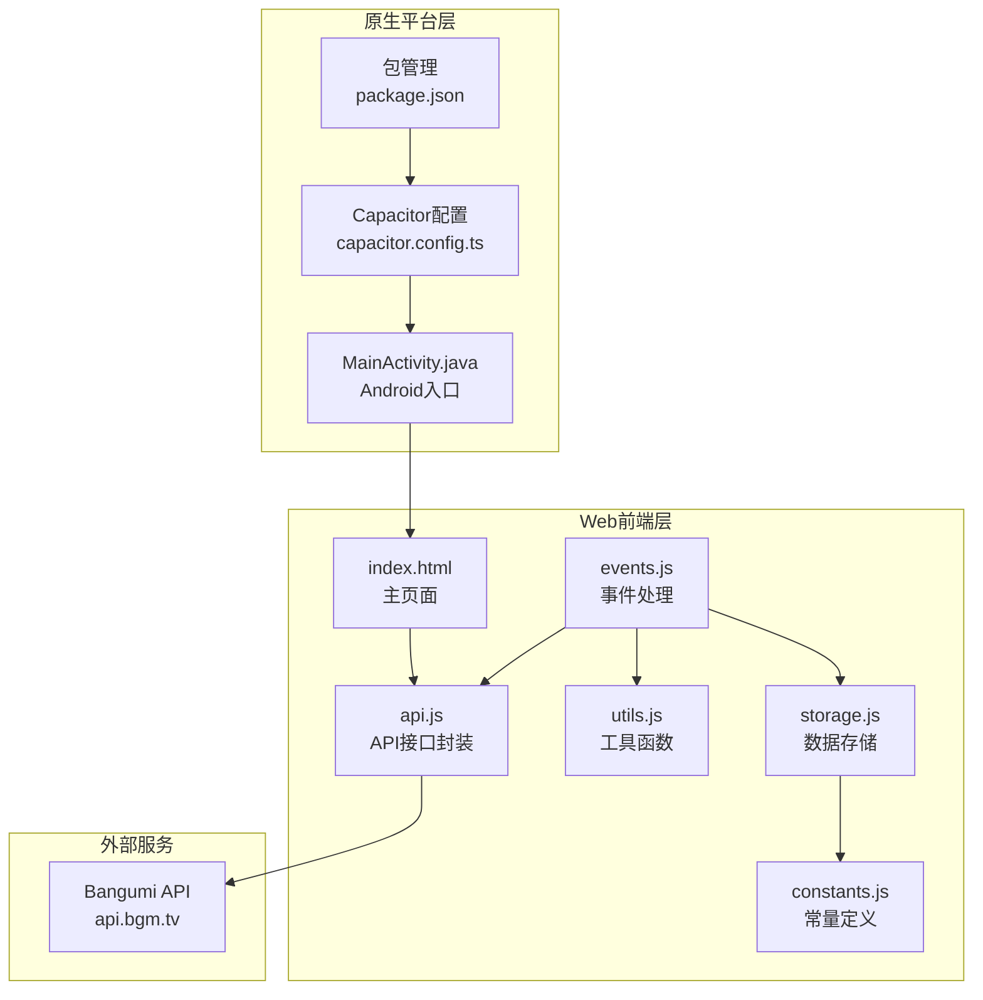
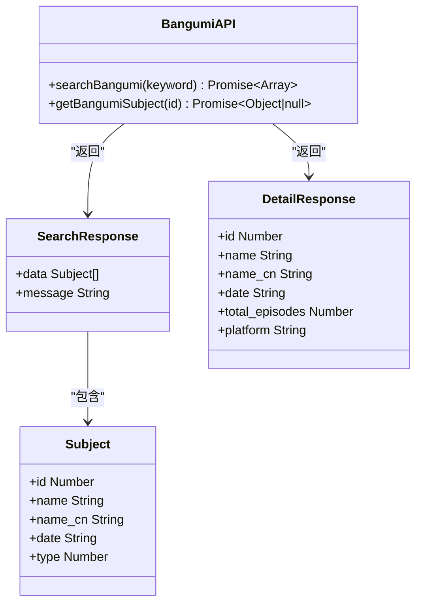
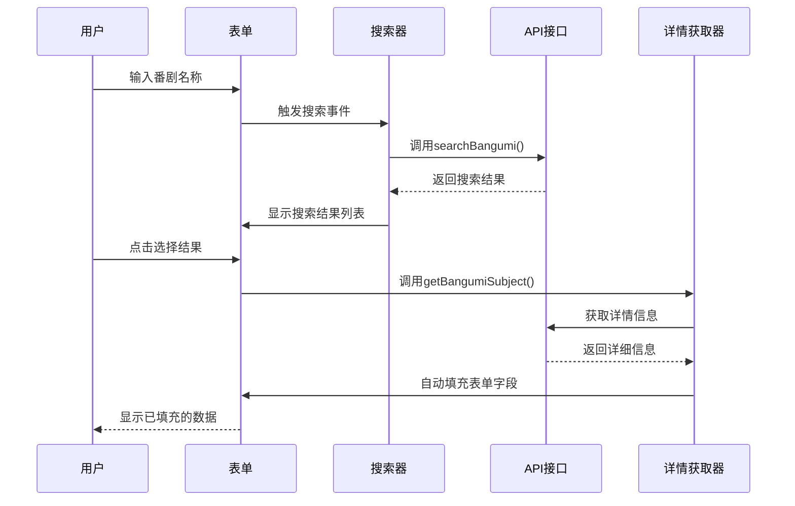
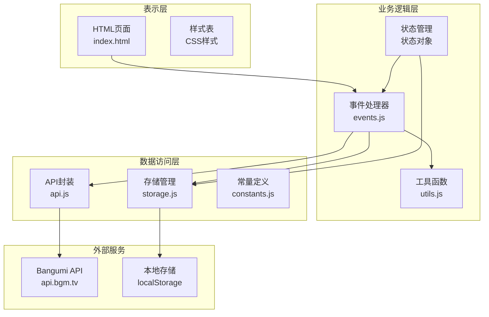
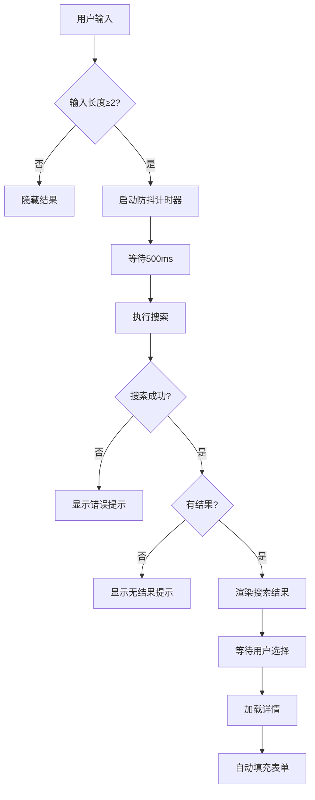
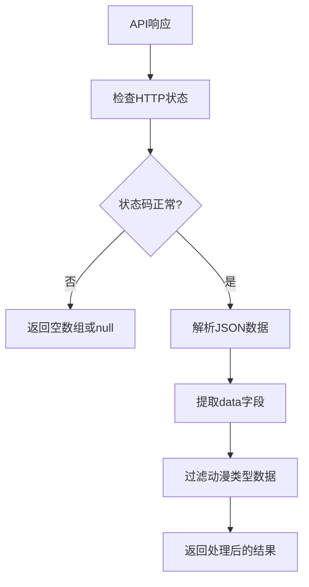
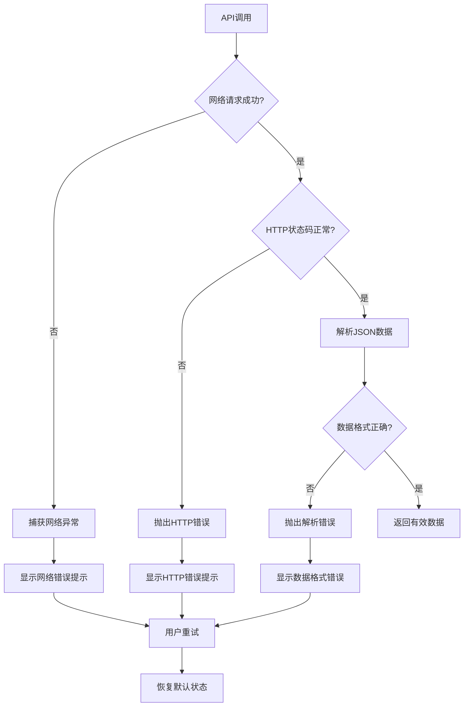
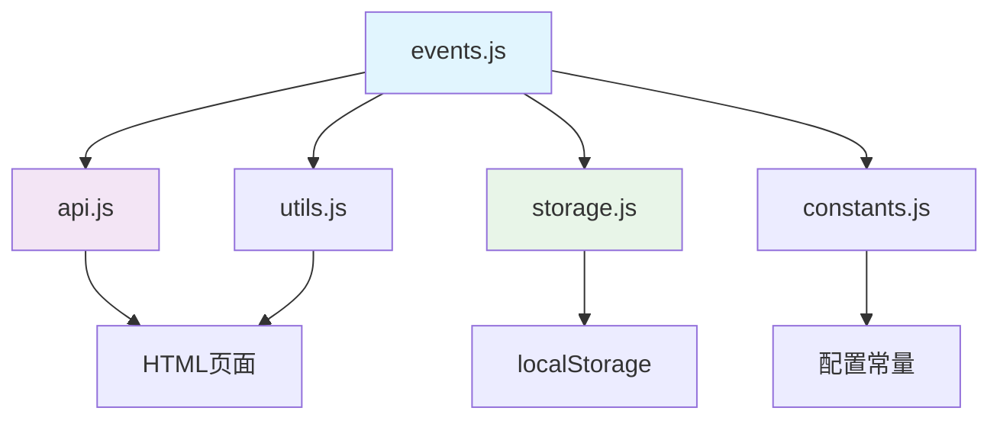

# Bangumi API集成

<cite>
**本文档引用的文件**
- [MainActivity.java](file://android/app/src/main/java/com/animetracker/app/MainActivity.java)
- [index.html](file://android/app/src/main/assets/public/index.html)
- [api.js](file://www/js/api.js)
- [events.js](file://www/js/events.js)
- [utils.js](file://www/js/utils.js)
- [storage.js](file://www/js/storage.js)
- [constants.js](file://www/js/constants.js)
- [package.json](file://package.json)
- [capacitor.config.ts](file://capacitor.config.ts)
</cite>

## 目录
1. [简介](#简介)
2. [项目结构](#项目结构)
3. [核心组件](#核心组件)
4. [架构概览](#架构概览)
5. [详细组件分析](#详细组件分析)
6. [依赖关系分析](#依赖关系分析)
7. [性能考虑](#性能考虑)
8. [故障排除指南](#故障排除指南)
9. [结论](#结论)

## 简介

本项目是一个基于Capacitor框架开发的动漫追踪应用，集成了Bangumi API来实现番剧搜索和信息获取功能。Bangumi是一个专业的ACG条目数据库，提供了丰富的动漫、漫画、游戏等二次元内容信息。

该应用通过HTTP API与Bangumi服务交互，实现了以下核心功能：
- 番剧搜索（支持模糊匹配和精确匹配）
- 番剧详情获取（包括基本信息、播放进度、评分等）
- 自动填充功能（根据搜索结果自动填写表单）
- 数据持久化存储
- 用户友好的界面交互

## 项目结构

该项目采用混合移动应用架构，结合了Web技术栈和原生Android平台：



**图表来源**
- [index.html:1-50](file://android/app/src/main/assets/public/index.html#L1-L50)
- [api.js:1-31](file://www/js/api.js#L1-L31)
- [events.js:1-50](file://www/js/events.js#L1-L50)
- [MainActivity.java:1-5](file://android/app/src/main/java/com/animetracker/app/MainActivity.java#L1-L5)

**章节来源**
- [index.html:1-100](file://android/app/src/main/assets/public/index.html#L1-L100)
- [package.json:1-38](file://package.json#L1-L38)
- [capacitor.config.ts:1-22](file://capacitor.config.ts#L1-L22)

## 核心组件

### Bangumi API接口封装

应用通过专门的JavaScript模块封装了Bangumi API的所有调用逻辑：



**图表来源**
- [api.js:5-30](file://www/js/api.js#L5-L30)

### 自动填充系统

应用实现了智能的自动填充功能，能够根据用户输入实时搜索并填充表单：



**图表来源**
- [events.js:675-782](file://www/js/events.js#L675-L782)
- [api.js:10-30](file://www/js/api.js#L10-L30)

**章节来源**
- [api.js:1-31](file://www/js/api.js#L1-L31)
- [events.js:675-782](file://www/js/events.js#L675-L782)

## 架构概览

应用采用了分层架构设计，确保了代码的可维护性和扩展性：



**图表来源**
- [index.html:1-100](file://android/app/src/main/assets/public/index.html#L1-L100)
- [events.js:1-50](file://www/js/events.js#L1-L50)
- [api.js:1-31](file://www/js/api.js#L1-L31)
- [storage.js:1-40](file://www/js/storage.js#L1-L40)

## 详细组件分析

### API接口实现

#### 搜索接口 (/v0/search/subjects)

**HTTP方法**: POST  
**URL模式**: `https://api.bgm.tv/v0/search/subjects`  
**请求参数**:
- `keyword`: 搜索关键词（必填）
- `filter.type`: 类型过滤器，固定为[2]（动漫类型）
- `limit`: 结果数量限制，默认8个

**请求格式**:
```javascript
{
  "keyword": "你的搜索词",
  "filter": {
    "type": [2]
  },
  "limit": 8
}
```

**响应格式**:
```javascript
{
  "data": [
    {
      "id": 12345,
      "name": "动漫名称",
      "name_cn": "中文名称",
      "date": "2023-01-01",
      "type": 2
    }
  ]
}
```

#### 详情获取接口 (/v0/subjects/{id})

**HTTP方法**: GET  
**URL模式**: `https://api.bgm.tv/v0/subjects/{id}`  
**请求参数**: 无  
**响应格式**:
```javascript
{
  "id": 12345,
  "name": "动漫名称",
  "name_cn": "中文名称",
  "date": "2023-01-01",
  "total_episodes": 24,
  "platform": "平台信息"
}
```

**章节来源**
- [api.js:10-30](file://www/js/api.js#L10-L30)

### 自动填充功能实现

#### 搜索防抖机制

应用实现了智能的防抖机制来优化API调用：



**图表来源**
- [events.js:675-782](file://www/js/events.js#L675-L782)

#### 数据解析和验证

应用对从API获取的数据进行了严格的验证和处理：



**图表来源**
- [api.js:10-30](file://www/js/api.js#L10-L30)

**章节来源**
- [events.js:675-782](file://www/js/events.js#L675-L782)
- [api.js:10-30](file://www/js/api.js#L10-L30)

### 错误处理机制

应用实现了多层次的错误处理机制：



**图表来源**
- [events.js:682-758](file://www/js/events.js#L682-L758)
- [api.js:10-30](file://www/js/api.js#L10-L30)

**章节来源**
- [events.js:682-758](file://www/js/events.js#L682-L758)
- [api.js:10-30](file://www/js/api.js#L10-L30)

### 缓存策略

虽然当前版本没有实现专门的API缓存，但应用利用了浏览器的HTTP缓存机制：

- **浏览器缓存**: 利用浏览器的默认缓存策略
- **本地存储**: 使用localStorage存储用户数据和应用状态
- **内存缓存**: 在会话期间缓存最近使用的搜索结果

**章节来源**
- [storage.js:1-40](file://www/js/storage.js#L1-L40)

## 依赖关系分析

### 外部依赖

项目的主要外部依赖包括：

```mermaid
graph LR
subgraph "核心依赖"
A[React 18.2.0<br/>UI框架]
B[Capacitor 6.0.0<br/>跨平台框架]
C[Zustand 4.5.0<br/>状态管理]
end
subgraph "Capacitor插件"
D[@capacitor/core<br/>核心功能]
E[@capacitor/filesystem<br/>文件系统]
F[@capacitor/share<br/>分享功能]
end
subgraph "开发依赖"
G[React DOM 18.2.0<br/>DOM渲染]
H[Vite 5.1.0<br/>构建工具]
I[TypeScript 5.2.2<br/>类型检查]
end
A --> D
B --> D
C --> D
E --> D
F --> D
```

**图表来源**
- [package.json:18-36](file://package.json#L18-L36)

### 内部模块依赖



**图表来源**
- [events.js:1-50](file://www/js/events.js#L1-L50)
- [api.js:1-31](file://www/js/api.js#L1-L31)
- [storage.js:1-40](file://www/js/storage.js#L1-L40)

**章节来源**
- [package.json:18-36](file://package.json#L18-L36)
- [events.js:1-50](file://www/js/events.js#L1-L50)

## 性能考虑

### API调用优化

1. **防抖机制**: 实现了500ms的防抖延迟，避免频繁的API调用
2. **结果限制**: 每次搜索最多返回8个结果，减少数据传输量
3. **类型过滤**: 仅搜索动漫类型，提高搜索准确性
4. **错误快速响应**: 网络错误时立即反馈，避免不必要的等待

### 内存管理

1. **事件监听器清理**: 在适当时候移除事件监听器，防止内存泄漏
2. **DOM元素复用**: 通过innerHTML复用DOM元素，减少创建销毁开销
3. **状态管理**: 使用集中式状态管理，避免重复渲染

### 用户体验优化

1. **加载状态指示**: 搜索过程中显示加载动画，提升用户体验
2. **即时反馈**: 输入时立即响应，提供即时的视觉反馈
3. **错误友好提示**: 使用友好的错误消息，帮助用户理解问题

## 故障排除指南

### 常见问题及解决方案

#### API调用失败

**症状**: 搜索框显示"搜索失败，请重试"  
**可能原因**:
- 网络连接问题
- Bangumi API服务不可用
- 请求参数格式错误

**解决步骤**:
1. 检查网络连接是否正常
2. 确认Bangumi API服务状态
3. 查看浏览器开发者工具中的网络请求
4. 重新尝试搜索

#### 搜索结果为空

**症状**: 搜索后显示"未找到相关番剧"  
**可能原因**:
- 关键词过于具体或拼写错误
- 该番剧不在Bangumi数据库中
- API限制导致结果不完整

**解决步骤**:
1. 尝试更通用的关键词
2. 检查关键词拼写
3. 稍后再试，避开API限制

#### 自动填充功能失效

**症状**: 点击搜索结果后无法自动填充表单  
**可能原因**:
- 详情API调用失败
- 数据格式不符合预期
- 浏览器兼容性问题

**解决步骤**:
1. 检查详情API的响应格式
2. 验证数据字段的存在性
3. 在不同浏览器中测试

### 调试技巧

1. **浏览器开发者工具**: 使用Network标签查看API调用详情
2. **控制台日志**: 添加console.log输出调试信息
3. **断点调试**: 在关键位置设置断点分析执行流程
4. **错误边界**: 实现错误边界组件捕获和显示错误

**章节来源**
- [events.js:682-758](file://www/js/events.js#L682-L758)
- [api.js:10-30](file://www/js/api.js#L10-L30)

## 结论

本项目成功实现了Bangumi API的深度集成，提供了完整的番剧搜索和信息获取功能。通过智能的防抖机制、完善的错误处理和友好的用户界面，为用户提供了流畅的使用体验。

### 主要优势

1. **简洁的API封装**: 将复杂的API调用封装为简单的JavaScript函数
2. **智能的自动填充**: 减少了用户的手动输入工作量
3. **健壮的错误处理**: 提供了良好的用户体验和故障恢复能力
4. **现代化的技术栈**: 使用React和Capacitor构建跨平台应用

### 改进建议

1. **实现API缓存**: 添加本地缓存机制减少重复请求
2. **增加搜索历史**: 记录用户的搜索历史便于再次使用
3. **优化移动端体验**: 针对移动设备优化触摸交互
4. **增强错误恢复**: 实现自动重试和降级策略

该应用为动漫追踪提供了一个功能完整、易于使用的解决方案，展现了现代Web应用开发的最佳实践。