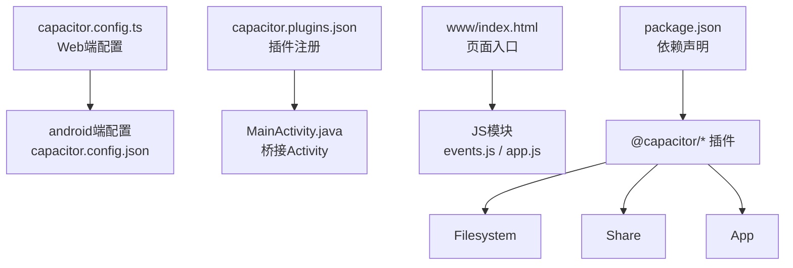
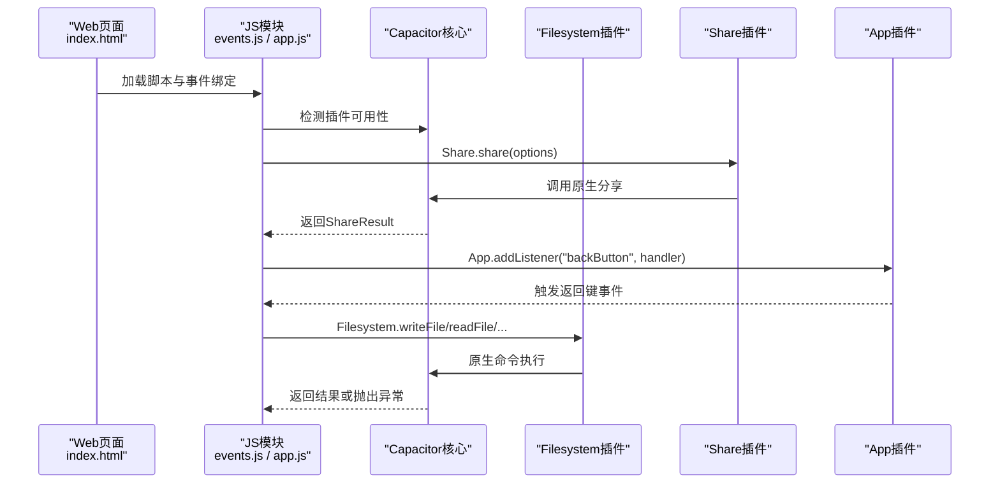
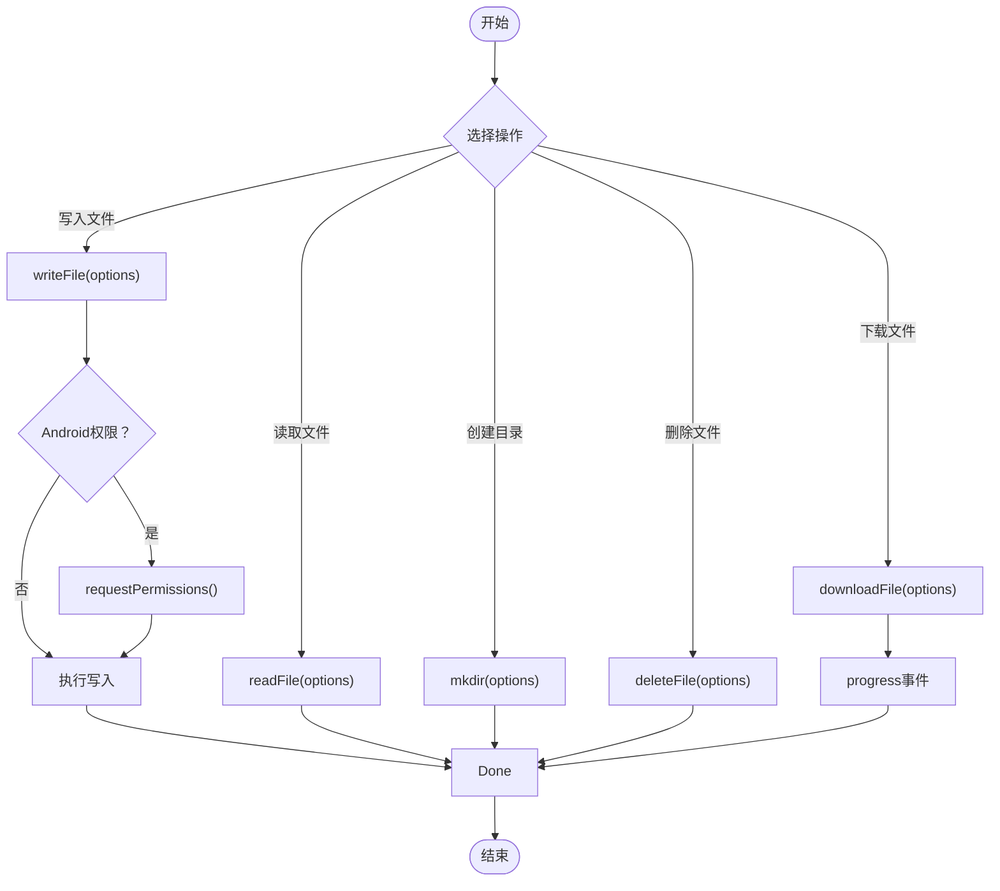
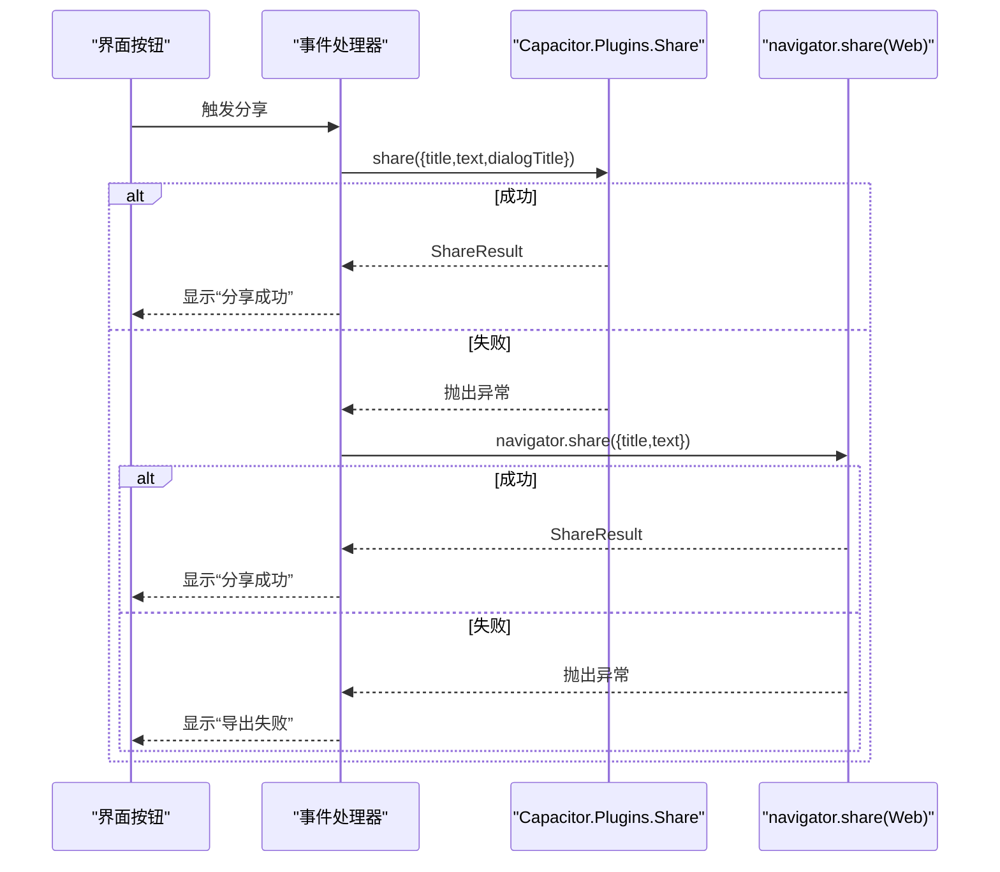
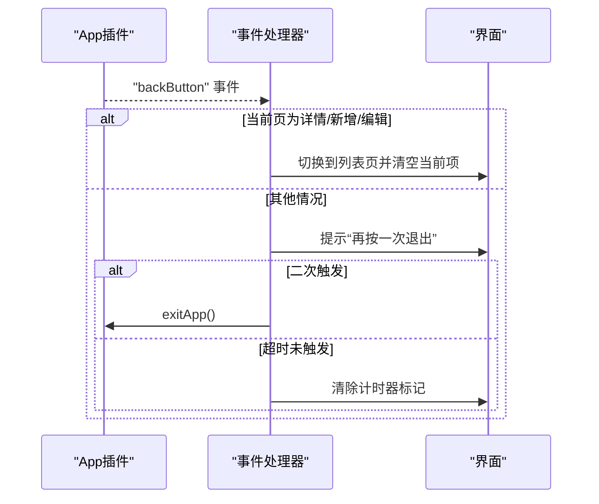
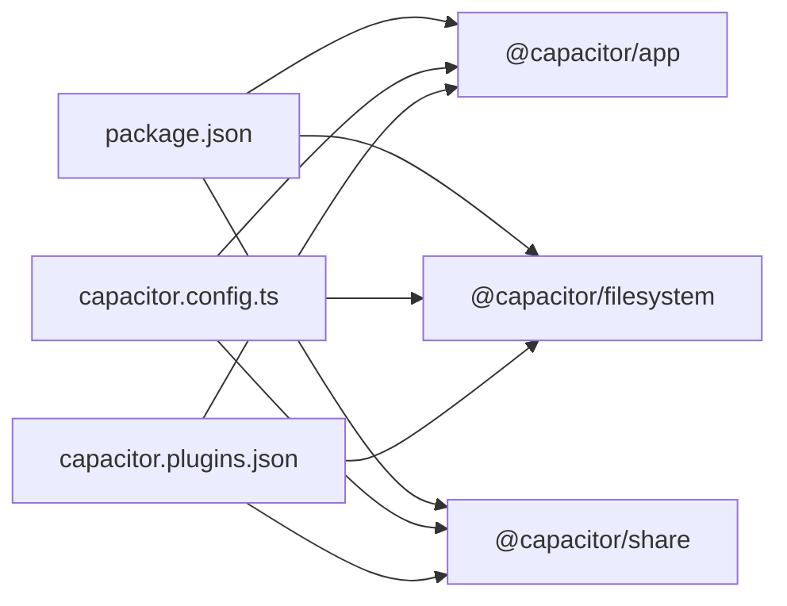

# Capacitor插件API

<cite>
**本文引用的文件**
- [capacitor.config.ts](file://capacitor.config.ts)
- [package.json](file://package.json)
- [android\app\src\main\assets\capacitor.config.json](file://android\app\src\main\assets\capacitor.config.json)
- [android\app\src\main\assets\capacitor.plugins.json](file://android\app\src\main\assets\capacitor.plugins.json)
- [android\app\src\main\java\com\animetracker\app\MainActivity.java](file://android\app\src\main\java\com\animetracker\app\MainActivity.java)
- [@capacitor\app 定义](file://node_modules/@capacitor/app/dist/esm/definitions.d.ts)
- [@capacitor\filesystem 定义](file://node_modules/@capacitor/filesystem/dist/esm/definitions.d.ts)
- [@capacitor\share 定义](file://node_modules/@capacitor/share/dist/esm/definitions.d.ts)
- [www\index.html](file://www\index.html)
- [_check.js](file://_check.js)
- [www\js\events.js](file://www\js\events.js)
- [www\js\app.js](file://www\js\app.js)
- [android\app\src\main\assets\public\index.html](file://android\app\src\main\assets\public\index.html)
- [_server.js](file://_server.js)
</cite>

## 目录
1. [简介](#简介)
2. [项目结构](#项目结构)
3. [核心组件](#核心组件)
4. [架构总览](#架构总览)
5. [详细组件分析](#详细组件分析)
6. [依赖关系分析](#依赖关系分析)
7. [性能考虑](#性能考虑)
8. [故障排查指南](#故障排查指南)
9. [结论](#结论)
10. [附录](#附录)

## 简介
本文件为Capacitor插件API的综合参考文档，聚焦以下三个官方插件在本项目中的使用与实践：
- 文件系统插件（Filesystem）：文件读写、目录操作、权限处理与错误处理
- 分享插件（Share）：文本分享、文件分享、分享对话框定制与平台兼容性
- 应用生命周期插件（App）：事件监听机制，包括应用进入后台、前台切换、暂停恢复、返回键处理等

文档同时提供初始化、配置与使用模式的完整示例路径，以及平台特定注意事项与调试技巧。

## 项目结构
本项目采用标准Capacitor结构，前端资源位于www目录，原生端通过capacitor.plugins.json声明启用插件；配置由capacitor.config.ts与android端的capacitor.config.json共同定义。

**图表来源**
- [capacitor.config.ts:1-22](file://capacitor.config.ts#L1-L22)
- [android\app\src\main\assets\capacitor.config.json:1-18](file://android\app\src\main\assets\capacitor.config.json#L1-L18)
- [android\app\src\main\assets\capacitor.plugins.json:1-15](file://android\app\src\main\assets\capacitor.plugins.json#L1-L15)
- [android\app\src\main\java\com\animetracker\app\MainActivity.java:1-5](file://android\app\src\main\java\com\animetracker\app\MainActivity.java#L1-L5)
- [www\index.html:1-75](file://www\index.html#L1-L75)
- [package.json:18-29](file://package.json#L18-L29)

**章节来源**
- [capacitor.config.ts:1-22](file://capacitor.config.ts#L1-L22)
- [android\app\src\main\assets\capacitor.config.json:1-18](file://android\app\src\main\assets\capacitor.config.json#L1-L18)
- [android\app\src\main\assets\capacitor.plugins.json:1-15](file://android\app\src\main\assets\capacitor.plugins.json#L1-L15)
- [android\app\src\main\java\com\animetracker\app\MainActivity.java:1-5](file://android\app\src\main\java\com\animetracker\app\MainActivity.java#L1-L5)
- [www\index.html:1-75](file://www\index.html#L1-L75)
- [package.json:18-29](file://package.json#L18-L29)

## 核心组件
- Filesystem（文件系统）
  - 支持读取、写入、追加、删除、创建/移除目录、列出目录、获取URI、统计信息、重命名/复制、下载文件、权限检查与请求、进度监听
  - 关键类型：Directory、Encoding、ReadFileOptions、WriteFileOptions、MkdirOptions、RmdirOptions、ReaddirOptions、StatOptions、CopyOptions、PermissionStatus
- Share（分享）
  - 支持canShare检测、share分享（标题、文本、URL、文件数组、对话框标题），返回活动标识
  - 关键类型：ShareOptions、ShareResult、CanShareResult
- App（应用生命周期）
  - 提供exitApp、getInfo、getState、getLaunchUrl、minimizeApp、状态变更监听（appStateChange）、暂停/恢复监听（pause/resume）、URL打开监听（appUrlOpen）、恢复结果监听（appRestoredResult）、返回键监听（backButton）

**章节来源**
- [@capacitor\filesystem 定义:496-597](file://node_modules/@capacitor/filesystem/dist/esm/definitions.d.ts#L496-L597)
- [@capacitor\share 定义:55-68](file://node_modules/@capacitor/share/dist/esm/definitions.d.ts#L55-L68)
- [@capacitor\app 定义:121-236](file://node_modules/@capacitor/app/dist/esm/definitions.d.ts#L121-L236)

## 架构总览
下图展示了浏览器端JS调用Capacitor插件的典型流程，以及原生层对事件的分发。

**图表来源**
- [www\index.html:64-72](file://www\index.html#L64-L72)
- [www\js\events.js:374-395](file://www\js\events.js#L374-L395)
- [www\js\app.js:20-37](file://www\js\app.js#L20-L37)
- [@capacitor\share 定义:55-68](file://node_modules/@capacitor/share/dist/esm/definitions.d.ts#L55-L68)
- [@capacitor\app 定义:121-236](file://node_modules/@capacitor/app/dist/esm/definitions.d.ts#L121-L236)
- [@capacitor\filesystem 定义:496-597](file://node_modules/@capacitor/filesystem/dist/esm/definitions.d.ts#L496-L597)

## 详细组件分析

### 文件系统插件（Filesystem）
- 使用场景
  - 将应用数据持久化到设备存储（如DATA目录）
  - 列出目录内容、查询文件元信息、重命名/复制文件
  - 下载远程文件并保存至本地
- 关键能力与参数
  - 写入/读取/追加/删除文件：WriteFileOptions、ReadFileOptions、AppendFileOptions、DeleteFileOptions
  - 目录操作：MkdirOptions、RmdirOptions、ReaddirOptions
  - 元信息：StatOptions、GetUriOptions
  - 复制/重命名：CopyOptions
  - 权限：checkPermissions、requestPermissions（Android针对Documents/ExternalStorage）
  - 下载：DownloadFileOptions（支持进度监听）
- 平台差异
  - Android 10及以上：Documents与ExternalStorage访问受限，需申请权限或使用应用私有目录
  - 编码：UTF8适用于字符串；ASCII/UTF16仅Android支持
  - Web端：Blob支持用于写入
- 错误处理建议
  - 对可能抛出异常的操作进行try/catch
  - 在递归创建目录前确认recursive选项
  - 下载时监听progress事件，避免UI卡顿

**图表来源**
- [@capacitor\filesystem 定义:496-597](file://node_modules/@capacitor/filesystem/dist/esm/definitions.d.ts#L496-L597)

**章节来源**
- [@capacitor\filesystem 定义:496-597](file://node_modules/@capacitor/filesystem/dist/esm/definitions.d.ts#L496-L597)
- [@capacitor\filesystem 定义:1-638](file://node_modules/@capacitor/filesystem/dist/esm/definitions.d.ts#L1-L638)

### 分享插件（Share）
- 接口规范
  - canShare()：检测是否支持分享
  - share(options)：分享文本、URL或文件列表，可设置对话框标题
  - 返回值：ShareResult（activityType）
- 使用模式
  - 容错降级：优先使用Capacitor插件，若不可用则回退到Web Share API
  - 异常处理：捕获AbortError等用户取消行为，避免误报错误
- 平台兼容性
  - 文件分享：iOS与Android支持；Web端不支持
  - 对话框标题：Android支持dialogTitle
- 示例路径
  - [分享逻辑（Web端）:374-395](file://www\js\events.js#L374-L395)
  - [分享逻辑（打包后HTML）:2110-2131](file://android\app\src\main\assets\public\index.html#L2110-L2131)
  - [分享逻辑（测试脚本）:774-799](file://_check.js#L774-L799)

**图表来源**
- [www\js\events.js:374-395](file://www\js\events.js#L374-L395)
- [android\app\src\main\assets\public\index.html:2110-2131](file://android\app\src\main\assets\public\index.html#L2110-L2131)
- [@capacitor\share 定义:55-68](file://node_modules/@capacitor/share/dist/esm/definitions.d.ts#L55-L68)

**章节来源**
- [@capacitor\share 定义:55-68](file://node_modules/@capacitor/share/dist/esm/definitions.d.ts#L55-L68)
- [www\js\events.js:374-395](file://www\js\events.js#L374-L395)
- [android\app\src\main\assets\public\index.html:2110-2131](file://android\app\src\main\assets\public\index.html#L2110-L2131)
- [_check.js:774-799](file://_check.js#L774-L799)

### 应用生命周期插件（App）
- 事件监听
  - appStateChange：应用前后台切换、可见性变化
  - pause/resume：暂停/恢复（含Android Activity生命周期）
  - appUrlOpen：自定义协议/通用链接打开
  - appRestoredResult：恢复被中断的外部Activity结果
  - backButton：Android物理返回键（需自行处理默认行为）
- 使用模式
  - Android返回键：通过addListener接管返回键，决定导航或退出
  - 退出应用：结合backButton与exitApp
- 示例路径
  - [返回键处理（Web端）:20-37](file://www\js\app.js#L20-L37)
  - [返回键处理（测试脚本）:1329-1346](file://_check.js#L1329-L1346)

**图表来源**
- [www\js\app.js:20-37](file://www\js\app.js#L20-L37)
- [@capacitor\app 定义:121-236](file://node_modules/@capacitor/app/dist/esm/definitions.d.ts#L121-L236)

**章节来源**
- [@capacitor\app 定义:121-236](file://node_modules/@capacitor/app/dist/esm/definitions.d.ts#L121-L236)
- [www\js\app.js:20-37](file://www\js\app.js#L20-L37)
- [_check.js:1329-1346](file://_check.js#L1329-L1346)

## 依赖关系分析
- 依赖声明
  - @capacitor/app、@capacitor/filesystem、@capacitor/share均在package.json中声明
- 原生插件注册
  - android端capacitor.plugins.json显式注册了上述插件类路径
- 配置一致性
  - Web端capacitor.config.ts与android端capacitor.config.json保持一致的应用ID、应用名、服务器配置与插件配置

**图表来源**
- [package.json:18-29](file://package.json#L18-L29)
- [capacitor.config.ts:1-22](file://capacitor.config.ts#L1-L22)
- [android\app\src\main\assets\capacitor.plugins.json:1-15](file://android\app\src\main\assets\capacitor.plugins.json#L1-L15)

**章节来源**
- [package.json:18-29](file://package.json#L18-L29)
- [capacitor.config.ts:1-22](file://capacitor.config.ts#L1-L22)
- [android\app\src\main\assets\capacitor.plugins.json:1-15](file://android\app\src\main\assets\capacitor.plugins.json#L1-L15)

## 性能考虑
- 文件下载
  - 使用downloadFile的progress选项监听进度，避免频繁更新UI导致卡顿
  - Android/iOS对进度事件进行节流，注意合理刷新频率
- 目录操作
  - 创建多级目录时开启recursive，减少多次调用
- 分享
  - 优先使用Capacitor插件，避免不必要的回退分支
  - 对大文件分享建议先压缩或转存到应用私有目录后再分享

## 故障排查指南
- 分享失败
  - 检查canShare返回值
  - 捕获AbortError（用户取消）并忽略
  - 回退到navigator.share，确保title/text存在
  - 参考路径：[分享逻辑（Web端）:374-395](file://www\js\events.js#L374-L395)
- 返回键无响应
  - 确认已添加backButton监听
  - 在顶层页面正确调用exitApp
  - 参考路径：[返回键处理（Web端）:20-37](file://www\js\app.js#L20-L37)
- 文件读写异常
  - Android权限：针对Documents/ExternalStorage需requestPermissions
  - 编码问题：统一使用UTF8字符串
  - 参考路径：[文件系统定义:496-597](file://node_modules/@capacitor/filesystem/dist/esm/definitions.d.ts#L496-L597)
- 开发调试
  - 使用内置HTTP服务预览www资源
  - 参考路径：[_server.js:1-31](file://_server.js#L1-L31)

**章节来源**
- [www\js\events.js:374-395](file://www\js\events.js#L374-L395)
- [www\js\app.js:20-37](file://www\js\app.js#L20-L37)
- [@capacitor\filesystem 定义:496-597](file://node_modules/@capacitor/filesystem/dist/esm/definitions.d.ts#L496-L597)
- [_server.js:1-31](file://_server.js#L1-L31)

## 结论
本项目基于Capacitor官方插件实现了文件持久化、跨平台分享与应用生命周期管理。通过合理的权限处理、事件监听与容错降级策略，能够在多平台环境下提供一致的用户体验。建议在生产环境中进一步完善错误日志与性能监控，并根据业务需求扩展更多插件能力。

## 附录
- 初始化与配置
  - Web端配置：[capacitor.config.ts:1-22](file://capacitor.config.ts#L1-L22)
  - Android端配置：[capacitor.config.json:1-18](file://android\app\src\main\assets\capacitor.config.json#L1-L18)
  - 插件注册：[capacitor.plugins.json:1-15](file://android\app\src\main\assets\capacitor.plugins.json#L1-L15)
  - MainActivity桥接：[MainActivity.java:1-5](file://android\app\src\main\java\com\animetracker\app\MainActivity.java#L1-L5)
- 页面入口与模块加载
  - [www\index.html:64-72](file://www\index.html#L64-L72)
- 示例路径汇总
  - 分享：[www\js\events.js:374-395](file://www\js\events.js#L374-L395)、[android\app\src\main\assets\public\index.html:2110-2131](file://android\app\src\main\assets\public\index.html#L2110-L2131)、[_check.js:774-799](file://_check.js#L774-L799)
  - 返回键：[www\js\app.js:20-37](file://www\js\app.js#L20-L37)、[_check.js:1329-1346](file://_check.js#L1329-L1346)
  - 文件系统：[@capacitor\filesystem 定义:496-597](file://node_modules/@capacitor/filesystem/dist/esm/definitions.d.ts#L496-L597)