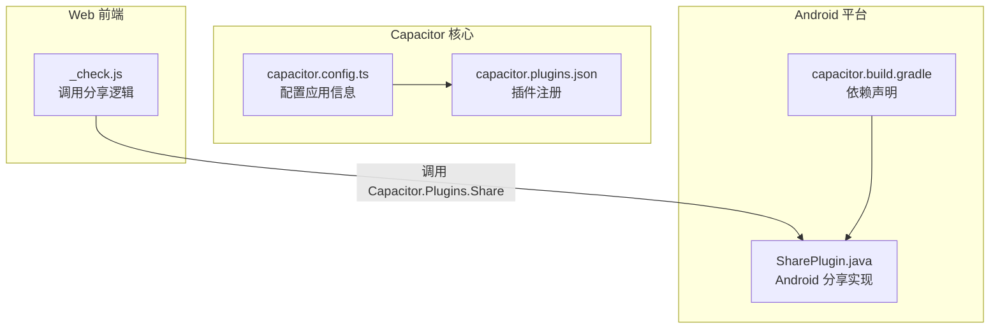
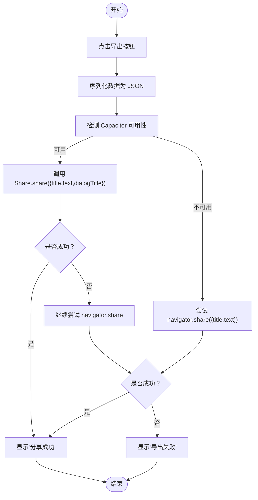
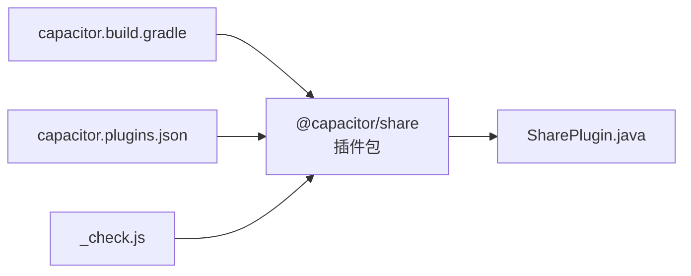

# 分享插件

<cite>
**本文引用的文件**
- [_check.js](file://_check.js)
- [capacitor.config.ts](file://capacitor.config.ts)
- [android/app/src/main/assets/capacitor.plugins.json](file://android/app/src/main/assets/capacitor.plugins.json)
- [android/app/capacitor.build.gradle](file://android/app/capacitor.build.gradle)
- [@capacitor/share 定义文件](file://node_modules/@capacitor/share/dist/esm/definitions.d.ts)
- [@capacitor/share Web 插件](file://node_modules/@capacitor/share/dist/esm/web.d.ts)
- [@capacitor/share README](file://node_modules/@capacitor/share/README.md)
- [Android Share 插件实现](file://node_modules/@capacitor/share/android/src/main/java/com/capacitorjs/plugins/share/SharePlugin.java)
</cite>

## 目录
1. [简介](#简介)
2. [项目结构](#项目结构)
3. [核心组件](#核心组件)
4. [架构概览](#架构概览)
5. [详细组件分析](#详细组件分析)
6. [依赖关系分析](#依赖关系分析)
7. [性能考虑](#性能考虑)
8. [故障排查指南](#故障排查指南)
9. [结论](#结论)
10. [附录](#附录)

## 简介
本文件为 Capacitor 分享插件（Share）的完整 API 文档，覆盖以下主题：
- 分享接口规范：参数配置、支持的内容类型与平台差异
- 分享对话框定制：标题、文本、链接与图片/文件分享
- 跨平台兼容性：Web Share API 回退、原生分享面板、第三方应用集成
- 成功率统计、用户取消处理与错误诊断方法

该仓库中通过 Capacitor 的 Share 插件实现了跨平台分享能力，并在 Web 环境下回退到浏览器的 Web Share API。

## 项目结构
该项目采用 Capacitor 架构，前端通过 JavaScript 调用 Capacitor 插件；Android 端通过 Gradle 引入 @capacitor/share 插件并在运行时注册。



图表来源
- [_check.js:753-799](file://_check.js#L753-L799)
- [capacitor.config.ts:1-22](file://capacitor.config.ts#L1-L22)
- [android/app/src/main/assets/capacitor.plugins.json:1-15](file://android/app/src/main/assets/capacitor.plugins.json#L1-L15)
- [android/app/capacitor.build.gradle:11-16](file://android/app/capacitor.build.gradle#L11-L16)
- [Android Share 插件实现:24-140](file://node_modules/@capacitor/share/android/src/main/java/com/capacitorjs/plugins/share/SharePlugin.java#L24-L140)

章节来源
- [_check.js:753-799](file://_check.js#L753-L799)
- [capacitor.config.ts:1-22](file://capacitor.config.ts#L1-L22)
- [android/app/src/main/assets/capacitor.plugins.json:1-15](file://android/app/src/main/assets/capacitor.plugins.json#L1-L15)
- [android/app/capacitor.build.gradle:11-16](file://android/app/capacitor.build.gradle#L11-L16)

## 核心组件
- 分享插件接口定义：提供 canShare 与 share 方法，以及 ShareOptions、ShareResult、CanShareResult 类型。
- Web 端回退：当 Capacitor 不可用或不支持时，回退至 navigator.share。
- Android 实现：使用系统分享意图（Intent），支持文本、URL、单/多文件分享，并可自定义分享对话框标题。

章节来源
- [@capacitor/share 定义文件:1-69](file://node_modules/@capacitor/share/dist/esm/definitions.d.ts#L1-L69)
- [@capacitor/share Web 插件:1-7](file://node_modules/@capacitor/share/dist/esm/web.d.ts#L1-L7)
- [@capacitor/share README:55-129](file://node_modules/@capacitor/share/README.md#L55-L129)
- [Android Share 插件实现:70-140](file://node_modules/@capacitor/share/android/src/main/java/com/capacitorjs/plugins/share/SharePlugin.java#L70-L140)

## 架构概览
分享流程在不同平台上的实现路径如下：

```mermaid
sequenceDiagram
participant UI as "前端界面<br/>_check.js"
participant Cap as "Capacitor Share<br/>JS 接口"
participant Web as "Web Share API<br/>navigator.share"
participant And as "Android 分享面板<br/>SharePlugin"
UI->>Cap : "检查 Capacitor 是否可用"
alt "Capacitor 可用"
UI->>Cap : "调用 Share.share(options)"
Cap->>And : "发起系统分享意图"
And-->>Cap : "返回 activityType 或取消"
Cap-->>UI : "Promise 结果"
else "Capacitor 不可用"
UI->>Web : "尝试 navigator.share(options)"
Web-->>UI : "Promise 结果可能抛出 AbortError"
end
```

图表来源
- [_check.js:774-796](file://_check.js#L774-L796)
- [@capacitor/share 定义文件:55-68](file://node_modules/@capacitor/share/dist/esm/definitions.d.ts#L55-L68)
- [Android Share 插件实现:78-140](file://node_modules/@capacitor/share/android/src/main/java/com/capacitorjs/plugins/share/SharePlugin.java#L78-L140)

## 详细组件分析

### 分享接口规范（ShareOptions）
- 支持字段
  - title：消息标题（邮件场景作为主题）
  - text：要分享的文本
  - url：要分享的 URL（http/https 或 file://）
  - files：要分享的本地文件数组（仅 iOS/Android 支持）
  - dialogTitle：分享对话框标题（仅 Android 支持）
- 参数校验
  - 至少提供 text、url 或 files 中的一个
  - url 必须是 http/https 或 file://
  - 多文件分享时使用 ACTION_SEND_MULTIPLE
- 返回值
  - ShareResult.activityType：接收分享的应用标识符（Web 端为 undefined）

章节来源
- [@capacitor/share 定义文件:1-69](file://node_modules/@capacitor/share/dist/esm/definitions.d.ts#L1-L69)
- [Android Share 插件实现:86-94](file://node_modules/@capacitor/share/android/src/main/java/com/capacitorjs/plugins/share/SharePlugin.java#L86-L94)
- [Android Share 插件实现:118-120](file://node_modules/@capacitor/share/android/src/main/java/com/capacitorjs/plugins/share/SharePlugin.java#L118-L120)

### 分享对话框定制
- Android
  - dialogTitle：自定义分享对话框标题
  - 使用 Intent.createChooser 并传入 PendingIntent 获取被选中的组件
- Web
  - navigator.share 由浏览器决定 UI 表现，无法自定义标题
- iOS
  - 通过系统分享面板展示，具体 UI 由系统控制

章节来源
- [@capacitor/share 定义文件:28-35](file://node_modules/@capacitor/share/dist/esm/definitions.d.ts#L28-L35)
- [Android Share 插件实现:131-136](file://node_modules/@capacitor/share/android/src/main/java/com/capacitorjs/plugins/share/SharePlugin.java#L131-L136)

### 内容类型与平台适配
- 文本分享
  - Android：设置 EXTRA_TEXT，类型为 text/plain
  - Web：navigator.share(text)
- 链接分享
  - Android：若仅提供 url（http/https），会放入 EXTRA_TEXT；若同时提供 text，则拼接 text + url
  - Web：navigator.share(url 作为 text）
- 文件分享
  - Android：支持单/多文件，使用 FileProvider 生成临时授权 URI，授予读取权限
  - Web：不支持文件分享
- 图片分享
  - 通过 files 数组传递图片文件路径实现
  - Android：自动推断 MIME 类型，多文件时使用通配类型

章节来源
- [Android Share 插件实现:96-120](file://node_modules/@capacitor/share/android/src/main/java/com/capacitorjs/plugins/share/SharePlugin.java#L96-L120)
- [Android Share 插件实现:142-180](file://node_modules/@capacitor/share/android/src/main/java/com/capacitorjs/plugins/share/SharePlugin.java#L142-L180)
- [@capacitor/share README:46-51](file://node_modules/@capacitor/share/README.md#L46-L51)

### 跨平台兼容性实现
- 优先级策略
  1) 检测 Capacitor.Plugins.Share 是否可用
  2) 若不可用则尝试 navigator.share
  3) 两者均失败则提示“导出失败”
- 用户取消处理
  - Android：当结果为取消时，插件拒绝调用并返回“Share canceled”
  - Web：navigator.share 抛出 AbortError 时视为取消
- 第三方应用集成
  - Android：通过系统分享面板选择目标应用，activityType 返回所选应用包名
  - Web：由浏览器决定可用的分享目标

章节来源
- [_check.js:774-796](file://_check.js#L774-L796)
- [Android Share 插件实现:58-68](file://node_modules/@capacitor/share/android/src/main/java/com/capacitorjs/plugins/share/SharePlugin.java#L58-L68)
- [Android Share 插件实现:60-66](file://node_modules/@capacitor/share/android/src/main/java/com/capacitorjs/plugins/share/SharePlugin.java#L60-L66)

### 成功率统计、用户取消与错误诊断
- 统计建议
  - 在调用 share 前后记录时间戳与 options 关键字段
  - 记录 activityType（Android）或浏览器行为（Web）
  - 将异常信息（如“Share canceled”、“Must provide a URL or Message or files”）归类
- 用户取消
  - Android：捕获拒绝并判断为取消
  - Web：捕获 AbortError 并直接返回
- 错误诊断
  - 参数非法：url 非法、缺少必要参数
  - 文件访问：非 file:// 路径或文件不可读
  - 并发限制：正在展示分享面板时拒绝新请求

章节来源
- [Android Share 插件实现:86-94](file://node_modules/@capacitor/share/android/src/main/java/com/capacitorjs/plugins/share/SharePlugin.java#L86-L94)
- [Android Share 插件实现:137-140](file://node_modules/@capacitor/share/android/src/main/java/com/capacitorjs/plugins/share/SharePlugin.java#L137-L140)
- [_check.js:774-796](file://_check.js#L774-L796)

### 典型调用流程（导出番剧列表）


图表来源
- [_check.js:753-799](file://_check.js#L753-L799)

## 依赖关系分析
- 插件注册
  - capacitor.plugins.json 明确注册 @capacitor/share
  - capacitor.config.ts 提供应用基础配置
- Android 依赖
  - capacitor.build.gradle 引入 :capacitor-share
  - SharePlugin.java 实现分享核心逻辑



图表来源
- [android/app/src/main/assets/capacitor.plugins.json:10-13](file://android/app/src/main/assets/capacitor.plugins.json#L10-L13)
- [android/app/capacitor.build.gradle:14-15](file://android/app/capacitor.build.gradle#L14-L15)
- [Android Share 插件实现:24-25](file://node_modules/@capacitor/share/android/src/main/java/com/capacitorjs/plugins/share/SharePlugin.java#L24-L25)

章节来源
- [android/app/src/main/assets/capacitor.plugins.json:1-15](file://android/app/src/main/assets/capacitor.plugins.json#L1-L15)
- [android/app/capacitor.build.gradle:11-16](file://android/app/capacitor.build.gradle#L11-L16)

## 性能考虑
- 避免重复触发：Android 端对并发分享进行保护，防止多次调用导致 UI 冲突
- 文件分享优化：多文件时统一设置类型为通配，减少类型推断开销
- Web 回退：优先使用 Capacitor，以获得更一致的用户体验与更高的成功率

## 故障排查指南
- 症状：分享失败
  - 检查是否提供了有效的 text/url/files
  - 确认 url 为 http/https 或 file://
  - Android：确认文件路径有效且可读
- 症状：用户取消
  - Android：捕获“Share canceled”，视为正常取消
  - Web：捕获 AbortError，视为取消
- 症状：无任何应用响应
  - 确认设备上安装了支持分享的应用
  - 检查 Android 文件路径是否在 FileProvider 白名单内

章节来源
- [Android Share 插件实现:86-94](file://node_modules/@capacitor/share/android/src/main/java/com/capacitorjs/plugins/share/SharePlugin.java#L86-L94)
- [Android Share 插件实现:60-66](file://node_modules/@capacitor/share/android/src/main/java/com/capacitorjs/plugins/share/SharePlugin.java#L60-L66)
- [_check.js:793-796](file://_check.js#L793-L796)

## 结论
本项目通过 Capacitor 分享插件实现了跨平台分享能力，并在 Web 环境下优雅回退到浏览器的 Web Share API。Android 端支持文本、链接与文件分享，并允许自定义分享对话框标题。结合参数校验、取消处理与错误诊断，可构建稳定可靠的分享体验。

## 附录

### API 一览表
- 方法
  - canShare(): Promise<CanShareResult>
  - share(options: ShareOptions): Promise<ShareResult>
- 类型
  - ShareOptions：title, text, url, files[], dialogTitle
  - ShareResult：activityType
  - CanShareResult：value

章节来源
- [@capacitor/share 定义文件:55-69](file://node_modules/@capacitor/share/dist/esm/definitions.d.ts#L55-L69)
- [@capacitor/share README:102-129](file://node_modules/@capacitor/share/README.md#L102-L129)