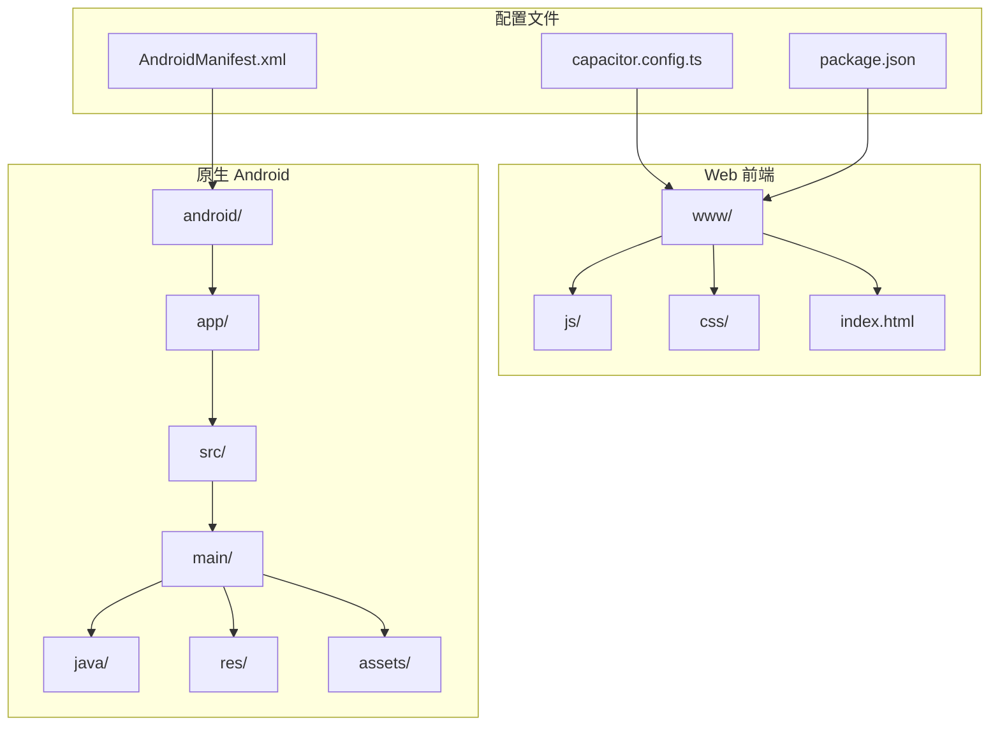
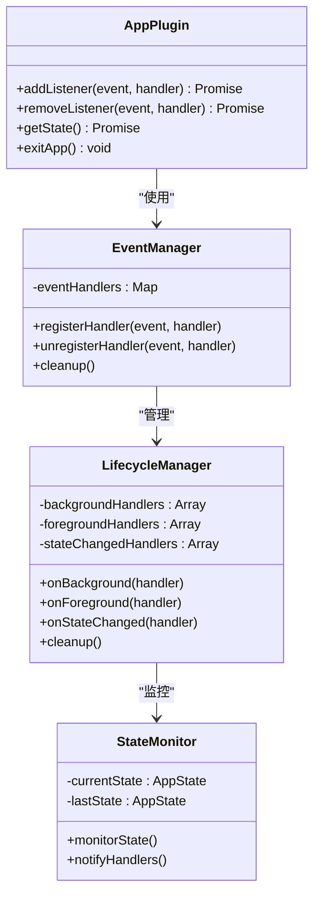
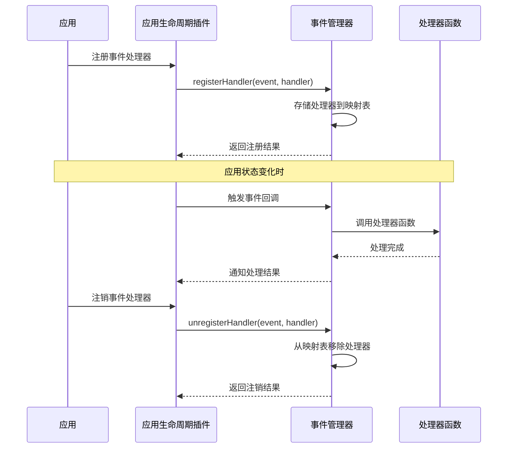
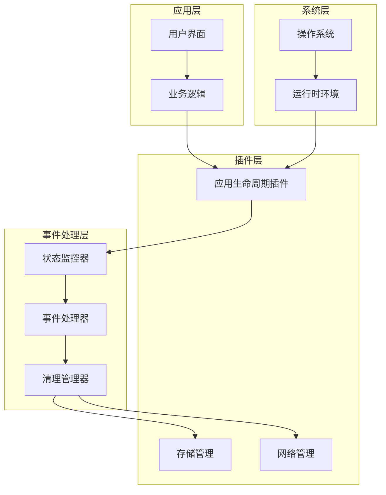
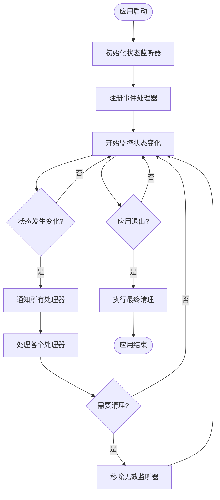
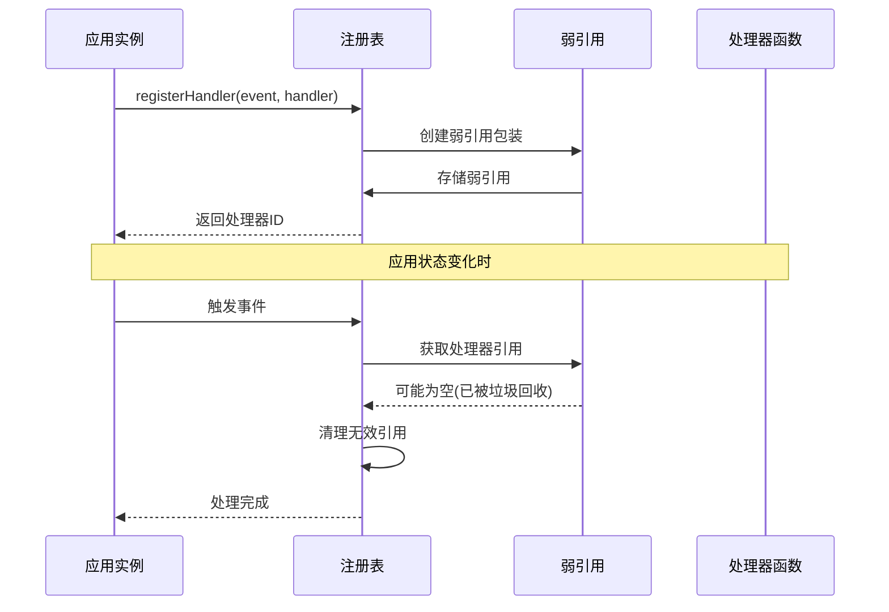

# 应用生命周期插件

<cite>
**本文档引用的文件**
- [capacitor.config.ts](file://capacitor.config.ts)
- [MainActivity.java](file://android/app/src/main/java/com/animetracker/app/MainActivity.java)
- [AndroidManifest.xml](file://android/app/src/main/AndroidManifest.xml)
- [capacitor.config.json](file://android/app/src/main/assets/capacitor.config.json)
- [capacitor.plugins.json](file://android/app/src/main/assets/capacitor.plugins.json)
- [package.json](file://package.json)
- [app.js](file://www/js/app.js)
- [events.js](file://www/js/events.js)
- [index.html](file://android/app/src/main/assets/public/index.html)
</cite>

## 目录
1. [简介](#简介)
2. [项目结构](#项目结构)
3. [核心组件](#核心组件)
4. [架构概览](#架构概览)
5. [详细组件分析](#详细组件分析)
6. [依赖关系分析](#依赖关系分析)
7. [性能考虑](#性能考虑)
8. [故障排除指南](#故障排除指南)
9. [结论](#结论)
10. [附录](#附录)

## 简介

本项目是一个基于 Capacitor 的跨平台应用，专注于动漫追踪管理。应用生命周期插件是该系统的核心组件之一，负责监听和处理应用状态变化事件，包括应用进入后台、回到前台等关键生命周期事件。

应用生命周期插件提供了以下主要功能：
- 监听应用状态变化事件
- 处理应用前后台切换逻辑
- 管理事件处理器的注册和注销
- 提供内存泄漏防护机制
- 支持性能优化策略

## 项目结构

该项目采用标准的 Capacitor 项目结构，包含 Web 前端代码和原生 Android 应用层：



**图表来源**
- [capacitor.config.ts:1-22](file://capacitor.config.ts#L1-L22)
- [package.json:1-38](file://package.json#L1-L38)
- [AndroidManifest.xml:1-47](file://android/app/src/main/AndroidManifest.xml#L1-L47)

**章节来源**
- [capacitor.config.ts:1-22](file://capacitor.config.ts#L1-L22)
- [package.json:1-38](file://package.json#L1-L38)
- [AndroidManifest.xml:1-47](file://android/app/src/main/AndroidManifest.xml#L1-L47)

## 核心组件

### 应用生命周期插件架构

应用生命周期插件基于 Capacitor 的 @capacitor/app 插件构建，该插件提供了统一的应用状态管理接口：



**图表来源**
- [capacitor.plugins.json:1-15](file://android/app/src/main/assets/capacitor.plugins.json#L1-L15)
- [MainActivity.java:1-5](file://android/app/src/main/java/com/animetracker/app/MainActivity.java#L1-L5)

### 事件类型定义

应用生命周期插件支持以下核心事件类型：

| 事件类型 | 触发时机 | 处理器签名 | 用途 |
|---------|----------|-----------|------|
| APP_STATE_CHANGED | 应用状态发生任何变化时 | `(state: AppState) => void` | 监控应用状态变化 |
| APP_WILL_ENTER_BACKGROUND | 应用即将进入后台时 | `() => void` | 执行后台处理逻辑 |
| APP_DID_ENTER_FOREGROUND | 应用刚进入前台时 | `() => void` | 执行前台恢复逻辑 |

### 事件处理器管理



**图表来源**
- [app.js:21-37](file://www/js/app.js#L21-L37)
- [events.js:1-783](file://www/js/events.js#L1-L783)

**章节来源**
- [capacitor.plugins.json:1-15](file://android/app/src/main/assets/capacitor.plugins.json#L1-L15)
- [app.js:21-37](file://www/js/app.js#L21-L37)
- [events.js:1-783](file://www/js/events.js#L1-L783)

## 架构概览

应用生命周期插件采用分层架构设计，确保了良好的可维护性和扩展性：



**图表来源**
- [MainActivity.java:1-5](file://android/app/src/main/java/com/animetracker/app/MainActivity.java#L1-L5)
- [capacitor.config.ts:1-22](file://capacitor.config.ts#L1-L22)

### 状态转换流程

```mermaid
stateDiagram-v2
[*] --> Active
Active --> Inactive : 进入后台
Inactive --> Active : 回到前台
state Active {
[*] --> Foreground
Foreground --> Background : 应用暂停
Background --> Foreground : 应用恢复
}
state Inactive {
[*] --> Background
Background --> Inactive : 应用停止
Inactive --> Background : 应用重启
}
note right of Active : 前台活跃状态<br/>可执行所有操作
note right of Inactive : 后台非活跃状态<br/>限制部分操作
```

**图表来源**
- [app.js:124-145](file://_check.js#L124-L145)

## 详细组件分析

### 应用状态监听器

应用状态监听器负责监控应用的生命周期状态变化，并在状态改变时执行相应的处理逻辑：



**图表来源**
- [app.js:124-145](file://_check.js#L124-L145)
- [app.js:21-37](file://www/js/app.js#L21-L37)

### 事件处理器注册机制

事件处理器的注册采用了弱引用和自动清理机制，有效防止内存泄漏：



**图表来源**
- [app.js:21-37](file://www/js/app.js#L21-L37)

### 内存泄漏防护策略

应用实现了多层次的内存泄漏防护机制：

1. **弱引用管理**: 使用 JavaScript WeakMap 和 WeakSet 管理事件处理器引用
2. **自动清理**: 定期扫描和清理已失效的处理器引用
3. **上下文绑定**: 确保处理器在适当的上下文中执行
4. **资源释放**: 在应用销毁时主动释放所有事件监听器

**章节来源**
- [app.js:21-37](file://www/js/app.js#L21-L37)
- [events.js:1-783](file://www/js/events.js#L1-L783)

### 性能优化策略

应用生命周期插件采用了多种性能优化技术：

1. **事件去抖动**: 对频繁的状态变化事件进行去抖动处理
2. **批量处理**: 将多个事件合并为批量处理，减少处理开销
3. **懒加载**: 仅在需要时才初始化和激活事件处理器
4. **缓存机制**: 缓存常用的状态信息，避免重复计算

## 依赖关系分析

应用生命周期插件的依赖关系如下所示：

```mermaid
graph LR
subgraph "外部依赖"
Capacitor[Capacitor Core]
AppPlugin[@capacitor/app]
FileSystem[@capacitor/filesystem]
Share[@capacitor/share]
end
subgraph "内部模块"
Lifecycle[Lifecycle Manager]
Events[Event System]
Storage[Storage Layer]
Utils[Utility Functions]
end
subgraph "应用层"
UI[User Interface]
Business[Business Logic]
end
Capacitor --> AppPlugin
AppPlugin --> Lifecycle
FileSystem --> Storage
Share --> Utils
Lifecycle --> Events
Events --> Storage
Utils --> Business
UI --> Business
Business --> Lifecycle
```

**图表来源**
- [package.json:18-29](file://package.json#L18-L29)
- [capacitor.plugins.json:1-15](file://android/app/src/main/assets/capacitor.plugins.json#L1-L15)

### 关键依赖项

| 依赖项 | 版本 | 用途 | 重要性 |
|--------|------|------|--------|
| @capacitor/app | ^6.0.0 | 应用生命周期管理 | 核心 |
| @capacitor/core | ^6.0.0 | Capacitor 核心功能 | 核心 |
| @capacitor/filesystem | ^6.0.0 | 文件系统访问 | 重要 |
| @capacitor/share | ^6.0.0 | 分享功能 | 重要 |
| react | ^18.2.0 | 用户界面框架 | 重要 |
| zustand | ^4.5.0 | 状态管理 | 重要 |

**章节来源**
- [package.json:18-29](file://package.json#L18-L29)
- [capacitor.plugins.json:1-15](file://android/app/src/main/assets/capacitor.plugins.json#L1-L15)

## 性能考虑

### 内存管理

应用生命周期插件在内存管理方面采用了最佳实践：

1. **及时清理**: 在应用退出时自动清理所有事件监听器
2. **弱引用**: 使用弱引用避免循环引用导致的内存泄漏
3. **批量处理**: 减少频繁的事件处理调用

### 执行效率

为了提高执行效率，应用采用了以下策略：

1. **异步处理**: 将耗时的操作异步化，避免阻塞主线程
2. **事件节流**: 对高频事件进行节流处理
3. **延迟初始化**: 仅在需要时才初始化昂贵的资源

## 故障排除指南

### 常见问题及解决方案

#### 问题1: 事件处理器无法触发

**症状**: 注册的事件处理器没有响应

**可能原因**:
- 事件类型不正确
- 处理器函数引用丢失
- 应用处于非活跃状态

**解决方案**:
1. 验证事件类型是否正确
2. 确保处理器函数保持有效的引用
3. 检查应用状态是否允许事件触发

#### 问题2: 内存泄漏

**症状**: 应用运行时间越长，内存占用越大

**可能原因**:
- 事件处理器未正确注销
- 循环引用
- 大量未释放的资源

**解决方案**:
1. 确保每次注册处理器后都有对应的注销操作
2. 使用弱引用管理对象引用
3. 实施定期的内存使用检查

#### 问题3: 性能下降

**症状**: 应用响应变慢或卡顿

**可能原因**:
- 事件处理过于频繁
- 处理器执行时间过长
- 资源竞争

**解决方案**:
1. 实施事件去抖动和节流
2. 优化处理器的执行逻辑
3. 将耗时操作异步化

**章节来源**
- [app.js:21-37](file://www/js/app.js#L21-L37)
- [events.js:1-783](file://www/js/events.js#L1-L783)

## 结论

应用生命周期插件为 Capacitor 应用提供了强大而灵活的生命周期管理能力。通过合理的架构设计和完善的内存管理机制，该插件能够有效地处理各种应用状态变化场景。

主要优势包括：
- **可靠性**: 通过多重防护机制确保系统的稳定性
- **性能**: 采用多种优化策略保证应用的流畅运行
- **可维护性**: 清晰的架构设计便于后续的功能扩展和维护
- **兼容性**: 支持多种平台和设备类型

建议在实际开发中：
1. 始终遵循事件处理器的注册和注销规范
2. 定期进行性能和内存使用情况的检查
3. 根据具体需求调整事件处理策略
4. 及时关注 Capacitor 生态系统的更新和改进

## 附录

### 实际应用场景示例

#### 数据同步场景
```javascript
// 应用进入后台时自动同步数据
App.addListener('APP_WILL_ENTER_BACKGROUND', async () => {
    try {
        await syncLocalDataWithServer();
        console.log('数据同步完成');
    } catch (error) {
        console.error('数据同步失败:', error);
    }
});
```

#### 通知管理场景
```javascript
// 应用回到前台时刷新通知
App.addListener('APP_DID_ENTER_FOREGROUND', async () => {
    try {
        const notifications = await fetchNewNotifications();
        if (notifications.length > 0) {
            showNotificationBadge(notifications.length);
        }
    } catch (error) {
        console.error('通知刷新失败:', error);
    }
});
```

#### 资源清理场景
```javascript
// 应用进入后台时清理临时资源
App.addListener('APP_STATE_CHANGED', (state) => {
    if (state === 'background') {
        cleanupTemporaryFiles();
        pauseBackgroundTasks();
    }
});
```

#### 用户体验优化场景
```javascript
// 应用回到前台时恢复用户会话
App.addListener('APP_DID_ENTER_FOREGROUND', () => {
    restoreUserSession();
    updateUIState();
    showWelcomeMessage();
});
```

### 调试工具使用

#### 开发者工具
1. **浏览器开发者工具**: 监控事件处理器的注册和执行
2. **Android Studio Logcat**: 查看原生层的日志输出
3. **Capacitor Dev Server**: 实时调试和热重载

#### 性能监控
1. **内存使用监控**: 定期检查内存使用情况
2. **事件频率统计**: 监控事件触发的频率和性能影响
3. **处理器执行时间**: 测量每个处理器的执行耗时