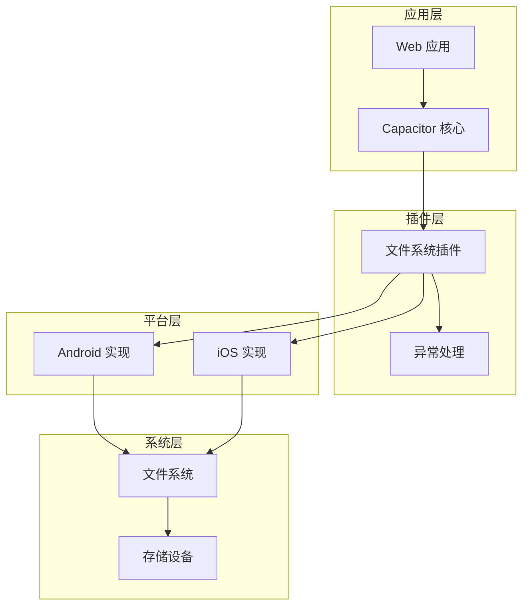
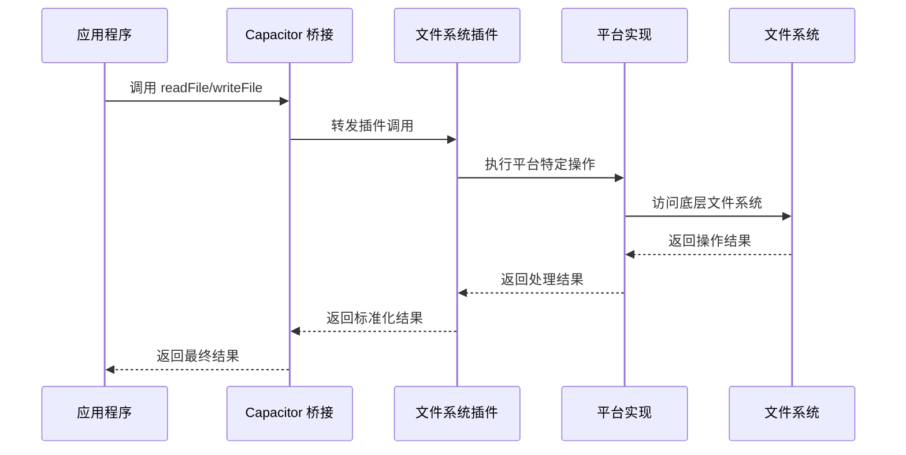
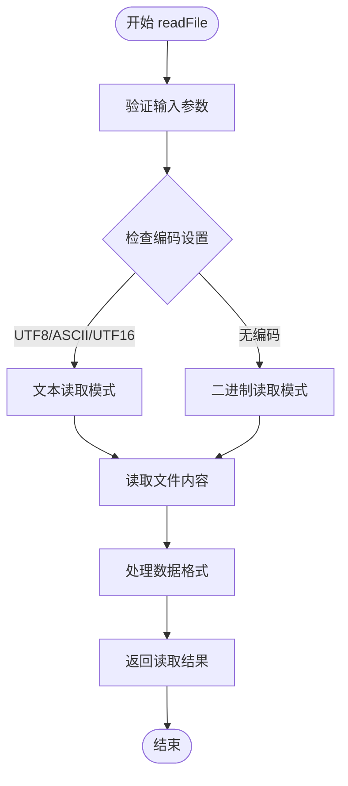
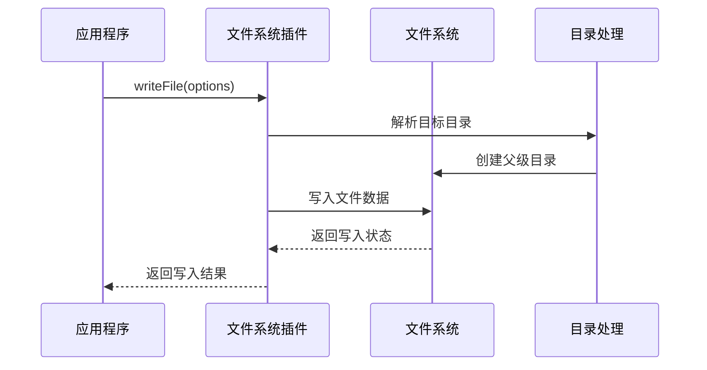
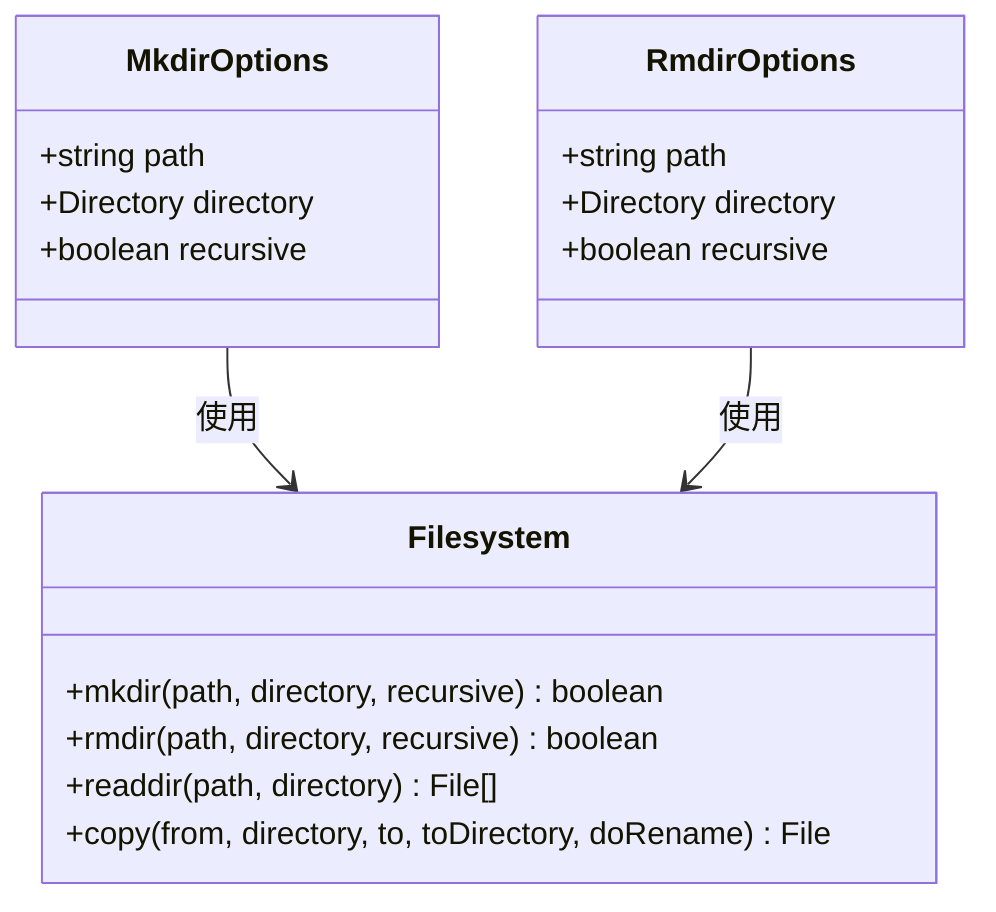
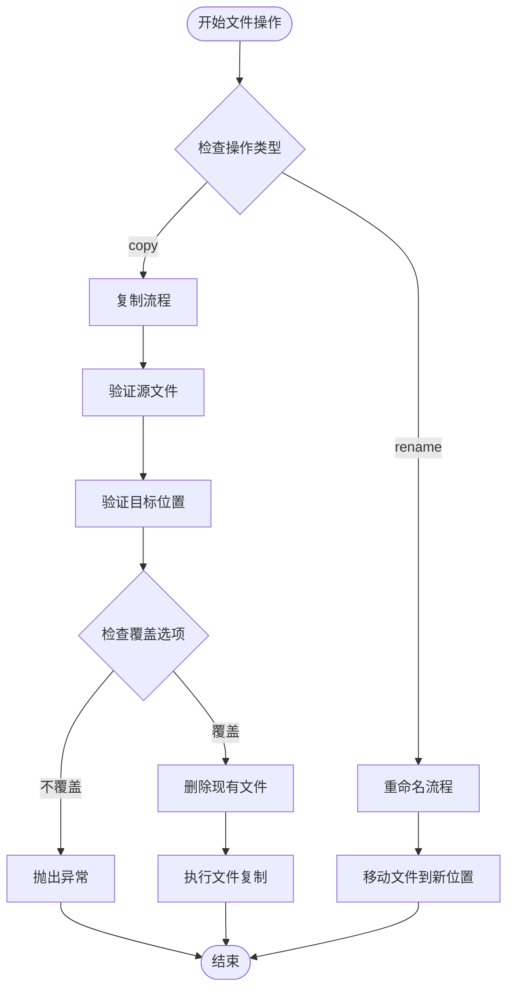
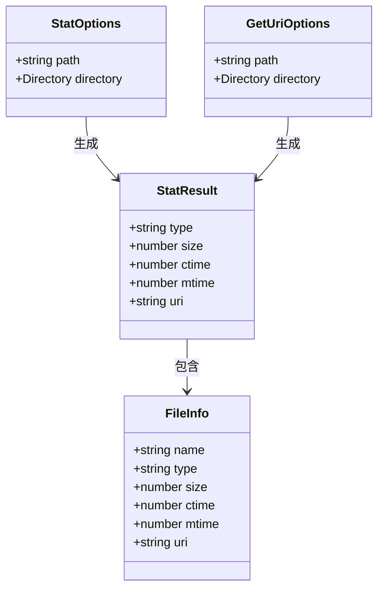
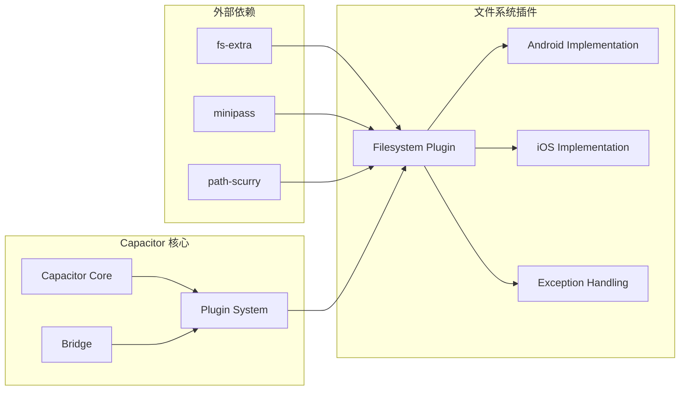
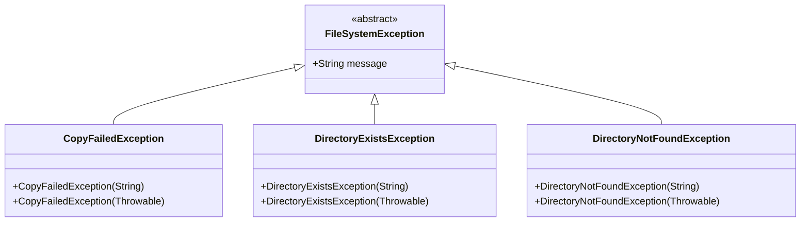

# 文件系统插件

<cite>
**本文档引用的文件**
- [definitions.d.ts](file://node_modules/@capacitor/filesystem/dist/esm/definitions.d.ts)
- [Filesystem.java](file://node_modules/@capacitor/filesystem/android/src/main/java/com/capacitorjs/plugins/filesystem/Filesystem.java)
- [FilesystemPlugin.swift](file://node_modules/@capacitor/filesystem/ios/Sources/FilesystemPlugin/FilesystemPlugin.swift)
- [README.md](file://node_modules/@capacitor/filesystem/README.md)
- [CopyFailedException.java](file://node_modules/@capacitor/filesystem/android/src/main/java/com/capacitorjs/plugins/filesystem/exceptions/CopyFailedException.java)
- [DirectoryExistsException.java](file://node_modules/@capacitor/filesystem/android/src/main/java/com/capacitorjs/plugins/filesystem/exceptions/DirectoryExistsException.java)
- [DirectoryNotFoundException.java](file://node_modules/@capacitor/filesystem/android/src/main/java/com/capacitorjs/plugins/filesystem/exceptions/DirectoryNotFoundException.java)
- [AndroidManifest.xml](file://android/app/src/main/AndroidManifest.xml)
- [capacitor.config.ts](file://capacitor.config.ts)
- [_server.js](file://_server.js)
</cite>

## 目录
1. [简介](#简介)
2. [项目结构](#项目结构)
3. [核心组件](#核心组件)
4. [架构概览](#架构概览)
5. [详细组件分析](#详细组件分析)
6. [依赖关系分析](#依赖关系分析)
7. [性能考虑](#性能考虑)
8. [故障排除指南](#故障排除指南)
9. [结论](#结论)
10. [附录](#附录)

## 简介
本文件系统插件为 Capacitor 应用提供跨平台的文件读写能力，支持在 iOS 和 Android 平台上进行文件操作。该插件提供了类似于 Node.js 的文件系统 API，允许开发者在应用沙盒内安全地存储和管理文件数据。

## 项目结构
文件系统插件采用分层架构设计，包含以下关键组件：

**图表来源**
- [FilesystemPlugin.swift:1-391](file://node_modules/@capacitor/filesystem/ios/Sources/FilesystemPlugin/FilesystemPlugin.swift#L1-391)
- [Filesystem.java:1-384](file://node_modules/@capacitor/filesystem/android/src/main/java/com/capacitorjs/plugins/filesystem/Filesystem.java#L1-384)

**章节来源**
- [definitions.d.ts:496-597](file://node_modules/@capacitor/filesystem/dist/esm/definitions.d.ts#L496-L597)
- [README.md:118-142](file://node_modules/@capacitor/filesystem/README.md#L118-L142)

## 核心组件
文件系统插件提供以下核心功能模块：

### 数据类型定义
插件定义了完整的 TypeScript 接口体系，包括：
- **Directory 枚举**: 定义不同存储目录类型（Documents、Data、Library、Cache、External、ExternalStorage）
- **Encoding 枚举**: 支持 UTF8、ASCII、UTF16 编码格式
- **文件操作接口**: ReadFileOptions、WriteFileOptions、MkdirOptions 等
- **结果接口**: ReadFileResult、WriteFileResult、ReaddirResult 等

### 权限管理系统
插件实现了跨平台的权限控制机制：
- **Android 权限**: READ_EXTERNAL_STORAGE、WRITE_EXTERNAL_STORAGE、MANAGE_EXTERNAL_STORAGE
- **iOS 权限**: 通过 NSPrivacyAccessedAPITypes 隐私清单管理
- **运行时权限**: 支持检查和请求存储权限

**章节来源**
- [definitions.d.ts:5-69](file://node_modules/@capacitor/filesystem/dist/esm/definitions.d.ts#L5-L69)
- [definitions.d.ts:70-93](file://node_modules/@capacitor/filesystem/dist/esm/definitions.d.ts#L70-L93)
- [definitions.d.ts:496-597](file://node_modules/@capacitor/filesystem/dist/esm/definitions.d.ts#L496-L597)

## 架构概览
文件系统插件采用桥接模式实现跨平台通信：

**图表来源**
- [FilesystemPlugin.swift:33-54](file://node_modules/@capacitor/filesystem/ios/Sources/FilesystemPlugin/FilesystemPlugin.swift#L33-L54)
- [Filesystem.java:40-49](file://node_modules/@capacitor/filesystem/android/src/main/java/com/capacitorjs/plugins/filesystem/Filesystem.java#L40-L49)

## 详细组件分析

### 文件读取操作 (readFile)
readFile 方法提供灵活的文件读取能力：

**图表来源**
- [Filesystem.java:40-49](file://node_modules/@capacitor/filesystem/android/src/main/java/com/capacitorjs/plugins/filesystem/Filesystem.java#L40-L49)
- [FilesystemPlugin.swift:33-54](file://node_modules/@capacitor/filesystem/ios/Sources/FilesystemPlugin/FilesystemPlugin.swift#L33-L54)

#### 参数规范
- **path**: 文件路径（必需）
- **directory**: 存储目录类型（可选，默认 DATA）
- **encoding**: 文件编码格式（可选，默认二进制）

#### 返回值
- **data**: 文件内容（字符串或 Blob 对象）

#### 异常处理
- 文件不存在：抛出 FileNotFoundException
- 权限不足：抛出 SecurityException
- 编码不支持：抛出 IllegalArgumentException

**章节来源**
- [definitions.d.ts:161-183](file://node_modules/@capacitor/filesystem/dist/esm/definitions.d.ts#L161-L183)
- [Filesystem.java:40-49](file://node_modules/@capacitor/filesystem/android/src/main/java/com/capacitorjs/plugins/filesystem/Filesystem.java#L40-L49)

### 文件写入操作 (writeFile)
writeFile 方法支持多种数据类型的文件写入：

**图表来源**
- [Filesystem.java:51-66](file://node_modules/@capacitor/filesystem/android/src/main/java/com/capacitorjs/plugins/filesystem/Filesystem.java#L51-L66)
- [FilesystemPlugin.swift:59-88](file://node_modules/@capacitor/filesystem/ios/Sources/FilesystemPlugin/FilesystemPlugin.swift#L59-L88)

#### 参数规范
- **path**: 文件路径（必需）
- **data**: 要写入的数据（必需，字符串或 Blob）
- **directory**: 存储目录类型（可选）
- **encoding**: 文件编码格式（可选）
- **recursive**: 是否创建父级目录（可选，默认 false）

#### 返回值
- **uri**: 文件写入后的统一资源标识符

#### 编码处理
- **UTF8**: 文本数据直接写入
- **Base64**: 二进制数据自动解码后写入
- **Blob**: Web 平台特有支持

**章节来源**
- [definitions.d.ts:94-131](file://node_modules/@capacitor/filesystem/dist/esm/definitions.d.ts#L94-L131)
- [Filesystem.java:51-66](file://node_modules/@capacitor/filesystem/android/src/main/java/com/capacitorjs/plugins/filesystem/Filesystem.java#L51-L66)

### 目录操作 (mkdir/rmdir)
目录管理功能提供完整的文件夹生命周期管理：

**图表来源**
- [definitions.d.ts:198-239](file://node_modules/@capacitor/filesystem/dist/esm/definitions.d.ts#L198-L239)
- [Filesystem.java:76-101](file://node_modules/@capacitor/filesystem/android/src/main/java/com/capacitorjs/plugins/filesystem/Filesystem.java#L76-L101)

#### mkdir 操作
- **单级创建**: 创建指定路径的单个目录
- **递归创建**: 自动创建所有必要的父级目录
- **存在性检查**: 如果目录已存在则抛出 DirectoryExistsException

#### rmdir 操作
- **非递归删除**: 只能删除空目录
- **递归删除**: 删除目录及其所有子内容
- **安全性检查**: 防止误删重要系统目录

**章节来源**
- [definitions.d.ts:198-239](file://node_modules/@capacitor/filesystem/dist/esm/definitions.d.ts#L198-L239)
- [DirectoryExistsException.java:1-17](file://node_modules/@capacitor/filesystem/android/src/main/java/com/capacitorjs/plugins/filesystem/exceptions/DirectoryExistsException.java#L1-17)

### 文件复制与重命名 (copy/rename)
高级文件操作支持复杂的文件管理任务：

**图表来源**
- [Filesystem.java:103-151](file://node_modules/@capacitor/filesystem/android/src/main/java/com/capacitorjs/plugins/filesystem/Filesystem.java#L103-L151)
- [FilesystemPlugin.swift:297-321](file://node_modules/@capacitor/filesystem/ios/Sources/FilesystemPlugin/FilesystemPlugin.swift#L297-L321)

#### 复制操作
- **文件复制**: 支持单个文件的完整复制
- **目录复制**: 递归复制整个目录树
- **覆盖保护**: 默认不允许覆盖已存在的文件

#### 重命名操作
- **原子重命名**: 在同一文件系统内进行高效重命名
- **跨目录移动**: 支持将文件移动到其他目录
- **路径验证**: 确保目标路径的有效性和可达性

**章节来源**
- [definitions.d.ts:282-309](file://node_modules/@capacitor/filesystem/dist/esm/definitions.d.ts#L282-L309)
- [CopyFailedException.java:1-17](file://node_modules/@capacitor/filesystem/android/src/main/java/com/capacitorjs/plugins/filesystem/exceptions/CopyFailedException.java#L1-17)

### 文件信息查询 (stat/getUri)
元数据查询功能提供详细的文件属性信息：

**图表来源**
- [definitions.d.ts:268-415](file://node_modules/@capacitor/filesystem/dist/esm/definitions.d.ts#L268-L415)

#### stat 操作
- **文件类型检测**: 区分文件和目录
- **大小统计**: 返回字节单位的文件大小
- **时间戳获取**: 创建时间和最后修改时间
- **URI 提供**: 返回文件的统一资源标识符

#### getUri 操作
- **路径解析**: 将相对路径转换为绝对 URI
- **平台适配**: 不同平台的 URI 格式转换
- **权限验证**: 确保 URI 的可访问性

**章节来源**
- [definitions.d.ts:268-415](file://node_modules/@capacitor/filesystem/dist/esm/definitions.d.ts#L268-L415)

## 依赖关系分析

**图表来源**
- [package.json:18-29](file://package.json#L18-L29)
- [capacitor.settings.gradle:8-9](file://android/capacitor.settings.gradle#L8-L9)

**章节来源**
- [package.json:18-29](file://package.json#L18-L29)
- [capacitor.settings.gradle:8-9](file://android/capacitor.settings.gradle#L8-L9)

## 性能考虑

### 内存管理
- **流式处理**: 大文件操作采用流式读写，避免内存溢出
- **缓冲区优化**: 使用 1024 字节的固定缓冲区进行数据传输
- **垃圾回收**: 及时释放文件流和缓冲区资源

### 存储优化
- **目录选择**: 根据数据类型选择合适的存储目录
  - Cache: 临时缓存数据，可被系统清理
  - Data/Library: 应用私有数据，永久保存
  - Documents: 用户可访问的文档
- **文件格式**: 优先使用高效的 JSON 或二进制格式

### 网络下载
- **进度监控**: 支持下载进度事件监听
- **节流机制**: 进度事件每 100ms 发送一次，避免性能问题
- **超时设置**: 可配置连接和读取超时时间

**章节来源**
- [Filesystem.java:352-382](file://node_modules/@capacitor/filesystem/android/src/main/java/com/capacitorjs/plugins/filesystem/Filesystem.java#L352-L382)
- [README.md:67-68](file://node_modules/@capacitor/filesystem/README.md#L67-L68)

## 故障排除指南

### 常见异常类型
插件定义了专门的异常类来处理各种错误情况：

**图表来源**
- [CopyFailedException.java:1-17](file://node_modules/@capacitor/filesystem/android/src/main/java/com/capacitorjs/plugins/filesystem/exceptions/CopyFailedException.java#L1-17)
- [DirectoryExistsException.java:1-17](file://node_modules/@capacitor/filesystem/android/src/main/java/com/capacitorjs/plugins/filesystem/exceptions/DirectoryExistsException.java#L1-17)
- [DirectoryNotFoundException.java:1-17](file://node_modules/@capacitor/filesystem/android/src/main/java/com/capacitorjs/plugins/filesystem/exceptions/DirectoryNotFoundException.java#L1-17)

### 错误诊断步骤
1. **检查权限**: 确认应用具有必要的存储权限
2. **验证路径**: 确保文件路径有效且可访问
3. **检查编码**: 验证文件编码设置正确
4. **监控内存**: 关注大文件操作的内存使用情况

### 调试工具
- **日志输出**: 启用详细日志以跟踪文件操作
- **断点调试**: 在关键文件操作处设置断点
- **单元测试**: 编写针对文件操作的测试用例

**章节来源**
- [Filesystem.java:68-101](file://node_modules/@capacitor/filesystem/android/src/main/java/com/capacitorjs/plugins/filesystem/Filesystem.java#L68-L101)

## 结论
文件系统插件为 Capacitor 应用提供了强大而灵活的文件管理能力。通过统一的 API 设计和完善的错误处理机制，开发者可以轻松实现跨平台的文件操作需求。建议在实际开发中：

1. **合理选择存储目录**: 根据数据性质选择合适的存储位置
2. **正确处理编码**: 确保文本文件的正确编码处理
3. **实现异常处理**: 建立完善的错误处理和恢复机制
4. **优化性能**: 关注大文件操作的性能影响
5. **遵循隐私要求**: 确保符合各平台的隐私和权限要求

## 附录

### API 参考表

| 方法名 | 功能描述 | 参数数量 | 返回值类型 | 平台支持 |
|--------|----------|----------|------------|----------|
| readFile | 读取文件内容 | 1 | ReadFileResult | iOS/Android/Web |
| writeFile | 写入文件内容 | 1 | WriteFileResult | iOS/Android/Web |
| appendFile | 追加文件内容 | 1 | void | iOS/Android |
| deleteFile | 删除文件 | 1 | void | iOS/Android |
| mkdir | 创建目录 | 1 | void | iOS/Android |
| rmdir | 删除目录 | 1 | void | iOS/Android |
| readdir | 列出目录内容 | 1 | ReaddirResult | iOS/Android |
| getUri | 获取文件 URI | 1 | GetUriResult | iOS/Android |
| stat | 获取文件信息 | 1 | StatResult | iOS/Android |
| rename | 重命名文件 | 1 | void | iOS/Android |
| copy | 复制文件 | 1 | CopyResult | iOS/Android |
| checkPermissions | 检查权限 | 0 | PermissionStatus | iOS/Android |
| requestPermissions | 请求权限 | 0 | PermissionStatus | iOS/Android |

### 最佳实践建议

#### 数据持久化
- **配置文件**: 使用 JSON 格式存储应用配置
- **用户数据**: 使用加密格式存储敏感用户信息
- **缓存策略**: 合理设置缓存过期时间和清理机制

#### 性能优化
- **批量操作**: 尽量合并多个文件操作以减少系统调用
- **异步处理**: 使用异步 API 避免阻塞主线程
- **资源管理**: 及时关闭文件句柄和释放内存

#### 安全考虑
- **路径验证**: 始终验证用户提供的文件路径
- **权限检查**: 在执行敏感操作前检查必要权限
- **数据验证**: 验证文件内容格式和大小限制

**章节来源**
- [README.md:75-116](file://node_modules/@capacitor/filesystem/README.md#L75-L116)
- [AndroidManifest.xml:42-46](file://android/app/src/main/AndroidManifest.xml#L42-L46)