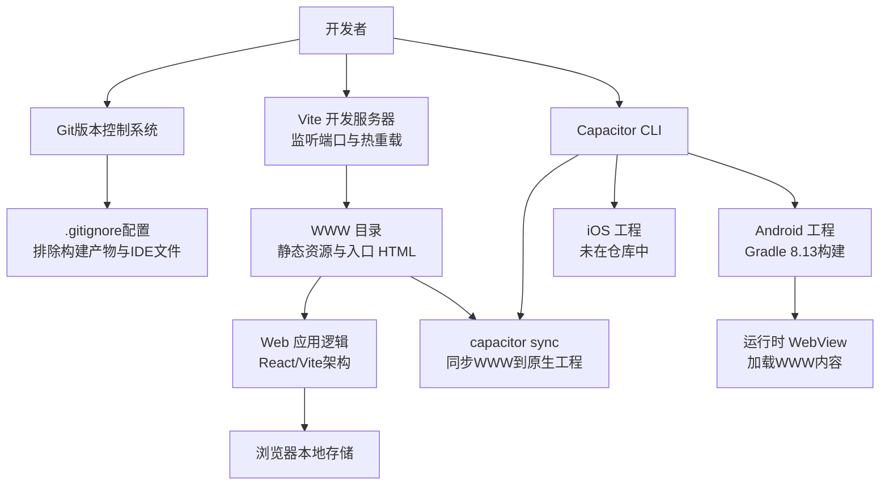

# 开发指南

<cite>
**本文引用的文件**
- [.gitignore](file://.gitignore)
- [android/.gitignore](file://android/.gitignore)
- [android/app/.gitignore](file://android/app/.gitignore)
- [android/gradle.properties](file://android/gradle.properties)
- [android/gradle/wrapper/gradle-wrapper.properties](file://android/gradle/wrapper/gradle-wrapper.properties)
- [android/build.gradle](file://android/build.gradle)
- [android/app/build.gradle](file://android/app/build.gradle)
- [package.json](file://package.json)
- [capacitor.config.ts](file://capacitor.config.ts)
- [vite.config.js](file://vite.config.js)
- [项目解读分析与改进建议.md](file://项目解读分析与改进建议.md)
</cite>

## 更新摘要
**所做更改**
- 新增版本控制基础设施章节，详细说明.gitignore配置和Git工作流程
- 更新Gradle构建系统章节，反映现代化Gradle包装器和构建脚本
- 移除遗留开发文件和IDE配置文件的相关内容
- 更新开发工作流程，强调现代化的构建和版本控制实践

## 目录
1. [简介](#简介)
2. [版本控制基础设施](#版本控制基础设施)
3. [项目结构](#项目结构)
4. [核心组件](#核心组件)
5. [架构总览](#架构总览)
6. [详细组件分析](#详细组件分析)
7. [依赖关系分析](#依赖关系分析)
8. [性能考虑](#性能考虑)
9. [故障排查指南](#故障排查指南)
10. [结论](#结论)
11. [附录](#附录)

## 简介
本指南面向Anime Tracker项目的开发者，覆盖现代化开发环境搭建、版本控制最佳实践、调试技巧、构建与部署流程；详解Vite开发服务器的配置与使用、热重载机制与代理能力；深入说明Capacitor的同步机制、原生功能调试方法以及平台特定注意事项；并提供代码规范、最佳实践与性能优化建议，以及常见问题的排查与解决路径。

## 版本控制基础设施

### Git忽略规则配置
项目建立了完整的版本控制基础设施，通过多层.gitignore配置确保开发环境的整洁性和构建产物的安全性：

#### 根级.gitignore配置
根级配置主要排除Node.js相关文件和开发临时文件：
- `node_modules/` - 排除Node.js依赖包
- `*.log` - 排除日志文件
- `.DS_Store` - 排除macOS系统文件
- `Thumbs.db` - 排除Windows缩略图缓存
- `*.bat` - 排除Windows批处理文件
- `_check.js` 和 `_server.js` - 排除遗留开发文件

#### Android专用.gitignore配置
Android模块使用标准的Android gitignore模板，全面排除构建产物和IDE配置：
- **构建产物**：`*.apk`, `*.aar`, `bin/`, `out/`, `build/`
- **Gradle缓存**：`.gradle/`, `local.properties`
- **IDE配置**：`.idea/`, `*.iml`, `.navigation/`
- **生成文件**：`app/src/main/assets/public`（复制的Web资源）
- **配置文件**：`app/src/main/assets/capacitor.config.json`

#### 应用级.gitignore配置
应用模块保留构建输出但排除不必要的文件：
- `/build/*` - 排除所有构建产物
- `!/build/.npmkeep` - 保留.npmkeep文件确保目录存在

**章节来源**
- [.gitignore:1-28](file://.gitignore#L1-L28)
- [android/.gitignore:1-102](file://android/.gitignore#L1-L102)
- [android/app/.gitignore:1-3](file://android/app/.gitignore#L1-L3)

### 现代化Gradle构建系统

#### Gradle包装器配置
项目采用Gradle 8.13版本，提供稳定的构建环境：
- **Gradle版本**：8.13-bin.zip
- **网络超时**：10000毫秒
- **分布式缓存**：使用GRADLE_USER_HOME
- **分发验证**：启用validateDistributionUrl确保下载完整性

#### Gradle属性配置
根级gradle.properties配置优化构建性能：
- **内存设置**：`org.gradle.jvmargs=-Xmx1536m`
- **AndroidX支持**：`android.useAndroidX=true`
- **并行构建**：预留parallel模式配置空间

#### 构建脚本现代化
- **Android Gradle Plugin**：8.11.0版本
- **Google Services**：4.4.0版本集成
- **命名空间**：使用现代命名空间`com.animetracker.app`
- **AndroidX依赖**：统一使用AndroidX库

**章节来源**
- [android/gradle.properties:1-23](file://android/gradle.properties#L1-L23)
- [android/gradle/wrapper/gradle-wrapper.properties:1-8](file://android/gradle/wrapper/gradle-wrapper.properties#L1-L8)
- [android/build.gradle:1-30](file://android/build.gradle#L1-L30)
- [android/app/build.gradle:1-55](file://android/app/build.gradle#L1-L55)

## 项目结构
项目采用前端单页应用（SPA）与Capacitor混合架构，现已建立完整的版本控制和构建基础设施：
- 前端Web资源位于www目录，由Vite管理开发与构建。
- Capacitor负责桥接Web与原生平台（Android/iOS），通过capacitor.config.ts与Android资源中的capacitor.config.json进行配置同步。
- package.json定义脚本命令，涵盖开发、构建、预览、Capacitor平台添加与同步、原生工程打开等。
- 现代化的Gradle构建系统提供稳定的Android原生构建环境。



**图表来源**
- [package.json:8-16](file://package.json#L8-L16)
- [capacitor.config.ts:1-22](file://capacitor.config.ts#L1-L22)
- [android/build.gradle:1-30](file://android/build.gradle#L1-L30)
- [android/app/build.gradle:1-55](file://android/app/build.gradle#L1-L55)

**章节来源**
- [package.json:1-38](file://package.json#L1-L38)
- [capacitor.config.ts:1-22](file://capacitor.config.ts#L1-L22)
- [vite.config.js:1-17](file://vite.config.js#L1-L17)

## 核心组件
- Vite开发服务器与构建工具链：提供快速启动、热重载、TypeScript支持与React插件。
- Capacitor配置与同步：统一Web与原生配置，确保WWW内容正确注入到Android工程。
- Web应用状态与渲染：基于localStorage的本地持久化，页面切换与事件绑定集中在_check.js。
- 原生权限与清单：AndroidManifest声明网络与存储权限，支持明文流量与文件共享。
- 现代化Gradle构建系统：提供稳定的Android原生构建环境，支持最新Android SDK。

**章节来源**
- [package.json:8-16](file://package.json#L8-L16)
- [capacitor.config.ts:3-19](file://capacitor.config.ts#L3-L19)
- [android/build.gradle:1-30](file://android/build.gradle#L1-L30)
- [android/app/build.gradle:1-55](file://android/app/build.gradle#L1-L55)

## 架构总览
下图展示从开发到原生运行的关键交互，现已集成现代化版本控制和构建系统：

```mermaid
sequenceDiagram
participant Dev as "开发者"
participant Git as "Git版本控制"
participant NPM as "NPM 脚本"
participant Vite as "Vite 服务器"
participant WWW as "WWW 静态资源"
participant Cap as "Capacitor CLI"
participant Gradle as "Gradle 8.13"
participant And as "Android 工程"
participant WV as "WebView 运行时"
Dev->>Git : 提交代码与构建产物
Git-->>Dev : 应用.gitignore规则
Dev->>NPM : 执行 dev/build/preview/sync/open
NPM->>Vite : 启动开发服务器/构建产物
Vite-->>WWW : 写入/监听 www 目录
Dev->>Cap : 执行 npx cap sync
Cap->>Gradle : 调用Gradle 8.13构建
Gradle->>And : 使用AndroidX与最新SDK构建
Dev->>And : 打开 Android Studio 或运行
And->>WV : 加载本地 www/index.html
WV-->>Dev : 显示Web应用界面
```

**图表来源**
- [package.json:8-16](file://package.json#L8-L16)
- [capacitor.config.ts:6](file://capacitor.config.ts#L6)
- [android/gradle/wrapper/gradle-wrapper.properties:1-8](file://android/gradle/wrapper/gradle-wrapper.properties#L1-L8)

## 详细组件分析

### Vite 开发服务器与热重载
- 启动与预览
  - 开发：执行开发脚本启动Vite，默认监听端口并提供热重载。
  - 预览：对构建后的生产包进行本地预览。
- 热重载机制
  - Vite通过WebSocket向浏览器推送变更，实现模块级热替换，无需整页刷新。
- 代理与跨域
  - 可在Vite配置中添加代理规则以转发API请求至后端服务，避免浏览器同源限制。
- TypeScript与React
  - 使用React插件与TypeScript编译器，确保类型安全与现代化语法支持。

**章节来源**
- [package.json:8-11](file://package.json#L8-L11)
- [vite.config.js:1-17](file://vite.config.js#L1-L17)

### Capacitor 同步与原生集成
- 配置一致性
  - 项目同时维护TypeScript配置与Android资源中的JSON配置，二者需保持一致（如webDir、server.androidScheme、插件等）。
- 平台添加与同步
  - 添加平台：执行对应平台脚本。
  - 同步：将WWW内容同步到原生工程，生成可运行APK/IPA。
  - 打开工程：直接在IDE中打开原生工程以便调试。
- Android 权限与网络
  - 清单声明INTERNET、读写外部存储权限，并允许明文HTTP流量，便于开发阶段访问本地或测试接口。
- WebView 行为
  - 通过配置项控制背景色、iOS内容Inset、Android混合内容策略等，影响首屏与滚动体验。

**章节来源**
- [package.json:12-16](file://package.json#L12-L16)
- [capacitor.config.ts:3-19](file://capacitor.config.ts#L3-L19)

### 现代化Gradle构建系统
- Gradle版本管理
  - 使用Gradle 8.13稳定版，确保构建兼容性和性能优化。
  - 通过gradle-wrapper.properties统一管理Gradle分发版本。
- Android SDK配置
  - 支持AndroidX迁移，使用现代Android库和命名空间。
  - 配置compileSdk、targetSdk、minSdk版本，确保向后兼容性。
- 依赖管理
  - 使用Android Gradle Plugin 8.11.0和Google Services 4.4.0。
  - 通过variables.gradle集中管理版本号，避免硬编码。
- 构建优化
  - 配置命名空间和aaptOptions，优化资源打包过程。
  - 支持release和debug构建类型，满足不同开发需求。

**章节来源**
- [android/gradle.properties:1-23](file://android/gradle.properties#L1-L23)
- [android/gradle/wrapper/gradle-wrapper.properties:1-8](file://android/gradle/wrapper/gradle-wrapper.properties#L1-L8)
- [android/build.gradle:1-30](file://android/build.gradle#L1-L30)
- [android/app/build.gradle:1-55](file://android/app/build.gradle#L1-L55)

### Web 应用状态管理与渲染
- 数据持久化
  - 使用localStorage作为唯一持久化介质，封装加载与保存函数，异常时降级为空数组。
- 页面与状态
  - 维护列表页、详情页、新增/编辑页等多页面状态，切换时重新渲染。
- 搜索与筛选
  - 支持按状态与标题关键词过滤，搜索输入采用防抖式组合事件处理，保证中文输入法体验。
- 导入导出
  - 优先使用系统文件选择器保存JSON；若不可用则回退到Capacitor Share或Web Share API。
- 事件绑定
  - 列表页、详情页、表单页分别附加事件监听，包括展开折叠、加一集、评分、状态切换等。

**章节来源**
- [项目解读分析与改进建议.md:93-164](file://项目解读分析与改进建议.md#L93-L164)

### 原生调试与平台注意事项
- Android 调试
  - 使用Chrome DevTools远程调试WebView，或在Android Studio中启用USB调试。
  - 若遇到HTTPS/混合内容问题，检查配置项与网络权限。
- iOS 调试
  - 在Xcode中打开iOS工程，使用Safari Web Inspector进行调试。
- 文件与分享
  - 分享与文件写入依赖Capacitor Share与文件系统插件，需在原生层正确配置权限与Provider。

**章节来源**
- [package.json:12-16](file://package.json#L12-L16)
- [capacitor.config.ts:10-18](file://capacitor.config.ts#L10-L18)

## 依赖关系分析
- 脚本命令
  - dev/build/preview：Vite生命周期相关。
  - android/ios/sync/open：Capacitor平台生命周期相关。
- 外部依赖
  - React与React DOM：UI框架。
  - Zustand：轻量状态管理。
  - Capacitor系列插件：App、Filesystem、Share等。
  - Vite与React插件：开发与构建工具链。
- 构建系统
  - Gradle 8.13：Android原生构建。
  - Android Gradle Plugin 8.11.0：Android应用构建。
  - Google Services 4.4.0：Firebase集成支持。

**章节来源**
- [package.json:8-36](file://package.json#L8-L36)

## 性能考虑
- 首屏与渲染
  - 将样式内联于HTML头部，减少额外HTTP请求；避免在首屏渲染中执行重型计算。
- 事件与交互
  - 列表项点击、加一集等高频操作应避免重复绑定与全量重排，优先使用委托与局部更新。
- 存储与序列化
  - localStorage写入应批量进行，避免频繁I/O；对大对象序列化前进行必要裁剪。
- 网络与代理
  - 开发期通过Vite代理转发API，生产期确保HTTPS与CORS配置正确，减少不必要的跨域拦截。
- WebView 体验
  - 控制背景色与滚动Insets，减少白块与遮挡；Android允许混合内容仅用于开发阶段。
- 构建性能
  - Gradle 8.13提供更好的构建缓存和增量编译。
  - AndroidX迁移提升运行时性能和内存使用效率。

## 故障排查指南
- 无法访问开发服务器
  - 确认Vite端口未被占用；检查防火墙与杀毒软件拦截。
  - 如需代理，请在Vite配置中添加代理规则并重启开发服务器。
- 同步后原生无变化
  - 确保执行了同步命令；核对capacitor.config.ts与Android资源中的配置一致。
- Android 无法联网或显示空白
  - 检查清单是否声明INTERNET与存储权限；确认允许明文流量设置。
  - 若使用HTTPS，请确保证书有效且域名匹配。
- 分享/导出失败
  - 浏览器不支持系统文件选择器时，回退到Capacitor Share或Web Share；若均失败，检查权限与沙盒限制。
- 热重载无效
  - 确认浏览器未禁用WebSocket；检查Vite日志是否有错误；尝试清理缓存与重新安装依赖。
- Gradle构建失败
  - 检查网络连接和Gradle分发URL可达性。
  - 清理.gradle缓存目录并重新构建。
  - 确认Android SDK版本与项目配置兼容。

**章节来源**
- [package.json:8-16](file://package.json#L8-L16)
- [capacitor.config.ts:3-19](file://capacitor.config.ts#L3-L19)
- [android/gradle/wrapper/gradle-wrapper.properties:1-8](file://android/gradle/wrapper/gradle-wrapper.properties#L1-L8)

## 结论
本指南提供了从现代化开发环境到构建部署、从Vite热重载到Capacitor同步的完整路径，并结合实际代码文件定位了关键配置点与实现细节。通过引入现代化的Git忽略规则、Gradle构建系统和版本控制基础设施，项目现在具备了更好的开发体验和构建稳定性。遵循本文的最佳实践与排障步骤，可显著提升开发效率与应用稳定性。

## 附录
- 本地简易HTTP服务
  - 提供了一个基础HTTP服务器脚本，用于在没有Vite时快速预览www目录内容，便于快速验证静态资源可用性。
- 代码质量改进建议
  - 基于项目解读分析，建议优先推进代码模块化和架构分层，为后续功能扩展奠定基础。

**章节来源**
- [项目解读分析与改进建议.md:318-340](file://项目解读分析与改进建议.md#L318-L340)