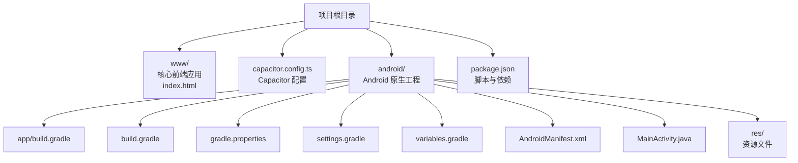
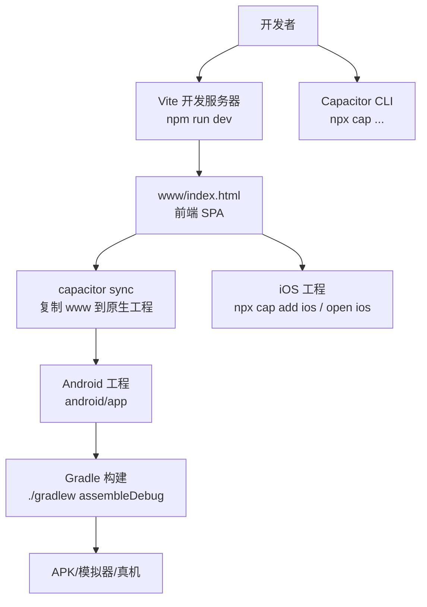
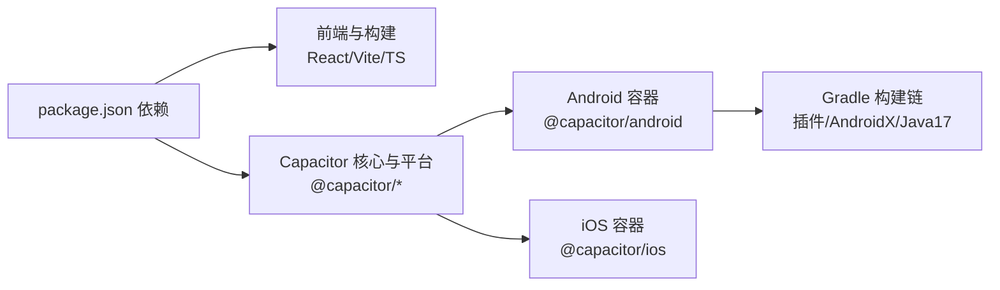

# 快速开始

<cite>
**本文引用的文件**
- [package.json](file://package.json)
- [capacitor.config.ts](file://capacitor.config.ts)
- [android/app/build.gradle](file://android/app/build.gradle)
- [android/build.gradle](file://android/build.gradle)
- [android/gradle.properties](file://android/gradle.properties)
- [android/settings.gradle](file://android/settings.gradle)
- [android/variables.gradle](file://android/variables.gradle)
- [android/app/src/main/AndroidManifest.xml](file://android/app/src/main/AndroidManifest.xml)
- [android/app/src/main/java/com/animetracker/app/MainActivity.java](file://android/app/src/main/java/com/animetracker/app/MainActivity.java)
- [android/app/src/main/res/values/strings.xml](file://android/app/src/main/res/values/strings.xml)
- [android/app/src/main/res/xml/file_paths.xml](file://android/app/src/main/res/xml/file_paths.xml)
- [android/app/capacitor.build.gradle](file://android/app/capacitor.build.gradle)
- [www/index.html](file://www/index.html)
- [项目解读分析与改进建议.md](file://项目解读分析与改进建议.md)
</cite>

## 目录
1. [简介](#简介)
2. [项目结构](#项目结构)
3. [核心组件](#核心组件)
4. [架构概览](#架构概览)
5. [详细组件分析](#详细组件分析)
6. [依赖分析](#依赖分析)
7. [性能考虑](#性能考虑)
8. [故障排除指南](#故障排除指南)
9. [结论](#结论)
10. [附录](#附录)

## 简介
本指南面向新手开发者，帮助你在最短时间内搭建 Anime Tracker 项目的开发与运行环境，并完成首次构建与运行。项目采用 React + Vite + Capacitor 技术栈，支持 Web、Android、iOS 三端运行。你将了解环境要求、安装步骤、开发服务器启动方法、Android/iOS 平台添加与配置、首次构建与运行流程，以及常见初始化问题的排查与验证步骤。

## 项目结构
项目采用“前端源码 + Capacitor 原生桥接”的组织方式：
- 前端核心位于 www/index.html，包含完整的 SPA（单页应用）代码（HTML/CSS/JS 全内联）
- Capacitor 配置位于根目录的 capacitor.config.ts
- Android 原生工程位于 android/，通过 Capacitor 生成并管理
- 顶层 package.json 定义了开发与构建脚本、依赖及版本



**图表来源**
- [capacitor.config.ts:1-22](file://capacitor.config.ts#L1-L22)
- [android/app/build.gradle:1-55](file://android/app/build.gradle#L1-L55)
- [android/build.gradle:1-30](file://android/build.gradle#L1-L30)
- [android/gradle.properties:1-23](file://android/gradle.properties#L1-L23)
- [android/settings.gradle:1-5](file://android/settings.gradle#L1-L5)
- [android/variables.gradle:1-16](file://android/variables.gradle#L1-L16)
- [android/app/src/main/AndroidManifest.xml:1-47](file://android/app/src/main/AndroidManifest.xml#L1-L47)
- [android/app/src/main/java/com/animetracker/app/MainActivity.java:1-5](file://android/app/src/main/java/com/animetracker/app/MainActivity.java#L1-L5)
- [www/index.html:1-800](file://www/index.html#L1-L800)
- [package.json:1-38](file://package.json#L1-L38)

**章节来源**
- [项目解读分析与改进建议.md:55-90](file://项目解读分析与改进建议.md#L55-L90)

## 核心组件
- 前端应用入口：www/index.html，包含 SPA 的完整实现
- Capacitor 配置：capacitor.config.ts，定义应用 ID、名称、Web 目录、服务器参数、平台特定设置与插件
- Android 构建配置：android/app/build.gradle、android/build.gradle、android/gradle.properties、android/settings.gradle、android/variables.gradle
- Android 清单与入口：AndroidManifest.xml、MainActivity.java、strings.xml、file_paths.xml
- 顶层脚本与依赖：package.json，提供 dev/build/preview、添加/打开平台、同步等脚本

**章节来源**
- [capacitor.config.ts:1-22](file://capacitor.config.ts#L1-L22)
- [android/app/build.gradle:1-55](file://android/app/build.gradle#L1-L55)
- [android/build.gradle:1-30](file://android/build.gradle#L1-L30)
- [android/gradle.properties:1-23](file://android/gradle.properties#L1-L23)
- [android/settings.gradle:1-5](file://android/settings.gradle#L1-L5)
- [android/variables.gradle:1-16](file://android/variables.gradle#L1-L16)
- [android/app/src/main/AndroidManifest.xml:1-47](file://android/app/src/main/AndroidManifest.xml#L1-L47)
- [android/app/src/main/java/com/animetracker/app/MainActivity.java:1-5](file://android/app/src/main/java/com/animetracker/app/MainActivity.java#L1-L5)
- [android/app/src/main/res/values/strings.xml:1-8](file://android/app/src/main/res/values/strings.xml#L1-L8)
- [android/app/src/main/res/xml/file_paths.xml:1-8](file://android/app/src/main/res/xml/file_paths.xml#L1-L8)
- [www/index.html:1-800](file://www/index.html#L1-L800)
- [package.json:1-38](file://package.json#L1-L38)

## 架构概览
下图展示了从开发到移动端运行的整体架构：前端通过 Vite 开发服务器提供 Web 端体验；Capacitor 将 Web 内容封装为 Android/iOS 原生应用；Android 原生工程通过 Gradle 构建，使用 Capacitor 插件与系统能力交互。



**图表来源**
- [package.json:8-17](file://package.json#L8-L17)
- [capacitor.config.ts:1-22](file://capacitor.config.ts#L1-L22)
- [android/app/build.gradle:1-55](file://android/app/build.gradle#L1-L55)
- [android/build.gradle:1-30](file://android/build.gradle#L1-L30)

## 详细组件分析

### 环境要求与安装准备
- Node.js 版本：请使用稳定版 LTS（建议 18.x 或 20.x）。具体版本以项目使用的 Vite/React 生态兼容为准。
- Android 开发环境：安装 Android Studio（含 SDK、NDK、模拟器），确保 ANDROID_HOME 或 ANDROID_SDK_ROOT 已配置。
- iOS 开发环境：macOS + Xcode（如需构建 iOS）

安装步骤（Windows/Linux/macOS 通用）：
1) 安装依赖
```bash
npm install
```
2) 同步 Capacitor 资源
```bash
npm run sync
```

**章节来源**
- [package.json:8-17](file://package.json#L8-L17)

### 开发服务器启动
- 启动开发服务器
```bash
npm run dev
```
- 预览构建产物
```bash
npm run preview
```
- 预览默认会启动本地静态服务器，可在浏览器中访问构建后的 www 目录内容。

预期输出（示例）：
- 控制台显示 Vite 启动成功，监听端口（通常为 5173）
- 浏览器打开 http://localhost:5173，看到 Anime Tracker 的首页

**章节来源**
- [package.json:8-11](file://package.json#L8-L11)
- [www/index.html:1-800](file://www/index.html#L1-L800)

### 添加与配置 Android 平台
- 添加 Android 平台
```bash
npm run android
```
- 同步资源
```bash
npm run sync
```
- 打开 Android 工程（可选）
```bash
npm run open:android
```
- 构建调试 APK
```bash
cd android && ./gradlew assembleDebug
```
- 在模拟器或真机上安装调试 APK

Android 平台关键配置要点：
- 应用 ID、名称、Web 目录、服务器参数、平台特定设置见 Capacitor 配置
- AndroidManifest.xml 声明了网络与文件访问权限，允许明文流量
- MainActivity 继承 BridgeActivity，作为原生入口
- Gradle 使用 Java 17 兼容配置，compileSdk/targetSdk 为 35，minSdk 为 22

**章节来源**
- [package.json:12-16](file://package.json#L12-L16)
- [capacitor.config.ts:3-19](file://capacitor.config.ts#L3-L19)
- [android/app/src/main/AndroidManifest.xml:1-47](file://android/app/src/main/AndroidManifest.xml#L1-L47)
- [android/app/src/main/java/com/animetracker/app/MainActivity.java:1-5](file://android/app/src/main/java/com/animetracker/app/MainActivity.java#L1-L5)
- [android/app/capacitor.build.gradle:4-7](file://android/app/capacitor.build.gradle#L4-L7)
- [android/variables.gradle:2-4](file://android/variables.gradle#L2-L4)

### 添加与配置 iOS 平台
- 添加 iOS 平台
```bash
npm run ios
```
- 同步资源
```bash
npm run sync
```
- 打开 iOS 工程（可选）
```bash
npm run open:ios
```
- 在 Xcode 中打开 ios/App/App.xcworkspace，配置签名后构建运行

**章节来源**
- [package.json:13-16](file://package.json#L13-L16)

### 首次构建与运行
- Web 端验证
  - 启动开发服务器：npm run dev
  - 在浏览器中访问 http://localhost:5173，确认页面正常加载
- Android 端验证
  - 添加平台并同步：npm run android && npm run sync
  - 构建调试 APK：cd android && ./gradlew assembleDebug
  - 在模拟器或真机安装并运行
- iOS 端验证
  - 添加平台并同步：npm run ios && npm run sync
  - 在 Xcode 打开工程，配置签名后运行

**章节来源**
- [package.json:8-17](file://package.json#L8-L17)
- [android/app/build.gradle:19-25](file://android/app/build.gradle#L19-L25)

### 关键配置说明
- Capacitor 配置（capacitor.config.ts）
  - appId、appName、webDir 指定应用标识、显示名称与 Web 输出目录
  - server.androidScheme 指定 Android 使用 https
  - android/ios 节点配置背景色、混用内容、内容 inset 等
  - plugins 留空，可扩展原生插件
- Android Gradle 配置
  - compileSdk/targetSdk/minSdk、AndroidX、Java 17 兼容
  - 仓库与依赖（Capacitor Android、AndroidX、测试库）
  - 可选 google-services 插件（若接入推送等）
- AndroidManifest.xml
  - 声明 INTERNET、存储读写权限
  - 允许明文流量与外部存储管理权限
  - FileProvider 配置用于文件分享

**章节来源**
- [capacitor.config.ts:3-19](file://capacitor.config.ts#L3-L19)
- [android/app/build.gradle:3-45](file://android/app/build.gradle#L3-L45)
- [android/build.gradle:3-16](file://android/build.gradle#L3-L16)
- [android/gradle.properties:22](file://android/gradle.properties#L22)
- [android/app/src/main/AndroidManifest.xml:42-46](file://android/app/src/main/AndroidManifest.xml#L42-L46)
- [android/app/capacitor.build.gradle:4-7](file://android/app/capacitor.build.gradle#L4-L7)

## 依赖分析
- 前端与构建
  - React、ReactDOM、Zustand、@vitejs/plugin-react、Vite、TypeScript
- Capacitor 核心与平台
  - @capacitor/core、@capacitor/cli、@capacitor/android、@capacitor/ios
  - @capacitor/app、@capacitor/filesystem、@capacitor/share
- Android 构建链
  - Gradle 插件：com.android.application、Google Services（可选）
  - AndroidX 依赖：AppCompat、CoordinatorLayout、Core Splashscreen 等
  - Java 17 兼容编译选项



**图表来源**
- [package.json:18-36](file://package.json#L18-L36)
- [android/app/build.gradle:33-43](file://android/app/build.gradle#L33-L43)
- [android/app/capacitor.build.gradle:11-16](file://android/app/capacitor.build.gradle#L11-L16)

**章节来源**
- [package.json:18-36](file://package.json#L18-L36)
- [android/app/build.gradle:33-43](file://android/app/build.gradle#L33-L43)
- [android/app/capacitor.build.gradle:11-16](file://android/app/capacitor.build.gradle#L11-L16)

## 性能考虑
- 前端 SPA 体积较大（单文件约 2767 行），建议在开发阶段使用 Vite 的热更新提升迭代速度
- Android 构建使用 Java 17 兼容，确保 Gradle 与 JDK 版本匹配
- Capacitor 插件按需启用，避免不必要的原生能力引入

[本节为通用指导，不涉及具体文件分析]

## 故障排除指南
- 无法启动开发服务器
  - 确认 Node.js 版本与项目兼容
  - 清理缓存后重装依赖：删除 node_modules 与 package-lock.json 后重新 npm install
  - 检查端口占用，必要时更换端口
- Capacitor 同步失败
  - 确保已先执行构建：npm run build
  - 再执行同步：npm run sync
- Android 构建报错
  - 检查 ANDROID_HOME/ANDROID_SDK_ROOT 是否正确配置
  - 确认 Gradle 版本与 Android Gradle Plugin 兼容
  - 若出现 Java 版本不匹配，调整到 Java 17
- 权限相关问题
  - AndroidManifest.xml 已声明网络与存储权限，如遇运行时权限，请在应用内处理
- iOS 构建失败
  - 在 Xcode 中打开工程，配置签名与描述文件
  - 确保已安装所需 Xcode 组件

**章节来源**
- [package.json:8-17](file://package.json#L8-L17)
- [android/app/src/main/AndroidManifest.xml:42-46](file://android/app/src/main/AndroidManifest.xml#L42-L46)
- [android/app/capacitor.build.gradle:4-7](file://android/app/capacitor.build.gradle#L4-L7)

## 结论
通过本指南，你已完成 Anime Tracker 项目的环境搭建、开发服务器启动、Android/iOS 平台添加与配置，并完成了首次构建与运行。建议在开发过程中结合 Vite 的热更新特性提升效率，同时关注项目文档中关于代码模块化与架构分层的改进建议，为后续功能扩展打下良好基础。

[本节为总结性内容，不涉及具体文件分析]

## 附录

### 常用命令清单
- 安装依赖：npm install
- 启动开发服务器：npm run dev
- 预览构建：npm run preview
- 构建 Web：npm run build
- 添加 Android：npm run android
- 添加 iOS：npm run ios
- 同步资源：npm run sync
- 打开 Android 工程：npm run open:android
- 打开 iOS 工程：npm run open:ios
- 构建 Android 调试 APK：cd android && ./gradlew assembleDebug

**章节来源**
- [package.json:8-17](file://package.json#L8-L17)

### 验证步骤清单
- Web 端：访问 http://localhost:5173，确认页面加载正常
- Android 端：安装调试 APK 至模拟器/真机，确认应用可启动
- iOS 端：在 Xcode 中打开工程，配置签名后运行

**章节来源**
- [package.json:8-17](file://package.json#L8-L17)
- [www/index.html:1-800](file://www/index.html#L1-L800)