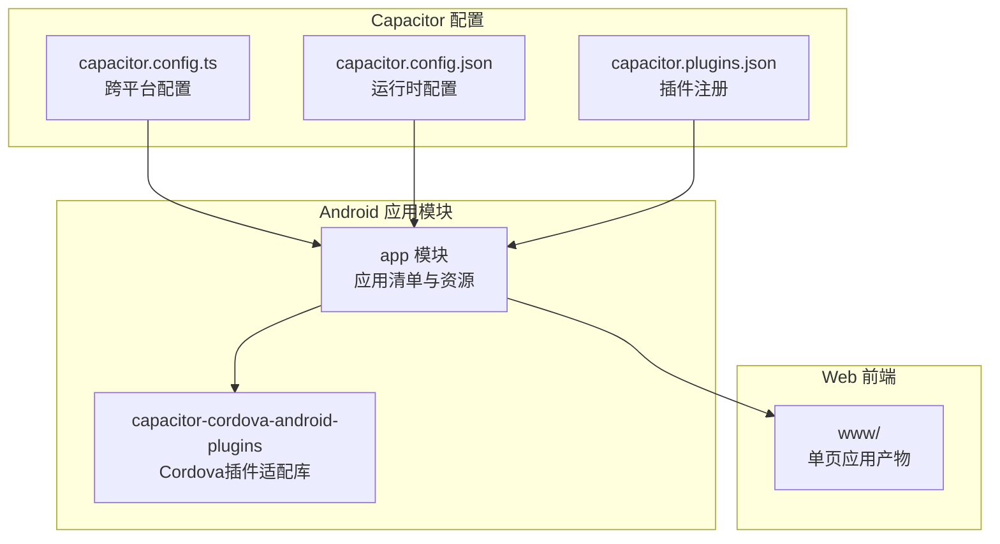
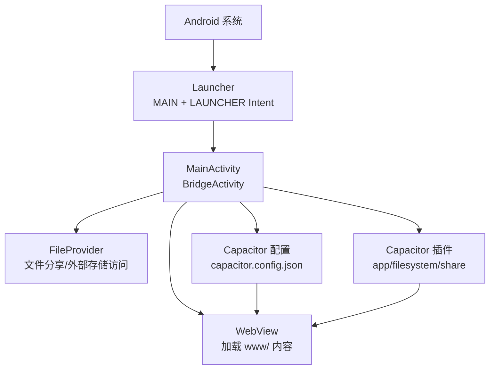
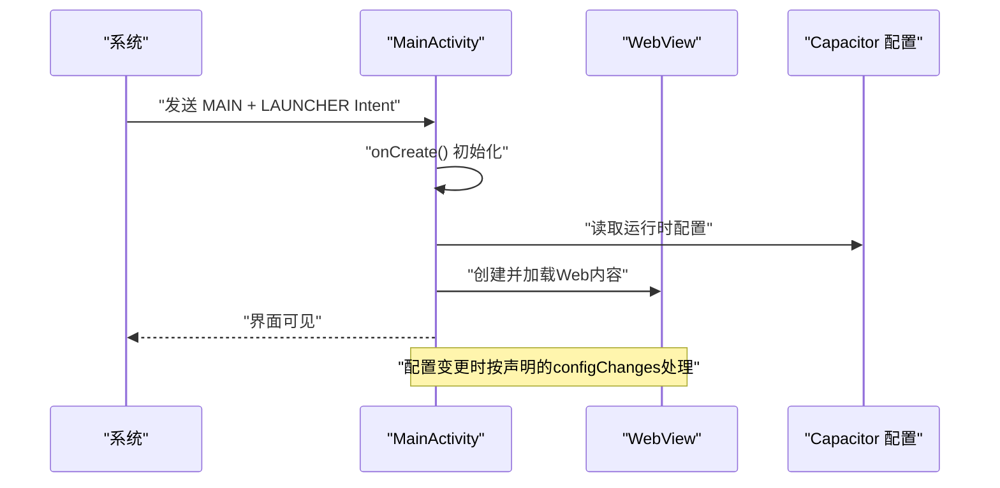
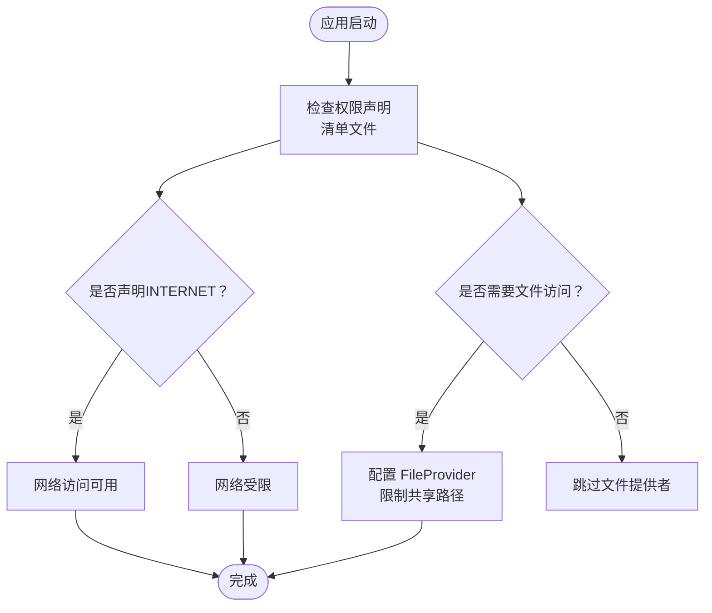
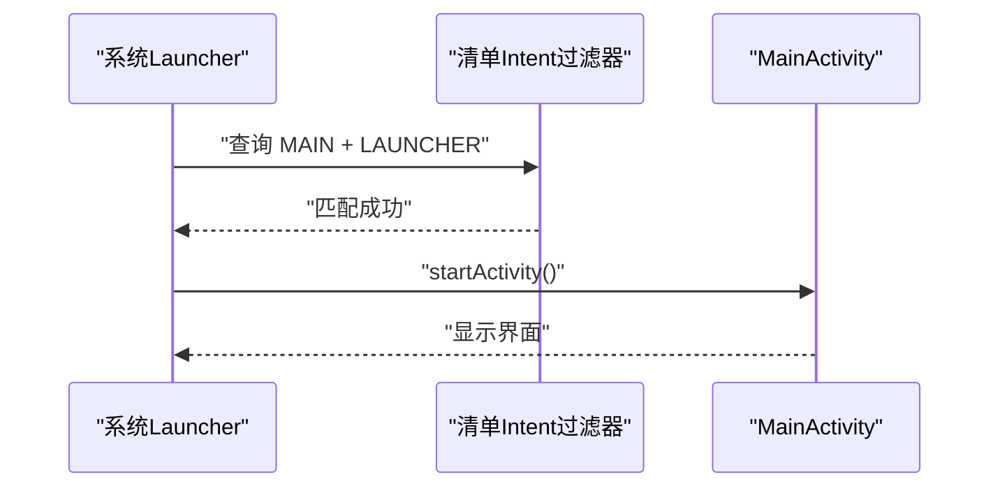
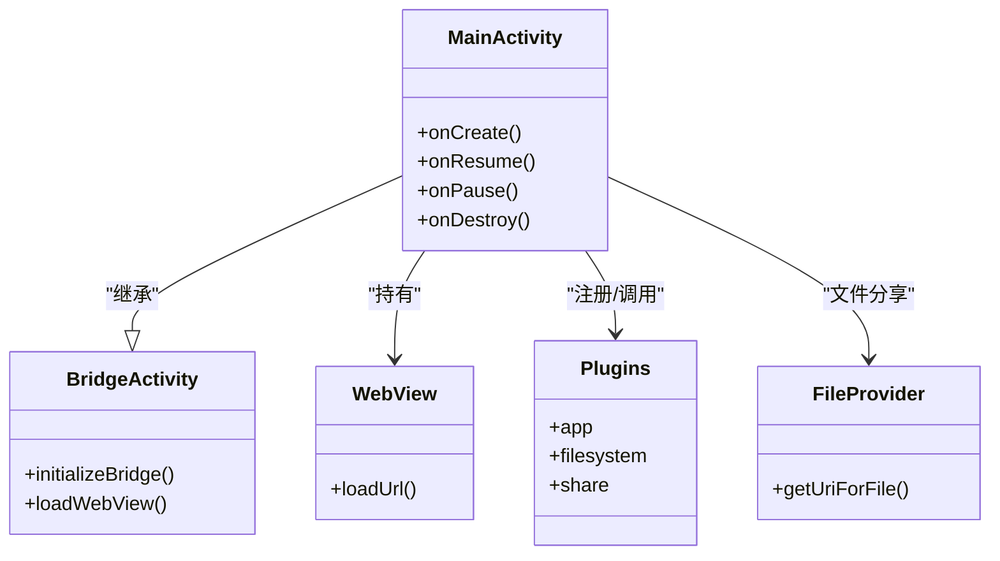
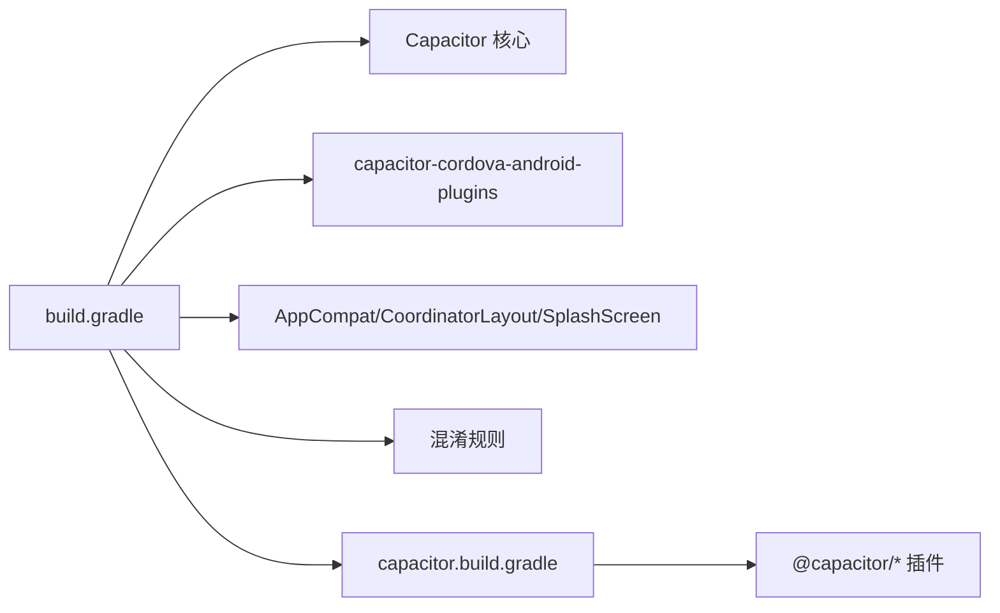
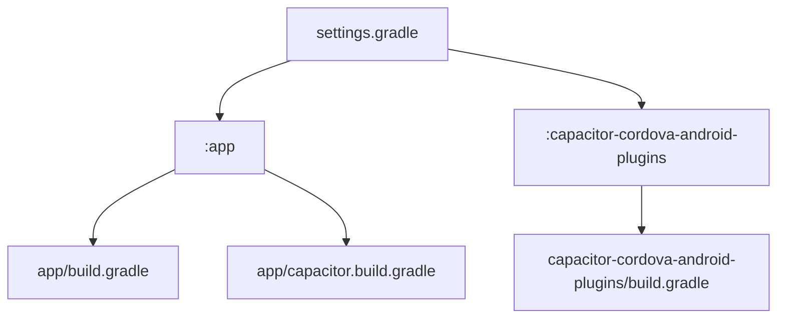

# Android平台集成

<cite>
**本文引用的文件**
- [MainActivity.java](file://android/app/src/main/java/com/animetracker/app/MainActivity.java)
- [AndroidManifest.xml](file://android/app/src/main/AndroidManifest.xml)
- [activity_main.xml](file://android/app/src/main/res/layout/activity_main.xml)
- [build.gradle](file://android/app/build.gradle)
- [capacitor.config.ts](file://capacitor.config.ts)
- [capacitor.build.gradle](file://android/app/capacitor.build.gradle)
- [settings.gradle](file://android/settings.gradle)
- [strings.xml](file://android/app/src/main/res/values/strings.xml)
- [styles.xml](file://android/app/src/main/res/values/styles.xml)
- [file_paths.xml](file://android/app/src/main/res/xml/file_paths.xml)
- [config.xml](file://android/app/src/main/res/xml/config.xml)
- [capacitor.config.json](file://android/app/src/main/assets/capacitor.config.json)
- [capacitor.plugins.json](file://android/app/src/main/assets/capacitor.plugins.json)
- [capacitor-cordova-android-plugins/build.gradle](file://android/capacitor-cordova-android-plugins/build.gradle)
</cite>

## 目录
1. [简介](#简介)
2. [项目结构](#项目结构)
3. [核心组件](#核心组件)
4. [架构总览](#架构总览)
5. [详细组件分析](#详细组件分析)
6. [依赖关系分析](#依赖关系分析)
7. [性能考虑](#性能考虑)
8. [故障排查指南](#故障排查指南)
9. [结论](#结论)
10. [附录](#附录)

## 简介
本文件面向Android平台集成场景，围绕基于Capacitor的混合应用展开，重点说明以下方面：
- Activity生命周期与启动模式、配置变更处理
- 权限声明与安全设置在清单文件中的体现
- Intent处理机制与入口Activity配置
- MainActivity作为应用入口点的职责与桥接能力
- Android特有的系统集成点、硬件访问控制与系统服务调用
- 平台特定的优化策略与兼容性处理方案

## 项目结构
该工程采用Capacitor生成的Android原生工程，核心由Web前端产物与Android原生层组成。原生层通过BridgeActivity承载WebView，实现对Web端的宿主环境。

**图表来源**
- [settings.gradle:1-5](file://android/settings.gradle#L1-L5)
- [capacitor.config.ts:1-22](file://capacitor.config.ts#L1-L22)
- [capacitor.config.json:1-18](file://android/app/src/main/assets/capacitor.config.json#L1-L18)
- [capacitor.plugins.json:1-15](file://android/app/src/main/assets/capacitor.plugins.json#L1-L15)

**章节来源**
- [settings.gradle:1-5](file://android/settings.gradle#L1-L5)
- [capacitor.config.ts:1-22](file://capacitor.config.ts#L1-L22)
- [capacitor.config.json:1-18](file://android/app/src/main/assets/capacitor.config.json#L1-L18)
- [capacitor.plugins.json:1-15](file://android/app/src/main/assets/capacitor.plugins.json#L1-L15)

## 核心组件
- MainActivity：继承自BridgeActivity，作为应用入口点，负责初始化Capacitor桥接与WebView容器。
- AndroidManifest：声明应用元信息、Activity、Provider、权限与Intent过滤器。
- activity_main.xml：定义WebView容器布局，承载Web内容。
- Capacitor配置：capacitor.config.ts与运行时配置文件共同决定Web目录、服务器协议与Android特定行为。
- 构建脚本：build.gradle与capacitor.build.gradle定义编译选项、仓库与依赖，以及插件集成。

**章节来源**
- [MainActivity.java:1-5](file://android/app/src/main/java/com/animetracker/app/MainActivity.java#L1-L5)
- [AndroidManifest.xml:1-47](file://android/app/src/main/AndroidManifest.xml#L1-L47)
- [activity_main.xml:1-13](file://android/app/src/main/res/layout/activity_main.xml#L1-L13)
- [capacitor.config.ts:1-22](file://capacitor.config.ts#L1-L22)
- [build.gradle:1-55](file://android/app/build.gradle#L1-L55)
- [capacitor.build.gradle:1-22](file://android/app/capacitor.build.gradle#L1-L22)

## 架构总览
下图展示从系统启动到Web页面渲染的关键路径，体现MainActivity如何通过BridgeActivity与WebView承载Web应用，并通过FileProvider与系统服务交互。

**图表来源**
- [AndroidManifest.xml:14-37](file://android/app/src/main/AndroidManifest.xml#L14-L37)
- [activity_main.xml:9-11](file://android/app/src/main/res/layout/activity_main.xml#L9-L11)
- [capacitor.config.json:1-18](file://android/app/src/main/assets/capacitor.config.json#L1-L18)
- [capacitor.plugins.json:1-15](file://android/app/src/main/assets/capacitor.plugins.json#L1-L15)

## 详细组件分析

### MainActivity与Activity生命周期
- 继承关系：MainActivity继承BridgeActivity，获得Capacitor提供的生命周期桥接与插件系统。
- 启动模式：使用singleTask，有助于避免重复实例与任务栈问题。
- 配置变更：声明了多项configChanges，以减少因屏幕方向、键盘状态等变化导致的Activity重建。
- 入口点：通过Intent过滤器匹配MAIN与LAUNCHER，成为桌面入口。

**图表来源**
- [AndroidManifest.xml:14-25](file://android/app/src/main/AndroidManifest.xml#L14-L25)
- [MainActivity.java:1-5](file://android/app/src/main/java/com/animetracker/app/MainActivity.java#L1-L5)
- [capacitor.config.json:1-18](file://android/app/src/main/assets/capacitor.config.json#L1-L18)

**章节来源**
- [MainActivity.java:1-5](file://android/app/src/main/java/com/animetracker/app/MainActivity.java#L1-L5)
- [AndroidManifest.xml:14-25](file://android/app/src/main/AndroidManifest.xml#L14-L25)

### 权限管理与安全设置
- 权限声明：清单中声明INTERNET、读写外部存储及管理外部存储权限，满足Web资源加载与文件操作需求。
- FileProvider：通过FileProvider与file_paths.xml限定文件共享范围，提升安全性。
- 明文流量：允许明文HTTP流量，便于开发调试；生产建议收紧。
- 外部存储兼容：启用requestLegacyExternalStorage，兼容旧版存储模型。

**图表来源**
- [AndroidManifest.xml:40-46](file://android/app/src/main/AndroidManifest.xml#L40-L46)
- [file_paths.xml:1-8](file://android/app/src/main/res/xml/file_paths.xml#L1-L8)

**章节来源**
- [AndroidManifest.xml:40-46](file://android/app/src/main/AndroidManifest.xml#L40-L46)
- [file_paths.xml:1-8](file://android/app/src/main/res/xml/file_paths.xml#L1-L8)

### Intent处理机制
- 入口Intent：MAIN与LAUNCHER组合确保应用可从桌面启动。
- 单例模式：singleTask启动模式避免重复创建实例。
- 配置变更：通过configChanges减少重建成本。

**图表来源**
- [AndroidManifest.xml:22-25](file://android/app/src/main/AndroidManifest.xml#L22-L25)

**章节来源**
- [AndroidManifest.xml:14-25](file://android/app/src/main/AndroidManifest.xml#L14-L25)

### WebView与系统集成点
- WebView容器：activity_main.xml中定义WebView，承载Web内容。
- Capacitor插件：通过capacitor.plugins.json注册app、filesystem、share等插件，扩展系统能力。
- 文件访问：FileProvider与file_paths.xml配合，支持受控的文件分享与外部存储访问。

**图表来源**
- [MainActivity.java:1-5](file://android/app/src/main/java/com/animetracker/app/MainActivity.java#L1-L5)
- [activity_main.xml:9-11](file://android/app/src/main/res/layout/activity_main.xml#L9-L11)
- [capacitor.plugins.json:1-15](file://android/app/src/main/assets/capacitor.plugins.json#L1-L15)
- [file_paths.xml:1-8](file://android/app/src/main/res/xml/file_paths.xml#L1-L8)

**章节来源**
- [activity_main.xml:1-13](file://android/app/src/main/res/layout/activity_main.xml#L1-L13)
- [capacitor.plugins.json:1-15](file://android/app/src/main/assets/capacitor.plugins.json#L1-L15)

### 构建与依赖
- 编译与目标版本：compileSdk、minSdk、targetSdk在构建脚本中统一管理。
- 仓库与依赖：引入Capacitor核心与Cordova插件适配库，启用FileProvider与相关UI库。
- 插件注入：capacitor.build.gradle动态注入插件依赖与Java版本配置。

**图表来源**
- [build.gradle:33-43](file://android/app/build.gradle#L33-L43)
- [capacitor.build.gradle:11-16](file://android/app/capacitor.build.gradle#L11-L16)

**章节来源**
- [build.gradle:1-55](file://android/app/build.gradle#L1-L55)
- [capacitor.build.gradle:1-22](file://android/app/capacitor.build.gradle#L1-L22)
- [capacitor-cordova-android-plugins/build.gradle:1-59](file://android/capacitor-cordova-android-plugins/build.gradle#L1-L59)

## 依赖关系分析
- 模块依赖：settings.gradle包含app与capacitor-cordova-android-plugins两个模块。
- 版本管理：variables.gradle与根级gradle属性控制SDK版本与编译选项。
- 插件生态：capacitor.build.gradle集中声明插件依赖，简化维护。

**图表来源**
- [settings.gradle:1-5](file://android/settings.gradle#L1-L5)
- [build.gradle:1-55](file://android/app/build.gradle#L1-L55)
- [capacitor.build.gradle:1-22](file://android/app/capacitor.build.gradle#L1-L22)
- [capacitor-cordova-android-plugins/build.gradle:1-59](file://android/capacitor-cordova-android-plugins/build.gradle#L1-L59)

**章节来源**
- [settings.gradle:1-5](file://android/settings.gradle#L1-L5)
- [build.gradle:1-55](file://android/app/build.gradle#L1-L55)
- [capacitor.build.gradle:1-22](file://android/app/capacitor.build.gradle#L1-L22)
- [capacitor-cordova-android-plugins/build.gradle:1-59](file://android/capacitor-cordova-android-plugins/build.gradle#L1-L59)

## 性能考虑
- 减少重建：通过configChanges覆盖常见配置变更，降低Activity重建频率。
- WebView加载：保持WebView单一实例，避免重复初始化。
- 插件精简：仅注册必要插件，减少初始化开销。
- 存储访问：合理使用FileProvider与缓存路径，避免频繁I/O。
- 构建优化：关闭release混淆或谨慎配置，平衡体积与性能。

[本节为通用指导，无需列出具体文件来源]

## 故障排查指南
- 启动无界面：检查清单中的MAIN/LAUNCHER过滤器与Activity导出标志。
- 网络异常：确认INTERNET权限已声明，且服务器scheme与allowMixedContent符合预期。
- 文件访问失败：核对FileProvider与file_paths.xml路径映射，确保URI授权正确。
- 插件未生效：检查capacitor.plugins.json中插件classpath与包名一致。
- WebView空白：确认capacitor.config.json中webDir与实际目录一致。

**章节来源**
- [AndroidManifest.xml:14-37](file://android/app/src/main/AndroidManifest.xml#L14-L37)
- [capacitor.config.json:1-18](file://android/app/src/main/assets/capacitor.config.json#L1-L18)
- [capacitor.plugins.json:1-15](file://android/app/src/main/assets/capacitor.plugins.json#L1-L15)
- [file_paths.xml:1-8](file://android/app/src/main/res/xml/file_paths.xml#L1-L8)

## 结论
本项目通过Capacitor将Web前端与Android原生层解耦，MainActivity作为桥接入口，借助BridgeActivity与WebView承载Web应用，同时通过清单与配置文件实现权限、Intent与系统服务的可控接入。构建脚本与插件体系保证了跨平台一致性与扩展性。建议在生产环境中收紧明文流量与存储权限，并根据设备能力进一步优化插件与资源加载策略。

[本节为总结性内容，无需列出具体文件来源]

## 附录
- 资源与主题：strings.xml与styles.xml定义应用名称、主题色与启动背景，影响首屏体验。
- Cordova兼容：capacitor-cordova-android-plugins提供Cordova生态插件适配，便于迁移与扩展。
- 开发与测试：单元测试与仪器测试位于对应测试目录，便于验证业务逻辑与系统集成。

**章节来源**
- [strings.xml:1-8](file://android/app/src/main/res/values/strings.xml#L1-L8)
- [styles.xml:1-23](file://android/app/src/main/res/values/styles.xml#L1-L23)
- [capacitor-cordova-android-plugins/build.gradle:1-59](file://android/capacitor-cordova-android-plugins/build.gradle#L1-L59)