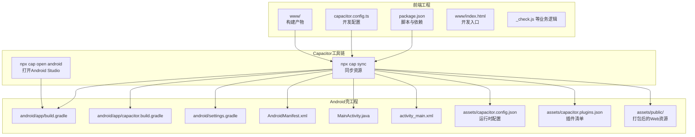
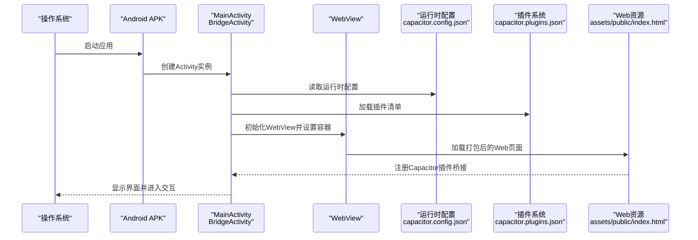
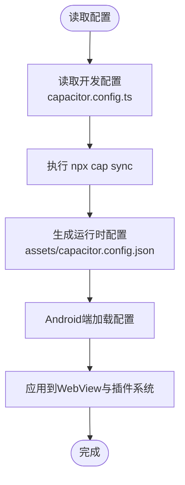
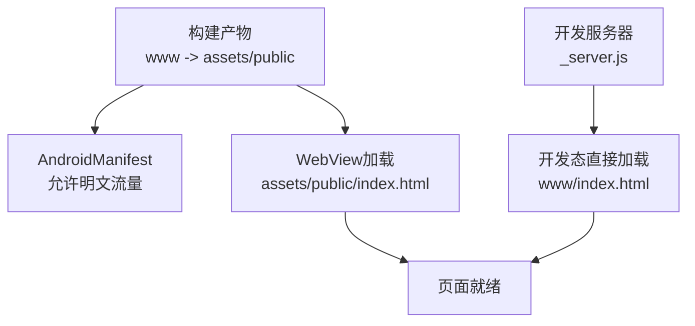
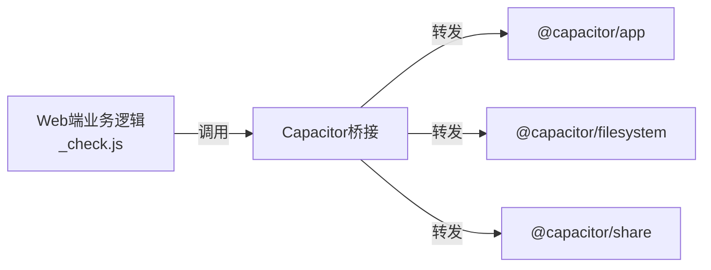
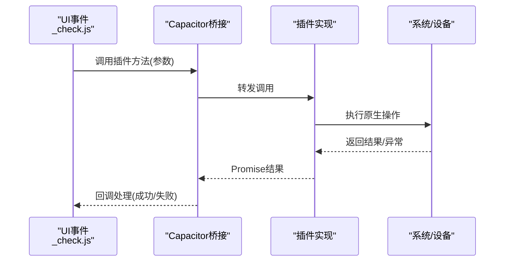
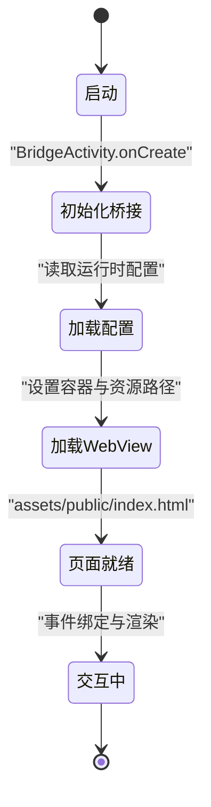
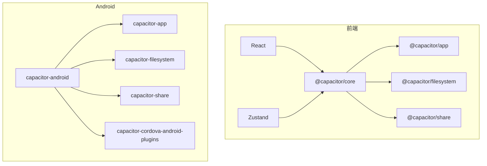

# Capacitor集成

<cite>
**本文引用的文件**
- [capacitor.config.ts](file://capacitor.config.ts)
- [capacitor.config.json](file://android/app/src/main/assets/capacitor.config.json)
- [MainActivity.java](file://android/app/src/main/java/com/animetracker/app/MainActivity.java)
- [index.html（开发）](file://www/index.html)
- [index.html（打包）](file://android/app/src/main/assets/public/index.html)
- [package.json](file://package.json)
- [AndroidManifest.xml](file://android/app/src/main/AndroidManifest.xml)
- [activity_main.xml](file://android/app/src/main/res/layout/activity_main.xml)
- [capacitor.plugins.json](file://android/app/src/main/assets/capacitor.plugins.json)
- [_check.js](file://_check.js)
- [_server.js](file://_server.js)
- [build.gradle（应用）](file://android/app/build.gradle)
- [capacitor.build.gradle](file://android/app/capacitor.build.gradle)
- [settings.gradle](file://android/settings.gradle)
</cite>

## 目录
1. [引言](#引言)
2. [项目结构](#项目结构)
3. [核心组件](#核心组件)
4. [架构总览](#架构总览)
5. [组件详解](#组件详解)
6. [依赖关系分析](#依赖关系分析)
7. [性能考量](#性能考量)
8. [故障排查指南](#故障排查指南)
9. [结论](#结论)
10. [附录](#附录)

## 引言
本文件系统化梳理该Capacitor跨平台应用的集成架构，重点覆盖以下方面：
- Capacitor作为跨平台容器的作用：统一承载Web内容、提供原生能力桥接与平台抽象。
- Web内容加载机制：开发态与构建态的资源路径、服务器配置与加载策略。
- 原生功能桥接：通过插件系统对接App、文件系统、分享等能力。
- 平台抽象层设计：Android WebView容器与BridgeActivity的职责边界。
- 配置文件解析：capacitor.config.ts与生成的capacitor.config.json的字段含义与影响。
- 启动流程与生命周期：从应用启动到Web页面渲染的关键节点。
- 通信机制：JavaScript与原生之间的消息传递、异步调用与错误处理策略。
- 多平台兼容性与性能优化：Android端的WebView配置、权限与运行时行为。

## 项目结构
该项目采用“前端Web工程 + Capacitor桥接 + Android原生壳”的混合架构。核心要点：
- 前端工程位于根目录，使用Vite构建，输出至www目录。
- Capacitor配置位于根目录的TypeScript配置文件中，并在构建时生成Android端的JSON配置。
- Android壳工程位于android/app，使用BridgeActivity承载WebView，加载assets/public中的打包资源。
- 插件清单由Capacitor生成，声明启用的原生插件类路径。

图表来源
- [package.json:1-38](file://package.json#L1-L38)
- [capacitor.config.ts:1-22](file://capacitor.config.ts#L1-L22)
- [www/index.html:1-75](file://www/index.html#L1-L75)
- [android/app/build.gradle:1-55](file://android/app/build.gradle#L1-L55)
- [android/app/capacitor.build.gradle:1-21](file://android/app/capacitor.build.gradle#L1-L21)
- [android/settings.gradle:1-5](file://android/settings.gradle#L1-L5)
- [android/app/src/main/AndroidManifest.xml:1-47](file://android/app/src/main/AndroidManifest.xml#L1-L47)
- [android/app/src/main/java/com/animetracker/app/MainActivity.java:1-5](file://android/app/src/main/java/com/animetracker/app/MainActivity.java#L1-L5)
- [android/app/src/main/res/layout/activity_main.xml:1-13](file://android/app/src/main/res/layout/activity_main.xml#L1-L13)
- [android/app/src/main/assets/capacitor.config.json:1-18](file://android/app/src/main/assets/capacitor.config.json#L1-L18)
- [android/app/src/main/assets/capacitor.plugins.json:1-15](file://android/app/src/main/assets/capacitor.plugins.json#L1-L15)
- [android/app/src/main/assets/public/index.html:1-800](file://android/app/src/main/assets/public/index.html#L1-L800)

章节来源
- [package.json:1-38](file://package.json#L1-L38)
- [capacitor.config.ts:1-22](file://capacitor.config.ts#L1-L22)
- [www/index.html:1-75](file://www/index.html#L1-L75)
- [android/app/build.gradle:1-55](file://android/app/build.gradle#L1-L55)
- [android/app/capacitor.build.gradle:1-21](file://android/app/capacitor.build.gradle#L1-L21)
- [android/settings.gradle:1-5](file://android/settings.gradle#L1-L5)
- [android/app/src/main/AndroidManifest.xml:1-47](file://android/app/src/main/AndroidManifest.xml#L1-L47)
- [android/app/src/main/java/com/animetracker/app/MainActivity.java:1-5](file://android/app/src/main/java/com/animetracker/app/MainActivity.java#L1-L5)
- [android/app/src/main/res/layout/activity_main.xml:1-13](file://android/app/src/main/res/layout/activity_main.xml#L1-L13)
- [android/app/src/main/assets/capacitor.config.json:1-18](file://android/app/src/main/assets/capacitor.config.json#L1-L18)
- [android/app/src/main/assets/capacitor.plugins.json:1-15](file://android/app/src/main/assets/capacitor.plugins.json#L1-L15)
- [android/app/src/main/assets/public/index.html:1-800](file://android/app/src/main/assets/public/index.html#L1-L800)

## 核心组件
- 配置系统
  - 开发配置：capacitor.config.ts定义应用标识、应用名、Web目录、服务器参数（如Android Scheme）、平台特定参数（背景色、混合内容策略等），以及空插件对象。
  - 运行时配置：构建后生成android/app/src/main/assets/capacitor.config.json，供Android端读取。
- 容器与桥接
  - MainActivity继承自BridgeActivity，负责初始化Capacitor桥接与WebView容器。
  - AndroidManifest.xml声明应用权限与Activity配置；activity_main.xml内嵌WebView用于承载Web内容。
- 插件系统
  - 通过capacitor.plugins.json声明启用的原生插件（App、Filesystem、Share），并在构建后以类路径形式接入。
- 前端工程
  - package.json定义脚本（如sync、open:android），并声明对@capacitor/*系列包的依赖。
  - www/index.html为开发态入口；android/app/src/main/assets/public/index.html为打包后运行态入口，包含完整的样式与脚本加载顺序。
- 业务逻辑
  - _check.js提供本地存储、渲染、事件绑定等核心逻辑，支持导出/分享等操作。

章节来源
- [capacitor.config.ts:1-22](file://capacitor.config.ts#L1-L22)
- [android/app/src/main/assets/capacitor.config.json:1-18](file://android/app/src/main/assets/capacitor.config.json#L1-L18)
- [android/app/src/main/java/com/animetracker/app/MainActivity.java:1-5](file://android/app/src/main/java/com/animetracker/app/MainActivity.java#L1-L5)
- [android/app/src/main/AndroidManifest.xml:1-47](file://android/app/src/main/AndroidManifest.xml#L1-L47)
- [android/app/src/main/res/layout/activity_main.xml:1-13](file://android/app/src/main/res/layout/activity_main.xml#L1-L13)
- [android/app/src/main/assets/capacitor.plugins.json:1-15](file://android/app/src/main/assets/capacitor.plugins.json#L1-L15)
- [package.json:1-38](file://package.json#L1-L38)
- [www/index.html:1-75](file://www/index.html#L1-L75)
- [android/app/src/main/assets/public/index.html:1-800](file://android/app/src/main/assets/public/index.html#L1-L800)
- [_check.js:1-800](file://_check.js#L1-L800)

## 架构总览
下图展示从应用启动到Web内容渲染的整体流程，以及Capacitor在其中的定位。

图表来源
- [android/app/src/main/java/com/animetracker/app/MainActivity.java:1-5](file://android/app/src/main/java/com/animetracker/app/MainActivity.java#L1-L5)
- [android/app/src/main/assets/capacitor.config.json:1-18](file://android/app/src/main/assets/capacitor.config.json#L1-L18)
- [android/app/src/main/assets/capacitor.plugins.json:1-15](file://android/app/src/main/assets/capacitor.plugins.json#L1-L15)
- [android/app/src/main/assets/public/index.html:1-800](file://android/app/src/main/assets/public/index.html#L1-L800)

## 组件详解

### 配置文件与参数解析
- 关键参数说明
  - appId：应用唯一标识，用于区分不同应用。
  - appName：应用显示名称。
  - webDir：前端构建产物目录（开发态）。
  - server.androidScheme：Android端使用的协议（如https），影响本地资源加载策略。
  - android.backgroundColor：启动页背景色，提升视觉一致性。
  - android.allowMixedContent：允许混合内容（HTTP/HTTPS混用），便于调试或旧资源访问。
  - ios.contentInset、ios.backgroundColor：iOS侧内容边距与背景色配置。
  - plugins：插件注册占位，实际插件由capacitor.plugins.json声明。
- 配置来源与生效
  - 开发态：capacitor.config.ts
  - 运行态：构建后生成android/app/src/main/assets/capacitor.config.json，Android端读取生效

图表来源
- [capacitor.config.ts:1-22](file://capacitor.config.ts#L1-L22)
- [android/app/src/main/assets/capacitor.config.json:1-18](file://android/app/src/main/assets/capacitor.config.json#L1-L18)

章节来源
- [capacitor.config.ts:1-22](file://capacitor.config.ts#L1-L22)
- [android/app/src/main/assets/capacitor.config.json:1-18](file://android/app/src/main/assets/capacitor.config.json#L1-L18)

### Web内容加载机制
- 开发态
  - www/index.html作为开发入口，按顺序加载业务脚本。
  - _server.js提供本地静态服务，便于开发调试。
- 构建态
  - assets/public/index.html为最终打包产物，包含完整样式与脚本。
  - MainActivity通过BridgeActivity加载WebView，指向assets/public下的资源。
- 资源路径与服务器
  - server.androidScheme控制Android端协议，避免HTTP资源被拦截。
  - AndroidManifest.xml允许明文流量（usesCleartextTraffic=true），便于开发期HTTP资源访问。

图表来源
- [www/index.html:1-75](file://www/index.html#L1-L75)
- [_server.js:1-32](file://_server.js#L1-L32)
- [android/app/src/main/assets/public/index.html:1-800](file://android/app/src/main/assets/public/index.html#L1-L800)
- [android/app/src/main/AndroidManifest.xml:1-47](file://android/app/src/main/AndroidManifest.xml#L1-L47)

章节来源
- [www/index.html:1-75](file://www/index.html#L1-L75)
- [_server.js:1-32](file://_server.js#L1-L32)
- [android/app/src/main/assets/public/index.html:1-800](file://android/app/src/main/assets/public/index.html#L1-L800)
- [android/app/src/main/AndroidManifest.xml:1-47](file://android/app/src/main/AndroidManifest.xml#L1-L47)

### 原生功能桥接与插件系统
- 插件清单
  - App：应用生命周期与状态相关能力。
  - Filesystem：文件系统读写能力。
  - Share：系统分享能力。
- 集成方式
  - 通过capacitor.plugins.json声明插件类路径，构建后由Capacitor注入到WebView桥接层。
  - 业务代码可通过window.Capacitor或Capacitor.Plugins调用对应能力。

图表来源
- [_check.js:754-800](file://_check.js#L754-L800)
- [android/app/src/main/assets/capacitor.plugins.json:1-15](file://android/app/src/main/assets/capacitor.plugins.json#L1-L15)

章节来源
- [_check.js:754-800](file://_check.js#L754-L800)
- [android/app/src/main/assets/capacitor.plugins.json:1-15](file://android/app/src/main/assets/capacitor.plugins.json#L1-L15)

### 通信机制与异步调用
- 调用模式
  - Web端通过Capacitor.Plugins.<Plugin>.<Method>()发起调用。
  - 调用在WebView内经由桥接层转发至原生插件，插件执行后回调Promise式结果。
- 错误处理
  - 导出/分享场景中，优先使用浏览器原生navigator.share或Capacitor Share插件；若均不可用则降级提示。
  - 文件/网络异常时捕获错误并提示用户，避免阻断主流程。

图表来源
- [_check.js:754-800](file://_check.js#L754-L800)

章节来源
- [_check.js:754-800](file://_check.js#L754-L800)

### 启动流程与生命周期
- 应用启动
  - Android系统启动MainActivity，BridgeActivity初始化Capacitor与WebView。
  - 读取运行时配置，加载assets/public中的Web页面。
- 生命周期要点
  - Activity onCreate阶段完成桥接初始化与页面加载。
  - 页面加载完成后，Web端可注册事件、初始化状态并响应用户交互。

图表来源
- [android/app/src/main/java/com/animetracker/app/MainActivity.java:1-5](file://android/app/src/main/java/com/animetracker/app/MainActivity.java#L1-L5)
- [android/app/src/main/assets/capacitor.config.json:1-18](file://android/app/src/main/assets/capacitor.config.json#L1-L18)
- [android/app/src/main/assets/public/index.html:1-800](file://android/app/src/main/assets/public/index.html#L1-L800)

章节来源
- [android/app/src/main/java/com/animetracker/app/MainActivity.java:1-5](file://android/app/src/main/java/com/animetracker/app/MainActivity.java#L1-L5)
- [android/app/src/main/assets/capacitor.config.json:1-18](file://android/app/src/main/assets/capacitor.config.json#L1-L18)
- [android/app/src/main/assets/public/index.html:1-800](file://android/app/src/main/assets/public/index.html#L1-L800)

## 依赖关系分析
- 前端依赖
  - @capacitor/*系列包：核心、CLI、各插件（App、Filesystem、Share）。
  - React与Zustand：用于UI与状态管理（尽管当前业务逻辑主要在纯JavaScript模块中体现）。
- Android构建依赖
  - 依赖capacitor-android与cordova-android-plugins，通过capacitor.build.gradle注入插件。
  - settings.gradle包含子工程，确保插件模块参与编译。

图表来源
- [package.json:18-29](file://package.json#L18-L29)
- [android/app/build.gradle:33-43](file://android/app/build.gradle#L33-L43)
- [android/app/capacitor.build.gradle:11-16](file://android/app/capacitor.build.gradle#L11-L16)
- [android/settings.gradle:1-5](file://android/settings.gradle#L1-5)

章节来源
- [package.json:18-29](file://package.json#L18-L29)
- [android/app/build.gradle:33-43](file://android/app/build.gradle#L33-L43)
- [android/app/capacitor.build.gradle:11-16](file://android/app/capacitor.build.gradle#L11-L16)
- [android/settings.gradle:1-5](file://android/settings.gradle#L1-5)

## 性能考量
- WebView配置
  - 使用CoordinatorLayout包裹WebView，利于布局与动画表现。
  - AndroidManifest中允许明文流量，便于开发期快速调试；生产环境建议关闭并使用HTTPS。
- 资源加载
  - 将构建产物置于assets/public，减少网络请求与CDN依赖。
  - 通过server.androidScheme与allowMixedContent合理配置，避免加载失败导致的重试开销。
- 业务层面
  - 本地存储使用localStorage，注意容量限制与序列化成本。
  - 渲染采用一次性innerHTML替换，减少频繁DOM操作；复杂列表建议虚拟滚动（当前实现为完整渲染，可评估优化空间）。

章节来源
- [android/app/src/main/res/layout/activity_main.xml:1-13](file://android/app/src/main/res/layout/activity_main.xml#L1-L13)
- [android/app/src/main/AndroidManifest.xml:1-47](file://android/app/src/main/AndroidManifest.xml#L1-L47)
- [android/app/src/main/assets/public/index.html:1-800](file://android/app/src/main/assets/public/index.html#L1-L800)
- [_check.js:12-27](file://_check.js#L12-L27)

## 故障排查指南
- 无法加载Web资源
  - 检查capacitor.config.json中的webDir与server.androidScheme是否与构建产物一致。
  - 确认assets/public存在且包含index.html。
- 分享/导出失败
  - 若navigator.share不可用，检查Capacitor Share插件是否正确注入。
  - 观察错误分支与提示逻辑，确认是否捕获并反馈异常。
- 权限问题
  - AndroidManifest中需具备Internet、读写外部存储等权限，确保文件读写与网络访问正常。
- 开发调试
  - 使用_vite dev或本地_http服务器验证开发态资源加载。

章节来源
- [android/app/src/main/assets/capacitor.config.json:1-18](file://android/app/src/main/assets/capacitor.config.json#L1-L18)
- [android/app/src/main/assets/public/index.html:1-800](file://android/app/src/main/assets/public/index.html#L1-L800)
- [_check.js:754-800](file://_check.js#L754-L800)
- [android/app/src/main/AndroidManifest.xml:42-46](file://android/app/src/main/AndroidManifest.xml#L42-L46)

## 结论
本项目以Capacitor为核心，实现了Web内容与原生能力的稳定桥接。通过清晰的配置体系、规范的构建流程与插件化扩展，既保证了开发效率，也为后续功能扩展提供了良好基础。建议在生产环境中进一步收紧网络与安全策略，并结合业务复杂度评估渲染与存储的性能优化方案。

## 附录
- 常用命令
  - npx cap sync：同步前端构建产物与原生工程。
  - npx cap open android：在Android Studio中打开原生工程。
  - npx cap add android/ios：添加目标平台。
- 关键文件速览
  - 配置：capacitor.config.ts、android/app/src/main/assets/capacitor.config.json
  - 容器：MainActivity.java、activity_main.xml、AndroidManifest.xml
  - 插件：android/app/src/main/assets/capacitor.plugins.json
  - 前端：www/index.html、_check.js、_server.js
  - 构建：android/app/build.gradle、android/app/capacitor.build.gradle、android/settings.gradle