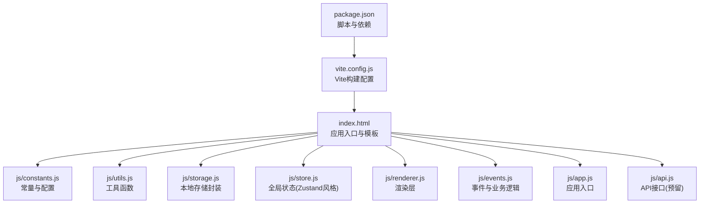
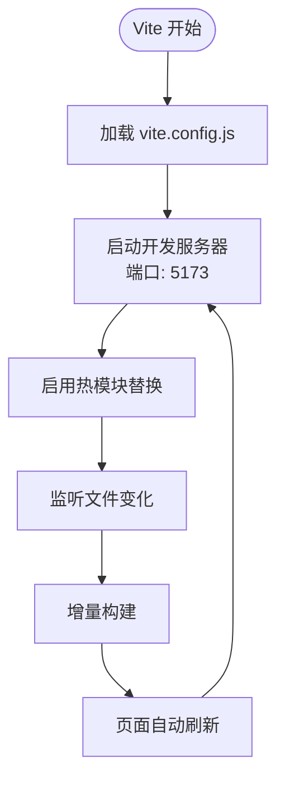
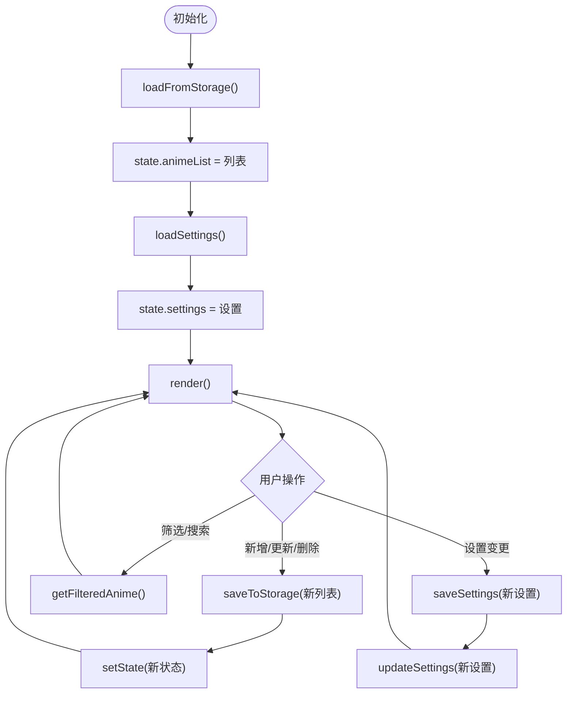
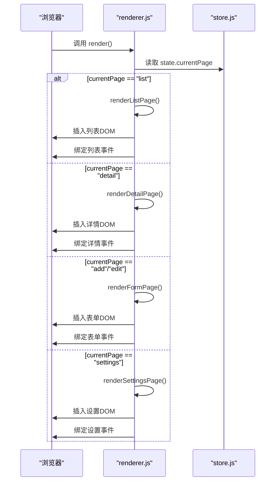
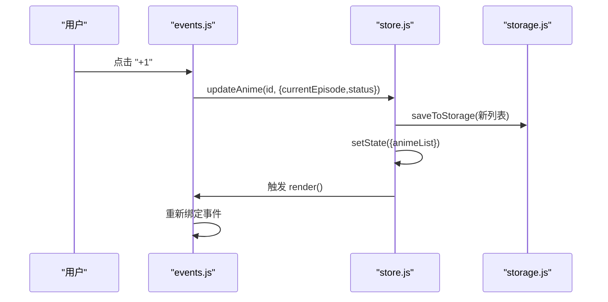
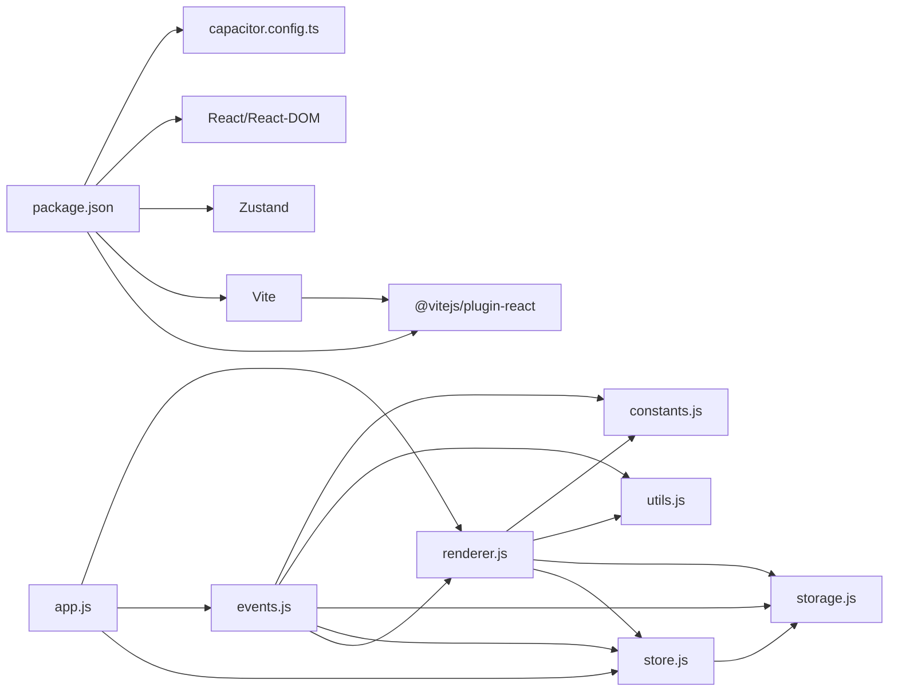

# 前端架构

<cite>
**本文引用的文件**
- [package.json](file://package.json)
- [vite.config.js](file://vite.config.js)
- [capacitor.config.ts](file://capacitor.config.ts)
- [index.html](file://www/index.html)
- [app.js](file://www/js/app.js)
- [store.js](file://www/js/store.js)
- [events.js](file://www/js/events.js)
- [renderer.js](file://www/js/renderer.js)
- [constants.js](file://www/js/constants.js)
- [utils.js](file://www/js/utils.js)
- [storage.js](file://www/js/storage.js)
</cite>

## 更新摘要
**变更内容**
- 新增Vite作为现代化前端构建工具的配置和使用说明
- 更新开发服务器配置，支持热模块替换和优化资源打包
- 增强开发工作流程，包括端口配置和构建优化
- 更新项目结构以反映Vite集成后的变化

## 目录
1. [引言](#引言)
2. [项目结构](#项目结构)
3. [核心组件](#核心组件)
4. [架构总览](#架构总览)
5. [详细组件分析](#详细组件分析)
6. [依赖关系分析](#依赖关系分析)
7. [性能考量](#性能考量)
8. [故障排查指南](#故障排查指南)
9. [结论](#结论)
10. [附录](#附录)

## 引言
本文件面向 Anime Tracker 前端，系统性梳理其单页应用（SPA）架构设计与实现要点。项目采用原生 JavaScript（ES6+）构建，配合 Capacitor 实现跨平台打包；状态管理采用轻量级自研"Zustand 风格"方案（全局状态 + 渲染分发），结合 localStorage 实现数据持久化；UI 通过模块化的渲染函数与事件绑定实现响应式交互。随着 Vite 的引入，项目建立了现代化的前端工作流，支持热模块替换、优化资源打包和高效的开发体验。文档涵盖组件化结构、状态管理模式、路由系统、HTML/CSS/JS 模块化设计、数据流与状态树、性能优化策略与用户体验设计原则，并提供可视化图表帮助理解。

## 项目结构
项目采用"静态资源 + 模块化 JS"的前端组织方式，现已集成 Vite 构建工具：
- 构建工具层：vite.config.js
  - 根目录配置：root: 'www'
  - 输出目录：dist
  - 开发服务器：port: 5173
  - Rollup 输入：www/index.html
- Web 层：www 目录存放最终构建产物与运行时资源
  - index.html：应用入口与模板骨架、样式与脚本加载顺序
  - js/：按职责拆分的模块
    - constants.js：常量与配置（状态、季度边界、类型等）
    - utils.js：工具函数（HTML 转义、ID 生成、评分渲染、提示等）
    - storage.js：localStorage 封装（数据与折叠状态）
    - store.js：全局状态与 CRUD 操作（Zustand 风格）
    - renderer.js：视图渲染层（按页面状态渲染不同模板）
    - events.js：事件绑定与业务逻辑（导入/导出、表单、详情页等）
    - app.js：应用启动入口（首屏渲染、启动页、物理返回键）
    - api.js：预留接口（当前未见实现）
- 配置层：
  - package.json：脚本与依赖（React、Capacitor、Vite 等）
  - capacitor.config.ts：Capacitor 配置（Web 目录、平台参数）



**图表来源**
- [index.html](file://www/index.html)
- [vite.config.js](file://vite.config.js)
- [package.json](file://package.json)
- [constants.js](file://www/js/constants.js)
- [utils.js](file://www/js/utils.js)
- [storage.js](file://www/js/storage.js)
- [store.js](file://www/js/store.js)
- [renderer.js](file://www/js/renderer.js)
- [events.js](file://www/js/events.js)
- [app.js](file://www/js/app.js)
- [api.js](file://www/js/api.js)

**章节来源**
- [package.json](file://package.json)
- [vite.config.js](file://vite.config.js)
- [capacitor.config.ts](file://capacitor.config.ts)
- [index.html](file://www/index.html)

## 核心组件
- 全局状态与持久化
  - 全局状态对象：包含番剧列表、筛选器、搜索词、当前页面、当前番剧、设置等
  - 状态更新：setState 合并更新并触发渲染
  - 数据持久化：localStorage 保存番剧列表、折叠状态与设置
- 渲染层
  - render 分发器：根据 currentPage 渲染列表/详情/表单/设置
  - 页面模板：列表页、详情页、添加/编辑表单、设置页、空状态、筛选栏、搜索栏
- 事件层
  - 列表页事件：筛选、搜索、折叠/展开、+1、导入/导出、跳转
  - 详情页事件：进度增减、状态切换、评分、删除、Bangumi 详情加载
  - 表单页事件：类型切换、进度滚轮、保存、Bangumi 搜索
  - 设置页事件：列表样式切换、深色模式、API 接口配置、数据管理
- 工具与常量
  - HTML 转义、ID 生成、评分渲染、Toast 提示
  - 状态配置、季度边界、类型配置、星期映射、季度排序

**章节来源**
- [store.js](file://www/js/store.js)
- [renderer.js](file://www/js/renderer.js)
- [events.js](file://www/js/events.js)
- [storage.js](file://www/js/storage.js)
- [utils.js](file://www/js/utils.js)
- [constants.js](file://www/js/constants.js)

## 架构总览
该应用采用"自研 Zustand 风格状态管理 + 渲染分发 + 事件绑定"的轻量架构，现已集成 Vite 构建工具：
- 状态集中于全局对象，通过 setState 推动 UI 更新
- 渲染层按页面状态调用对应模板函数，避免复杂组件树
- 事件层负责用户交互与业务流程，完成后统一调用状态更新
- localStorage 实现数据持久化，确保刷新不丢失
- Vite 提供现代化开发体验，支持热模块替换和优化打包

```mermaid
graph TB
subgraph "状态层"
S["state<br/>全局状态"]
P["localStorage<br/>持久化"]
end
subgraph "渲染层"
R["render()<br/>分发器"]
L["renderListPage()"]
D["renderDetailPage()"]
F["renderFormPage()"]
ST["renderSettingsPage()"]
end
subgraph "事件层"
E1["attachListEvents()"]
E2["attachDetailEvents()"]
E3["attachFormEvents()"]
E4["attachSettingsEvents()"]
end
subgraph "工具与常量"
U["utils.js"]
C["constants.js"]
END
subgraph "构建工具"
V["Vite<br/>开发服务器:5173"]
B["Rollup<br/>资源打包"]
HMR["HMR<br/>热模块替换"]
end
S --> R
R --> L
R --> D
R --> F
R --> ST
E1 --> S
E2 --> S
E3 --> S
E4 --> S
S --> P
U --> R
U --> E1
U --> E2
U --> E3
U --> E4
C --> R
C --> E1
C --> E2
C --> E3
C --> E4
V --> HMR
V --> B
```

**图表来源**
- [store.js](file://www/js/store.js)
- [renderer.js](file://www/js/renderer.js)
- [events.js](file://www/js/events.js)
- [storage.js](file://www/js/storage.js)
- [utils.js](file://www/js/utils.js)
- [constants.js](file://www/js/constants.js)
- [vite.config.js](file://vite.config.js)

## 详细组件分析

### Vite 构建工具集成
- 开发服务器配置
  - 端口：5173（避免与传统开发服务器冲突）
  - 根目录：www（指向静态资源目录）
  - 热模块替换：支持快速开发体验
- 构建优化
  - Rollup 输入：www/index.html
  - 输出目录：dist（生产环境构建产物）
  - 资源打包：优化 JavaScript、CSS 和静态资源
- 开发脚本
  - dev：启动 Vite 开发服务器
  - build：生产环境构建
  - preview：预览构建结果



**图表来源**
- [vite.config.js](file://vite.config.js)
- [package.json](file://package.json)

**章节来源**
- [vite.config.js](file://vite.config.js)
- [package.json](file://package.json)

### 状态管理与持久化（Zustand 风格）
- 全局状态字段
  - animeList：番剧数组
  - filter：筛选状态
  - searchQuery：搜索关键词
  - currentPage：当前页面（list/detail/add/edit/settings）
  - currentAnime：当前选中的番剧
  - settings：应用设置（列表样式、深色模式、API 端点）
- 关键方法
  - setState：合并更新并触发 render
  - updateSettings：更新设置并持久化
  - CRUD：addAnime/updateAnime/deleteAnime
  - 辅助：getFilteredAnime/getAnimeById
- 持久化策略
  - loadFromStorage/saveToStorage：保存/恢复番剧列表
  - loadCollapsed/saveCollapsed：保存/恢复折叠状态
  - loadSettings/saveSettings：保存/恢复应用设置



**图表来源**
- [store.js](file://www/js/store.js)
- [storage.js](file://www/js/storage.js)
- [renderer.js](file://www/js/renderer.js)

**章节来源**
- [store.js](file://www/js/store.js)
- [storage.js](file://www/js/storage.js)

### 渲染分发与页面模板
- render 分发器：根据 currentPage 渲染不同页面
- 页面模板函数：
  - 列表页：头部、筛选栏、搜索栏、番剧列表（按年/季分组）、空状态
  - 详情页：基本信息、进度控制、状态切换、评分、观后感、Bangumi 详情
  - 表单页：标题、类型、总集数/已看集数（滚轮）、状态、日期、评分、观后感
  - 设置页：列表样式、深色模式、API 接口、数据管理、关于信息
- 模板渲染：使用模板字符串拼接 HTML，减少 DOM 操作



**图表来源**
- [renderer.js](file://www/js/renderer.js)
- [store.js](file://www/js/store.js)

**章节来源**
- [renderer.js](file://www/js/renderer.js)

### 事件绑定与业务流程
- 列表页事件
  - 筛选按钮：更新 filter 并重新渲染
  - 搜索输入：防输入法组合，节流更新
  - 折叠/展开：维护 COLLAPSE_KEY，更新 UI 动画
  - +1 按钮：自动推进状态（want/watching/completed）
  - 导入/导出：弹窗、文件读取、JSON 解析/序列化、浏览器保存/分享
- 详情页事件
  - 进度增减：限制上下界，必要时切换状态
  - 状态切换：一键更新
  - 评分：点击切换 1-5
  - 删除：二次确认
  - Bangumi 详情：异步加载，支持多种数据源
- 表单页事件
  - 类型切换：显示/隐藏对应区域
  - 进度滚轮：自定义滚轮控件，中心吸附
  - Bangumi 搜索：防抖搜索、结果选择填充
  - 保存：校验必填、去重、计算状态、提交
- 设置页事件
  - 列表样式切换：文本/封面模式
  - 深色模式：实时主题切换
  - API 接口配置：直连/代理选择
  - 数据管理：导入/导出功能



**图表来源**
- [events.js](file://www/js/events.js)
- [store.js](file://www/js/store.js)
- [storage.js](file://www/js/storage.js)

**章节来源**
- [events.js](file://www/js/events.js)

### HTML 模板结构与 CSS 组织
- HTML 结构
  - 容器：#app 作为根节点
  - 启动页：#splashScreen
  - 弹窗：导入/导出筛选、粘贴导入、追番提醒、单集编辑
  - 脚本加载顺序：constants → utils → storage → store → api → renderer → events → app
- CSS 组织
  - 内联样式与外部样式结合，采用原子化与语义化类名
  - 响应式与滚动条定制、模糊背景、动画过渡
  - 按页面区域划分样式：header/filter/search/main/content/detail/form/settings

**章节来源**
- [index.html](file://www/index.html)

### JavaScript 模块化设计
- 模块职责清晰
  - constants：纯配置，无副作用
  - utils：纯函数工具，便于复用
  - storage：单一职责的数据访问
  - store：状态与业务操作
  - renderer：视图渲染
  - events：事件与交互
  - app：入口与生命周期
- 依赖顺序严格，避免循环引用

**章节来源**
- [constants.js](file://www/js/constants.js)
- [utils.js](file://www/js/utils.js)
- [storage.js](file://www/js/storage.js)
- [store.js](file://www/js/store.js)
- [renderer.js](file://www/js/renderer.js)
- [events.js](file://www/js/events.js)
- [app.js](file://www/js/app.js)

## 依赖关系分析
- 外部依赖
  - React、React-DOM：声明为依赖但未在前端代码中使用（可能用于 Capacitor 开发环境或未来迁移）
  - Capacitor：Android/iOS 打包与插件（App、Share、Filesystem）
  - Vite：现代化开发与构建工具
  - @vitejs/plugin-react：React 支持
  - zustand：状态管理库
- 内部依赖
  - constants → renderer/events/utils/storage/store
  - utils → renderer/events/utils/storage/store
  - storage → store
  - renderer → constants/utils/storage/store/events
  - events → constants/utils/storage/store/renderer
  - app → renderer



**图表来源**
- [package.json](file://package.json)
- [capacitor.config.ts](file://capacitor.config.ts)
- [app.js](file://www/js/app.js)
- [renderer.js](file://www/js/renderer.js)
- [events.js](file://www/js/events.js)
- [store.js](file://www/js/store.js)
- [constants.js](file://www/js/constants.js)
- [utils.js](file://www/js/utils.js)
- [storage.js](file://www/js/storage.js)
- [vite.config.js](file://vite.config.js)

**章节来源**
- [package.json](file://package.json)
- [capacitor.config.ts](file://capacitor.config.ts)

## 性能考量
- 渲染优化
  - 仅在状态变更时触发 render，避免不必要的重绘
  - 列表渲染按年/季分组，折叠状态持久化，减少 DOM 数量
  - 封面模式懒加载，提升初始渲染性能
- 事件绑定
  - 每次渲染后重新绑定事件，保证动态元素可用；建议后续引入事件委托降低绑定成本
- 输入体验
  - 搜索输入使用组合事件处理，避免中文输入法导致的频繁渲染
  - 表单输入延迟保存（详情页评论），平衡实时性与性能
- 滚轮控件
  - 自定义滚轮控件采用被动滚动监听，提升滚动流畅度
- 本地存储
  - 仅在状态变更时写入 localStorage，避免频繁 IO
- 启动体验
  - 启动页淡出与 Toast 提示，提升感知速度
- Vite 性能优化
  - 热模块替换：快速开发体验，减少全量刷新
  - 资源打包：Tree-shaking 和代码分割
  - 缓存策略：开发和生产环境缓存优化

## 故障排查指南
- 导入/导出失败
  - 检查 JSON 格式是否正确，数组格式是否符合预期
  - 浏览器兼容性：FileReader、showSaveFilePicker、navigator.share 的支持情况
- 物理返回键行为异常
  - 确认 Capacitor App 插件可用，backButton 事件是否被正确注册
- 折叠状态丢失
  - 检查 COLLAPSE_KEY 是否被意外清空或异常解析
- 评分/进度异常
  - 确认 total/current 的边界值与状态切换逻辑一致
- Bangumi 搜索失败
  - 检查网络请求与防抖逻辑，确认结果填充是否正确
- Vite 开发问题
  - 端口占用：5173 端口被占用时修改配置
  - 模块解析：检查相对路径和模块导入
  - 缓存问题：清理 node_modules/.vite 缓存

**章节来源**
- [events.js](file://www/js/events.js)
- [storage.js](file://www/js/storage.js)
- [app.js](file://www/js/app.js)
- [vite.config.js](file://vite.config.js)

## 结论
Anime Tracker 前端采用"轻量自研状态管理 + 渲染分发 + 事件绑定"的架构，在不引入重型框架的前提下实现了清晰的职责分离与良好的可维护性。通过 localStorage 实现数据持久化，配合 Capacitor 支持多端部署；渲染层与事件层模块化设计便于扩展。随着 Vite 的引入，项目获得了现代化的开发体验，支持热模块替换和优化资源打包。建议后续引入事件委托、状态树快照与调试工具，以及对 React/Vite 的逐步迁移，进一步提升开发效率与性能表现。

## 附录
- 状态树结构（简化）
  - state: {
      animeList: [],
      filter: 'all',
      searchQuery: '',
      currentPage: 'list',
      currentAnime: null,
      settings: {
        listStyle: 'text',
        darkMode: false,
        apiEndpoint: 'direct'
      }
    }
- 关键常量
  - STATUS_CONFIG：观看状态标签与样式类
  - TYPE_CONFIG：类型标签与样式类
  - QUARTER_BOUNDARIES：季度边界规则
  - WEEK_DAYS：星期映射
  - STORAGE_KEY/COLLAPSE_KEY/SETTINGS_KEY：localStorage 键名

**章节来源**
- [store.js](file://www/js/store.js)
- [constants.js](file://www/js/constants.js)