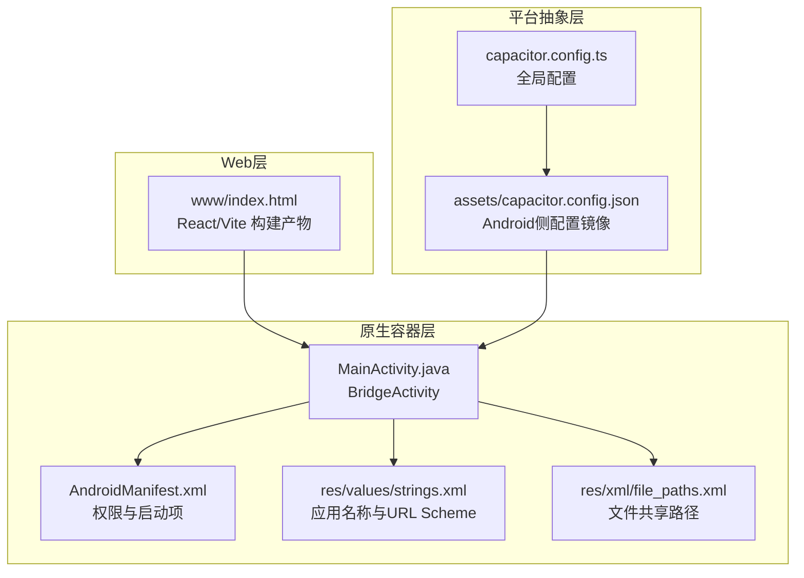
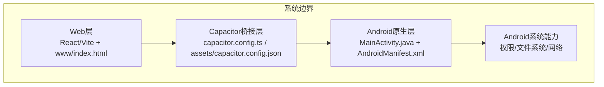
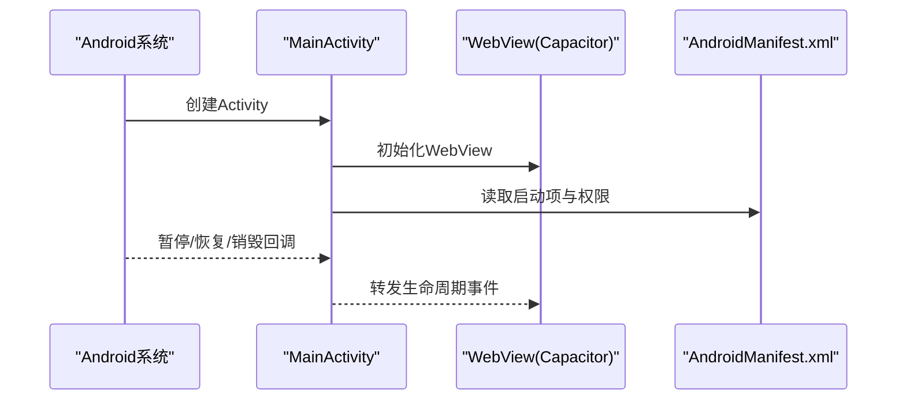
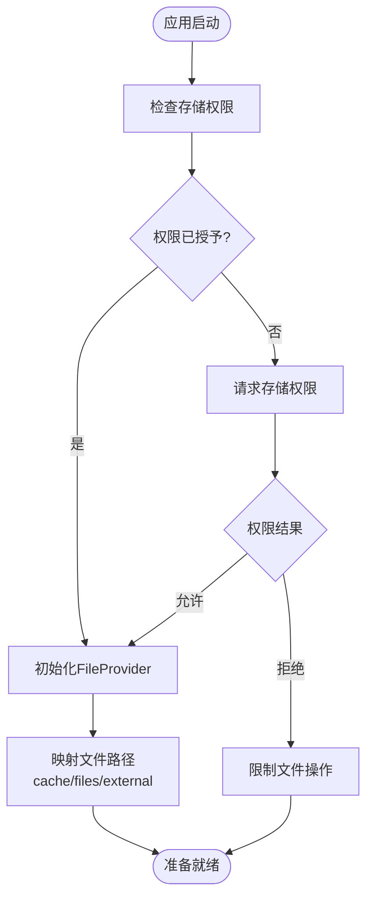
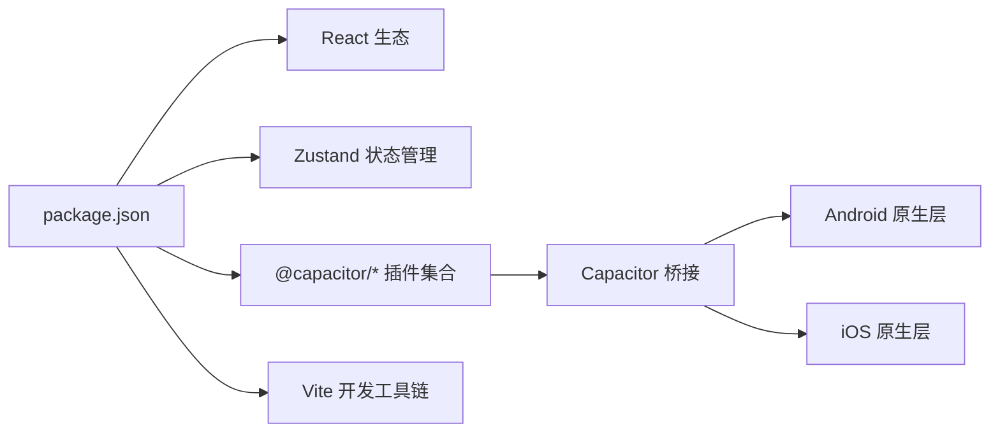

# 技术架构

<cite>
**本文引用的文件**
- [capacitor.config.ts](file://capacitor.config.ts)
- [package.json](file://package.json)
- [MainActivity.java](file://android/app/src/main/java/com/animetracker/app/MainActivity.java)
- [AndroidManifest.xml](file://android/app/src/main/AndroidManifest.xml)
- [capacitor.config.json](file://android/app/src/main/assets/capacitor.config.json)
- [strings.xml](file://android/app/src/main/res/values/strings.xml)
- [file_paths.xml](file://android/app/src/main/res/xml/file_paths.xml)
- [index.html](file://www/index.html)
</cite>

## 目录
1. [引言](#引言)
2. [项目结构](#项目结构)
3. [核心组件](#核心组件)
4. [架构总览](#架构总览)
5. [详细组件分析](#详细组件分析)
6. [依赖分析](#依赖分析)
7. [性能考虑](#性能考虑)
8. [故障排除指南](#故障排除指南)
9. [结论](#结论)
10. [附录](#附录)

## 引言
本技术架构文档面向Anime Tracker项目，系统性阐述其基于Capacitor的跨平台架构设计。该应用采用“Web层 + 原生容器层 + 平台抽象层”的分层模式：Web层由React + Vite构建，负责UI与业务逻辑；原生容器层通过Capacitor桥接Android/iOS系统能力；平台抽象层以Capacitor插件形式提供统一的API调用入口。文档同时覆盖Android平台的原生集成、权限管理与生命周期处理，并给出系统边界图、组件交互图与数据流向图，帮助读者快速理解整体设计与实现。

## 项目结构
项目采用前后端分离与原生容器结合的布局：
- Web层：Vite构建产物位于www目录，作为WebView加载的静态资源。
- 原生容器层：Android模块通过BridgeActivity承载WebView，使用Capacitor配置驱动运行时行为。
- 配置与资源：Capacitor配置在根目录与Android资产中分别存在，确保跨平台一致性。



**图表来源**
- [capacitor.config.ts:1-22](file://capacitor.config.ts#L1-L22)
- [capacitor.config.json:1-18](file://android/app/src/main/assets/capacitor.config.json#L1-L18)
- [MainActivity.java:1-5](file://android/app/src/main/java/com/animetracker/app/MainActivity.java#L1-L5)
- [AndroidManifest.xml:1-47](file://android/app/src/main/AndroidManifest.xml#L1-L47)
- [strings.xml:1-8](file://android/app/src/main/res/values/strings.xml#L1-L8)
- [file_paths.xml:1-8](file://android/app/src/main/res/xml/file_paths.xml#L1-L8)
- [index.html:1-800](file://www/index.html#L1-L800)

**章节来源**
- [capacitor.config.ts:1-22](file://capacitor.config.ts#L1-L22)
- [package.json:1-38](file://package.json#L1-L38)
- [MainActivity.java:1-5](file://android/app/src/main/java/com/animetracker/app/MainActivity.java#L1-L5)
- [AndroidManifest.xml:1-47](file://android/app/src/main/AndroidManifest.xml#L1-L47)
- [capacitor.config.json:1-18](file://android/app/src/main/assets/capacitor.config.json#L1-L18)
- [strings.xml:1-8](file://android/app/src/main/res/values/strings.xml#L1-L8)
- [file_paths.xml:1-8](file://android/app/src/main/res/xml/file_paths.xml#L1-L8)
- [index.html:1-800](file://www/index.html#L1-L800)

## 核心组件
- Capacitor配置（根配置与Android资产镜像）：定义应用ID、应用名、Web目录、服务器参数与平台特定设置，保证跨平台一致行为。
- React + Vite Web层：提供用户界面与交互逻辑，构建产物放置于www目录供原生容器加载。
- Android原生容器：MainActivity继承BridgeActivity，承载WebView并响应系统事件。
- 权限与文件共享：AndroidManifest声明网络与存储相关权限；FileProvider与file_paths.xml提供安全的文件共享路径映射。
- 字符串与URL Scheme：strings.xml提供应用名与自定义URL Scheme，支持深度链接与系统集成。

**章节来源**
- [capacitor.config.ts:1-22](file://capacitor.config.ts#L1-L22)
- [package.json:18-28](file://package.json#L18-L28)
- [MainActivity.java:1-5](file://android/app/src/main/java/com/animetracker/app/MainActivity.java#L1-L5)
- [AndroidManifest.xml:40-46](file://android/app/src/main/AndroidManifest.xml#L40-L46)
- [file_paths.xml:1-8](file://android/app/src/main/res/xml/file_paths.xml#L1-L8)
- [strings.xml:1-8](file://android/app/src/main/res/values/strings.xml#L1-L8)

## 架构总览
下图展示系统边界与三层交互关系：Web层通过Capacitor桥接到原生容器，原生容器再访问Android系统能力（如存储、分享等），形成稳定的跨平台运行时。



**图表来源**
- [capacitor.config.ts:1-22](file://capacitor.config.ts#L1-L22)
- [capacitor.config.json:1-18](file://android/app/src/main/assets/capacitor.config.json#L1-L18)
- [MainActivity.java:1-5](file://android/app/src/main/java/com/animetracker/app/MainActivity.java#L1-L5)
- [AndroidManifest.xml:1-47](file://android/app/src/main/AndroidManifest.xml#L1-L47)

## 详细组件分析

### 组件A分析：Capacitor配置与同步机制
- 根配置（capacitor.config.ts）与Android资产配置（assets/capacitor.config.json）共同决定应用的运行参数，包括应用ID、应用名、Web目录、服务器参数（如Android Scheme）、平台特定属性（背景色、混合内容允许）以及插件占位。
- 同步流程：通过脚本命令将Web层构建产物与原生工程同步，确保www目录与Android资产一致。

```mermaid
sequenceDiagram
participant Dev as "开发者"
participant CLI as "Capacitor CLI"
participant CFG as "capacitor.config.ts"
participant ASSET as "assets/capacitor.config.json"
participant AND as "Android 工程"
Dev->>CLI : 执行同步命令
CLI->>CFG : 读取根配置
CLI->>ASSET : 写入Android资产配置
CLI->>AND : 复制www构建产物
AND-->>Dev : 应用更新完成
```

**图表来源**
- [capacitor.config.ts:1-22](file://capacitor.config.ts#L1-L22)
- [capacitor.config.json:1-18](file://android/app/src/main/assets/capacitor.config.json#L1-L18)
- [package.json:8-16](file://package.json#L8-L16)

**章节来源**
- [capacitor.config.ts:1-22](file://capacitor.config.ts#L1-L22)
- [capacitor.config.json:1-18](file://android/app/src/main/assets/capacitor.config.json#L1-L18)
- [package.json:8-16](file://package.json#L8-L16)

### 组件B分析：Android原生容器与生命周期
- MainActivity继承BridgeActivity，作为WebView的承载容器，负责初始化与系统事件转发。
- AndroidManifest声明应用主题、启动模式、导出状态、配置变更处理以及FileProvider与权限。
- 生命周期：应用通过MainActivity的生命周期方法与系统交互，WebView随Activity生命周期加载与销毁。



**图表来源**
- [MainActivity.java:1-5](file://android/app/src/main/java/com/animetracker/app/MainActivity.java#L1-L5)
- [AndroidManifest.xml:14-27](file://android/app/src/main/AndroidManifest.xml#L14-L27)

**章节来源**
- [MainActivity.java:1-5](file://android/app/src/main/java/com/animetracker/app/MainActivity.java#L1-L5)
- [AndroidManifest.xml:14-27](file://android/app/src/main/AndroidManifest.xml#L14-L27)

### 组件C分析：权限管理与文件共享
- 权限声明：AndroidManifest包含网络、外部存储读写与管理权限，满足应用的在线功能与本地文件操作需求。
- 文件共享：通过FileProvider与file_paths.xml映射缓存、应用内部存储与外部存储路径，为分享、导入导出等功能提供基础。



**图表来源**
- [AndroidManifest.xml:42-46](file://android/app/src/main/AndroidManifest.xml#L42-L46)
- [file_paths.xml:1-8](file://android/app/src/main/res/xml/file_paths.xml#L1-L8)

**章节来源**
- [AndroidManifest.xml:42-46](file://android/app/src/main/AndroidManifest.xml#L42-L46)
- [file_paths.xml:1-8](file://android/app/src/main/res/xml/file_paths.xml#L1-L8)

### 组件D分析：Web层与平台抽象层的数据流
- Web层通过Capacitor桥接调用原生能力，实现跨平台统一接口。例如文件系统、分享等能力可通过插件扩展。
- 数据流向：Web层发起请求 → Capacitor桥接 → 原生容器执行 → 返回结果给Web层。

```mermaid
sequenceDiagram
participant UI as "Web层(React)"
participant BR as "Capacitor桥接"
participant AND as "Android原生"
participant SYS as "系统能力"
UI->>BR : 发起平台调用(示例 : 读取文件/分享)
BR->>AND : 转发调用
AND->>SYS : 执行系统级操作
SYS-->>AND : 返回结果
AND-->>BR : 包装返回值
BR-->>UI : 回传结果
```

**图表来源**
- [package.json:18-28](file://package.json#L18-L28)
- [index.html:1-800](file://www/index.html#L1-L800)

**章节来源**
- [package.json:18-28](file://package.json#L18-L28)
- [index.html:1-800](file://www/index.html#L1-L800)

## 依赖分析
- 前端依赖：React、React DOM、Zustand用于状态管理、Vite与React插件用于开发与构建。
- Capacitor生态：@capacitor/core、@capacitor/cli、@capacitor/android、@capacitor/ios、@capacitor/app、@capacitor/filesystem、@capacitor/share等，提供跨平台桥接与插件能力。
- 运行脚本：通过npm scripts封装开发、构建、预览与原生工程同步/打开流程。



**图表来源**
- [package.json:18-36](file://package.json#L18-L36)

**章节来源**
- [package.json:18-36](file://package.json#L18-L36)

## 性能考虑
- WebView渲染：Web层样式与交互复杂度直接影响WebView渲染性能，建议控制DOM层级与重绘范围，合理使用虚拟滚动与懒加载策略。
- 资源加载：构建后静态资源应启用压缩与缓存策略，减少首屏加载时间。
- Capacitor桥接开销：避免频繁的跨层调用，批量处理数据或合并多次调用，降低JS与原生之间的往返成本。
- Android后台策略：根据系统版本调整后台任务与网络策略，避免不必要的唤醒与电量消耗。

## 故障排除指南
- 同步失败：确认capacitor.config.ts与assets/capacitor.config.json一致，执行同步脚本后检查www目录是否更新。
- 权限问题：若文件操作受限，检查AndroidManifest中的权限声明与运行时授权流程。
- 启动异常：核对MainActivity与AndroidManifest的启动项、主题与导出状态，确保Activity正确注册。
- 分享/文件路径：验证FileProvider与file_paths.xml的路径映射，确保目标路径可访问且符合Android安全策略。

**章节来源**
- [capacitor.config.ts:1-22](file://capacitor.config.ts#L1-L22)
- [capacitor.config.json:1-18](file://android/app/src/main/assets/capacitor.config.json#L1-L18)
- [AndroidManifest.xml:14-27](file://android/app/src/main/AndroidManifest.xml#L14-L27)
- [file_paths.xml:1-8](file://android/app/src/main/res/xml/file_paths.xml#L1-L8)

## 结论
Anime Tracker采用Capacitor实现跨平台架构，以Web层为核心、原生容器为载体、平台抽象层为桥梁，形成清晰的职责划分与稳定的运行时环境。通过合理的配置管理、权限与生命周期处理，以及对性能与故障的针对性优化，项目能够在多平台上提供一致的用户体验。后续可在插件扩展、状态管理与资源优化方面持续演进。

## 附录
- 关键文件清单与作用概览
  - [capacitor.config.ts](file://capacitor.config.ts)：全局Capacitor配置，定义应用元信息与平台参数。
  - [capacitor.config.json](file://android/app/src/main/assets/capacitor.config.json)：Android侧配置镜像，确保构建一致性。
  - [MainActivity.java](file://android/app/src/main/java/com/animetracker/app/MainActivity.java)：原生容器入口，承载WebView。
  - [AndroidManifest.xml](file://android/app/src/main/AndroidManifest.xml)：权限、启动项与FileProvider配置。
  - [strings.xml](file://android/app/src/main/res/values/strings.xml)：应用名与URL Scheme。
  - [file_paths.xml](file://android/app/src/main/res/xml/file_paths.xml)：文件共享路径映射。
  - [index.html](file://www/index.html)：Web层构建产物入口。
  - [package.json](file://package.json)：依赖与脚本定义。