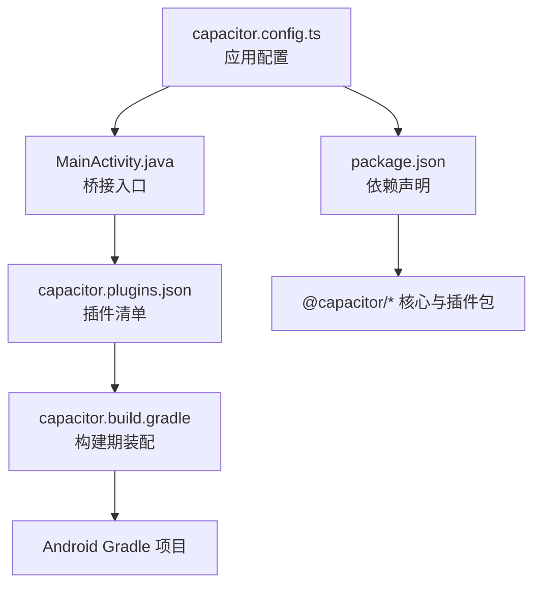
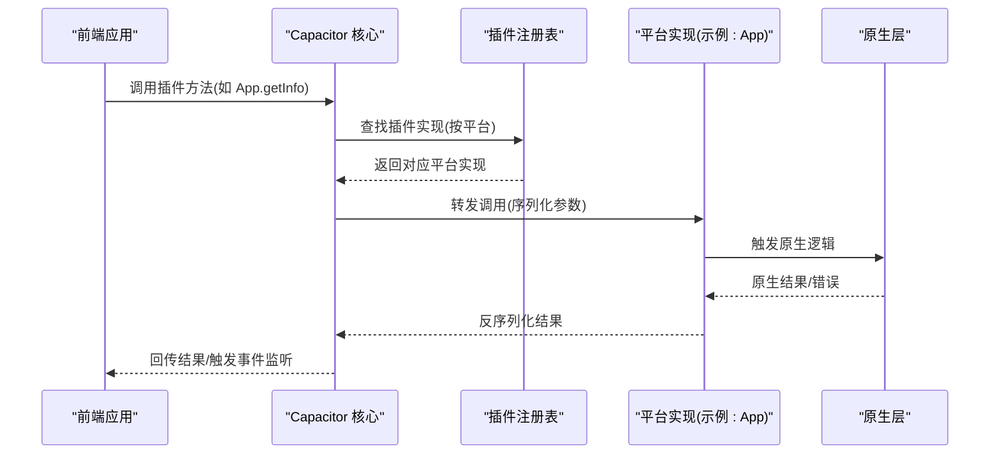
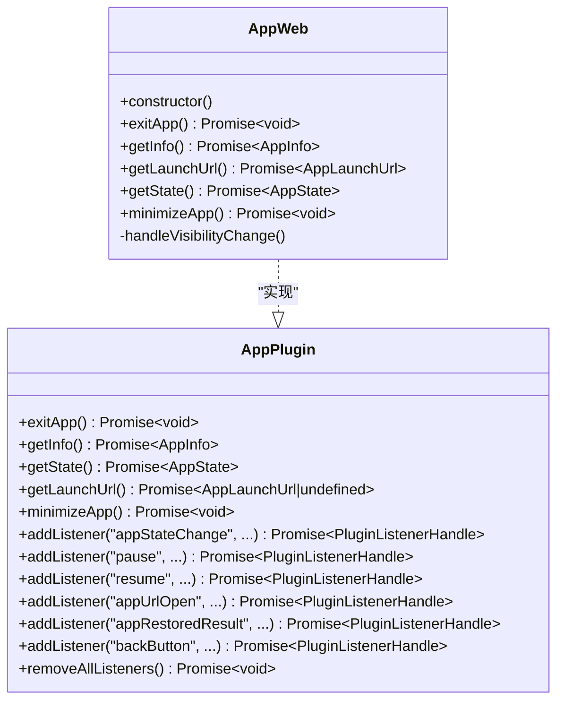
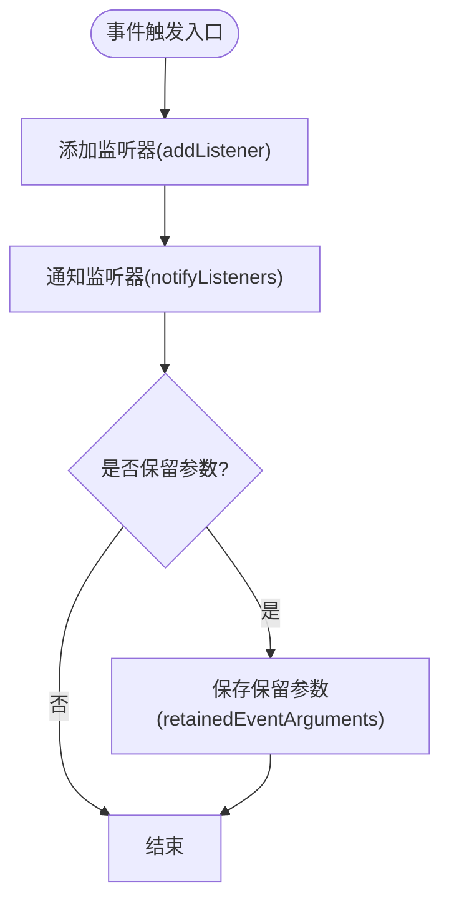
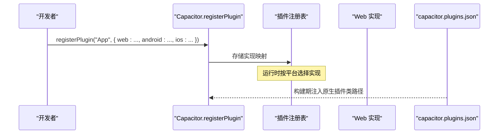
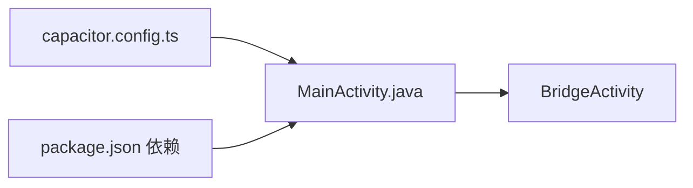
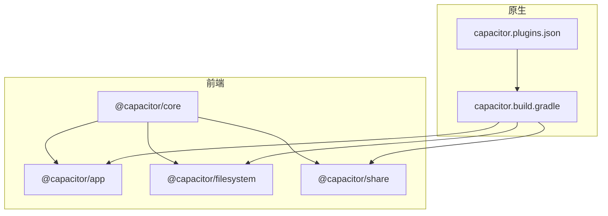

# 插件系统架构

<cite>
**本文引用的文件**
- [capacitor.config.ts](file://capacitor.config.ts)
- [package.json](file://package.json)
- [MainActivity.java](file://android/app/src/main/java/com/animetracker/app/MainActivity.java)
- [capacitor.plugins.json](file://android/app/src/main/assets/capacitor.plugins.json)
- [capacitor.build.gradle](file://android/app/capacitor.build.gradle)
- [index.d.ts](file://node_modules/@capacitor/core/types/index.d.ts)
- [definitions.d.ts](file://node_modules/@capacitor/core/types/definitions.d.ts)
- [web-plugin.d.ts](file://node_modules/@capacitor/core/types/web-plugin.d.ts)
- [global.d.ts](file://node_modules/@capacitor/core/types/global.d.ts)
- [definitions.d.ts（@capacitor/app）](file://node_modules/@capacitor/app/dist/esm/definitions.d.ts)
- [web.d.ts（@capacitor/app）](file://node_modules/@capacitor/app/dist/esm/web.d.ts)
</cite>

## 目录
1. [引言](#引言)
2. [项目结构](#项目结构)
3. [核心组件](#核心组件)
4. [架构总览](#架构总览)
5. [详细组件分析](#详细组件分析)
6. [依赖关系分析](#依赖关系分析)
7. [性能考量](#性能考量)
8. [故障排查指南](#故障排查指南)
9. [结论](#结论)
10. [附录](#附录)

## 引言
本文件面向Capacitor 6应用“追番记录”的插件系统进行系统化架构解析，重点覆盖以下主题：
- 插件注册机制：如何在运行时为不同平台注册插件实现，并通过统一API暴露给前端调用。
- API接口规范：插件方法签名、事件监听、结果回调与错误模型。
- 生命周期钩子：应用状态变化、URL打开、恢复调用等事件的监听与处理。
- 内置插件功能范围：基于已安装的官方插件（App、Filesystem、Share）说明其职责边界。
- 自定义与第三方插件集成：如何扩展或引入新的插件实现。
- 插件与原生交互模式：跨平台桥接、数据传输格式与错误传播。
- 架构图、调用链路图与扩展点设计：帮助开发者快速定位实现位置与扩展入口。
- 最佳实践与性能考量：减少桥接开销、合理使用事件监听与内存管理。

## 项目结构
该工程采用标准Capacitor项目布局，前端通过Vite构建，原生端通过Gradle管理，Capacitor配置集中于根目录配置文件中，插件清单由原生资源文件维护。

图表来源
- [capacitor.config.ts:1-22](file://capacitor.config.ts#L1-L22)
- [MainActivity.java:1-5](file://android/app/src/main/java/com/animetracker/app/MainActivity.java#L1-L5)
- [capacitor.plugins.json:1-15](file://android/app/src/main/assets/capacitor.plugins.json#L1-L15)
- [package.json:1-38](file://package.json#L1-L38)
- [capacitor.build.gradle:1-21](file://android/app/capacitor.build.gradle#L1-L21)

章节来源
- [capacitor.config.ts:1-22](file://capacitor.config.ts#L1-L22)
- [package.json:18-38](file://package.json#L18-L38)
- [MainActivity.java:1-5](file://android/app/src/main/java/com/animetracker/app/MainActivity.java#L1-L5)
- [capacitor.plugins.json:1-15](file://android/app/src/main/assets/capacitor.plugins.json#L1-L15)
- [capacitor.build.gradle:11-16](file://android/app/capacitor.build.gradle#L11-L16)

## 核心组件
- 运行时全局对象与注册API
  - 全局对象提供平台检测、文件路径转换、插件可用性检查、事件监听器注册/移除等能力。
  - 注册API用于为指定插件名绑定各平台实现（如web/android/ios），并返回统一的插件实例供前端调用。
- Web插件基类
  - 提供事件监听、窗口事件桥接、保留参数、未实现/不可用异常等通用能力。
- 官方插件接口
  - App插件：应用信息、状态、最小化、URL打开、返回键、恢复调用等事件监听。
  - Filesystem与Share插件：文件系统操作与分享能力（具体API以各自类型定义为准）。

章节来源
- [index.d.ts:1-10](file://node_modules/@capacitor/core/types/index.d.ts#L1-L10)
- [definitions.d.ts:3-57](file://node_modules/@capacitor/core/types/definitions.d.ts#L3-L57)
- [definitions.d.ts:71-81](file://node_modules/@capacitor/core/types/definitions.d.ts#L71-L81)
- [web-plugin.d.ts:6-32](file://node_modules/@capacitor/core/types/web-plugin.d.ts#L6-L32)
- [definitions.d.ts（@capacitor/app）:121-236](file://node_modules/@capacitor/app/dist/esm/definitions.d.ts#L121-L236)
- [web.d.ts（@capacitor/app）:3-11](file://node_modules/@capacitor/app/dist/esm/web.d.ts#L3-L11)

## 架构总览
下图展示了从前端到原生的典型调用链路，以及插件注册与事件分发的关键节点。

图表来源
- [definitions.d.ts:71-81](file://node_modules/@capacitor/core/types/definitions.d.ts#L71-L81)
- [global.d.ts:1-22](file://node_modules/@capacitor/core/types/global.d.ts#L1-L22)
- [definitions.d.ts（@capacitor/app）:121-142](file://node_modules/@capacitor/app/dist/esm/definitions.d.ts#L121-L142)

## 详细组件分析

### 组件A：App插件（应用生命周期与事件）
- 方法族
  - 应用信息查询、当前状态查询、启动URL获取、最小化应用、退出应用等。
  - 事件监听：应用状态变化、暂停/恢复、URL打开、返回键、恢复调用结果。
- Web实现要点
  - Web端实现继承WebPlugin，负责事件桥接与可见性变化处理。
- 生命周期与事件
  - 通过add/removeListener订阅事件；支持保留参数以便恢复调用后消费。

图表来源
- [definitions.d.ts（@capacitor/app）:121-236](file://node_modules/@capacitor/app/dist/esm/definitions.d.ts#L121-L236)
- [web.d.ts（@capacitor/app）:3-11](file://node_modules/@capacitor/app/dist/esm/web.d.ts#L3-L11)

章节来源
- [definitions.d.ts（@capacitor/app）:121-236](file://node_modules/@capacitor/app/dist/esm/definitions.d.ts#L121-L236)
- [web.d.ts（@capacitor/app）:3-11](file://node_modules/@capacitor/app/dist/esm/web.d.ts#L3-L11)

### 组件B：Web插件基类与事件机制
- 事件模型
  - 支持添加/移除监听器、通知监听器、保留参数、注册窗口事件桥接。
  - 提供unimplemented/unavailable异常工具，便于在不支持的平台返回一致的错误语义。
- 与核心的协作
  - 通过registerPlugin为不同平台提供实现；前端通过统一实例调用。

图表来源
- [web-plugin.d.ts:11-32](file://node_modules/@capacitor/core/types/web-plugin.d.ts#L11-L32)

章节来源
- [web-plugin.d.ts:6-32](file://node_modules/@capacitor/core/types/web-plugin.d.ts#L6-L32)
- [definitions.d.ts:82-89](file://node_modules/@capacitor/core/types/definitions.d.ts#L82-L89)

### 组件C：插件注册与平台实现映射
- 注册API
  - 为插件名绑定各平台实现，核心根据当前平台选择对应实现。
- 平台实现
  - Web端通常直接导出类实例；原生端通过capacitor.plugins.json声明类路径，在构建期装配。

图表来源
- [definitions.d.ts:71-81](file://node_modules/@capacitor/core/types/definitions.d.ts#L71-L81)
- [global.d.ts:1-22](file://node_modules/@capacitor/core/types/global.d.ts#L1-L22)
- [capacitor.plugins.json:1-15](file://android/app/src/main/assets/capacitor.plugins.json#L1-L15)

章节来源
- [definitions.d.ts:71-81](file://node_modules/@capacitor/core/types/definitions.d.ts#L71-L81)
- [global.d.ts:1-22](file://node_modules/@capacitor/core/types/global.d.ts#L1-L22)
- [capacitor.plugins.json:1-15](file://android/app/src/main/assets/capacitor.plugins.json#L1-L15)

### 组件D：应用入口与桥接
- MainActivity继承BridgeActivity，作为原生与Web内容之间的桥接容器。
- 配置项
  - Capacitor配置文件定义应用ID、名称、Web目录、服务器参数与插件集合。

图表来源
- [MainActivity.java:1-5](file://android/app/src/main/java/com/animetracker/app/MainActivity.java#L1-L5)
- [capacitor.config.ts:3-19](file://capacitor.config.ts#L3-L19)
- [package.json:18-29](file://package.json#L18-L29)

章节来源
- [MainActivity.java:1-5](file://android/app/src/main/java/com/animetracker/app/MainActivity.java#L1-L5)
- [capacitor.config.ts:3-19](file://capacitor.config.ts#L3-L19)
- [package.json:18-29](file://package.json#L18-L29)

## 依赖关系分析
- 前端依赖
  - @capacitor/core提供运行时API与注册机制；@capacitor/app、@capacitor/filesystem、@capacitor/share提供具体插件。
- 原生依赖
  - 通过capacitor.build.gradle装配各插件模块；capacitor.plugins.json声明原生插件类路径。
- 关系可视化

图表来源
- [package.json:18-29](file://package.json#L18-L29)
- [capacitor.build.gradle:11-16](file://android/app/capacitor.build.gradle#L11-L16)
- [capacitor.plugins.json:1-15](file://android/app/src/main/assets/capacitor.plugins.json#L1-L15)

章节来源
- [package.json:18-29](file://package.json#L18-L29)
- [capacitor.build.gradle:11-16](file://android/app/capacitor.build.gradle#L11-L16)
- [capacitor.plugins.json:1-15](file://android/app/src/main/assets/capacitor.plugins.json#L1-L15)

## 性能考量
- 减少不必要的事件监听：仅在需要时添加监听器，及时在组件卸载时移除，避免内存泄漏与频繁回调。
- 合理使用保留参数：仅对确实需要恢复调用结果的场景启用，避免无谓的数据保留。
- 控制桥接频率：批量处理数据或合并多次调用，降低跨线程/跨进程通信成本。
- Web实现优化：在Web端尽量复用资源与缓存，避免重复初始化插件实例。
- 原生实现优化：在原生侧避免阻塞UI线程，异步处理耗时任务并通过回调返回结果。

## 故障排查指南
- 插件不可用
  - 使用平台可用性检查函数确认插件是否可用；若返回false，检查插件是否正确安装与注册。
- 事件未触发
  - 确认监听器已正确添加且未被移除；检查事件名称是否匹配；对于Web端，确认可见性变化等窗口事件已正确注册。
- 错误模型
  - 使用统一的异常类与错误接口，确保前后端一致的错误语义；在不支持的平台返回未实现/不可用异常。
- 原生插件未加载
  - 检查capacitor.plugins.json中的类路径是否正确；确认构建脚本已装配相应模块。

章节来源
- [definitions.d.ts:26-27](file://node_modules/@capacitor/core/types/definitions.d.ts#L26-L27)
- [web-plugin.d.ts:26-27](file://node_modules/@capacitor/core/types/web-plugin.d.ts#L26-L27)
- [capacitor.plugins.json:1-15](file://android/app/src/main/assets/capacitor.plugins.json#L1-L15)

## 结论
本项目的Capacitor插件体系以统一的注册机制为核心，结合Web插件基类与平台特定实现，实现了跨平台一致的API体验。通过明确的事件模型与错误语义，开发者可以稳定地扩展内置插件或接入第三方插件。建议在实际开发中遵循事件监听的生命周期管理、合理使用保留参数与桥接策略，以获得更优的性能与可维护性。

## 附录
- 扩展点设计
  - 新增插件：通过registerPlugin为新插件提供web/android/ios实现；在capacitor.plugins.json中声明原生类路径（如需原生实现）。
  - 自定义Web实现：继承WebPlugin，实现事件桥接与平台差异处理。
  - 第三方插件集成：在package.json中添加依赖，按需在capacitor.config.ts中配置插件参数或权限。
- 数据传输与错误处理
  - 参数与结果采用通用对象结构；错误通过统一接口传递，前端可据此进行降级或提示。