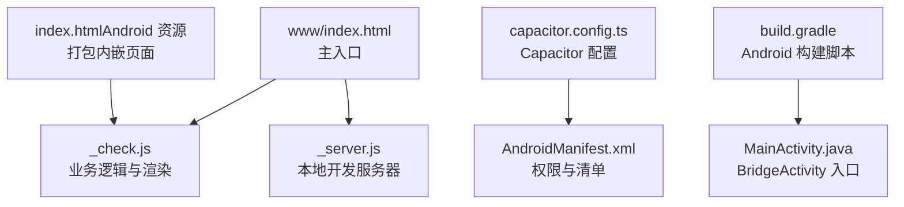
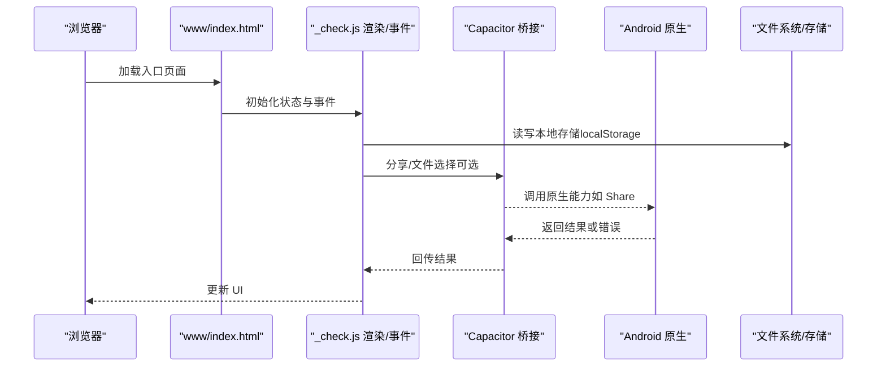
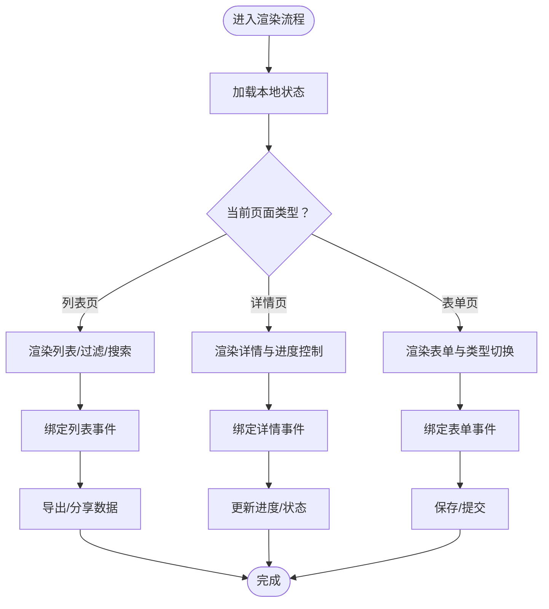
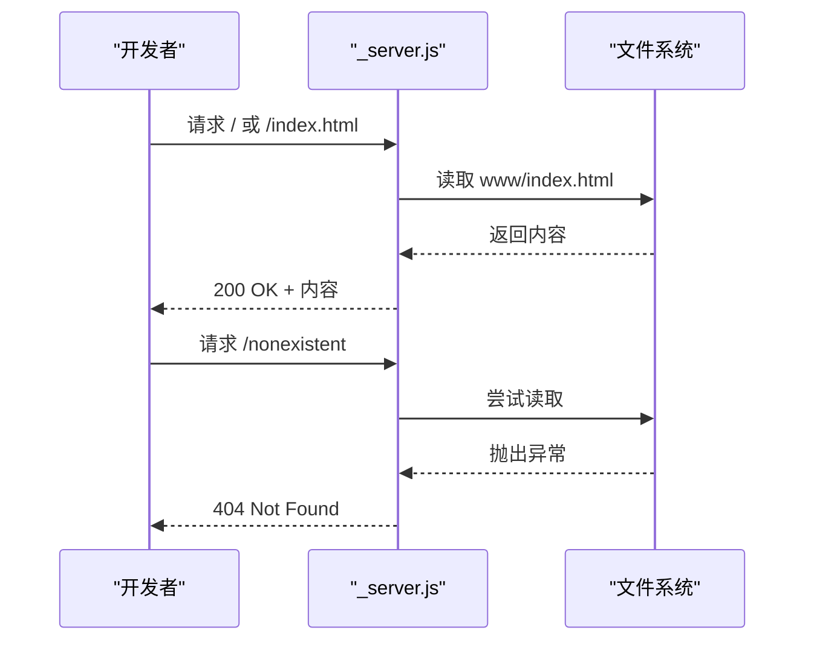
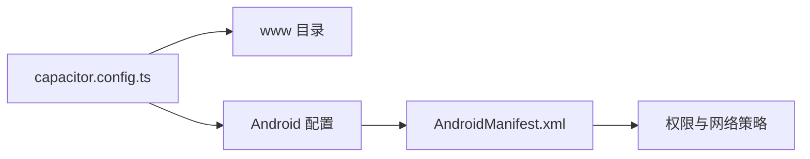
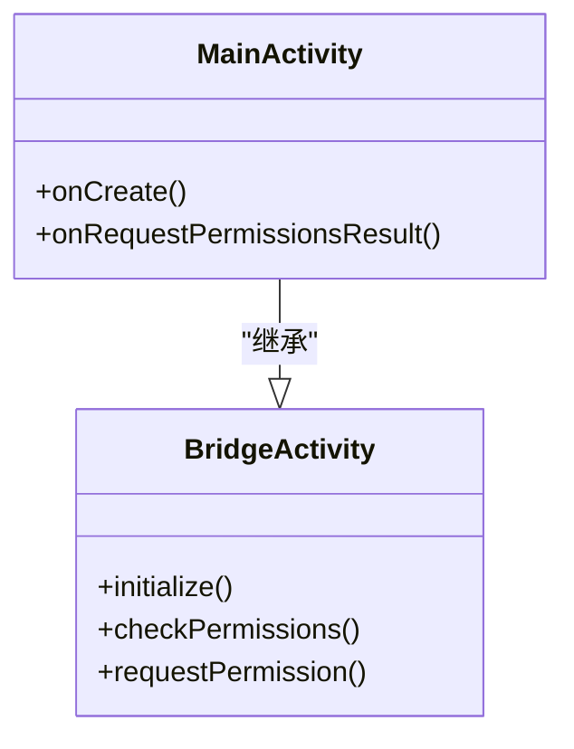
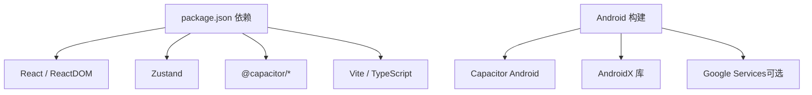

# 故障排除

<cite>
**本文引用的文件**   
- [package.json](file://package.json)
- [capacitor.config.ts](file://capacitor.config.ts)
- [AndroidManifest.xml](file://android/app/src/main/AndroidManifest.xml)
- [build.gradle](file://android/app/build.gradle)
- [MainActivity.java](file://android/app/src/main/java/com/animetracker/app/MainActivity.java)
- [_check.js](file://_check.js)
- [_server.js](file://_server.js)
- [index.html（Android 资源）](file://android/app/src/main/assets/public/index.html)
- [index.html（www）](file://www/index.html)
</cite>

## 目录
1. [简介](#简介)
2. [项目结构](#项目结构)
3. [核心组件](#核心组件)
4. [架构总览](#架构总览)
5. [详细组件分析](#详细组件分析)
6. [依赖关系分析](#依赖关系分析)
7. [性能考虑](#性能考虑)
8. [故障排除指南](#故障排除指南)
9. [结论](#结论)
10. [附录](#附录)

## 简介
本指南面向 Anime Tracker 的开发者与维护者，系统化地梳理开发环境、构建流程、运行时错误、平台特定问题以及性能与安全相关故障，并提供可复现的诊断步骤、根因分析与修复建议。内容覆盖前端 Web 应用、Capacitor 混合桥接层、Android 原生集成与本地静态服务器等模块。

## 项目结构
项目采用 Capacitor 混合应用架构：Web 前端位于 www 目录，通过 Capacitor 打包为原生应用；同时提供 Android 工程与 Gradle 构建脚本；另有用于本地开发的简易静态服务器脚本。

**图示来源**
- [index.html（www）](file://www/index.html)
- [_check.js](file://_check.js)
- [_server.js](file://_server.js)
- [capacitor.config.ts](file://capacitor.config.ts)
- [AndroidManifest.xml](file://android/app/src/main/AndroidManifest.xml)
- [build.gradle](file://android/app/build.gradle)
- [MainActivity.java](file://android/app/src/main/java/com/animetracker/app/MainActivity.java)
- [index.html（Android 资源）](file://android/app/src/main/assets/public/index.html)

**章节来源**
- [package.json](file://package.json)
- [capacitor.config.ts](file://capacitor.config.ts)
- [AndroidManifest.xml](file://android/app/src/main/AndroidManifest.xml)
- [build.gradle](file://android/app/build.gradle)
- [MainActivity.java](file://android/app/src/main/java/com/animetracker/app/MainActivity.java)
- [index.html（www）](file://www/index.html)
- [_check.js](file://_check.js)
- [_server.js](file://_server.js)
- [index.html（Android 资源）](file://android/app/src/main/assets/public/index.html)

## 核心组件
- Web 应用入口与渲染：www/index.html 引入多个 JS 模块，负责状态管理、事件绑定、UI 渲染与数据持久化。
- 本地开发服务器：_server.js 提供静态资源服务，便于本地预览与调试。
- Capacitor 配置：capacitor.config.ts 定义应用 ID、应用名、Web 目录、服务器参数与插件配置。
- Android 清单与构建：AndroidManifest.xml 声明权限与网络策略；build.gradle 管理依赖与插件；MainActivity.java 继承 BridgeActivity 作为原生入口。

**章节来源**
- [index.html（www）](file://www/index.html)
- [_check.js](file://_check.js)
- [_server.js](file://_server.js)
- [capacitor.config.ts](file://capacitor.config.ts)
- [AndroidManifest.xml](file://android/app/src/main/AndroidManifest.xml)
- [build.gradle](file://android/app/build.gradle)
- [MainActivity.java](file://android/app/src/main/java/com/animetracker/app/MainActivity.java)

## 架构总览
下图展示从浏览器到原生桥接的整体调用链路与关键交互点。

**图示来源**
- [index.html（www）](file://www/index.html)
- [_check.js](file://_check.js)
- [capacitor.config.ts](file://capacitor.config.ts)
- [AndroidManifest.xml](file://android/app/src/main/AndroidManifest.xml)

## 详细组件分析

### Web 应用与渲染引擎（_check.js）
- 数据模型与状态：以本地存储为唯一数据源，提供增删改查、过滤、排序与分组渲染。
- 事件绑定：列表页、详情页、表单页的交互事件均在此注册与处理。
- 导出/分享：优先使用现代浏览器文件接口，回退至 Capacitor Share 或 Web Share API。

**图示来源**
- [_check.js](file://_check.js)

**章节来源**
- [_check.js](file://_check.js)

### 本地开发服务器（_server.js）
- 功能：监听固定端口，根据扩展名设置 Content-Type，读取 www 目录下的静态资源。
- 场景：Vite 开发模式之外的快速预览与测试。

**图示来源**
- [_server.js](file://_server.js)

**章节来源**
- [_server.js](file://_server.js)

### Capacitor 配置与原生桥接
- 应用标识与目录：webDir 指向 www，确保构建产物正确打包。
- 服务器参数：androidScheme 控制 Android 端协议；允许混合内容以兼容本地资源。
- Android 权限与网络：声明 INTERNET、存储读写权限；允许明文流量以简化开发阶段访问。

**图示来源**
- [capacitor.config.ts](file://capacitor.config.ts)
- [AndroidManifest.xml](file://android/app/src/main/AndroidManifest.xml)

**章节来源**
- [capacitor.config.ts](file://capacitor.config.ts)
- [AndroidManifest.xml](file://android/app/src/main/AndroidManifest.xml)

### Android 构建与入口
- 构建脚本：定义 compile/target/min SDK、混淆规则与仓库路径；尝试应用 Google Services 插件（若存在）。
- 入口 Activity：继承 BridgeActivity，承载 Capacitor WebView 与原生能力。

**图示来源**
- [MainActivity.java](file://android/app/src/main/java/com/animetracker/app/MainActivity.java)
- [build.gradle](file://android/app/build.gradle)

**章节来源**
- [build.gradle](file://android/app/build.gradle)
- [MainActivity.java](file://android/app/src/main/java/com/animetracker/app/MainActivity.java)

## 依赖关系分析
- 前端依赖：React、Zustand（状态管理）、Capacitor 生态（@capacitor/*）。
- 构建工具：Vite、React 插件、TypeScript。
- Android 依赖：Capacitor Android、AndroidX 支持库、可选 Google Services 插件。

**图示来源**
- [package.json](file://package.json)
- [build.gradle](file://android/app/build.gradle)

**章节来源**
- [package.json](file://package.json)
- [build.gradle](file://android/app/build.gradle)

## 性能考虑
- 渲染优化：列表按年季分组与折叠，减少 DOM 数量；滚动条与模糊背景使用 CSS 实现，避免重排。
- 事件绑定：仅在页面切换时绑定必要事件，避免重复绑定导致的内存占用。
- 存储策略：使用本地存储进行数据持久化，注意容量限制与序列化开销。
- 网络与分享：导出/分享优先使用现代 API，回退分支需最小化额外依赖。

[本节为通用指导，不直接分析具体文件]

## 故障排除指南

### 一、开发环境问题

- 症状：npm/yarn 安装依赖失败或版本冲突
  - 排查要点：检查 Node 版本与 npm/yarn 缓存；清理 node_modules 与 lock 文件后重装
  - 修复建议：使用官方推荐 Node LTS；执行依赖清理与重新安装
  - 参考文件：[package.json](file://package.json)

- 症状：Vite 开发服务器无法启动或端口被占用
  - 排查要点：确认端口占用情况；检查 scripts 中 dev 命令
  - 修复建议：更换端口或释放占用进程
  - 参考文件：[package.json](file://package.json)

- 症状：本地静态服务器无法访问资源
  - 排查要点：确认 _server.js 监听端口与 www 目录路径；检查 MIME 映射
  - 修复建议：修正端口与路径；确保资源存在
  - 参考文件：[_server.js](file://_server.js)

**章节来源**
- [package.json](file://package.json)
- [_server.js](file://_server.js)

### 二、构建失败

- 症状：Android 构建报错（找不到类/资源）
  - 排查要点：检查 compileSdk/targetSdk/minSdk 配置；确认仓库路径与依赖是否存在
  - 修复建议：统一 SDK 版本；同步 Gradle 与 Android Studio SDK
  - 参考文件：[build.gradle](file://android/app/build.gradle)

- 症状：Capacitor 同步失败
  - 排查要点：确认 Capacitor CLI 版本与项目配置一致；检查 webDir 是否指向 www
  - 修复建议：执行 npx cap sync；核对 capacitor.config.ts
  - 参考文件：[capacitor.config.ts](file://capacitor.config.ts)

- 症状：Google Services 插件应用失败
  - 排查要点：确认 google-services.json 是否存在；Gradle 插件是否可选应用
  - 修复建议：移除可选插件或添加配置文件
  - 参考文件：[build.gradle](file://android/app/build.gradle)

**章节来源**
- [build.gradle](file://android/app/build.gradle)
- [capacitor.config.ts](file://capacitor.config.ts)

### 三、运行时错误

- 症状：页面空白或白屏
  - 排查要点：检查 www/index.html 是否正确引入 JS 模块；查看浏览器控制台错误
  - 修复建议：确认模块加载顺序与路径；修复语法或依赖缺失
  - 参考文件：[index.html（www）](file://www/index.html)

- 症状：导出/分享功能不可用
  - 排查要点：检查现代文件接口与 Capacitor Share/Web Share 的可用性
  - 修复建议：降级到可用方案；确保权限与协议配置正确
  - 参考文件：[_check.js](file://_check.js)

- 症状：列表渲染异常或事件无响应
  - 排查要点：确认渲染函数与事件绑定在页面切换时正确执行
  - 修复建议：检查渲染分支与事件绑定逻辑
  - 参考文件：[_check.js](file://_check.js)

**章节来源**
- [index.html（www）](file://www/index.html)
- [_check.js](file://_check.js)

### 四、平台特定问题

- Android 权限与网络
  - 症状：无法访问外部存储或明文网络
  - 排查要点：检查 AndroidManifest.xml 中权限与网络策略
  - 修复建议：按需保留权限；谨慎开启明文流量
  - 参考文件：[AndroidManifest.xml](file://android/app/src/main/AndroidManifest.xml)

- Android 构建入口
  - 症状：应用启动黑屏或崩溃
  - 排查要点：确认 MainActivity 继承 BridgeActivity；检查 Gradle 配置
  - 修复建议：保持默认入口；确保 Capacitor WebView 正常初始化
  - 参考文件：[MainActivity.java](file://android/app/src/main/java/com/animetracker/app/MainActivity.java)

**章节来源**
- [AndroidManifest.xml](file://android/app/src/main/AndroidManifest.xml)
- [MainActivity.java](file://android/app/src/main/java/com/animetracker/app/MainActivity.java)

### 五、日志分析与调试工具

- 浏览器控制台
  - 使用场景：捕获脚本报错、网络请求异常、事件绑定失败
  - 关注点：错误堆栈、资源加载失败、跨域与权限提示

- Capacitor 日志
  - 使用场景：原生桥接调用失败、插件未生效
  - 关注点：Capacitor 日志输出、插件初始化状态

- Android Logcat
  - 使用场景：原生崩溃、WebView 初始化问题
  - 关注点：应用进程日志、异常栈、权限拒绝

**章节来源**
- [_check.js](file://_check.js)
- [AndroidManifest.xml](file://android/app/src/main/AndroidManifest.xml)

### 六、性能问题排查

- 列表卡顿
  - 排查要点：分组与折叠逻辑复杂度；DOM 操作频率
  - 修复建议：减少重排重绘；延迟渲染非可见区域

- 事件绑定过多
  - 排查要点：页面切换时是否重复绑定
  - 修复建议：在切换前解绑旧事件；统一事件管理

- 存储写入频繁
  - 排查要点：批量更新与去抖策略
  - 修复建议：合并更新；降低序列化频率

**章节来源**
- [_check.js](file://_check.js)

### 七、内存泄漏检测

- 常见原因
  - 未解绑的事件监听器
  - 闭包持有大对象引用
  - 定时器未清理

- 检测方法
  - 使用浏览器内存快照对比；观察对象生命周期
  - 审核事件绑定与解绑逻辑

**章节来源**
- [_check.js](file://_check.js)

### 八、网络请求异常处理

- 症状：导出/分享失败或超时
  - 排查要点：现代接口支持情况；回退分支可用性
  - 修复建议：增加超时与重试；提供用户反馈

**章节来源**
- [_check.js](file://_check.js)

## 结论
本指南围绕 Anime Tracker 的混合架构，提供了从开发环境、构建、运行到平台适配与性能优化的系统化故障排除方法。建议在日常维护中结合日志与调试工具，建立标准化的诊断流程与修复闭环。

## 附录

### 常用命令速查
- 启动开发服务器：参考 scripts 中 dev 命令
- 构建与预览：参考 scripts 中 build/preview
- Capacitor 操作：add/android/sync/open:android

**章节来源**
- [package.json](file://package.json)