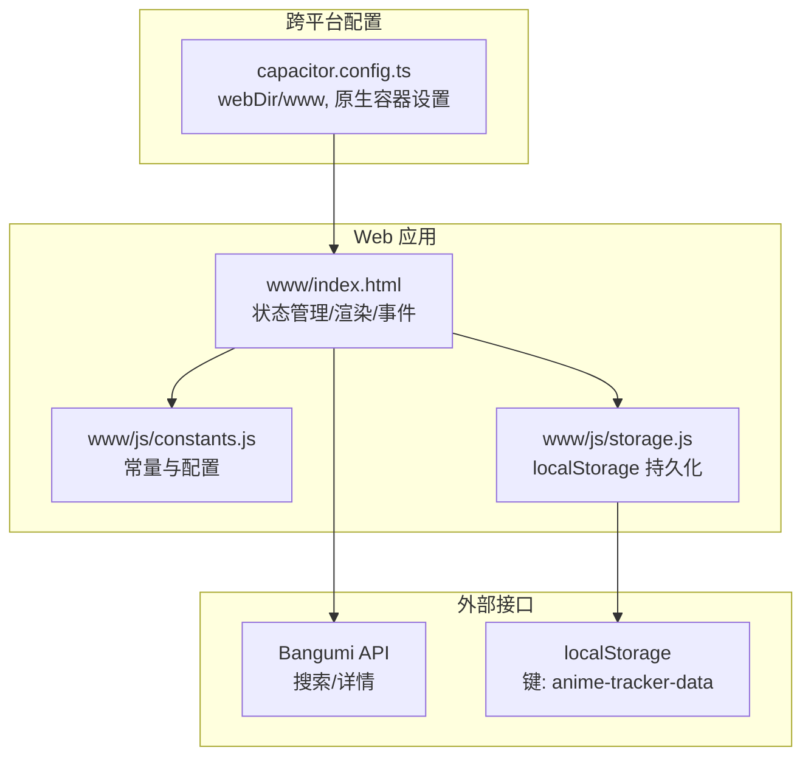
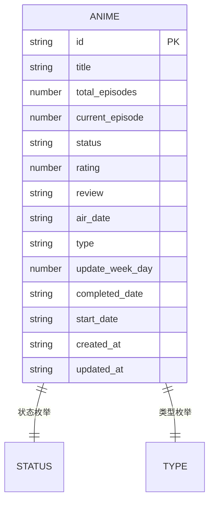
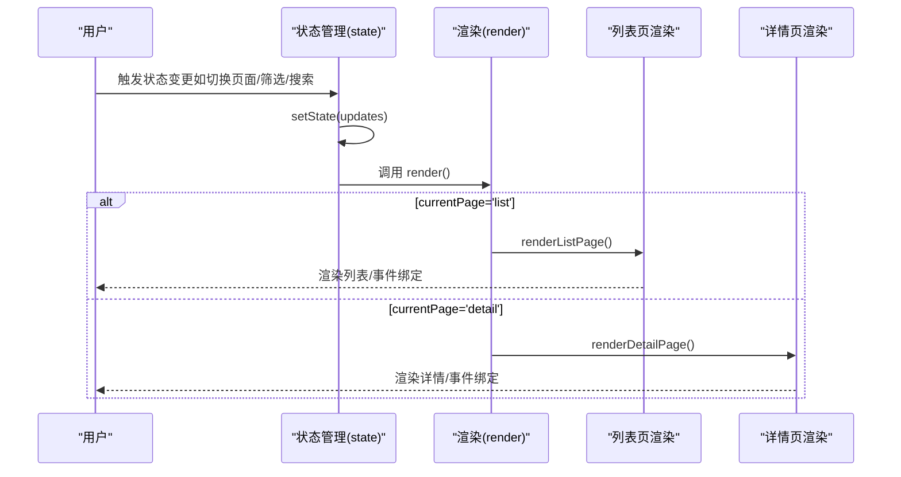
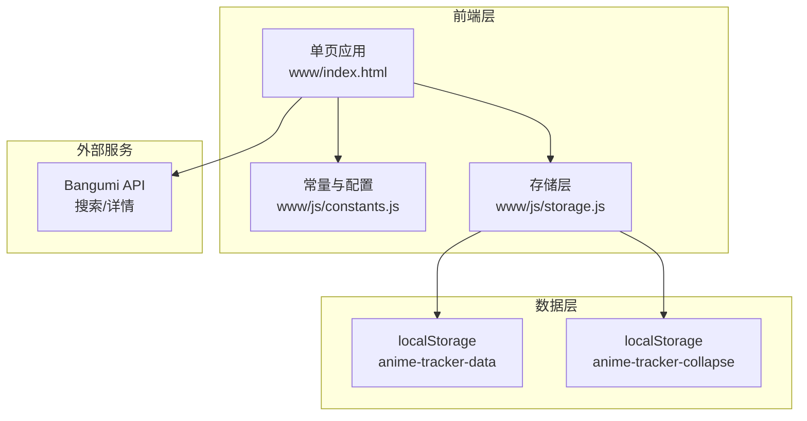
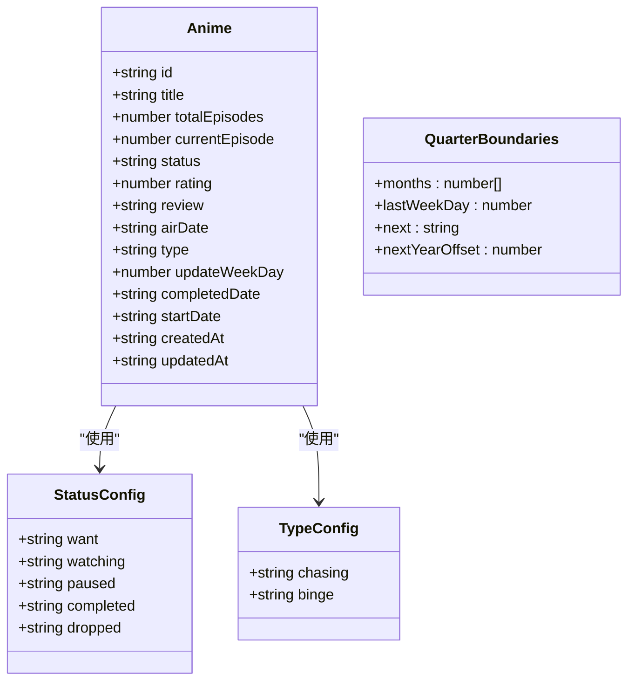
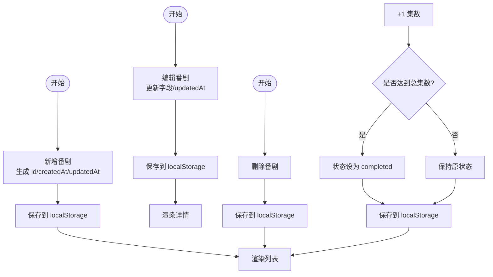
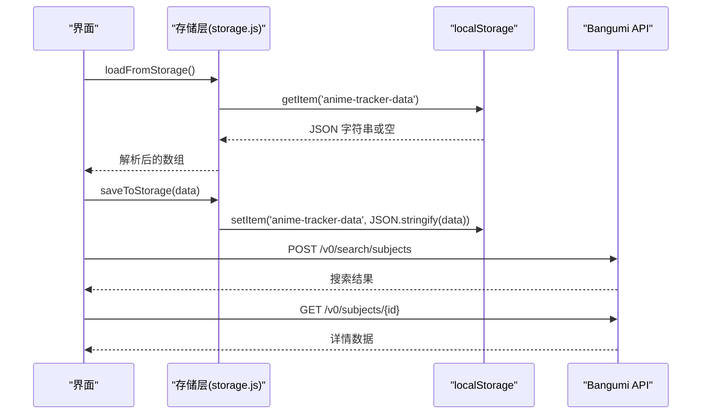
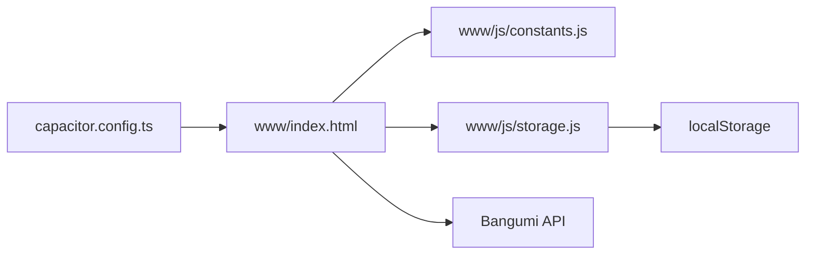

# 数据模型设计

<cite>
**本文档引用的文件**
- [package.json](file://package.json)
- [capacitor.config.ts](file://capacitor.config.ts)
- [_check.js](file://_check.js)
- [www/index.html](file://www/index.html)
- [www/js/constants.js](file://www/js/constants.js)
- [www/js/storage.js](file://www/js/storage.js)
- [项目解读分析与改进建议.md](file://项目解读分析与改进建议.md)
</cite>

## 目录
1. [引言](#引言)
2. [项目结构](#项目结构)
3. [核心组件](#核心组件)
4. [架构概览](#架构概览)
5. [详细组件分析](#详细组件分析)
6. [依赖分析](#依赖分析)
7. [性能考虑](#性能考虑)
8. [故障排除指南](#故障排除指南)
9. [结论](#结论)
10. [附录](#附录)

## 引言
本文件针对 Anime Tracker 项目的数据模型进行系统化设计文档整理，重点涵盖番剧实体的数据结构、状态管理模型、存储与持久化策略、数据访问模式、缓存策略与性能优化、数据生命周期管理与版本控制迁移策略。文档旨在帮助开发者与产品人员理解现有实现并指导后续演进。

## 项目结构
Anime Tracker 采用 Capacitor 跨平台架构，核心应用位于单文件 HTML 中，配合常量与存储模块实现数据模型与持久化。主要结构如下：
- 应用入口与核心逻辑：www/index.html（包含状态管理、渲染、事件绑定、Bangumi API 集成）
- 常量与配置：www/js/constants.js（状态配置、季度边界、类型配置等）
- 持久化层：www/js/storage.js（localStorage 读写、折叠状态持久化）
- 旧版同构逻辑：_check.js（备份/参考）
- 跨平台配置：capacitor.config.ts（Web 目录、原生容器配置）

**图表来源**
- [www/index.html](file://www/index.html)
- [www/js/constants.js](file://www/js/constants.js)
- [www/js/storage.js](file://www/js/storage.js)
- [capacitor.config.ts](file://capacitor.config.ts)

**章节来源**
- [package.json](file://package.json)
- [capacitor.config.ts](file://capacitor.config.ts)
- [www/index.html](file://www/index.html)
- [www/js/constants.js](file://www/js/constants.js)
- [www/js/storage.js](file://www/js/storage.js)
- [_check.js](file://_check.js)

## 核心组件
本节聚焦番剧实体数据模型与状态管理模型，明确字段定义、数据类型、验证规则与业务约束。

### 番剧实体数据模型
番剧实体用于描述单部动漫的观看进度与状态，字段定义如下：

- id: 字符串，唯一标识（基于时间戳与随机字符串拼接）
- title: 字符串，番剧名称
- totalEpisodes: 数字，总集数（≥1）
- currentEpisode: 数字，已看集数（0 ≤ currentEpisode ≤ totalEpisodes）
- status: 字符串，观看状态，取值限定为：
  - want（想看）
  - watching（在看）
  - paused（搁置）
  - completed（已看完）
  - dropped（放弃）
- rating: 数字，评分（0-5，半星/整星由 UI 控制）
- review: 字符串，观后感
- airDate: 字符串，放送日期（YYYY-MM-DD）
- type: 字符串，类型，取值限定为：
  - chasing（追番）
  - binge（补番）
- updateWeekDay: 数字，更新日（1=周一 ... 7=周日），仅在 chasing 类型下有意义
- completedDate: 字符串，看完日期（YYYY-MM-DD），仅在 binge 类型下有意义
- startDate: 字符串，开始观看日期（YYYY-MM-DD），仅在 binge 类型下有意义
- createdAt: 字符串，ISO 时间戳，创建时间
- updatedAt: 字符串，ISO 时间戳，最后更新时间

字段验证与业务约束：
- 集数约束：totalEpisodes ≥ 1；currentEpisode ∈ [0, totalEpisodes]
- 状态流转：当 currentEpisode 达到 totalEpisodes 且状态非 dropped 时，自动设为 completed；当 currentEpisode 从 0 变为 >0 且状态为 want 时，自动设为 watching
- 类型差异：chasing 侧重“周更”追踪（airDate + updateWeekDay），binge 侧重“补番”记录（startDate + completedDate）
- 时间字段：airDate、startDate、completedDate 采用 ISO 字符串格式，便于排序与展示
- 评分：0-5 整数或半整数，UI 层以星级渲染

**图表来源**
- [www/index.html](file://www/index.html)
- [www/js/constants.js](file://www/js/constants.js)

**章节来源**
- [www/index.html](file://www/index.html)
- [www/js/constants.js](file://www/js/constants.js)
- [项目解读分析与改进建议.md](file://项目解读分析与改进建议.md)

### 状态管理模型
应用通过全局状态对象管理番剧列表与页面状态，核心字段：
- state.animeList: 番剧实体数组
- state.filter: 当前筛选状态（all 或具体 status 值）
- state.searchQuery: 搜索关键字
- state.currentPage: 当前页面状态（list/detail/add/edit）
- state.currentAnime: 当前选中的番剧实体

状态变更流程：
- setState(updates) 更新全局状态并触发渲染
- 渲染根据 currentPage 调用对应渲染函数
- 事件绑定在渲染后附加，处理用户交互（筛选、搜索、进度变更、状态切换）

**图表来源**
- [www/index.html](file://www/index.html)

**章节来源**
- [www/index.html](file://www/index.html)

## 架构概览
数据模型与状态管理的整体架构围绕“单页应用 + 本地存储”的设计展开，Bangumi API 作为外部数据源辅助录入与填充。

**图表来源**
- [www/index.html](file://www/index.html)
- [www/js/constants.js](file://www/js/constants.js)
- [www/js/storage.js](file://www/js/storage.js)

**章节来源**
- [www/index.html](file://www/index.html)
- [www/js/storage.js](file://www/js/storage.js)

## 详细组件分析

### 数据模型类图
展示番剧实体与其相关配置的关系。

**图表来源**
- [www/index.html](file://www/index.html)
- [www/js/constants.js](file://www/js/constants.js)

**章节来源**
- [www/index.html](file://www/index.html)
- [www/js/constants.js](file://www/js/constants.js)

### 数据流程图（CRUD 与状态流转）
展示番剧实体的创建、更新、删除与状态自动流转过程。

**图表来源**
- [www/index.html](file://www/index.html)

**章节来源**
- [www/index.html](file://www/index.html)

### 数据访问模式
- 读取：loadFromStorage() 从 localStorage 读取 animeList
- 写入：saveToStorage() 将 animeList 写回 localStorage
- 折叠状态：loadCollapsed()/saveCollapsed() 持久化年/季折叠状态
- Bangumi API：通过 fetch 调用搜索与详情接口，自动填充表单

**图表来源**
- [www/js/storage.js](file://www/js/storage.js)
- [www/index.html](file://www/index.html)

**章节来源**
- [www/js/storage.js](file://www/js/storage.js)
- [www/index.html](file://www/index.html)

### 缓存策略与性能优化
- 本地缓存：localStorage 作为主存储，键名固定，容量约 5MB
- 折叠状态缓存：折叠/展开状态单独持久化，提升渲染性能
- Bangumi API：搜索结果可复用，建议引入 IndexedDB 缓存（见改进建议）
- 渲染优化：列表按年/季分组与折叠，减少 DOM 数量；季度边界算法优化分组排序
- 事件绑定：按需绑定，避免重复绑定导致的性能问题

**章节来源**
- [www/js/storage.js](file://www/js/storage.js)
- [www/index.html](file://www/index.html)
- [项目解读分析与改进建议.md](file://项目解读分析与改进建议.md)

## 依赖分析
- 依赖关系：www/index.html 依赖 www/js/constants.js（常量）与 www/js/storage.js（存储）
- 外部依赖：localStorage、Fetch API、Bangumi API
- 跨平台：Capacitor 配置指向 www 目录，Android/iOS 通过 WebView 加载

**图表来源**
- [www/index.html](file://www/index.html)
- [www/js/constants.js](file://www/js/constants.js)
- [www/js/storage.js](file://www/js/storage.js)
- [capacitor.config.ts](file://capacitor.config.ts)

**章节来源**
- [www/index.html](file://www/index.html)
- [www/js/constants.js](file://www/js/constants.js)
- [www/js/storage.js](file://www/js/storage.js)
- [capacitor.config.ts](file://capacitor.config.ts)

## 性能考虑
- 存储层：localStorage 同步 API，主线程阻塞，建议迁移到 IndexedDB（异步、更大容量）
- 渲染层：列表分组与折叠减少 DOM；季度边界算法复杂度 O(n)，适合中小规模数据
- 网络层：Bangumi API 无重试与缓存，建议引入指数退避与本地缓存
- 内存层：大列表建议虚拟滚动（见改进建议），减少内存占用与重绘

[本节为通用性能讨论，不直接分析具体文件]

## 故障排除指南
常见问题与排查要点：
- localStorage 写入失败：检查容量上限（约 5MB）、异常捕获与降级策略
- 数据解析异常：JSON.parse 失败时返回空数组，确认数据格式与完整性
- 状态不同步：确保 setState 后调用 render，事件绑定在渲染后执行
- Bangumi API 失败：检查网络连通性、接口可用性与错误提示

**章节来源**
- [www/js/storage.js](file://www/js/storage.js)
- [www/index.html](file://www/index.html)

## 结论
Anime Tracker 的数据模型以 localStorage 为核心，结合 Bangumi API 实现高效的数据录入与展示。番剧实体字段清晰、状态流转合理，配合折叠与分组渲染提升了用户体验。建议后续在存储层引入 IndexedDB、在网络层增加缓存与重试、在渲染层引入虚拟滚动，并考虑云同步与版本迁移策略，以支撑更大规模与更高可靠性的使用场景。

[本节为总结性内容，不直接分析具体文件]

## 附录

### 示例数据
以下为典型番剧实体示例（字段与类型与数据模型一致）：
- 追番示例：type=chasing，包含 airDate、updateWeekDay、currentEpisode、totalEpisodes、status 等
- 补番示例：type=binge，包含 startDate、completedDate、currentEpisode、totalEpisodes、status 等

**章节来源**
- [www/index.html](file://www/index.html)
- [项目解读分析与改进建议.md](file://项目解读分析与改进建议.md)