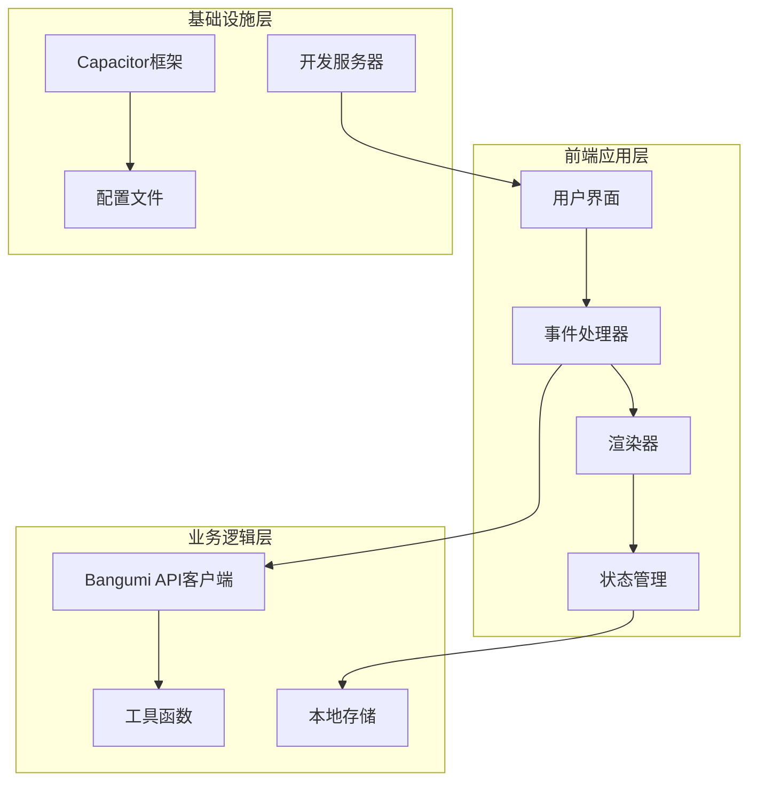
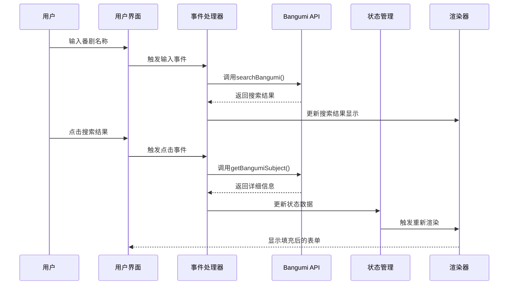
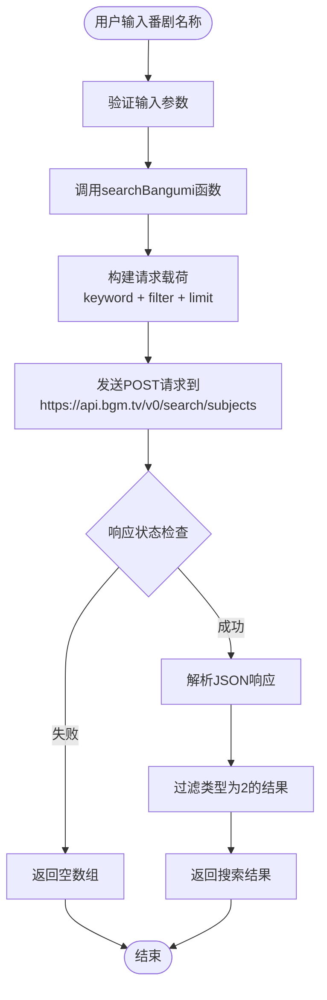
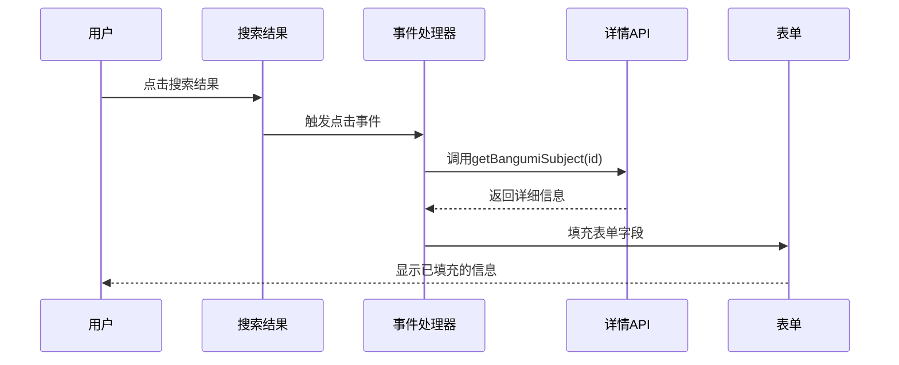
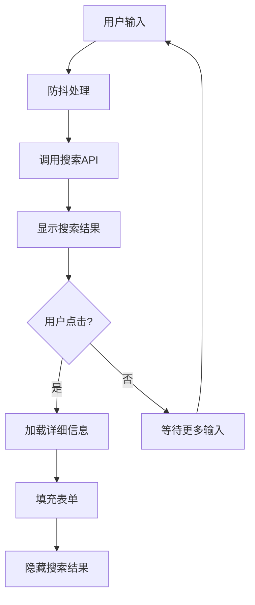
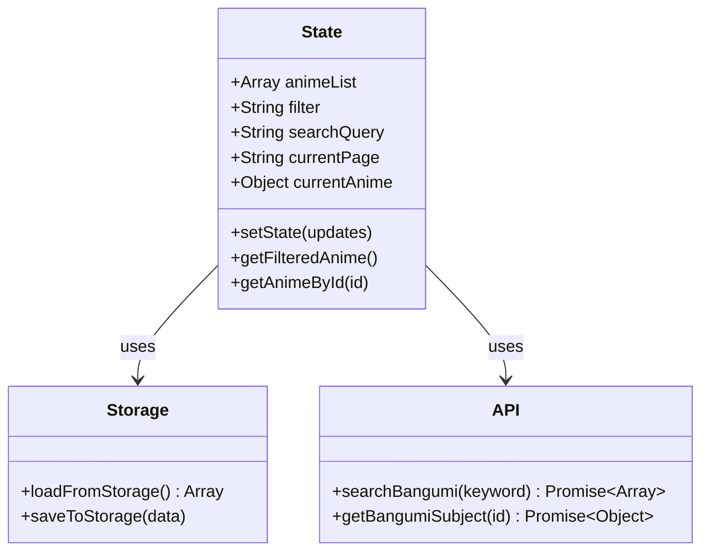
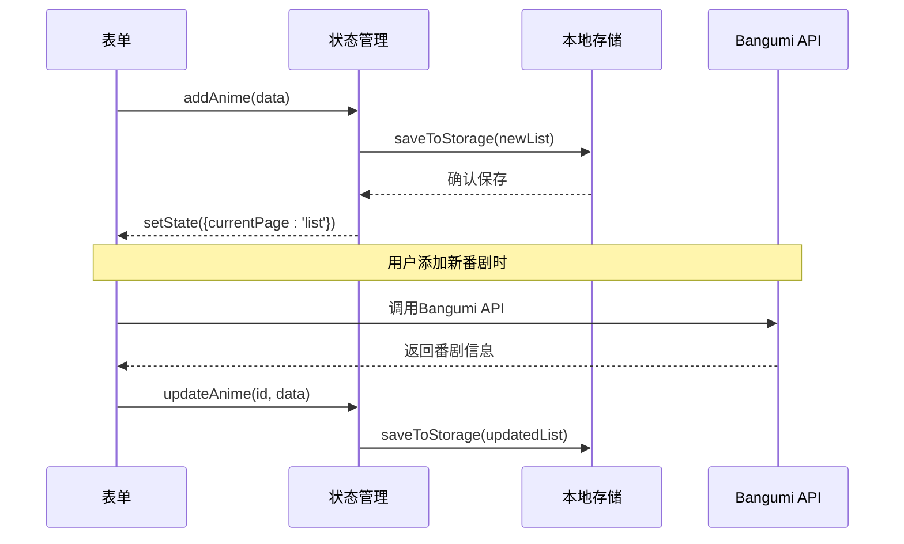
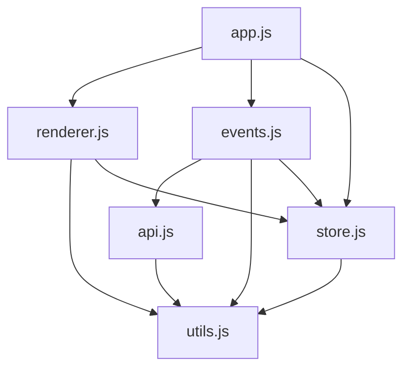

# Bangumi API集成

<cite>
**本文档引用的文件**
- [capacitor.config.ts](file://capacitor.config.ts)
- [package.json](file://package.json)
- [_server.js](file://_server.js)
- [www/index.html](file://www/index.html)
- [www/js/api.js](file://www/js/api.js)
- [www/js/events.js](file://www/js/events.js)
- [www/js/renderer.js](file://www/js/renderer.js)
- [www/js/store.js](file://www/js/store.js)
- [www/js/utils.js](file://www/js/utils.js)
- [www/js/app.js](file://www/js/app.js)
</cite>

## 目录
1. [简介](#简介)
2. [项目结构](#项目结构)
3. [核心组件](#核心组件)
4. [架构概览](#架构概览)
5. [详细组件分析](#详细组件分析)
6. [依赖关系分析](#依赖关系分析)
7. [性能考虑](#性能考虑)
8. [故障排除指南](#故障排除指南)
9. [结论](#结论)

## 简介

本项目是一个基于Web技术栈的番剧追踪应用，集成了Bangumi（即条目数据库）API来实现番剧信息的自动搜索和填充功能。该应用采用React和Capacitor框架构建，支持Web端和移动端部署。

Bangumi API集成为应用提供了强大的番剧数据支持，包括番剧搜索、详情获取等功能。通过API集成，用户可以快速添加新的番剧记录，并自动填充相关信息，大大提升了用户体验。

## 项目结构

项目采用模块化设计，主要分为以下几个层次：



**图表来源**
- [www/index.html:64-72](file://www/index.html#L64-L72)
- [www/js/app.js:1-38](file://www/js/app.js#L1-L38)

**章节来源**
- [capacitor.config.ts:1-22](file://capacitor.config.ts#L1-L22)
- [package.json:1-38](file://package.json#L1-L38)
- [www/index.html:1-75](file://www/index.html#L1-L75)

## 核心组件

### Bangumi API客户端

应用的核心是Bangumi API客户端，负责与Bangumi服务进行通信。主要包含两个核心方法：

1. **searchBangumi(keyword)**: 搜索番剧条目
2. **getBangumiSubject(id)**: 获取番剧详细信息

### 事件处理器

事件处理器负责处理用户交互，包括：
- 搜索框输入事件
- 结果项点击事件
- 表单提交事件
- 页面导航事件

### 渲染器

渲染器负责将数据转换为用户界面，包括：
- 列表页面渲染
- 详情页面渲染
- 表单页面渲染
- 搜索结果渲染

**章节来源**
- [www/js/api.js:1-31](file://www/js/api.js#L1-L31)
- [www/js/events.js:1-783](file://www/js/events.js#L1-L783)
- [www/js/renderer.js:1-630](file://www/js/renderer.js#L1-L630)

## 架构概览

应用采用MVVM架构模式，通过事件驱动的方式实现数据流：



**图表来源**
- [www/js/events.js:675-782](file://www/js/events.js#L675-L782)
- [www/js/api.js:10-30](file://www/js/api.js#L10-L30)

## 详细组件分析

### API搜索接口实现

#### 搜索接口调用机制

搜索功能通过`searchBangumi`函数实现，该函数使用Fetch API向Bangumi服务发送POST请求：



**图表来源**
- [www/js/api.js:10-19](file://www/js/api.js#L10-L19)

#### 请求参数详解

搜索请求包含以下关键参数：
- **keyword**: 搜索关键词（必填）
- **filter**: 过滤条件，设置`{ type: [2] }`确保只返回动漫类型
- **limit**: 限制返回结果数量为8个

#### 响应数据处理

API返回的数据结构包含多个字段，应用主要使用以下字段：
- **id**: Bangumi条目ID
- **name**: 原始名称
- **name_cn**: 中文名称
- **date**: 放送日期
- **type**: 条目类型

**章节来源**
- [www/js/api.js:10-19](file://www/js/api.js#L10-L19)

### 番剧信息自动填充功能

#### 自动填充实现原理

当用户点击搜索结果时，系统会调用`getBangumiSubject`函数获取详细信息，并自动填充到表单中：



**图表来源**
- [www/js/events.js:720-757](file://www/js/events.js#L720-L757)

#### 数据映射和字段对应

自动填充过程中，系统将Bangumi API返回的数据映射到应用内部的数据结构：

| Bangumi字段 | 应用字段 | 处理方式 |
|------------|----------|----------|
| name_cn | title | 使用中文名称，若不存在则使用原始名称 |
| total_episodes | totalEpisodes | 设置为默认值12（可编辑） |
| date | airDate | 根据类型设置不同字段 |
| date | startDate | 补番类型的开始观看日期 |
| date | completedDate | 完成观看日期 |

#### 错误处理机制

系统实现了多层次的错误处理：

1. **网络请求错误**: 捕获API调用异常
2. **数据解析错误**: 处理JSON解析失败
3. **用户交互错误**: 处理用户取消操作
4. **数据验证错误**: 验证必填字段

**章节来源**
- [www/js/events.js:720-757](file://www/js/events.js#L720-L757)

### 搜索结果展示和用户选择

#### 搜索结果展示

搜索结果以卡片形式展示，包含以下信息：
- **番剧名称**: 显示原始名称，若有中文名称则显示中文名称
- **更新日期**: 显示放送日期
- **点击选择**: 用户点击后自动填充表单

#### 用户选择流程



**图表来源**
- [www/js/events.js:682-782](file://www/js/events.js#L682-L782)

**章节来源**
- [www/js/events.js:682-782](file://www/js/events.js#L682-L782)

### 数据同步和状态管理

#### 状态管理架构

应用使用简单的状态管理模式，所有数据都存储在内存中并通过localStorage持久化：



**图表来源**
- [www/js/store.js:5-71](file://www/js/store.js#L5-L71)
- [www/js/api.js:10-30](file://www/js/api.js#L10-L30)

#### 数据同步流程



**图表来源**
- [www/js/store.js:38-71](file://www/js/store.js#L38-L71)
- [www/js/events.js:609-673](file://www/js/events.js#L609-L673)

**章节来源**
- [www/js/store.js:1-71](file://www/js/store.js#L1-L71)
- [www/js/renderer.js:1-630](file://www/js/renderer.js#L1-L630)

## 依赖关系分析

### 外部依赖

项目的主要外部依赖包括：

```mermaid
graph LR
subgraph "核心框架"
React[React 18.2.0]
Capacitor[Capacitor 6.0.0]
end
subgraph "UI组件"
Zustand[Zustand 4.5.0]
end
subgraph "开发工具"
Vite[Vite]
TypeScript[TypeScript]
ReactPlugin[@vitejs/plugin-react]
end
subgraph "平台支持"
Android[@capacitor/android]
IOS[@capacitor/ios]
Share[@capacitor/share]
end
React --> Zustand
Capacitor --> Android
Capacitor --> IOS
Capacitor --> Share
```

**图表来源**
- [package.json:18-36](file://package.json#L18-L36)

### 内部模块依赖

应用内部模块之间的依赖关系如下：



**图表来源**
- [www/index.html:64-72](file://www/index.html#L64-L72)

**章节来源**
- [package.json:18-36](file://package.json#L18-L36)
- [www/index.html:64-72](file://www/index.html#L64-L72)

## 性能考虑

### API调用优化

1. **防抖处理**: 搜索输入采用500ms防抖，避免频繁API调用
2. **结果缓存**: 最近一次搜索关键词会被缓存，避免重复请求
3. **请求限制**: 单次搜索限制8个结果，减少数据传输量

### 内存管理

1. **状态管理**: 使用简单对象存储状态，避免深层嵌套
2. **DOM操作**: 通过统一渲染器管理DOM更新，减少不必要的重绘
3. **事件绑定**: 事件处理器在页面切换时自动解绑，防止内存泄漏

### 网络优化

1. **HTTP缓存**: 利用浏览器缓存机制
2. **连接复用**: 复用HTTP连接，减少握手开销
3. **错误重试**: 实现基本的错误处理和重试机制

## 故障排除指南

### 常见问题及解决方案

#### API调用失败

**问题症状**: 搜索结果为空或显示"搜索失败"

**可能原因**:
1. 网络连接问题
2. Bangumi API服务不可用
3. 请求参数格式错误

**解决步骤**:
1. 检查网络连接状态
2. 验证API端点可用性
3. 查看浏览器开发者工具中的网络请求

#### 数据填充失败

**问题症状**: 点击搜索结果后无法自动填充表单

**可能原因**:
1. API响应格式变化
2. 字段映射错误
3. DOM元素不存在

**解决步骤**:
1. 检查API响应数据结构
2. 验证字段映射逻辑
3. 确认DOM元素选择器正确

#### 性能问题

**问题症状**: 页面加载缓慢或响应迟钝

**优化建议**:
1. 减少DOM操作次数
2. 实施虚拟滚动（对于大量数据）
3. 优化CSS样式计算

**章节来源**
- [www/js/events.js:694-757](file://www/js/events.js#L694-L757)
- [www/js/api.js:10-30](file://www/js/api.js#L10-L30)

## 结论

本项目成功实现了Bangumi API的深度集成，为用户提供了一个功能完善的番剧追踪解决方案。通过合理的架构设计和优化策略，应用在保持良好用户体验的同时，也具备了良好的可维护性和扩展性。

主要成就包括：
- 完整的Bangumi API集成，支持搜索和详情获取
- 智能的番剧信息自动填充功能
- 用户友好的界面设计和交互体验
- 良好的性能表现和错误处理机制

未来可以考虑的改进方向：
- 实现更复杂的搜索过滤功能
- 添加离线数据缓存机制
- 优化移动端用户体验
- 增加更多个性化定制选项