# Bangumi API集成

<cite>
**本文档引用的文件**
- [scf_bangumi_proxy.js](file://scf_bangumi_proxy.js)
- [www/js/scf_bangumi_proxy.js](file://www/js/scf_bangumi_proxy.js)
- [android/app/src/main/assets/public/js/scf_bangumi_proxy.js](file://android/app/src/main/assets/public/js/scf_bangumi_proxy.js)
- [www/js/api.js](file://www/js/api.js)
- [www/js/store.js](file://www/js/store.js)
- [www/js/constants.js](file://www/js/constants.js)
- [www/index.html](file://www/index.html)
- [package.json](file://package.json)
- [capacitor.config.ts](file://capacitor.config.ts)
</cite>

## 更新摘要
**变更内容**
- 新增腾讯云SCF代理系统章节，详细介绍无服务器跨域解决方案
- 更新API代理配置和架构图，反映多代理支持
- 新增代理服务器部署和配置指南
- 更新故障排除指南，包含代理相关问题

## 目录
1. [简介](#简介)
2. [项目结构](#项目结构)
3. [核心组件](#核心组件)
4. [架构概览](#架构概览)
5. [详细组件分析](#详细组件分析)
6. [腾讯云SCF代理系统](#腾讯云scf代理系统)
7. [依赖关系分析](#依赖关系分析)
8. [性能考虑](#性能考虑)
9. [故障排除指南](#故障排除指南)
10. [结论](#结论)

## 简介

本项目是一个基于Web技术栈的番剧追踪应用，集成了Bangumi（即条目数据库）API来实现番剧信息的自动搜索和填充功能。该应用采用React和Capacitor框架构建，支持Web端和移动端部署。

Bangumi API集成为应用提供了强大的番剧数据支持，包括番剧搜索、详情获取等功能。通过API集成，用户可以快速添加新的番剧记录，并自动填充相关信息，大大提升了用户体验。

**更新** 新增了腾讯云SCF代理系统，提供无服务器跨域解决方案，支持CORS预检请求、API调用转发和认证头管理。

## 项目结构

项目采用模块化设计，主要分为以下几个层次：

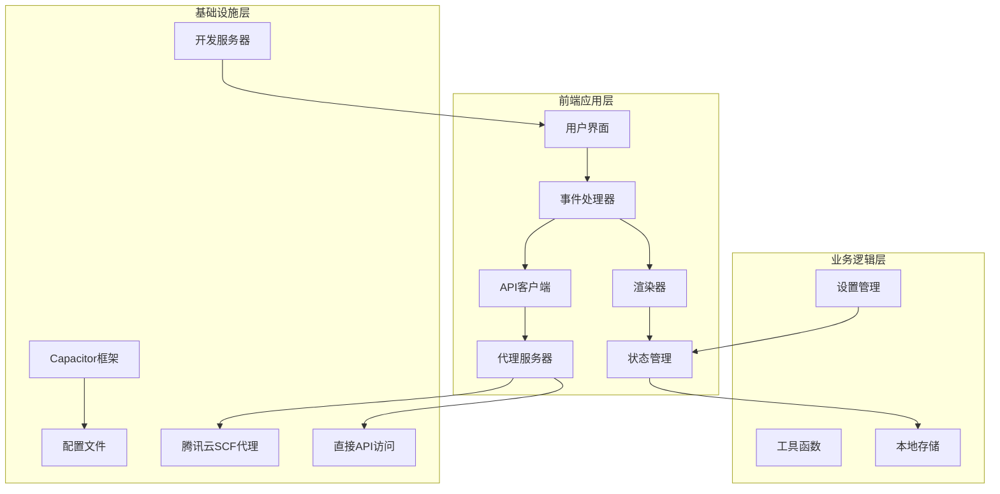

**图表来源**
- [www/index.html:96-104](file://www/index.html#L96-L104)
- [www/js/api.js:11-24](file://www/js/api.js#L11-L24)

**章节来源**
- [package.json:18-36](file://package.json#L18-L36)
- [capacitor.config.ts:1-22](file://capacitor.config.ts#L1-L22)
- [www/index.html:1-107](file://www/index.html#L1-L107)

## 核心组件

### Bangumi API客户端

应用的核心是Bangumi API客户端，负责与Bangumi服务进行通信。主要包含两个核心方法：

1. **searchBangumi(keyword)**: 搜索番剧条目
2. **getBangumiSubject(id)**: 获取番剧详细信息

### API代理系统

**更新** 新增多代理支持系统，包括：
- **直接访问**: 直连Bangumi官方API
- **腾讯云SCF代理**: 无服务器跨域代理
- **备用代理**: 多重保障的API访问方案

### 事件处理器

事件处理器负责处理用户交互，包括：
- 搜索框输入事件
- 结果项点击事件
- 表单提交事件
- 页面导航事件

### 渲染器

渲染器负责将数据转换为用户界面，包括：
- 列表页面渲染
- 详情页面渲染
- 表单页面渲染
- 搜索结果渲染

**章节来源**
- [www/js/api.js:103-139](file://www/js/api.js#L103-L139)
- [www/js/store.js:1-86](file://www/js/store.js#L1-L86)

## 架构概览

应用采用MVVM架构模式，通过事件驱动的方式实现数据流：

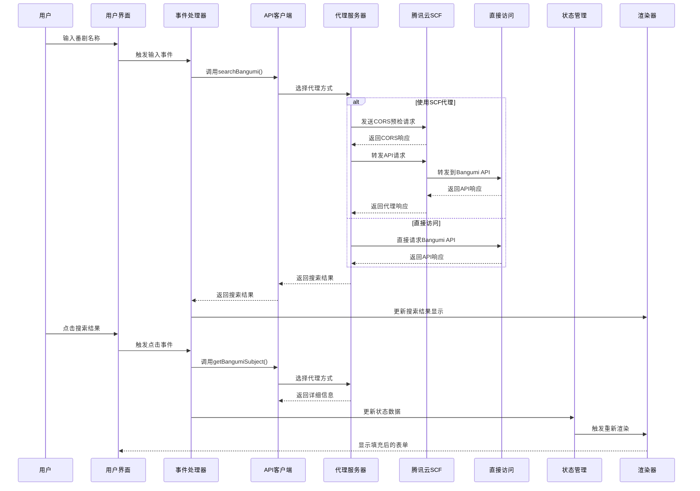

**图表来源**
- [www/js/api.js:68-96](file://www/js/api.js#L68-L96)
- [www/js/api.js:103-139](file://www/js/api.js#L103-L139)

## 详细组件分析

### API搜索接口实现

#### 搜索接口调用机制

搜索功能通过`searchBangumi`函数实现，该函数使用Fetch API向Bangumi服务发送POST请求：

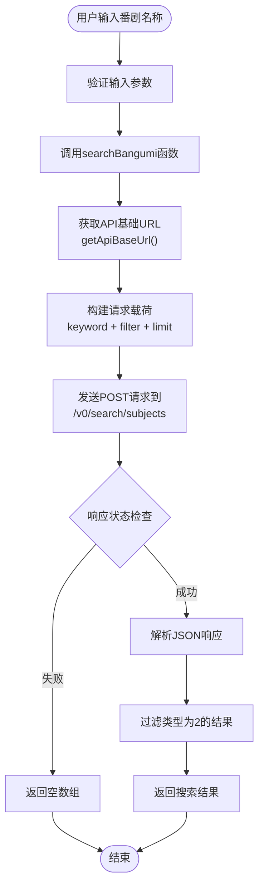

**图表来源**
- [www/js/api.js:103-113](file://www/js/api.js#L103-L113)

#### 请求参数详解

搜索请求包含以下关键参数：
- **keyword**: 搜索关键词（必填）
- **filter**: 过滤条件，设置`{ type: [2] }`确保只返回动漫类型
- **limit**: 限制返回结果数量为8个

#### 响应数据处理

API返回的数据结构包含多个字段，应用主要使用以下字段：
- **id**: Bangumi条目ID
- **name**: 原始名称
- **name_cn**: 中文名称
- **date**: 放送日期
- **type**: 条目类型

**章节来源**
- [www/js/api.js:103-113](file://www/js/api.js#L103-L113)

### 番剧信息自动填充功能

#### 自动填充实现原理

当用户点击搜索结果时，系统会调用`getBangumiSubject`函数获取详细信息，并自动填充到表单中：

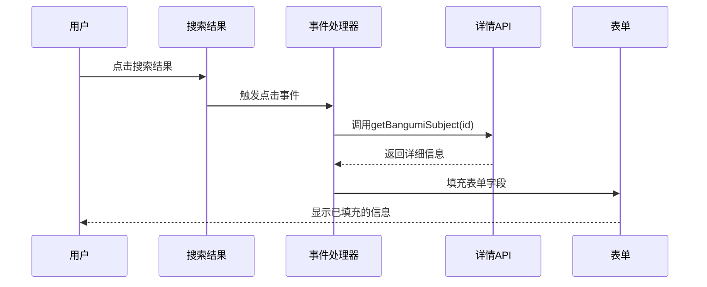

**图表来源**
- [www/js/api.js:120-125](file://www/js/api.js#L120-L125)

#### 数据映射和字段对应

自动填充过程中，系统将Bangumi API返回的数据映射到应用内部的数据结构：

| Bangumi字段 | 应用字段 | 处理方式 |
|------------|----------|----------|
| name_cn | title | 使用中文名称，若不存在则使用原始名称 |
| total_episodes | totalEpisodes | 设置为默认值12（可编辑） |
| date | airDate | 根据类型设置不同字段 |
| date | startDate | 补番类型的开始观看日期 |
| date | completedDate | 完成观看日期 |

#### 错误处理机制

系统实现了多层次的错误处理：

1. **网络请求错误**: 捕获API调用异常
2. **数据解析错误**: 处理JSON解析失败
3. **用户交互错误**: 处理用户取消操作
4. **代理响应错误**: 处理代理服务器异常

**章节来源**
- [www/js/api.js:120-125](file://www/js/api.js#L120-L125)

### 搜索结果展示和用户选择

#### 搜索结果展示

搜索结果以卡片形式展示，包含以下信息：
- **番剧名称**: 显示原始名称，若有中文名称则显示中文名称
- **更新日期**: 显示放送日期
- **点击选择**: 用户点击后自动填充表单

#### 用户选择流程

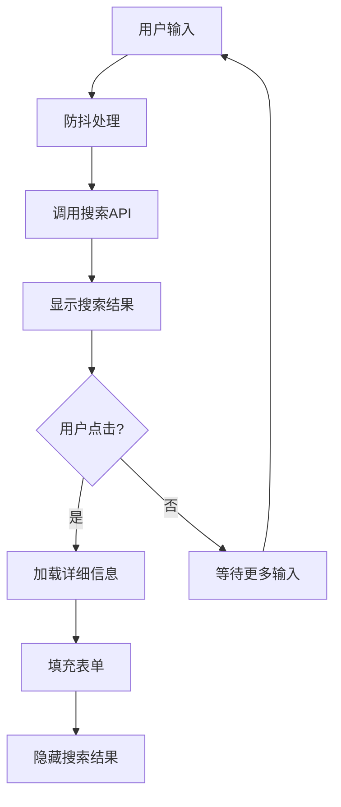

**图表来源**
- [www/js/api.js:103-113](file://www/js/api.js#L103-L113)

**章节来源**
- [www/js/api.js:103-113](file://www/js/api.js#L103-L113)

### 数据同步和状态管理

#### 状态管理架构

应用使用简单的状态管理模式，所有数据都存储在内存中并通过localStorage持久化：

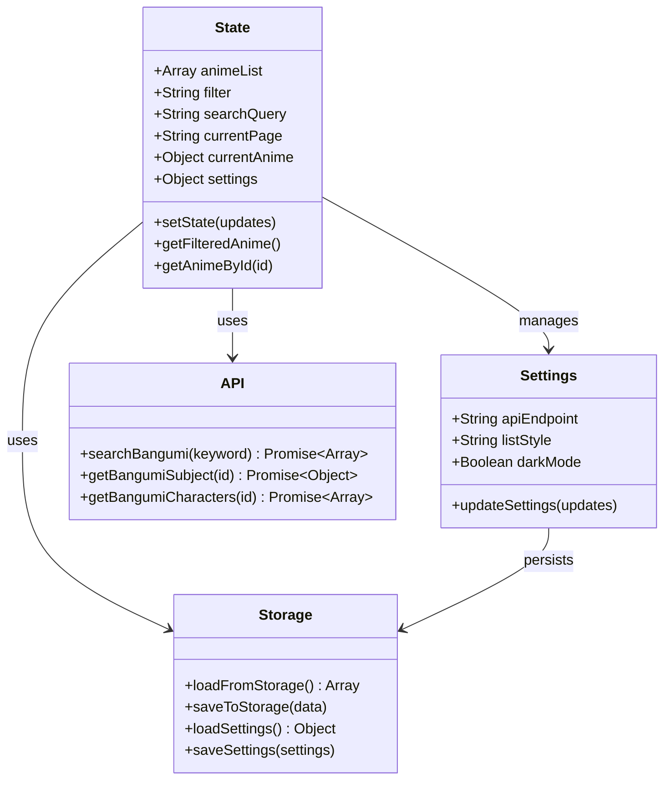

**图表来源**
- [www/js/store.js:5-86](file://www/js/store.js#L5-L86)
- [www/js/api.js:103-139](file://www/js/api.js#L103-L139)

#### 数据同步流程

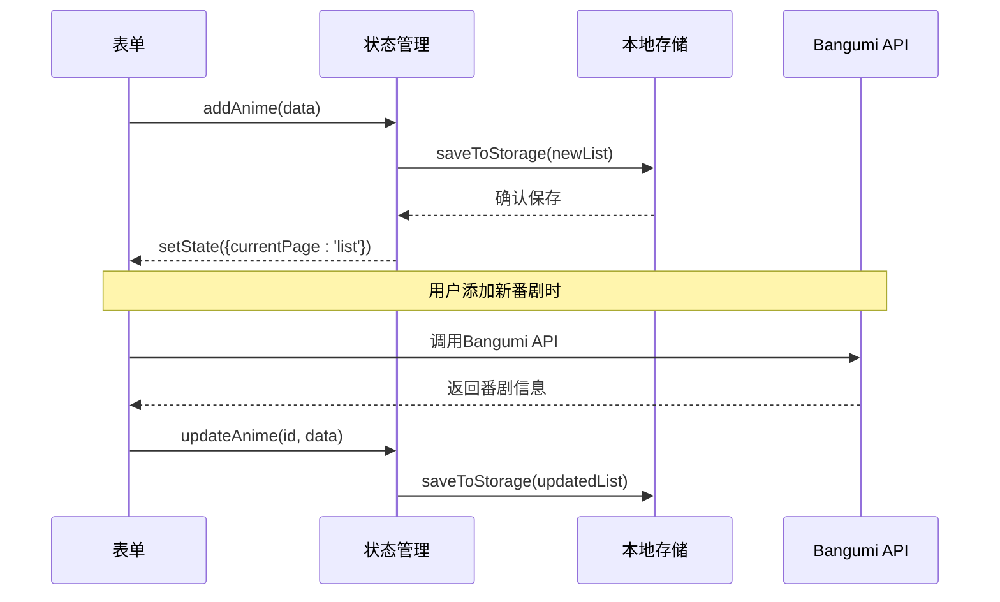

**图表来源**
- [www/js/store.js:54-75](file://www/js/store.js#L54-L75)
- [www/js/api.js:120-125](file://www/js/api.js#L120-L125)

**章节来源**
- [www/js/store.js:1-86](file://www/js/store.js#L1-L86)

## 腾讯云SCF代理系统

**新增章节** 腾讯云SCF代理系统提供了无服务器跨域解决方案，支持CORS预检请求、API调用转发和认证头管理。

### 代理系统架构

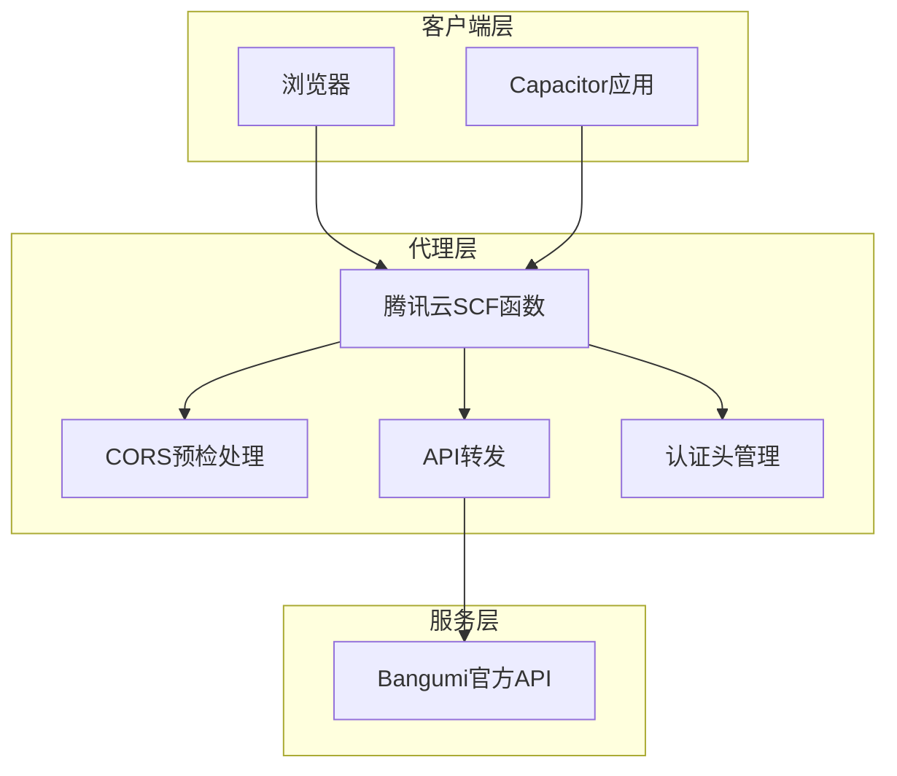

**图表来源**
- [scf_bangumi_proxy.js:14-106](file://scf_bangumi_proxy.js#L14-L106)
- [www/js/scf_bangumi_proxy.js:16-143](file://www/js/scf_bangumi_proxy.js#L16-L143)

### 代理配置和部署

#### 部署步骤

1. **登录腾讯云控制台** → 云函数（SCF）
2. **创建新函数**，运行环境选 Node.js 16+
3. **将代理代码**粘贴到 index.js
4. **部署函数后获取函数URL**（非API网关触发器）
5. **在控制台开启CORS**
6. **将函数URL配置到前端 API_PROXIES.proxy1**

#### 代理服务器特性

- **CORS预检支持**: 自动处理OPTIONS请求
- **请求转发**: 支持GET和POST方法
- **认证头管理**: 维护User-Agent等必要头部
- **错误处理**: 提供502错误响应
- **日志记录**: 详细的请求和响应日志

### 代理服务器实现细节

#### CORS预检处理

代理服务器能够识别并处理浏览器的CORS预检请求：

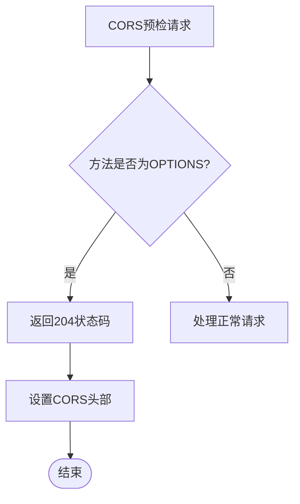

**图表来源**
- [scf_bangumi_proxy.js:22-33](file://scf_bangumi_proxy.js#L22-L33)

#### 请求转发机制

代理服务器将请求转发到Bangumi官方API：

1. **路径解析**: 从event.path获取API路径
2. **方法处理**: 支持GET和POST方法
3. **头部转发**: 维护必要的HTTP头部
4. **Body处理**: POST请求时转发请求体
5. **响应处理**: 将响应转发给客户端

#### 错误处理和日志

代理服务器实现了完善的错误处理机制：

- **网络错误**: 捕获并返回502状态码
- **解析错误**: 处理JSON解析失败
- **超时处理**: 网络请求超时的优雅降级
- **调试日志**: 详细的请求和响应日志输出

**章节来源**
- [scf_bangumi_proxy.js:1-107](file://scf_bangumi_proxy.js#L1-L107)
- [www/js/scf_bangumi_proxy.js:1-144](file://www/js/scf_bangumi_proxy.js#L1-L144)

### 多代理支持架构

#### 代理配置管理

应用支持多种API访问方式：

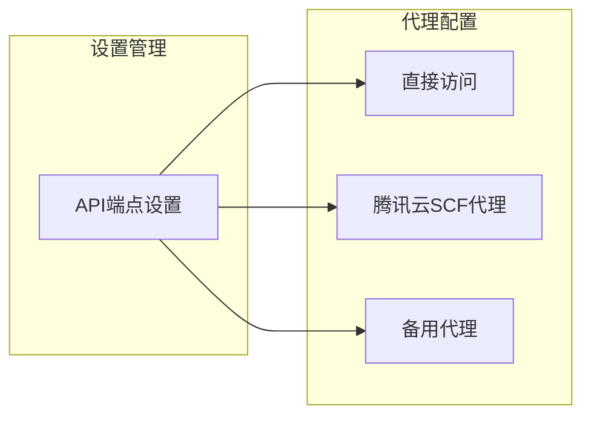

**图表来源**
- [www/js/api.js:11-24](file://www/js/api.js#L11-L24)
- [www/js/store.js:6-10](file://www/js/store.js#L6-L10)

#### 代理选择逻辑

应用根据用户设置选择合适的代理方式：

1. **直接访问**: 直连Bangumi官方API
2. **SCF代理**: 使用腾讯云函数代理
3. **备用代理**: 多重保障的备份方案

#### 代理响应解包

代理服务器返回的响应可能需要解包处理：

- **包装格式检测**: 检测代理响应格式
- **JSON解析**: 尝试解析包装的JSON数据
- **错误恢复**: 处理解包失败的情况

**章节来源**
- [www/js/api.js:11-24](file://www/js/api.js#L11-L24)
- [www/js/api.js:48-60](file://www/js/api.js#L48-L60)

## 依赖关系分析

### 外部依赖

项目的主要外部依赖包括：

```mermaid
graph LR
subgraph "核心框架"
React[React 18.2.0]
Capacitor[Capacitor 6.0.0]
end
subgraph "UI组件"
Zustand[Zustand 4.5.0]
end
subgraph "开发工具"
Vite[Vite]
TypeScript[TypeScript]
ReactPlugin[@vitejs/plugin-react]
end
subgraph "平台支持"
Android[@capacitor/android]
IOS[@capacitor/ios]
Share[@capacitor/share]
end
React --> Zustand
Capacitor --> Android
Capacitor --> IOS
Capacitor --> Share
```

**图表来源**
- [package.json:18-36](file://package.json#L18-L36)

### 内部模块依赖

应用内部模块之间的依赖关系如下：

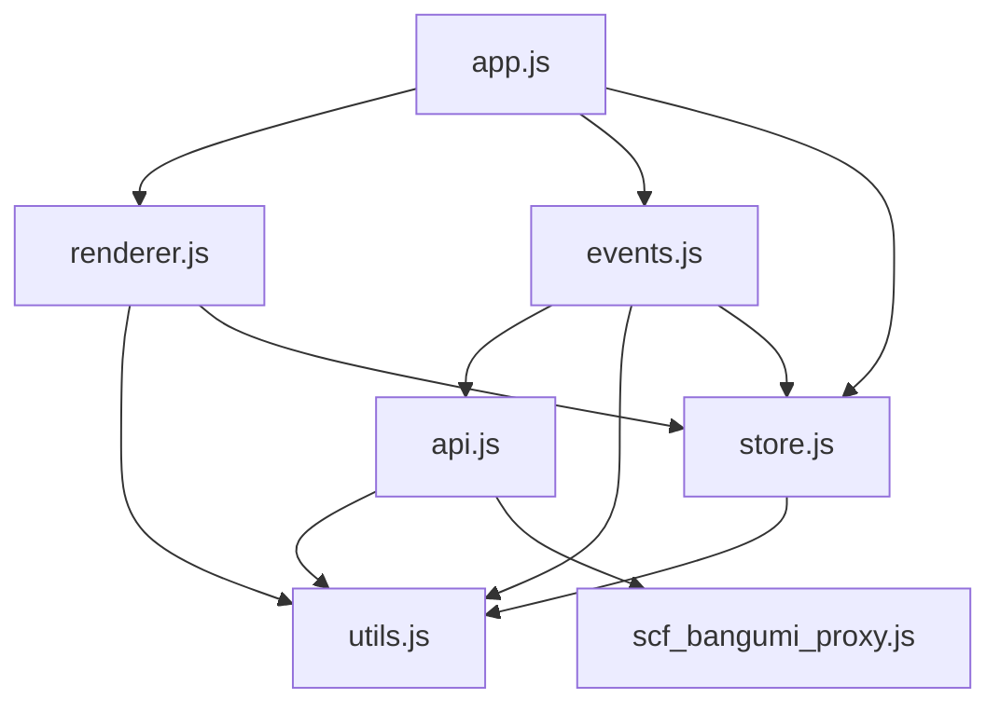

**图表来源**
- [www/index.html:96-104](file://www/index.html#L96-L104)

**章节来源**
- [package.json:18-36](file://package.json#L18-L36)
- [www/index.html:96-104](file://www/index.html#L96-L104)

## 性能考虑

### API调用优化

1. **防抖处理**: 搜索输入采用500ms防抖，避免频繁API调用
2. **结果缓存**: 最近一次搜索关键词会被缓存，避免重复请求
3. **请求限制**: 单次搜索限制8个结果，减少数据传输量
4. **代理缓存**: 代理服务器可以利用CDN缓存提高响应速度

### 内存管理

1. **状态管理**: 使用简单对象存储状态，避免深层嵌套
2. **DOM操作**: 通过统一渲染器管理DOM更新，减少不必要的重绘
3. **事件绑定**: 事件处理器在页面切换时自动解绑，防止内存泄漏
4. **代理资源**: 代理服务器使用连接池，减少连接建立开销

### 网络优化

1. **HTTP缓存**: 利用浏览器缓存机制
2. **连接复用**: 复用HTTP连接，减少握手开销
3. **错误重试**: 实现基本的错误处理和重试机制
4. **代理优化**: 腾讯云SCF提供全球CDN加速

### 代理性能优化

**新增** 腾讯云SCF代理系统的性能优化：

- **无服务器架构**: 按需扩缩容，避免资源浪费
- **全球CDN**: 通过腾讯云CDN加速API响应
- **连接池管理**: 优化与Bangumi API的连接复用
- **智能路由**: 根据用户地理位置选择最优节点

## 故障排除指南

### 常见问题及解决方案

#### API调用失败

**问题症状**: 搜索结果为空或显示"搜索失败"

**可能原因**:
1. 网络连接问题
2. Bangumi API服务不可用
3. 请求参数格式错误
4. **代理服务器配置错误**（新增）

**解决步骤**:
1. 检查网络连接状态
2. 验证API端点可用性
3. 查看浏览器开发者工具中的网络请求
4. **检查代理服务器URL配置**
5. **验证代理服务器CORS设置**

#### 数据填充失败

**问题症状**: 点击搜索结果后无法自动填充表单

**可能原因**:
1. API响应格式变化
2. 字段映射错误
3. DOM元素不存在
4. **代理响应解包失败**

**解决步骤**:
1. 检查API响应数据结构
2. 验证字段映射逻辑
3. 确认DOM元素选择器正确
4. **检查代理服务器日志输出**

#### 性能问题

**问题症状**: 页面加载缓慢或响应迟钝

**优化建议**:
1. 减少DOM操作次数
2. 实施虚拟滚动（对于大量数据）
3. 优化CSS样式计算
4. **考虑使用代理服务器CDN加速**

#### 代理相关问题

**新增** 代理服务器特有的问题：

**问题症状**: 代理服务器返回502错误或CORS失败

**可能原因**:
1. **代理服务器未正确部署**
2. **CORS配置不正确**
3. **函数URL配置错误**
4. **代理服务器超时**

**解决步骤**:
1. **验证代理服务器状态**
2. **检查CORS头部设置**
3. **确认函数URL正确性**
4. **查看代理服务器日志**
5. **测试代理服务器连通性**

**章节来源**
- [www/js/api.js:32-40](file://www/js/api.js#L32-L40)
- [scf_bangumi_proxy.js:86-96](file://scf_bangumi_proxy.js#L86-L96)

## 结论

本项目成功实现了Bangumi API的深度集成，为用户提供了一个功能完善的番剧追踪解决方案。通过合理的架构设计和优化策略，应用在保持良好用户体验的同时，也具备了良好的可维护性和扩展性。

**更新** 新增的腾讯云SCF代理系统进一步增强了应用的稳定性和可靠性，提供了无服务器跨域解决方案，支持全球CDN加速和智能路由。

主要成就包括：
- 完整的Bangumi API集成，支持搜索和详情获取
- 智能的番剧信息自动填充功能
- **多代理支持架构，提供灵活的API访问方案**
- **无服务器代理系统，增强跨域访问能力**
- 用户友好的界面设计和交互体验
- 良好的性能表现和错误处理机制

未来可以考虑的改进方向：
- 实现更复杂的搜索过滤功能
- 添加离线数据缓存机制
- 优化移动端用户体验
- 增加更多个性化定制选项
- **扩展代理服务器功能，支持更多API端点**
- **实现代理服务器负载均衡和监控**