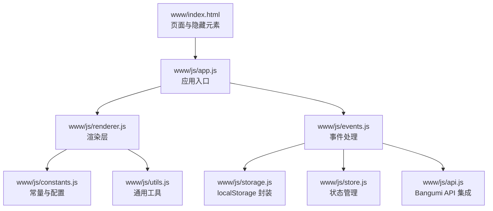
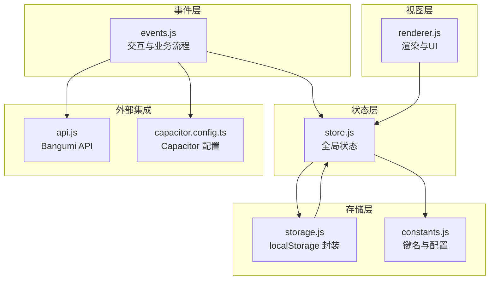
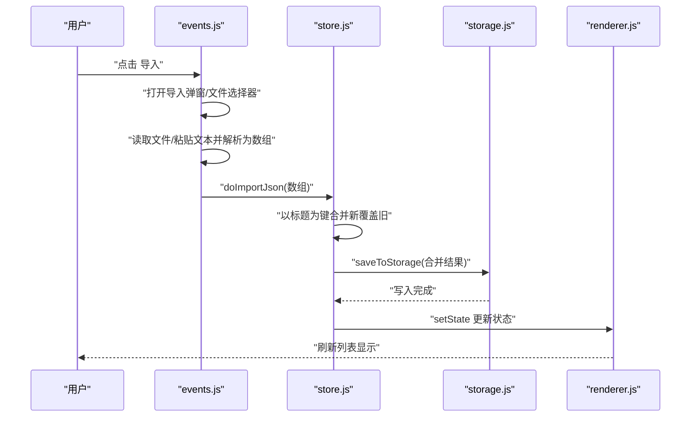
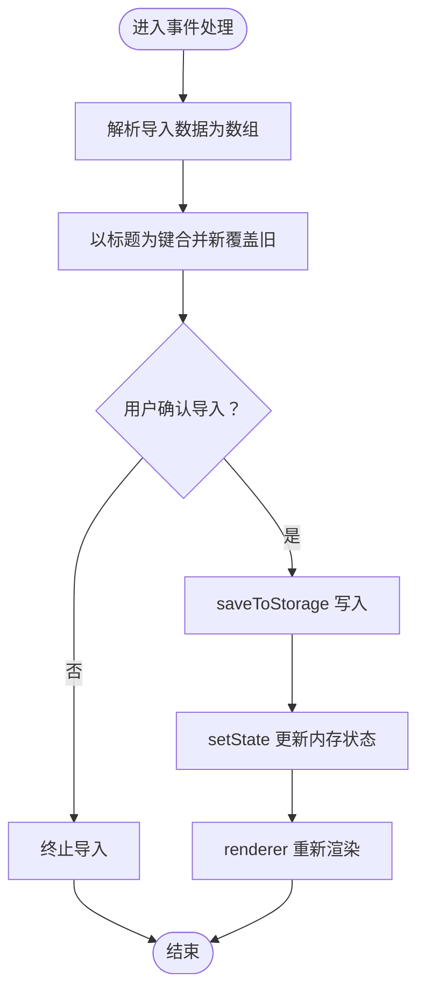
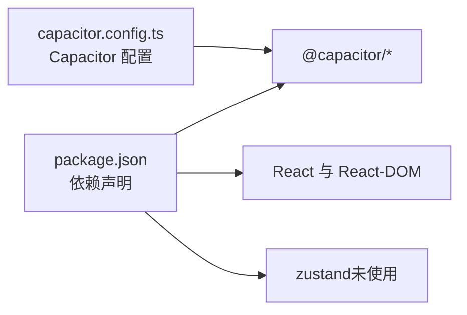

# 数据管理

<cite>
**本文引用的文件**
- [capacitor.config.ts](file://capacitor.config.ts)
- [package.json](file://package.json)
- [www/index.html](file://www/index.html)
- [www/js/constants.js](file://www/js/constants.js)
- [www/js/utils.js](file://www/js/utils.js)
- [www/js/storage.js](file://www/js/storage.js)
- [www/js/store.js](file://www/js/store.js)
- [www/js/api.js](file://www/js/api.js)
- [www/js/renderer.js](file://www/js/renderer.js)
- [www/js/events.js](file://www/js/events.js)
- [www/js/app.js](file://www/js/app.js)
</cite>

## 目录
1. [简介](#简介)
2. [项目结构](#项目结构)
3. [核心组件](#核心组件)
4. [架构总览](#架构总览)
5. [详细组件分析](#详细组件分析)
6. [依赖分析](#依赖分析)
7. [性能考量](#性能考量)
8. [故障排查指南](#故障排查指南)
9. [结论](#结论)
10. [附录](#附录)

## 简介
本文件围绕“数据管理”主题，系统梳理该应用的数据导入导出、localStorage 持久化、数据合并与冲突处理、版本兼容性、迁移与备份恢复、以及数据安全与隐私保护等关键能力。文档基于仓库中的前端源码与配置进行分析，帮助开发者与使用者理解数据层面的设计与实现。

## 项目结构
应用采用纯前端架构，HTML 页面通过脚本模块化组织，核心逻辑分布在多个 JS 文件中；同时使用 Capacitor 作为跨平台桥接，便于在移动端运行时调用原生能力（如分享、返回键处理等）。关键目录与文件如下：
- 配置与构建：capacitor.config.ts、package.json
- 入口页面：www/index.html
- 功能模块：www/js/*.js（常量、工具、存储、状态、API、渲染、事件、入口）

图表来源
- [www/index.html:1-75](file://www/index.html#L1-L75)
- [www/js/app.js:1-38](file://www/js/app.js#L1-L38)
- [www/js/renderer.js:1-630](file://www/js/renderer.js#L1-L630)
- [www/js/events.js:1-783](file://www/js/events.js#L1-L783)
- [www/js/storage.js:1-40](file://www/js/storage.js#L1-L40)
- [www/js/store.js:1-71](file://www/js/store.js#L1-L71)
- [www/js/api.js:1-31](file://www/js/api.js#L1-L31)
- [www/js/constants.js:1-37](file://www/js/constants.js#L1-L37)
- [www/js/utils.js:1-53](file://www/js/utils.js#L1-L53)

章节来源
- [www/index.html:1-75](file://www/index.html#L1-L75)
- [capacitor.config.ts:1-22](file://capacitor.config.ts#L1-L22)
- [package.json:1-38](file://package.json#L1-L38)

## 核心组件
- 常量与配置：定义状态标签、季度边界、星期映射、类型配置、localStorage 键名等。
- 工具函数：HTML 转义、唯一 ID 生成、日期转星期、星级渲染、Toast 提示等。
- 存储层：封装 localStorage 的读取与写入，分别针对番剧数据与折叠状态。
- 状态管理：维护全局状态（列表、筛选、搜索、当前页面、当前条目），提供增删改查与变更通知。
- 渲染层：负责页面渲染、分组展示、提醒弹窗、表单 UI 等。
- 事件处理：绑定交互事件，实现导入导出、筛选、搜索、折叠、Bangumi 搜索与填充等。
- API 集成：对接 Bangumi 搜索与详情接口，辅助用户快速录入数据。
- 应用入口：首次渲染、启动画面、追番提醒、Android 返回键处理。

章节来源
- [www/js/constants.js:1-37](file://www/js/constants.js#L1-L37)
- [www/js/utils.js:1-53](file://www/js/utils.js#L1-L53)
- [www/js/storage.js:1-40](file://www/js/storage.js#L1-L40)
- [www/js/store.js:1-71](file://www/js/store.js#L1-L71)
- [www/js/renderer.js:1-630](file://www/js/renderer.js#L1-L630)
- [www/js/events.js:1-783](file://www/js/events.js#L1-L783)
- [www/js/api.js:1-31](file://www/js/api.js#L1-L31)
- [www/js/app.js:1-38](file://www/js/app.js#L1-L38)

## 架构总览
下图展示了数据在各层之间的流转关系：事件层触发业务动作，状态层更新内存数据并持久化，渲染层根据状态重新绘制界面；导入导出通过浏览器能力或 Capacitor 分享插件完成。

图表来源
- [www/js/renderer.js:1-630](file://www/js/renderer.js#L1-L630)
- [www/js/events.js:1-783](file://www/js/events.js#L1-L783)
- [www/js/store.js:1-71](file://www/js/store.js#L1-L71)
- [www/js/storage.js:1-40](file://www/js/storage.js#L1-L40)
- [www/js/constants.js:1-37](file://www/js/constants.js#L1-L37)
- [www/js/api.js:1-31](file://www/js/api.js#L1-L31)
- [capacitor.config.ts:1-22](file://capacitor.config.ts#L1-L22)

## 详细组件分析

### 数据导入导出机制
- 导入方式
  - 文件导入：通过隐藏的文件选择器选取 .json 文件，使用 FileReader 读取文本并解析为数组。
  - 粘贴导入：在弹窗中粘贴 JSON 文本，校验是否为数组后执行导入。
  - 冲突处理：以“番剧标题”为键进行去重合并，相同标题的新数据会覆盖旧数据，并在确认后写入存储。
- 导出方式
  - 支持按年/季筛选导出选定范围。
  - 优先使用浏览器原生保存接口；若不可用则尝试 Capacitor 分享插件或 Web Share API；失败时提示导出失败。
- 浏览器兼容性
  - 使用标准 DOM API 与 FileReader；导出优先级为 showSaveFilePicker > Capacitor Share > Web Share > 失败提示。
  - 移动端通过 Capacitor 判断与事件绑定，确保返回键与平台特性一致。

图表来源
- [www/js/events.js:170-258](file://www/js/events.js#L170-L258)
- [www/js/events.js:397-412](file://www/js/events.js#L397-L412)
- [www/js/store.js:1-71](file://www/js/store.js#L1-L71)
- [www/js/storage.js:1-40](file://www/js/storage.js#L1-L40)
- [www/js/renderer.js:1-630](file://www/js/renderer.js#L1-L630)

章节来源
- [www/index.html:19-48](file://www/index.html#L19-L48)
- [www/js/events.js:130-168](file://www/js/events.js#L130-L168)
- [www/js/events.js:170-258](file://www/js/events.js#L170-L258)
- [www/js/events.js:337-395](file://www/js/events.js#L337-L395)
- [www/js/events.js:397-412](file://www/js/events.js#L397-L412)

### JSON 格式处理与校验
- 导入侧：严格要求 JSON 顶层为数组；对空输入、格式错误、非数组等情况进行提示与拦截。
- 导出侧：将选中数据序列化为 JSON 字符串（保留缩进以便阅读）。
- 安全性：导入前不执行动态 eval，仅使用 JSON.parse；渲染侧使用 HTML 转义避免 XSS。

章节来源
- [www/js/events.js:222-236](file://www/js/events.js#L222-L236)
- [www/js/events.js:238-256](file://www/js/events.js#L238-L256)
- [www/js/events.js:355-356](file://www/js/events.js#L355-L356)
- [www/js/utils.js:5-10](file://www/js/utils.js#L5-L10)

### localStorage 数据持久化
- 存储键名：统一使用 constants.js 中定义的键名，分别保存番剧列表与折叠状态。
- 序列化与反序列化：写入时 JSON.stringify，读取时 JSON.parse；异常捕获保证健壮性。
- 写入时机：每次新增、更新、删除、折叠状态变更均触发写入。

图表来源
- [www/js/events.js:397-412](file://www/js/events.js#L397-L412)
- [www/js/storage.js:15-22](file://www/js/storage.js#L15-L22)
- [www/js/store.js:38-70](file://www/js/store.js#L38-L70)

章节来源
- [www/js/constants.js:14-16](file://www/js/constants.js#L14-L16)
- [www/js/storage.js:1-40](file://www/js/storage.js#L1-L40)
- [www/js/store.js:1-71](file://www/js/store.js#L1-L71)

### 数据合并算法、冲突解决与版本兼容
- 合并策略：以“番剧标题”为键，先放入本地数据，再放入导入数据，后者覆盖前者，最终去重得到合并结果。
- 冲突解决：同一标题的条目以导入数据为准；未覆盖的条目保留本地数据。
- 版本兼容：当前实现未引入显式的版本字段；如需扩展，建议在导入时增加版本检查与迁移步骤（见“附录：迁移与备份恢复”）。

章节来源
- [www/js/events.js:397-412](file://www/js/events.js#L397-L412)

### 导出筛选与范围控制
- 年/季分组：根据放送日期或补番开始日期计算所属年份与季度，支持“未归类”场景。
- 筛选弹窗：按年/季勾选导出范围，确认后生成选中集合并导出。
- 导出优先级：浏览器原生保存 > Capacitor 分享 > Web Share > 失败提示。

章节来源
- [www/js/events.js:260-287](file://www/js/events.js#L260-L287)
- [www/js/events.js:289-335](file://www/js/events.js#L289-L335)
- [www/js/events.js:337-395](file://www/js/events.js#L337-L395)

### Bangumi 集成与数据填充
- 搜索：POST 请求搜索条目，限制类型为番剧，返回列表。
- 详情：按条目 ID 获取详情，自动填充标题、总集数、放送日期等字段。
- 输入防抖与安全：输入框输入防抖、加载状态、错误提示；渲染时对文本进行 HTML 转义。

章节来源
- [www/js/api.js:10-30](file://www/js/api.js#L10-L30)
- [www/js/events.js:675-781](file://www/js/events.js#L675-L781)
- [www/js/utils.js:5-10](file://www/js/utils.js#L5-L10)

### 数据安全与隐私保护
- XSS 防护：渲染侧对用户输入与外部数据进行 HTML 转义。
- 本地存储：数据保存在客户端 localStorage，未上传至服务器；导入/导出均为本地操作。
- 敏感信息：当前未涉及密码、账号等敏感字段，建议未来扩展时：
  - 对导入数据进行白名单字段校验；
  - 在导出时移除或加密敏感字段；
  - 提供“加密导出/解密导入”的可选开关（需额外实现）。

章节来源
- [www/js/utils.js:5-10](file://www/js/utils.js#L5-L10)
- [www/js/renderer.js:29-33](file://www/js/renderer.js#L29-L33)

## 依赖分析
- 构建与运行：Vite 作为开发与打包工具；Capacitor 作为跨平台桥接。
- 运行时依赖：@capacitor/core、@capacitor/app、@capacitor/share、@capacitor/filesystem 等。
- 状态管理：使用轻量内存状态与 localStorage 双写，Zustand 未在此项目中直接使用。

图表来源
- [package.json:18-29](file://package.json#L18-L29)
- [capacitor.config.ts:3-18](file://capacitor.config.ts#L3-L18)

章节来源
- [package.json:1-38](file://package.json#L1-L38)
- [capacitor.config.ts:1-22](file://capacitor.config.ts#L1-L22)

## 性能考量
- 渲染性能：列表按年/季分组并支持折叠，减少一次性渲染节点数量；滚动时仅局部更新。
- 事件绑定：使用事件委托与按需绑定，避免重复绑定导致的内存泄漏。
- 导入/导出：导入为一次性解析与合并；导出为按需筛选与序列化，避免大对象反复拷贝。
- 存储写入：每次状态变更即写入 localStorage，建议在高频更新场景下引入节流/防抖（当前已有部分输入防抖示例）。

## 故障排查指南
- 导入失败
  - 症状：弹窗提示“JSON 格式错误/文件格式错误”。
  - 排查：确认导入文件为 .json 且顶层为数组；检查字符编码与换行符。
- 导出失败
  - 症状：导出后无响应或提示失败。
  - 排查：确认浏览器支持 showSaveFilePicker 或可用 Capacitor/Share API；移动端需确保权限与网络正常。
- 数据丢失或异常
  - 症状：刷新后数据消失或显示异常。
  - 排查：检查浏览器是否禁用 localStorage；查看控制台是否有异常堆栈；尝试清除缓存后重试。
- 移动端返回键行为异常
  - 症状：无法退出或返回逻辑异常。
  - 排查：确认 Capacitor App 插件已正确注入；检查页面状态切换逻辑。

章节来源
- [www/js/events.js:222-236](file://www/js/events.js#L222-L236)
- [www/js/events.js:238-256](file://www/js/events.js#L238-L256)
- [www/js/events.js:357-394](file://www/js/events.js#L357-L394)
- [www/js/app.js:20-37](file://www/js/app.js#L20-L37)

## 结论
该应用在数据管理方面实现了清晰的职责分离：事件层负责交互与流程编排，状态层负责数据一致性与持久化，渲染层负责视图更新。导入导出采用 JSON 数组格式，合并策略简单明确；localStorage 提供基础持久化能力。建议后续增强版本兼容、字段白名单校验与加密导出等能力，以进一步提升安全性与可维护性。

## 附录

### 数据迁移指南（建议）
- 版本字段：在导入时检测数据版本号，若低于当前版本则执行迁移脚本。
- 字段兼容：对缺失字段提供默认值；对废弃字段进行映射或清理。
- 迁移流程：先解析为临时对象，执行迁移函数，再统一写入存储。

### 备份与恢复方案
- 备份：定期导出全部数据（或按筛选范围导出），保存为 .json 文件。
- 恢复：在新设备或新环境导入备份文件；如遇字段差异，先升级后再导入。
- 自动化：可在 CI/CD 中加入定时导出任务，或将导出结果上传到网盘/云存储。

### 隐私与安全加固（建议）
- 白名单字段：仅允许受控字段参与导入/导出。
- 加密导出：提供可选的加密导出/解密导入，避免明文泄露。
- 最小化存储：仅存储必要字段，避免冗余信息长期留存。