# 核心功能模块

<cite>
**本文引用的文件**
- [package.json](file://package.json)
- [capacitor.config.ts](file://capacitor.config.ts)
- [_check.js](file://_check.js)
- [_server.js](file://_server.js)
- [www/index.html](file://www/index.html)
- [www/js/api.js](file://www/js/api.js)
- [android/app/src/main/assets/public/js/api.js](file://android/app/src/main/assets/public/js/api.js)
- [www/js/store.js](file://www/js/store.js)
- [android/app/src/main/assets/public/js/store.js](file://android/app/src/main/assets/public/js/store.js)
- [www/js/renderer.js](file://www/js/renderer.js)
- [android/app/src/main/assets/public/js/renderer.js](file://android/app/src/main/assets/public/js/renderer.js)
- [www/js/events.js](file://www/js/events.js)
- [android/app/src/main/assets/public/js/events.js](file://android/app/src/main/assets/public/js/events.js)
- [scf_bangumi_proxy.js](file://scf_bangumi_proxy.js)
- [android/app/src/main/assets/public/js/scf_bangumi_proxy.js](file://android/app/src/main/assets/public/js/scf_bangumi_proxy.js)
- [项目解读分析与改进建议.md](file://项目解读分析与改进建议.md)
</cite>

## 更新摘要
**所做更改**
- 新增API代理端点配置章节，详细介绍直连、代理1、代理2三种访问方式
- 更新Bangumi API集成章节，增加代理服务器选择机制和错误处理
- 新增腾讯云SCF代理服务器部署指南和配置说明
- 更新状态管理机制，增加apiEndpoint设置项
- 新增API设置界面和用户交互流程

## 目录
1. [简介](#简介)
2. [项目结构](#项目结构)
3. [核心组件](#核心组件)
4. [架构总览](#架构总览)
5. [详细组件分析](#详细组件分析)
6. [依赖关系分析](#依赖关系分析)
7. [性能考量](#性能考量)
8. [故障排查指南](#故障排查指南)
9. [结论](#结论)
10. [附录](#附录)

## 简介
本文件面向Anime Tracker应用的核心功能模块，围绕以下主题展开：番剧管理（增删改查）、进度追踪（追番/补番模式）、Bangumi API集成、数据导入导出、状态管理机制、数据持久化策略与用户界面组件。文档提供流程图、序列图与类图等可视化说明，并给出可直接定位到源码位置的"章节来源"和"图表来源"，帮助开发者快速理解与扩展。

**更新** 本次更新重点增强了API集成能力，新增了多级代理端点支持，允许用户在直接API访问、腾讯云SCF代理或自定义代理配置之间进行灵活选择。

## 项目结构
该仓库采用前端单页应用（SPA）+ Capacitor混合打包的结构：
- 前端资源位于 www/ 与 android/app/src/main/assets/public/（Android原生资源目录）
- 核心逻辑集中在 _check.js 中，负责状态管理、渲染、事件绑定、Bangumi API交互、导入导出等
- 服务器用于本地开发预览（_server.js）
- Capacitor配置定义了应用元信息与平台参数（capacitor.config.ts）
- 包管理与脚本由 package.json 提供

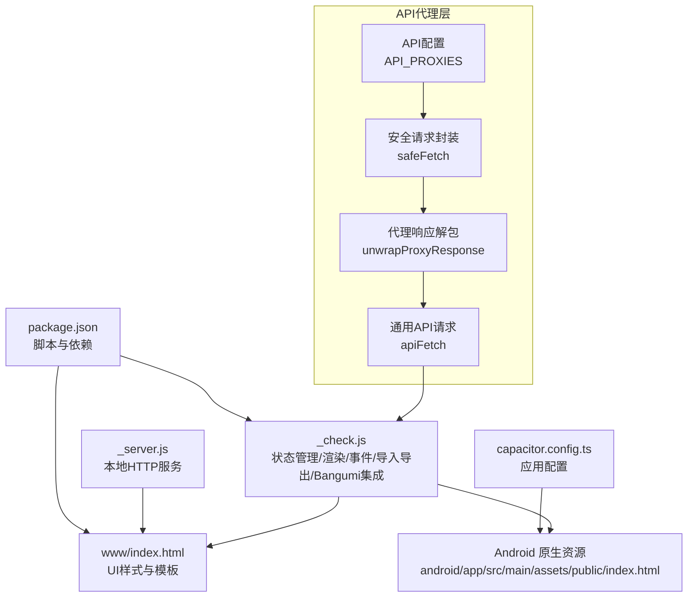

**图表来源**
- [package.json:1-38](file://package.json#L1-L38)
- [capacitor.config.ts:1-22](file://capacitor.config.ts#L1-L22)
- [_check.js:124-1329](file://_check.js#L124-L1329)
- [_server.js:1-32](file://_server.js#L1-L32)
- [www/index.html:1-800](file://www/index.html#L1-L800)
- [www/js/api.js:11-24](file://www/js/api.js#L11-L24)
- [www/js/api.js:32-40](file://www/js/api.js#L32-L40)
- [www/js/api.js:48-60](file://www/js/api.js#L48-L60)
- [www/js/api.js:68-96](file://www/js/api.js#L68-L96)

**章节来源**
- [package.json:1-38](file://package.json#L1-L38)
- [capacitor.config.ts:1-22](file://capacitor.config.ts#L1-L22)
- [_check.js:124-1329](file://_check.js#L124-L1329)
- [_server.js:1-32](file://_server.js#L1-L32)
- [www/index.html:1-800](file://www/index.html#L1-L800)

## 核心组件
- 状态管理与渲染引擎：集中于全局状态对象与渲染函数，负责页面切换、列表过滤、搜索、分组排序与UI生成
- 数据持久化：基于 localStorage 的简易持久化，键名约定明确
- 事件系统：为各页面元素绑定事件，处理用户交互（导航、筛选、搜索、进度变更、评分、状态切换）
- **API代理集成**：提供多级代理服务器选择，支持直连、代理1（腾讯云SCF）和代理2配置，具备自动回退机制
- 导入/导出：支持浏览器 File System Access API 或 Capacitor Share API 导出；支持JSON导入并按更新时间合并
- 追番提醒：根据当前日期与番剧更新日自动提示今日更新与未完成补番

**更新** 新增API代理集成组件，提供灵活的Bangumi API访问策略。

**章节来源**
- [_check.js:46-104](file://_check.js#L46-L104)
- [_check.js:124-1329](file://_check.js#L124-L1329)
- [_check.js:920-935](file://_check.js#L920-L935)
- [_check.js:753-843](file://_check.js#L753-L843)
- [_check.js:1268-1323](file://_check.js#L1268-L1323)
- [www/js/api.js:11-24](file://www/js/api.js#L11-L24)
- [www/js/api.js:32-40](file://www/js/api.js#L32-L40)
- [www/js/api.js:48-60](file://www/js/api.js#L48-L60)
- [www/js/api.js:68-96](file://www/js/api.js#L68-L96)

## 架构总览
下图展示了应用的运行时架构：前端状态驱动UI渲染，事件回调触发状态更新与持久化，**多级API代理提供弹性数据支撑**，Capacitor与原生资源桥接移动端能力。

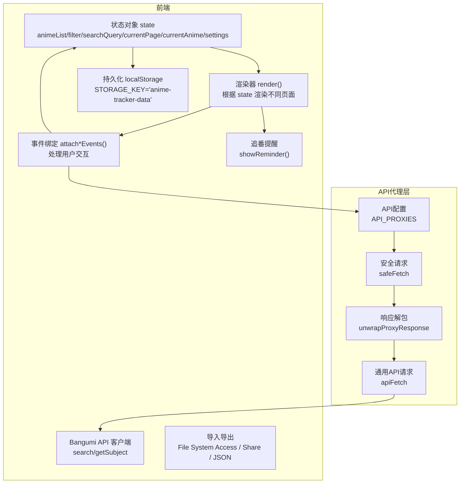

**图表来源**
- [_check.js:46-57](file://_check.js#L46-L57)
- [_check.js:124-145](file://_check.js#L124-L145)
- [_check.js:651-843](file://_check.js#L651-L843)
- [_check.js:920-935](file://_check.js#L920-L935)
- [_check.js:753-843](file://_check.js#L753-L843)
- [_check.js:1268-1323](file://_check.js#L1268-L1323)
- [www/js/api.js:11-24](file://www/js/api.js#L11-L24)
- [www/js/api.js:32-40](file://www/js/api.js#L32-L40)
- [www/js/api.js:48-60](file://www/js/api.js#L48-L60)
- [www/js/api.js:68-96](file://www/js/api.js#L68-L96)

## 详细组件分析

### 番剧管理（增删改查）
- 新增：表单收集字段，计算状态与更新时间，生成唯一ID，写入localStorage并返回列表页
- 查询：按ID检索、按状态与标题模糊搜索、分页/分组渲染
- 更新：支持进度+1、手动增减、评分、状态切换、观后感自动保存
- 删除：确认对话框后移除并持久化

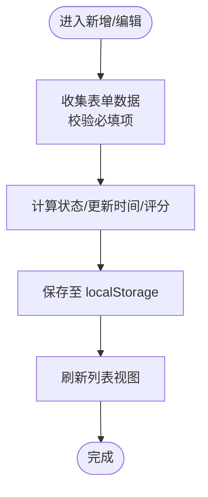

**图表来源**
- [_check.js:75-95](file://_check.js#L75-L95)
- [_check.js:1053-1110](file://_check.js#L1053-L1110)
- [_check.js:864-892](file://_check.js#L864-L892)
- [_check.js:858-862](file://_check.js#L858-L862)

**章节来源**
- [_check.js:75-95](file://_check.js#L75-L95)
- [_check.js:864-892](file://_check.js#L864-L892)
- [_check.js:858-862](file://_check.js#L858-L862)
- [_check.js:1053-1110](file://_check.js#L1053-L1110)

### 进度追踪（追番/补番模式）
- 追番模式（chasing）：记录放送日期与更新日（周几），按季度边界智能分组，支持"+1"一键推进
- 补番模式（binge）：记录开始日期与完结日期，按简单季度分组，支持手动进度推进
- 状态机：从"想看"到"在看"，到"已完成"或"放弃"，自动/手动切换

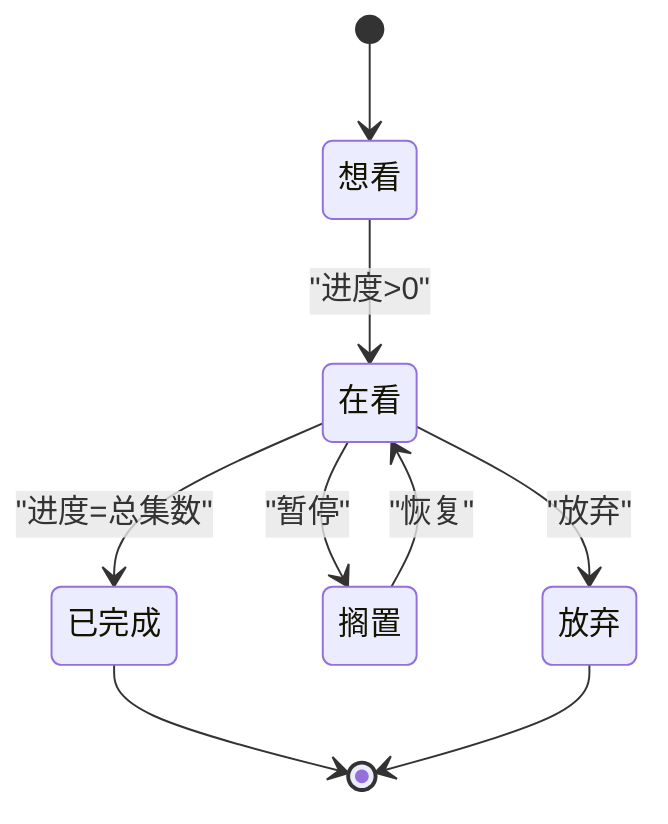

**图表来源**
- [_check.js:340-376](file://_check.js#L340-L376)
- [_check.js:864-892](file://_check.js#L864-L892)
- [_check.js:1071-1086](file://_check.js#L1071-L1086)

**章节来源**
- [_check.js:340-376](file://_check.js#L340-L376)
- [_check.js:1071-1086](file://_check.js#L1071-L1086)
- [项目解读分析与改进建议.md:129-132](file://项目解读分析与改进建议.md#L129-L132)

### API代理集成（新增）
- **代理配置**：支持直连（direct）、代理1（proxy1）、代理2（proxy2）三种访问方式
- **安全请求**：safeFetch封装，自动捕获网络异常并返回null
- **响应解包**：unwrapProxyResponse检测并解包SCF代理响应格式
- **通用API请求**：apiFetch提供完整错误处理和日志记录
- **自动回退**：当代理服务器不可用时，自动降级到其他可用代理

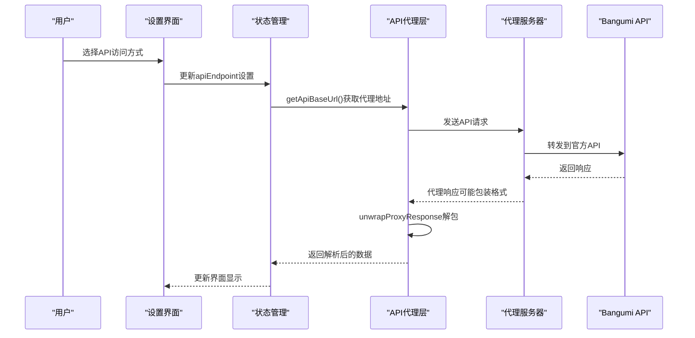

**图表来源**
- [www/js/api.js:11-24](file://www/js/api.js#L11-L24)
- [www/js/api.js:32-40](file://www/js/api.js#L32-L40)
- [www/js/api.js:48-60](file://www/js/api.js#L48-L60)
- [www/js/api.js:68-96](file://www/js/api.js#L68-L96)
- [www/js/store.js:9](file://www/js/store.js#L9)
- [www/js/renderer.js:761-771](file://www/js/renderer.js#L761-L771)
- [www/js/events.js:1079-1086](file://www/js/events.js#L1079-L1086)

**章节来源**
- [www/js/api.js:11-24](file://www/js/api.js#L11-L24)
- [www/js/api.js:32-40](file://www/js/api.js#L32-L40)
- [www/js/api.js:48-60](file://www/js/api.js#L48-L60)
- [www/js/api.js:68-96](file://www/js/api.js#L68-L96)
- [www/js/store.js:9](file://www/js/store.js#L9)
- [www/js/renderer.js:761-771](file://www/js/renderer.js#L761-L771)
- [www/js/events.js:1079-1086](file://www/js/events.js#L1079-L1086)

### 腾讯云SCF代理服务器（新增）
- **部署方式**：支持两种部署模式
  - API网关触发器：适合生产环境，自动处理CORS
  - 函数URL触发器：适合开发测试，需要手动开启CORS
- **功能特性**：完全转发请求，保持原始请求头和参数
- **错误处理**：网络异常时返回502状态码和错误信息
- **CORS支持**：自动处理预检请求和跨域头

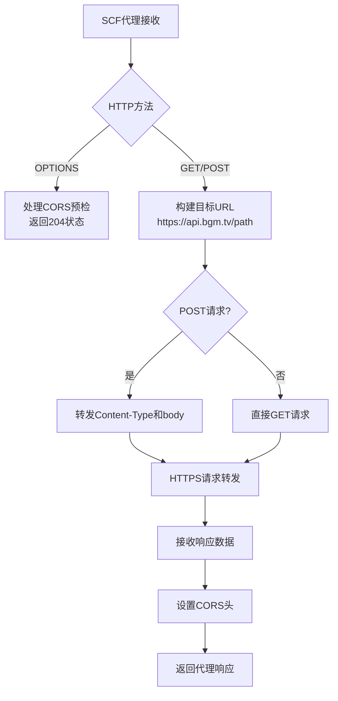

**图表来源**
- [scf_bangumi_proxy.js:14-33](file://scf_bangumi_proxy.js#L14-L33)
- [scf_bangumi_proxy.js:45-84](file://scf_bangumi_proxy.js#L45-L84)
- [scf_bangumi_proxy.js:86-106](file://scf_bangumi_proxy.js#L86-L106)

**章节来源**
- [scf_bangumi_proxy.js:1-107](file://scf_bangumi_proxy.js#L1-L107)
- [android/app/src/main/assets/public/js/scf_bangumi_proxy.js:1-143](file://android/app/src/main/assets/public/js/scf_bangumi_proxy.js#L1-L143)

### 数据导入/导出
- 导出：优先使用 File System Access API 保存JSON文件；否则尝试 Capacitor Share API 或 Web Share API
- 导入：读取JSON文件，按ID与updatedAt合并，弹出确认后写入localStorage

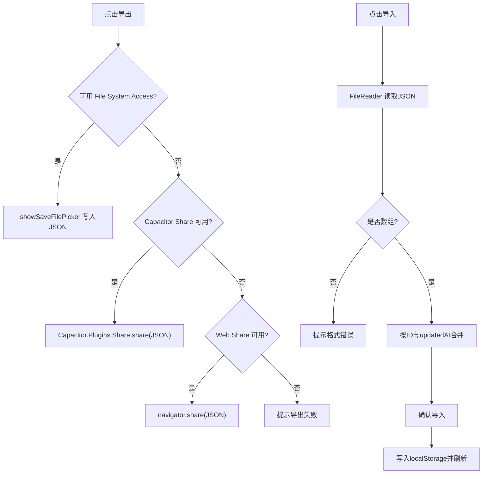

**图表来源**
- [_check.js:753-799](file://_check.js#L753-L799)
- [_check.js:801-843](file://_check.js#L801-L843)

**章节来源**
- [_check.js:753-799](file://_check.js#L753-L799)
- [_check.js:801-843](file://_check.js#L801-L843)
- [项目解读分析与改进建议.md:147-150](file://项目解读分析与改进建议.md#L147-L150)

### 状态管理机制（更新）
- 全局状态：animeList、filter、searchQuery、currentPage、currentAnime、**settings（新增apiEndpoint）**
- 状态更新：setState 合并更新并触发重新渲染
- 页面切换：根据 currentPage 渲染列表/详情/表单页
- **设置管理**：updateSettings自动持久化设置到localStorage
- 事件驱动：attachListEvents/attachDetailEvents/attachFormEvents 绑定交互

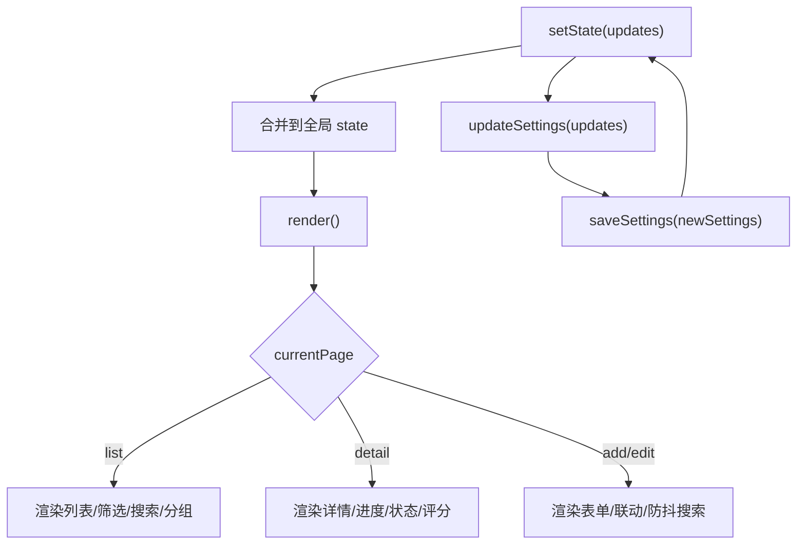

**图表来源**
- [_check.js:46-57](file://_check.js#L46-L57)
- [_check.js:124-145](file://_check.js#L124-L145)
- [_check.js:651-843](file://_check.js#L651-L843)
- [www/js/store.js:28-33](file://www/js/store.js#L28-L33)

**章节来源**
- [_check.js:46-57](file://_check.js#L46-L57)
- [_check.js:124-145](file://_check.js#L124-L145)
- [_check.js:651-843](file://_check.js#L651-L843)
- [www/js/store.js:28-33](file://www/js/store.js#L28-L33)

### 数据持久化策略
- 存储介质：localStorage
- 主键：STORAGE_KEY='anime-tracker-data'
- 结构：数组，每条记录包含基础字段、状态、评分、时间戳等
- **设置持久化**：settings对象自动保存到localStorage
- 折叠状态：COLLAPSE_KEY='anime-tracker-collapse'（在Android资源页中存在）

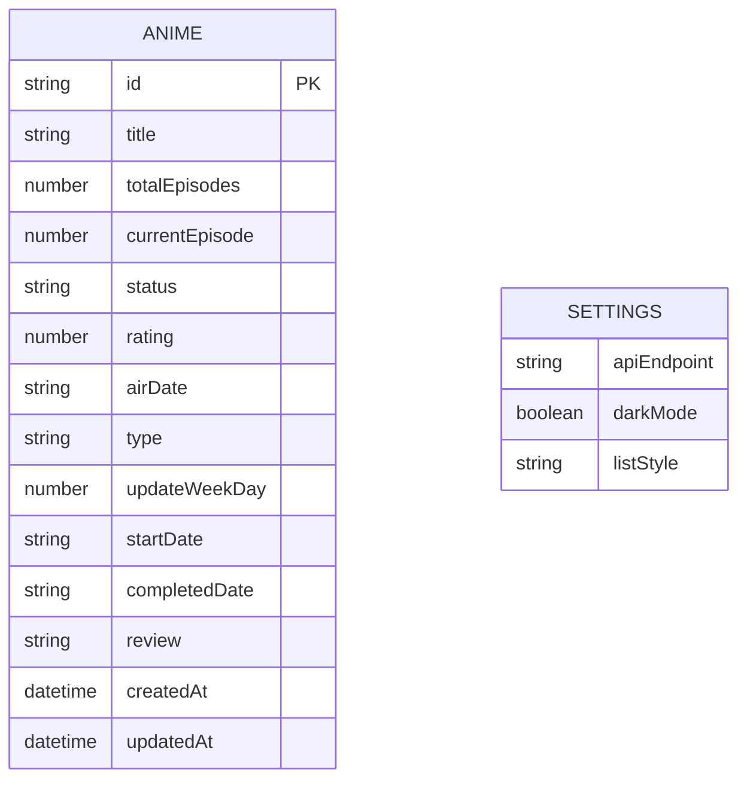

**图表来源**
- [_check.js:10-27](file://_check.js#L10-L27)
- [www/js/store.js:6-10](file://www/js/store.js#L6-L10)
- [www/index.html:1180-1213](file://www/index.html#L1180-L1213)

**章节来源**
- [_check.js:10-27](file://_check.js#L10-L27)
- [www/js/store.js:6-10](file://www/js/store.js#L6-L10)
- [www/index.html:1180-1213](file://www/index.html#L1180-L1213)
- [项目解读分析与改进建议.md:143-145](file://项目解读分析与改进建议.md#L143-L145)

### 用户界面组件（更新）
- 列表页：筛选栏、搜索框、折叠分组（年/季度/类型）、番剧卡片（标题/状态/评分/进度/+1）
- 详情页：进度控制（+/-）、状态网格、评分星标、观后感文本域
- 表单页：类型切换（追番/补番）、总集数/当前集数滚轮、状态选择、日期输入、Bangumi联想与自动填充
- **设置页**：API接口选择（直连/代理1/代理2）、深色模式切换、数据导出导入
- 提醒弹窗：今日更新与未完成补番提示

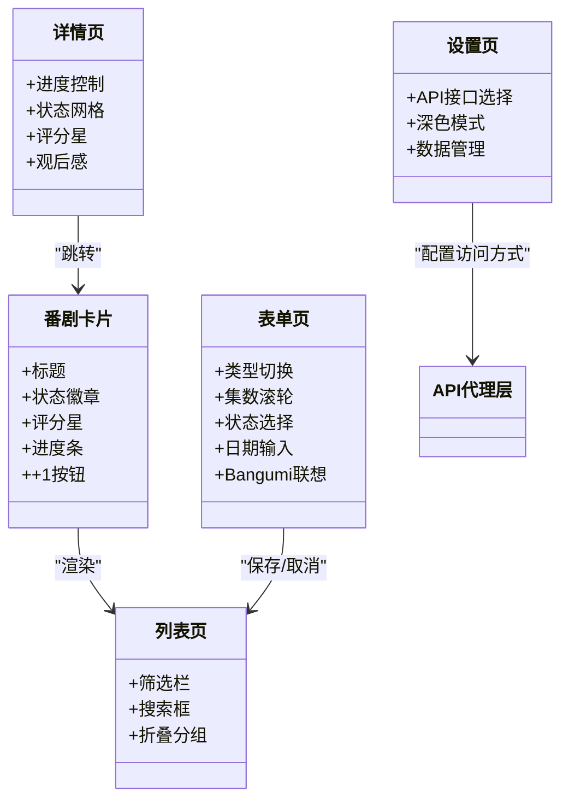

**图表来源**
- [_check.js:147-376](file://_check.js#L147-L376)
- [_check.js:378-492](file://_check.js#L378-L492)
- [_check.js:494-649](file://_check.js#L494-L649)
- [www/js/renderer.js:758-772](file://www/js/renderer.js#L758-L772)

**章节来源**
- [_check.js:147-376](file://_check.js#L147-L376)
- [_check.js:378-492](file://_check.js#L378-L492)
- [_check.js:494-649](file://_check.js#L494-L649)
- [www/js/renderer.js:758-772](file://www/js/renderer.js#L758-L772)

## 依赖关系分析
- 前端依赖：React、Zustand（声明安装但未在现有代码中使用）、Capacitor系列插件（App、Share、Filesystem等）
- 运行时依赖：浏览器API（localStorage、FileReader、File System Access、Web Share、fetch）
- **API代理依赖**：多级代理服务器配置，支持腾讯云SCF代理
- 平台集成：Capacitor用于移动端能力（如分享、返回键行为），Android资源目录提供原生静态资源

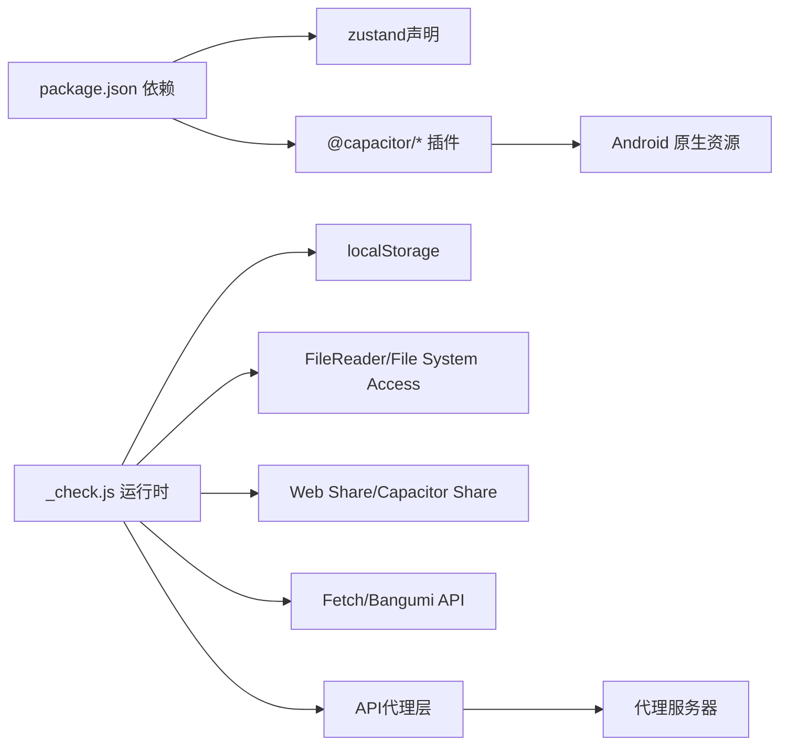

**图表来源**
- [package.json:18-29](file://package.json#L18-L29)
- [_check.js:753-799](file://_check.js#L753-L799)
- [_check.js:920-935](file://_check.js#L920-L935)
- [www/js/api.js:11-24](file://www/js/api.js#L11-L24)

**章节来源**
- [package.json:18-29](file://package.json#L18-L29)
- [_check.js:753-799](file://_check.js#L753-L799)
- [_check.js:920-935](file://_check.js#L920-L935)
- [www/js/api.js:11-24](file://www/js/api.js#L11-L24)

## 性能考量
- 渲染优化：按需渲染与事件委托，减少重复DOM操作
- 搜索防抖：表单输入使用防抖降低网络请求频率
- 滚轮选择：集数滚轮采用中心吸附与节流滚动，提升交互体验
- 本地存储：批量写入（保存时统一写入localStorage），避免频繁IO
- 分组排序：按季度与周几排序，使用稳定排序保证一致性
- **代理缓存**：代理服务器复用HTTPS连接，减少连接建立开销
- **错误重试**：网络异常时自动降级到其他代理服务器

## 故障排查指南
- 导出失败
  - 检查浏览器是否支持 File System Access API；若不支持，回落到 Capacitor Share 或 Web Share
  - 若使用 Capacitor，确认插件已正确注册与打包
- 导入失败
  - 确认JSON格式为数组；检查ID与updatedAt字段是否存在且可比较
  - 合并策略以最新更新时间为基准，注意覆盖风险
- **API访问失败（新增）**
  - 检查设置中的API访问方式是否正确配置
  - 直连模式：确保网络可达，Bangumi API可正常访问
  - 代理模式：检查代理服务器URL是否正确，代理服务器是否在线
  - 自动回退：当代理服务器不可用时，系统会自动尝试其他代理
- Bangumi搜索无结果
  - 关键词长度需≥2；确保网络可达；检查API响应状态
- 进度无法更新
  - 列表页"+1"仅在非完成/放弃状态下生效；详情页+/-按钮受边界约束
- 返回键行为
  - 移动端返回键监听：详情/表单页返回列表，列表页再次点击提示退出

**章节来源**
- [_check.js:753-799](file://_check.js#L753-L799)
- [_check.js:801-843](file://_check.js#L801-L843)
- [_check.js:1118-1216](file://_check.js#L1118-L1216)
- [_check.js:864-892](file://_check.js#L864-L892)
- [_check.js:1329-1345](file://_check.js#L1329-L1345)
- [www/js/api.js:32-40](file://www/js/api.js#L32-L40)
- [www/js/api.js:68-96](file://www/js/api.js#L68-L96)

## 结论
Anime Tracker以极简的状态机与事件驱动模型实现了完整的番剧管理闭环：从**多级API代理配置**、本地持久化到UI渲染与用户交互，形成清晰的职责分离。**新增的代理服务器支持显著提升了应用的网络适应性和可靠性**，用户可以根据网络环境和需求灵活选择最优的API访问方式。建议后续可在以下方面迭代：引入更完善的错误边界与日志上报、将Zustand替换为现有轻量方案以减少包体、完善单元测试与E2E测试覆盖、增强导入导出的版本兼容性与增量同步能力、扩展更多代理服务器选项。

## 附录
- 使用场景与最佳实践
  - 追番场景：启用"追番"模式，设置放送日期与更新日，利用提醒功能及时跟进
  - 补番场景：启用"补番"模式，记录开始与完结日期，便于统计观看时长
  - 数据迁移：定期导出JSON备份；跨设备导入时注意合并策略与冲突处理
  - 批量操作：结合筛选与搜索快速定位目标番剧，配合进度+1提升效率
  - **API配置最佳实践**：
    - 日常使用推荐使用直连模式，速度最快
    - 网络不稳定时可切换到代理1或代理2
    - 开发测试阶段可使用函数URL模式的代理2
    - 如遇代理服务器故障，系统会自动回退到其他可用代理

**章节来源**
- [项目解读分析与改进建议.md:129-165](file://项目解读分析与改进建议.md#L129-L165)
- [www/js/store.js:9](file://www/js/store.js#L9)
- [www/js/renderer.js:761-771](file://www/js/renderer.js#L761-L771)