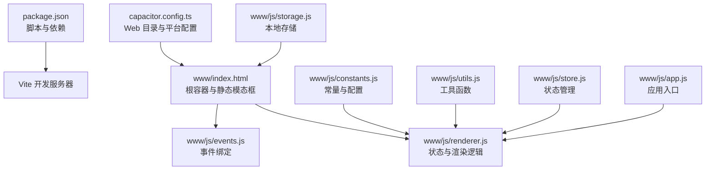
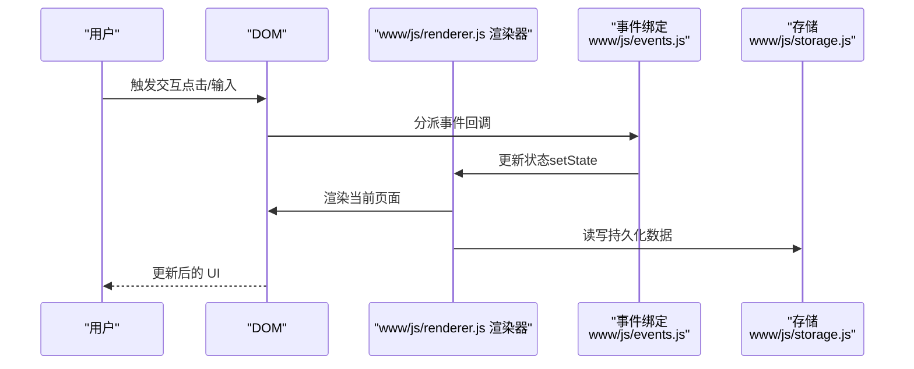
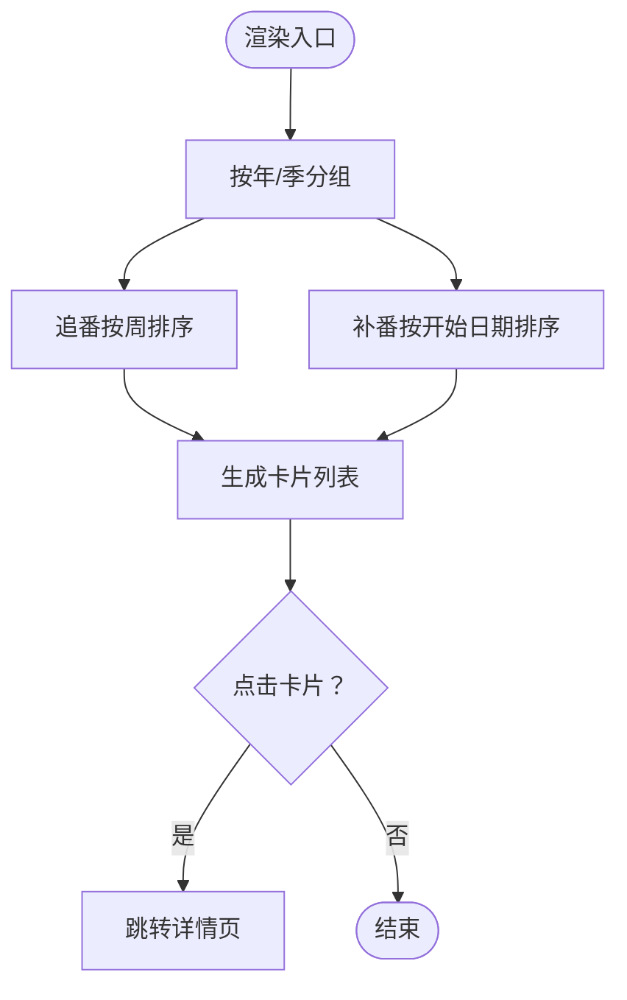
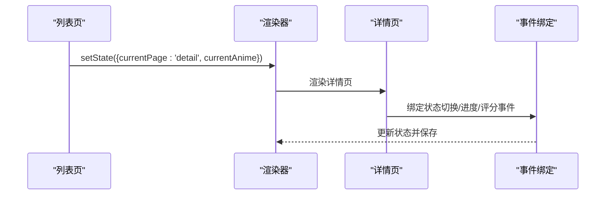
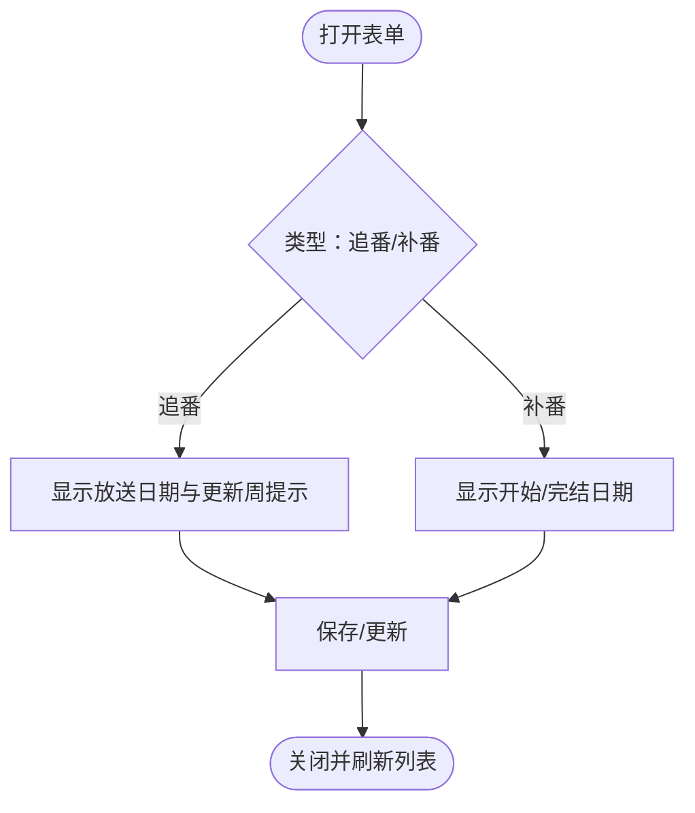
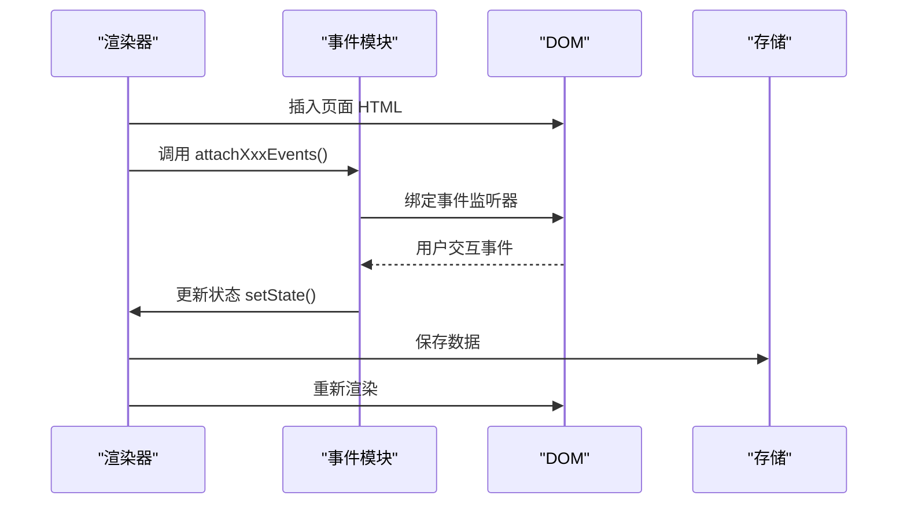
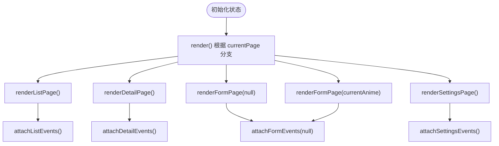
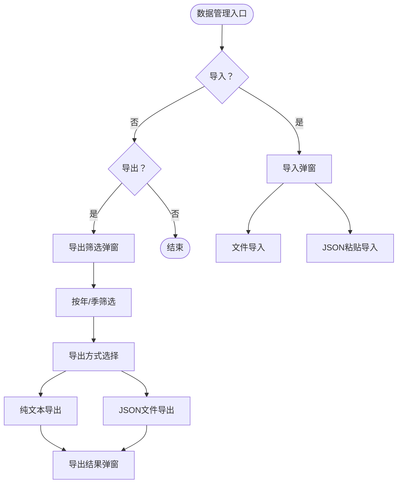
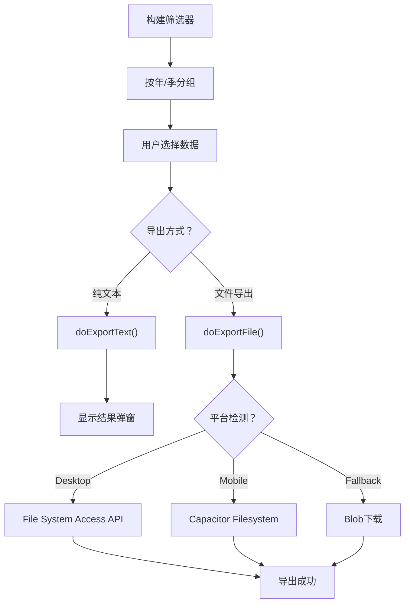
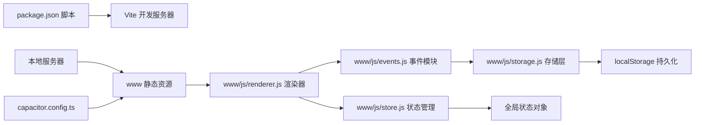

# 用户界面组件

<cite>
**本文引用的文件**
- [package.json](file://package.json)
- [capacitor.config.ts](file://capacitor.config.ts)
- [www/index.html](file://www/index.html)
- [www/js/events.js](file://www/js/events.js)
- [www/js/renderer.js](file://www/js/renderer.js)
- [www/js/store.js](file://www/js/store.js)
- [www/js/constants.js](file://www/js/constants.js)
- [www/js/utils.js](file://www/js/utils.js)
- [www/js/storage.js](file://www/js/storage.js)
- [www/js/app.js](file://www/js/app.js)
- [www/css/styles.css](file://www/css/styles.css)
</cite>

## 更新摘要
**变更内容**
- 新增高级数据管理能力的UI组件章节
- 更新事件绑定系统以包含导入/导出功能
- 新增导入/导出弹窗组件的详细说明
- 更新路由切换与页面渲染机制以支持数据管理功能
- 新增多平台兼容的导出策略说明

## 目录
1. [简介](#简介)
2. [项目结构](#项目结构)
3. [核心组件](#核心组件)
4. [架构总览](#架构总览)
5. [组件详解](#组件详解)
6. [高级数据管理组件](#高级数据管理组件)
7. [依赖关系分析](#依赖关系分析)
8. [性能考量](#性能考量)
9. [故障排查指南](#故障排查指南)
10. [结论](#结论)
11. [附录](#附录)

## 简介
本文件面向用户界面组件，围绕单页应用（SPA）的页面渲染机制、路由切换与事件绑定系统展开，系统性说明列表卡片、详情页面、表单组件与交互元素的实现原理，并给出响应式设计、动画效果与用户体验优化策略。同时提供组件复用模式、样式定制与主题配置的实践指南，以及可访问性与跨浏览器兼容的技术要点。

**更新** 本版本新增了高级数据管理能力的UI组件，包括导入/导出功能的模态对话框，支持文件选择和JSON粘贴操作，以及按特定时间段或类别过滤的导出系统。

## 项目结构
该应用采用"HTML + 原生 JS + 容器化"架构：通过 HTML 提供根节点与静态模板，使用原生 JS 实现状态管理与渲染，配合 Capacitor 将网页打包为原生应用。开发时可通过 Vite 或本地 HTTP 服务器提供静态资源。

**图表来源**
- [www/index.html:1-107](file://www/index.html#L1-L107)
- [www/js/events.js:1-800](file://www/js/events.js#L1-L800)
- [www/js/renderer.js:1-800](file://www/js/renderer.js#L1-L800)
- [www/js/store.js:1-86](file://www/js/store.js#L1-L86)
- [www/js/constants.js:1-38](file://www/js/constants.js#L1-L38)
- [www/js/utils.js:1-53](file://www/js/utils.js#L1-L53)
- [www/js/storage.js:1-57](file://www/js/storage.js#L1-L57)
- [www/js/app.js:1-38](file://www/js/app.js#L1-L38)
- [package.json:8-16](file://package.json#L8-L16)
- [capacitor.config.ts:6](file://capacitor.config.ts#L6)

**章节来源**
- [www/index.html:1-107](file://www/index.html#L1-L107)
- [package.json:8-16](file://package.json#L8-L16)
- [capacitor.config.ts:6](file://capacitor.config.ts#L6)

## 核心组件
- 页面容器与启动屏
  - 根容器用于承载 SPA 内容；启动屏在首屏过渡期间显示，提升感知速度。
- 列表页组件
  - 包含过滤栏、搜索条、分组折叠（年/季度）、列表项卡片与空状态。
- 详情页组件
  - 展示番剧基础信息、进度控制、状态切换与评论区。
- 表单组件
  - 支持新增与编辑，包含类型切换、集数选择器、日期输入、评分星标与动态节气信息。
- 交互与事件系统
  - 通过事件绑定函数集中处理路由切换、搜索、折叠、进度变更、导出等交互。

**更新** 新增高级数据管理组件，包括导入/导出弹窗、筛选器和结果展示组件。

**章节来源**
- [www/index.html:10-62](file://www/index.html#L10-L62)
- [www/js/events.js:146-342](file://www/js/events.js#L146-L342)
- [www/js/renderer.js:6-38](file://www/js/renderer.js#L6-L38)
- [www/js/renderer.js:40-83](file://www/js/renderer.js#L40-L83)
- [www/js/renderer.js:306-421](file://www/js/renderer.js#L306-L421)
- [www/js/renderer.js:423-576](file://www/js/renderer.js#L423-L576)

## 架构总览
应用采用"状态驱动渲染"的前端架构：全局状态对象决定当前页面与内容，渲染函数根据状态分支生成对应视图，事件绑定函数负责交互与状态更新，最终触发重新渲染。

**图表来源**
- [www/js/renderer.js:6-38](file://www/js/renderer.js#L6-L38)
- [www/js/events.js:21-34](file://www/js/events.js#L21-L34)
- [www/js/events.js:146-342](file://www/js/events.js#L146-L342)

## 组件详解

### 列表卡片组件（Anime Card）
- 功能要点
  - 展示标题、状态徽标、更新日标签、评分星标、进度条与"+1"按钮。
  - 支持按季分组与年份折叠，点击卡片进入详情页。
- 数据与排序
  - 按季度边界规则对放送日期进行分组；追番按更新周排序，补番按开始日期排序。
- 交互行为
  - "+1"按钮递增当前集数，自动调整状态（如完成或从"想看"转"在看"）。
- 复用建议
  - 将卡片渲染与事件绑定拆分为独立模块，便于在不同上下文复用。

**图表来源**
- [www/js/renderer.js:120-236](file://www/js/renderer.js#L120-L236)
- [www/js/renderer.js:238-304](file://www/js/renderer.js#L238-L304)
- [www/js/events.js:116-123](file://www/js/events.js#L116-L123)

**章节来源**
- [www/js/renderer.js:120-236](file://www/js/renderer.js#L120-L236)
- [www/js/renderer.js:238-304](file://www/js/renderer.js#L238-L304)
- [www/js/events.js:116-123](file://www/js/events.js#L116-L123)

### 详情页面组件（Detail Page）
- 功能要点
  - 展示类型、状态、放送日期、更新时间、进度控制、状态切换网格与评论文本域。
  - 星标评分可编辑，进度 +/- 按钮支持步进调整。
- 路由与返回
  - 通过状态切换到详情页，提供返回按钮回到列表。
- 交互行为
  - 状态切换、进度变更、评分修改均即时更新状态并持久化。

**图表来源**
- [www/js/renderer.js:306-421](file://www/js/renderer.js#L306-L421)
- [www/js/events.js:531-621](file://www/js/events.js#L531-L621)

**章节来源**
- [www/js/renderer.js:306-421](file://www/js/renderer.js#L306-L421)
- [www/js/events.js:531-621](file://www/js/events.js#L531-L621)

### 表单组件（Add/Edit Form）
- 功能要点
  - 类型切换（追番/补番），总集数与当前集数联动，状态网格选择，日期输入，评分星标，评论文本域。
  - 追番场景下展示"放送日期"与"更新周"联动提示。
- 复用建议
  - 将表单字段抽象为可注入的数据模型，统一校验与提交流程，便于扩展新字段。

**图表来源**
- [www/js/renderer.js:423-576](file://www/js/renderer.js#L423-L576)
- [www/js/renderer.js:578-596](file://www/js/renderer.js#L578-L596)

**章节来源**
- [www/js/renderer.js:423-576](file://www/js/renderer.js#L423-L576)
- [www/js/events.js:751-800](file://www/js/events.js#L751-L800)

### 事件绑定系统
- 列表页事件
  - 过滤按钮、搜索输入（含输入法组合阶段处理）、年/季折叠头、卡片点击、进度 +1、导出/分享。
- 详情页事件
  - 返回、编辑、删除、状态切换、进度 +/-、评分编辑、评论输入。
- 表单事件
  - 类型切换、集数滚轮、状态网格、日期输入、评分编辑、保存/取消。
- 数据管理事件
  - 导入/导出弹窗事件、筛选器事件、结果展示事件。
- 设计原则
  - 事件绑定集中在独立模块，避免重复绑定与内存泄漏；每次渲染后重新绑定。

**图表来源**
- [www/js/renderer.js:6-38](file://www/js/renderer.js#L6-L38)
- [www/js/events.js:1-342](file://www/js/events.js#L1-L342)

**章节来源**
- [www/js/events.js:1-342](file://www/js/events.js#L1-L342)
- [www/js/events.js:531-621](file://www/js/events.js#L531-L621)
- [www/js/events.js:751-800](file://www/js/events.js#L751-L800)

### 路由切换与页面渲染机制
- 路由状态
  - 使用全局状态中的当前页面键值控制渲染分支：列表、详情、新增、编辑、设置。
- 渲染流程
  - 渲染函数根据状态分支调用相应页面渲染方法，生成 HTML 并插入根容器；随后绑定对应事件。
- 性能注意
  - 每次切换仅替换根容器内容，避免整页刷新；事件绑定在渲染后执行，确保元素存在。

**图表来源**
- [www/js/renderer.js:6-38](file://www/js/renderer.js#L6-L38)
- [www/js/renderer.js:40-83](file://www/js/renderer.js#L40-L83)

**章节来源**
- [www/js/renderer.js:6-38](file://www/js/renderer.js#L6-L38)
- [www/js/renderer.js:40-83](file://www/js/renderer.js#L40-L83)

### 响应式设计与动画效果
- 响应式布局
  - 使用弹性布局与流式宽度适配移动端与桌面端；输入框与按钮尺寸随视口缩放。
- 动画与过渡
  - 启动屏具备淡入淡出过渡；折叠头通过 max-height 与类名切换实现展开/收起动画。
- 用户体验优化
  - 搜索输入支持输入法组合阶段防抖；滚动与焦点保持；空状态引导添加首部番剧。

**章节来源**
- [www/index.html:10-14](file://www/index.html#L10-L14)
- [www/js/renderer.js:180-236](file://www/js/renderer.js#L180-L236)
- [www/js/renderer.js:16-38](file://www/js/renderer.js#L16-L38)

### 组件复用模式、样式定制与主题配置
- 复用模式
  - 将渲染函数与事件绑定函数模块化，通过传入数据对象与回调接口实现复用。
- 样式定制
  - 通过 CSS 类名与内联样式的组合实现局部样式覆盖；建议引入 CSS 变量以统一间距与色彩。
- 主题配置
  - 在 HTML 中引入主题样式文件，或通过运行时切换 CSS 类名实现明暗主题切换。

**章节来源**
- [www/js/renderer.js:40-83](file://www/js/renderer.js#L40-L83)
- [www/js/renderer.js:306-421](file://www/js/renderer.js#L306-L421)
- [www/js/renderer.js:423-576](file://www/js/renderer.js#L423-L576)

### 可访问性与跨浏览器兼容
- 可访问性
  - 使用语义化标签与 aria 属性；为交互元素提供键盘可达性；为图片提供替代文本。
- 兼容性
  - 使用现代浏览器特性（如 FilePicker、Web Share API）时提供降级方案；在 Capacitor 环境下结合原生插件能力。
- 安全与健壮性
  - 输入转义与本地存储异常捕获，避免 XSS 与崩溃。

**章节来源**
- [www/index.html:4-8](file://www/index.html#L4-L8)
- [www/js/utils.js:5-10](file://www/js/utils.js#L5-L10)
- [www/js/events.js:451-512](file://www/js/events.js#L451-L512)

## 高级数据管理组件

### 导入/导出弹窗系统
- 功能概述
  - 提供完整的数据导入导出解决方案，支持多种数据格式和导出方式。
- 组件结构
  - 导入弹窗：支持文件选择和JSON粘贴两种导入方式
  - 导出筛选弹窗：按年/季分组筛选导出范围
  - 导出方式选择弹窗：支持纯文本复制和JSON文件导出
  - 导出结果弹窗：展示导出的JSON数据并支持复制

**图表来源**
- [www/index.html:22-94](file://www/index.html#L22-L94)
- [www/js/events.js:146-342](file://www/js/events.js#L146-L342)
- [www/js/events.js:344-436](file://www/js/events.js#L344-L436)

### 导入功能实现
- 文件导入
  - 支持 .json 文件选择，使用 FileReader 读取并解析
  - 自动验证JSON格式和数据结构
- JSON粘贴导入
  - 提供文本域让用户粘贴JSON数据
  - 实时验证JSON格式并显示错误信息
- 数据合并策略
  - 以番剧名称为键进行去重合并
  - 新数据会覆盖本地同名数据

**章节来源**
- [www/index.html:19-48](file://www/index.html#L19-L48)
- [www/js/events.js:250-336](file://www/js/events.js#L250-L336)
- [www/js/events.js:514-529](file://www/js/events.js#L514-L529)

### 导出功能实现
- 筛选机制
  - 按年份和季度自动分组番剧数据
  - 支持全选/反选操作
  - 实时统计各季度数据数量
- 导出策略
  - 纯文本导出：在弹窗中展示JSON格式数据
  - 文件导出：支持多种平台的下载策略
- 多平台兼容
  - 桌面浏览器：File System Access API
  - 移动设备：Capacitor Filesystem + Share
  - 传统浏览器：Blob下载

**图表来源**
- [www/js/events.js:344-436](file://www/js/events.js#L344-L436)
- [www/js/events.js:438-512](file://www/js/events.js#L438-L512)

**章节来源**
- [www/index.html:50-94](file://www/index.html#L50-L94)
- [www/js/events.js:344-512](file://www/js/events.js#L344-L512)

### 数据管理事件处理
- 导入事件
  - 文件选择事件：触发文件读取和解析
  - JSON粘贴事件：验证格式并导入数据
  - 导入确认：显示合并预览并执行导入
- 导出事件
  - 筛选器事件：构建年/季分组和选择逻辑
  - 导出方式事件：根据用户选择执行不同导出策略
  - 结果展示事件：复制到剪贴板或关闭弹窗

**章节来源**
- [www/js/events.js:146-342](file://www/js/events.js#L146-L342)
- [www/js/events.js:344-512](file://www/js/events.js#L344-L512)

## 依赖关系分析
- 构建与运行
  - Vite 作为开发与构建工具；Capacitor 配置 Web 目录为 www。
- 本地服务
  - 提供简易 HTTP 服务器用于静态资源调试。
- 事件模块
  - 事件绑定函数集中于独立模块，与渲染器解耦，提高可维护性。
- 数据管理
  - 导入/导出功能通过事件模块与渲染器协作，实现完整的数据生命周期管理。

**图表来源**
- [package.json:8-16](file://package.json#L8-L16)
- [capacitor.config.ts:6](file://capacitor.config.ts#L6)
- [www/js/renderer.js:6-38](file://www/js/renderer.js#L6-L38)
- [www/js/events.js:1-342](file://www/js/events.js#L1-L342)
- [www/js/storage.js:1-57](file://www/js/storage.js#L1-L57)
- [www/js/store.js:1-86](file://www/js/store.js#L1-L86)

**章节来源**
- [package.json:8-16](file://package.json#L8-L16)
- [capacitor.config.ts:6](file://capacitor.config.ts#L6)

## 性能考量
- 渲染策略
  - 仅在状态变化时触发渲染，避免不必要的重绘；事件绑定在渲染后执行，减少重复绑定。
- 交互优化
  - 搜索输入采用组合阶段防抖；进度 +1 按钮阻止冒泡，避免误触。
- 存储与网络
  - 本地存储异常兜底；导出优先使用 FilePicker，否则回退至 Web Share 或 Capacitor 分享插件。
- 数据管理优化
  - 导入数据采用去重合并策略，避免重复存储
  - 导出数据按需筛选，减少传输和处理开销

**章节来源**
- [www/js/renderer.js:16-38](file://www/js/renderer.js#L16-L38)
- [www/js/events.js:338-342](file://www/js/events.js#L338-L342)
- [www/js/events.js:451-512](file://www/js/events.js#L451-L512)
- [www/js/events.js:514-529](file://www/js/events.js#L514-L529)

## 故障排查指南
- 页面不更新
  - 检查状态更新是否调用渲染函数；确认事件回调中正确 setState。
- 事件无效
  - 确认事件绑定在渲染后执行；检查元素选择器与事件委托是否正确。
- 导出/分享失败
  - 检查浏览器支持与 Capacitor 插件可用性；查看错误日志并提示用户。
- 启动屏不消失
  - 确认启动屏元素与过渡样式；避免阻塞主线程。
- 导入数据失败
  - 检查JSON格式是否正确；确认文件编码和数据结构符合要求。
- 导出数据为空
  - 确认筛选器是否有数据被选中；检查数据分组逻辑。

**章节来源**
- [www/js/renderer.js:6-38](file://www/js/renderer.js#L6-L38)
- [www/js/events.js:1-342](file://www/js/events.js#L1-L342)
- [www/js/events.js:451-512](file://www/js/events.js#L451-L512)
- [www/js/events.js:514-529](file://www/js/events.js#L514-L529)

## 结论
该 UI 组件体系以状态驱动渲染为核心，通过模块化的事件绑定与可复用的渲染函数，实现了清晰的页面切换与丰富的交互体验。配合响应式布局与动画过渡，兼顾了移动端与桌面端的可用性。

**更新** 新增的高级数据管理组件进一步增强了应用的功能完整性，提供了完整的数据导入导出能力，支持多种平台和格式，确保了数据的安全性和可移植性。建议后续引入组件化框架或构建期样式变量，进一步提升可维护性与一致性。

## 附录
- 开发与预览
  - 使用 Vite 脚本启动开发服务器；使用本地 HTTP 服务器快速预览静态资源。
- 平台集成
  - Capacitor 配置 Web 目录为 www，支持 Android/iOS 打包与分享插件。
- 数据管理最佳实践
  - 定期备份重要数据
  - 使用标准JSON格式进行数据交换
  - 注意数据隐私和安全

**章节来源**
- [package.json:8-16](file://package.json#L8-L16)
- [capacitor.config.ts:6](file://capacitor.config.ts#L6)
- [www/js/events.js:146-342](file://www/js/events.js#L146-L342)
- [www/js/events.js:344-512](file://www/js/events.js#L344-L512)