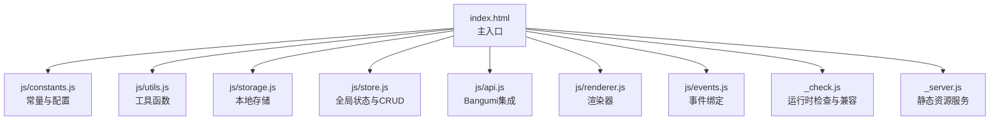
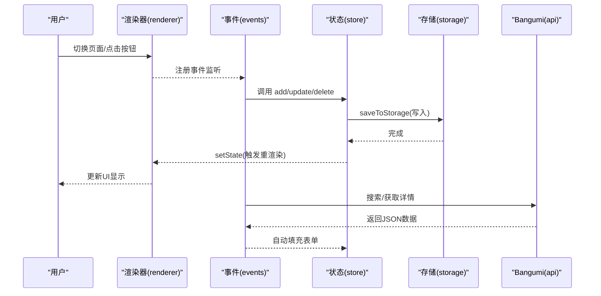
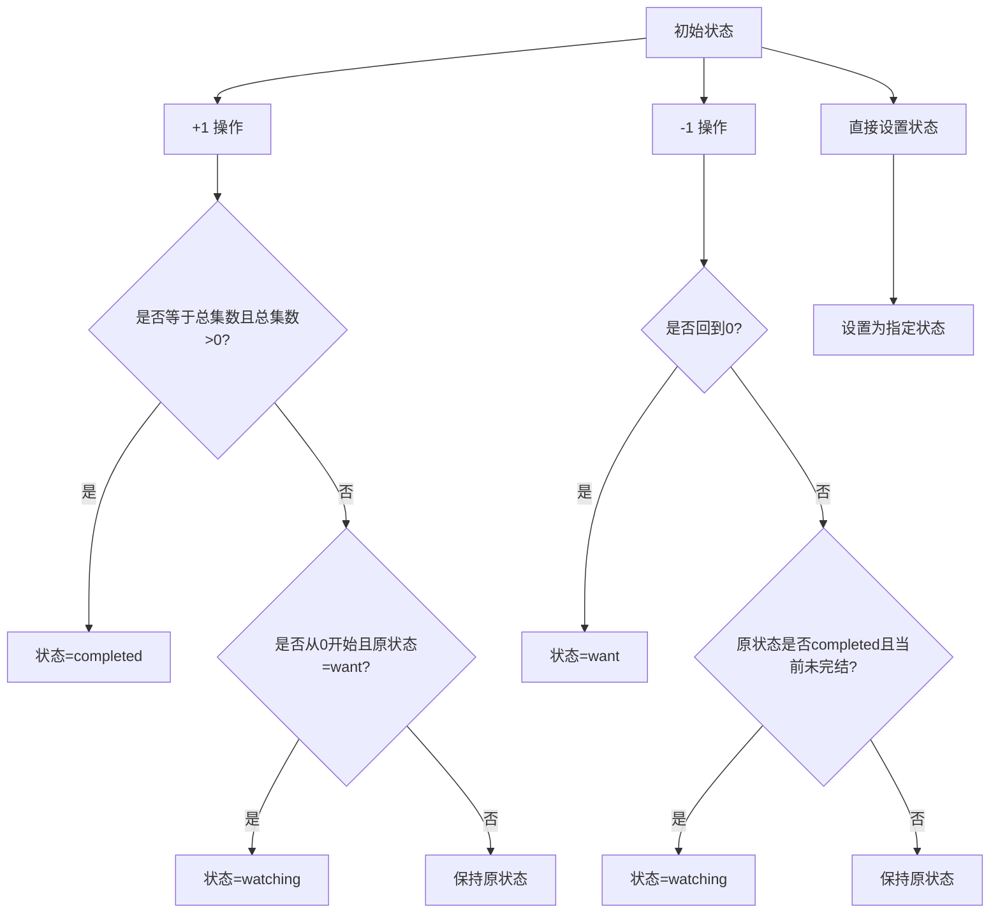
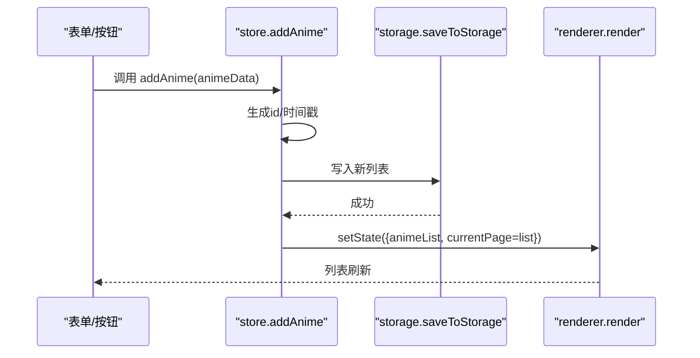
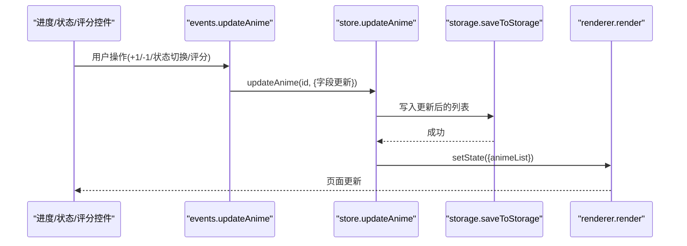
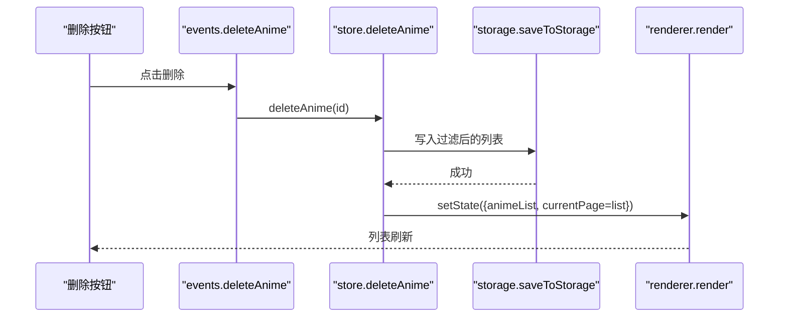
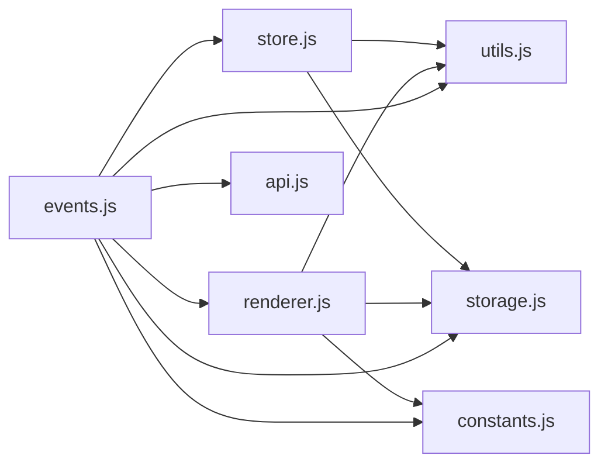

# 番剧管理

<cite>
**本文引用的文件**
- [index.html](file://www/index.html)
- [store.js](file://www/js/store.js)
- [constants.js](file://www/js/constants.js)
- [utils.js](file://www/js/utils.js)
- [storage.js](file://www/js/storage.js)
- [api.js](file://www/js/api.js)
- [events.js](file://www/js/events.js)
- [renderer.js](file://www/js/renderer.js)
- [_check.js](file://_check.js)
- [_server.js](file://_server.js)
- [package.json](file://package.json)
</cite>

## 目录
1. [简介](#简介)
2. [项目结构](#项目结构)
3. [核心组件](#核心组件)
4. [架构总览](#架构总览)
5. [详细组件分析](#详细组件分析)
6. [依赖关系分析](#依赖关系分析)
7. [性能考量](#性能考量)
8. [故障排查指南](#故障排查指南)
9. [结论](#结论)
10. [附录](#附录)

## 简介
本文件面向“番剧管理”功能，系统性阐述番剧的增删改查（CRUD）实现原理，重点解析 addAnime、updateAnime、deleteAnime 的工作机制；说明番剧数据模型字段、验证规则与状态管理（want、watching、paused、completed、dropped）及状态转换逻辑；提供完整 API 调用示例、参数说明与返回值格式；并给出实际使用场景演示与最佳实践建议。

## 项目结构
该应用采用前端单页架构，核心由状态管理、存储层、渲染层、事件绑定与工具函数组成，配合 Bangumi API 实现番剧信息检索与填充。模块加载顺序严格控制，确保状态初始化与渲染链路稳定。

图表来源
- [index.html:65-72](file://www/index.html#L65-L72)
- [constants.js:1-37](file://www/js/constants.js#L1-L37)
- [utils.js:1-53](file://www/js/utils.js#L1-L53)
- [storage.js:1-40](file://www/js/storage.js#L1-L40)
- [store.js:1-71](file://www/js/store.js#L1-L71)
- [api.js:1-31](file://www/js/api.js#L1-L31)
- [renderer.js:1-27](file://www/js/renderer.js#L1-L27)
- [events.js:1-258](file://www/js/events.js#L1-L258)
- [_check.js:1-874](file://_check.js#L1-L874)
- [_server.js:1-32](file://_server.js#L1-L32)

章节来源
- [index.html:1-75](file://www/index.html#L1-L75)
- [package.json:1-38](file://package.json#L1-L38)

## 核心组件
- 状态管理与 CRUD
  - addAnime：新增番剧，自动生成唯一 ID、创建与更新时间戳，写入本地存储并切换到列表页。
  - updateAnime：部分更新番剧字段（如进度、状态、评分等），自动更新 updatedAt，写回本地存储。
  - deleteAnime：按 ID 过滤列表，写回本地存储并回到列表页。
- 存储层
  - loadFromStorage/saveToStorage：基于 localStorage 的序列化/反序列化存取。
- 渲染与事件
  - renderer：根据当前页面状态渲染列表、详情、表单页。
  - events：绑定列表页 +1/-1、详情页进度变更、状态切换、表单提交、Bangumi 搜索与填充等交互。
- 工具与常量
  - utils：HTML 转义、ID 生成、周几计算、星级渲染等。
  - constants：状态配置、季度边界、类型配置、本地存储键名等。
- API 集成
  - api：封装 Bangumi 搜索与详情接口，支持自动填充表单。

章节来源
- [store.js:38-70](file://www/js/store.js#L38-L70)
- [storage.js:5-22](file://www/js/storage.js#L5-L22)
- [renderer.js:5-27](file://www/js/renderer.js#L5-L27)
- [events.js:109-128](file://www/js/events.js#L109-L128)
- [events.js:414-487](file://www/js/events.js#L414-L487)
- [utils.js:5-53](file://www/js/utils.js#L5-L53)
- [constants.js:5-37](file://www/js/constants.js#L5-L37)
- [api.js:5-31](file://www/js/api.js#L5-L31)

## 架构总览
下图展示“番剧管理”的端到端流程：用户通过 UI 触发事件，事件处理器调用状态管理函数，状态变更驱动渲染器更新界面，同时写入本地存储持久化。

图表来源
- [renderer.js:5-27](file://www/js/renderer.js#L5-L27)
- [events.js:109-128](file://www/js/events.js#L109-L128)
- [events.js:414-487](file://www/js/events.js#L414-L487)
- [store.js:38-70](file://www/js/store.js#L38-L70)
- [storage.js:15-22](file://www/js/storage.js#L15-L22)
- [api.js:10-30](file://www/js/api.js#L10-L30)

## 详细组件分析

### 数据模型与字段定义
番剧对象包含以下关键字段（字段名与含义）：
- title：番剧标题（必填）
- totalEpisodes：总集数（≥1）
- currentEpisode：当前观看集数（0..totalEpisodes）
- status：观看状态（枚举：want/watching/paused/completed/dropped）
- rating：评分（1-5，0 表示未评分）
- review：个人评论
- airDate：放送日期（YYYY-MM-DD）
- type：类型（chasing 追番 / binge 补番）
- updateWeekDay：更新星期（1-7，追番时使用）
- completedDate：完结日期（仅完成时有）
- startDate：开始观看日期（补番时使用）
- createdAt：创建时间（ISO 字符串）
- updatedAt：最后更新时间（ISO 字符串）

字段约束与默认值：
- totalEpisodes ≥ 1；currentEpisode ∈ [0, totalEpisodes]
- 当 currentEpisode = 0 且非补番时，status 默认为 want
- 当 currentEpisode = totalEpisodes 且 totalEpisodes > 0 时，status 自动转为 completed
- 补番模式下，若从 completed 回退到未完结，status 可能回退为 watching
- type 为 chasing 时，优先使用 airDate 推导更新星期；binge 时使用 airDate 与 startDate

章节来源
- [events.js:609-673](file://www/js/events.js#L609-L673)
- [events.js:433-461](file://www/js/events.js#L433-L461)
- [events.js:116-126](file://www/js/events.js#L116-L126)
- [store.js:39-49](file://www/js/store.js#L39-L49)

### 番剧状态管理与转换逻辑
状态集合与标签：
- want：想看
- watching：在看
- paused：搁置
- completed：已看完
- dropped：放弃

状态转换规则：
- +1 按钮：currentEpisode 增加 1，若超过 totalEpisodes 则截断至 totalEpisodes；当达到总集数且 totalEpisodes > 0 时，状态转为 completed；若从 want 开始观看，状态转为 watching。
- -1 按钮：currentEpisode 减少 1，若回到 0，则状态转为 want；若原状态为 completed 且回退到未完结，则状态转为 watching。
- 详情页状态切换：直接设置 status 为目标值。
- 表单保存：根据 currentEpisode 与 totalEpisodes 推导最终 status。

图表来源
- [events.js:116-126](file://www/js/events.js#L116-L126)
- [events.js:433-461](file://www/js/events.js#L433-L461)
- [events.js:472-477](file://www/js/events.js#L472-L477)

章节来源
- [constants.js:5-12](file://www/js/constants.js#L5-L12)
- [events.js:109-128](file://www/js/events.js#L109-L128)
- [events.js:414-487](file://www/js/events.js#L414-L487)

### 增删改查实现原理

#### addAnime（新增）
- 输入：animeData（除 id、createdAt、updatedAt 外的字段）
- 处理：
  - 生成唯一 id
  - 设置 createdAt/updatedAt 为当前时间
  - 将新对象推入列表
  - 写入本地存储
  - 切换到列表页
- 输出：无显式返回值，副作用为更新全局状态与存储

图表来源
- [store.js:38-49](file://www/js/store.js#L38-L49)
- [storage.js:15-22](file://www/js/storage.js#L15-L22)
- [renderer.js:5-27](file://www/js/renderer.js#L5-L27)

章节来源
- [store.js:38-49](file://www/js/store.js#L38-L49)

#### updateAnime（更新）
- 输入：id, updates（部分字段）
- 处理：
  - 通过 id 匹配目标项，合并 updates
  - 更新 updatedAt
  - 写回本地存储
  - 触发重渲染
- 输出：无显式返回值

图表来源
- [events.js:433-461](file://www/js/events.js#L433-L461)
- [events.js:472-477](file://www/js/events.js#L472-L477)
- [store.js:51-60](file://www/js/store.js#L51-L60)
- [storage.js:15-22](file://www/js/storage.js#L15-L22)

章节来源
- [store.js:51-60](file://www/js/store.js#L51-L60)
- [events.js:414-487](file://www/js/events.js#L414-L487)

#### deleteAnime（删除）
- 输入：id
- 处理：
  - 过滤掉匹配 id 的条目
  - 写回本地存储
  - 切换到列表页
- 输出：无显式返回值

图表来源
- [events.js:427-431](file://www/js/events.js#L427-L431)
- [store.js:62-70](file://www/js/store.js#L62-L70)
- [storage.js:15-22](file://www/js/storage.js#L15-L22)

章节来源
- [store.js:62-70](file://www/js/store.js#L62-L70)
- [events.js:414-487](file://www/js/events.js#L414-L487)

### API 集成与使用示例

#### Bangumi 搜索与详情
- 搜索接口
  - 方法：POST
  - 地址：https://api.bgm.tv/v0/search/subjects
  - 请求体：{ keyword, filter: { type: [2] }, limit: 8 }
  - 返回：数组，过滤掉非番剧类型（type=2）
- 详情接口
  - 方法：GET
  - 地址：https://api.bgm.tv/v0/subjects/{id}
  - 返回：对象或 null

调用示例（伪代码）：
- 搜索番剧
  - POST https://api.bgm.tv/v0/search/subjects
  - 请求体：{ "keyword": "xxx", "filter": { "type": [2] }, "limit": 8 }
  - 成功：返回条目数组（仅番剧）
- 获取详情
  - GET https://api.bgm.tv/v0/subjects/{id}
  - 成功：返回条目详情对象

章节来源
- [api.js:10-30](file://www/js/api.js#L10-L30)

## 依赖关系分析
- 模块耦合
  - events 依赖 store、renderer、api、utils、constants、storage
  - renderer 依赖 constants、utils、storage
  - store 依赖 storage、utils
  - api 为外部依赖，不依赖内部模块
- 关键依赖链
  - UI 事件 → 事件处理器 → 状态管理 → 存储 → 渲染
  - 表单校验与状态推导集中在 events 与 store

图表来源
- [events.js:1-258](file://www/js/events.js#L1-L258)
- [store.js:1-71](file://www/js/store.js#L1-L71)
- [renderer.js:1-27](file://www/js/renderer.js#L1-L27)
- [api.js:1-31](file://www/js/api.js#L1-L31)
- [utils.js:1-53](file://www/js/utils.js#L1-L53)
- [constants.js:1-37](file://www/js/constants.js#L1-L37)
- [storage.js:1-40](file://www/js/storage.js#L1-L40)

章节来源
- [events.js:1-258](file://www/js/events.js#L1-L258)
- [store.js:1-71](file://www/js/store.js#L1-L71)
- [renderer.js:1-27](file://www/js/renderer.js#L1-L27)
- [api.js:1-31](file://www/js/api.js#L1-L31)
- [utils.js:1-53](file://www/js/utils.js#L1-L53)
- [constants.js:1-37](file://www/js/constants.js#L1-L37)
- [storage.js:1-40](file://www/js/storage.js#L1-L40)

## 性能考量
- 渲染优化
  - 使用 setState 合并状态更新，避免多次重渲染
  - 列表分组与折叠状态持久化，减少 DOM 重建
- 存储优化
  - 一次性写入整表，避免频繁小粒度写入
  - 异常捕获与降级（失败时记录日志但不中断流程）
- 事件绑定
  - 使用事件委托与按需绑定，减少监听器数量
- 外部 API
  - 搜索使用防抖（表单输入 500ms 阈值），降低请求频率

章节来源
- [events.js:760-781](file://www/js/events.js#L760-L781)
- [storage.js:15-22](file://www/js/storage.js#L15-L22)
- [renderer.js:167-190](file://www/js/renderer.js#L167-L190)

## 故障排查指南
- 无法保存/读取数据
  - 检查浏览器隐私模式或存储限制
  - 查看控制台是否有异常（storage 写入捕获了异常）
- 状态不同步
  - 确认 updateAnime 是否正确传入 id 与 updates
  - 检查 updatedAt 是否更新，确认渲染链路是否触发
- Bangumi 搜索失败
  - 确认网络连通性
  - 检查响应码与返回体结构
- 导入/导出异常
  - 导入：确认 JSON 为数组格式
  - 导出：确认浏览器支持 showSaveFilePicker 或 Web Share API

章节来源
- [storage.js:15-22](file://www/js/storage.js#L15-L22)
- [events.js:222-257](file://www/js/events.js#L222-L257)
- [events.js:357-395](file://www/js/events.js#L357-L395)
- [api.js:10-30](file://www/js/api.js#L10-L30)

## 结论
本番剧管理系统以轻量前端架构实现完整的 CRUD 与状态管理，结合 Bangumi API 提升数据质量与录入效率。通过清晰的状态机与严格的字段约束，保证数据一致性与用户体验。建议在后续迭代中引入更完善的校验与版本迁移策略，以增强长期可用性。

## 附录

### API 调用示例与参数说明
- 新增番剧
  - 方法：POST
  - 路径：/（前端本地存储，无后端接口）
  - 参数：animeData（见“数据模型与字段定义”）
  - 返回：无（更新本地状态与存储）
- 更新番剧
  - 方法：PUT（前端本地存储，无后端接口）
  - 路径：/（同上）
  - 参数：id（必填）、updates（部分字段）
  - 返回：无
- 删除番剧
  - 方法：DELETE（前端本地存储，无后端接口）
  - 路径：/（同上）
  - 参数：id（必填）
  - 返回：无

章节来源
- [store.js:38-70](file://www/js/store.js#L38-L70)

### 使用场景演示
- 追番记录
  - 在“追番”类型下，填写放送日期，系统自动推导更新星期；观看进度变化时自动切换状态。
- 补番记录
  - 在“补番”类型下，填写开始/完结日期；进度达到总集数时自动标记完成。
- 批量导出/导入
  - 支持按年/季筛选导出；支持 JSON 导入并去重合并。

章节来源
- [events.js:109-128](file://www/js/events.js#L109-L128)
- [events.js:337-395](file://www/js/events.js#L337-L395)
- [events.js:397-412](file://www/js/events.js#L397-L412)

### 最佳实践建议
- 表单校验
  - 标题必填、集数最小为 1、进度不超过总集数
- 状态一致性
  - 通过统一的 updateAnime 调用路径，避免绕过状态推导
- 数据安全
  - 导入前提示合并策略，保留最新数据
- 用户体验
  - 使用 Toast 提示导入/导出结果
  - 详情页评分仅在 completed 时展示

章节来源
- [events.js:609-673](file://www/js/events.js#L609-L673)
- [events.js:397-412](file://www/js/events.js#L397-L412)
- [utils.js:45-53](file://www/js/utils.js#L45-L53)