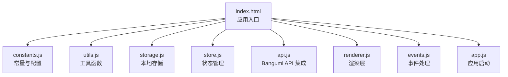
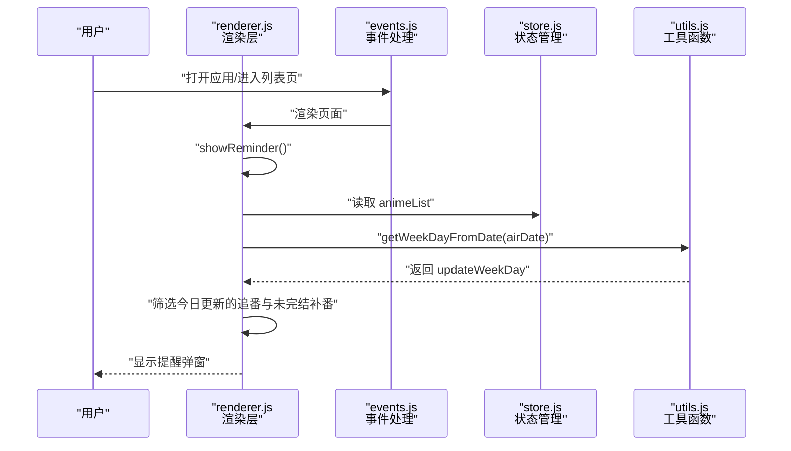
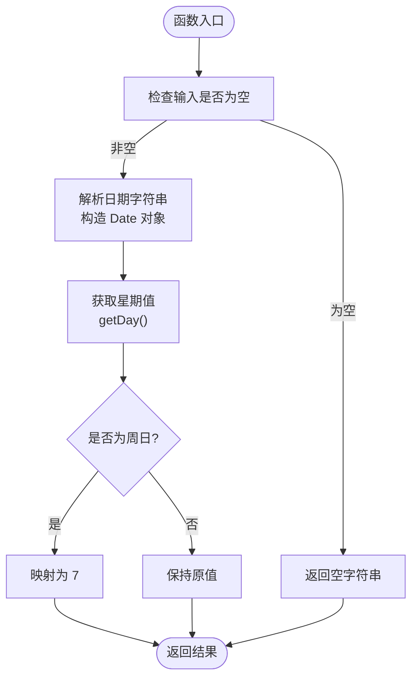
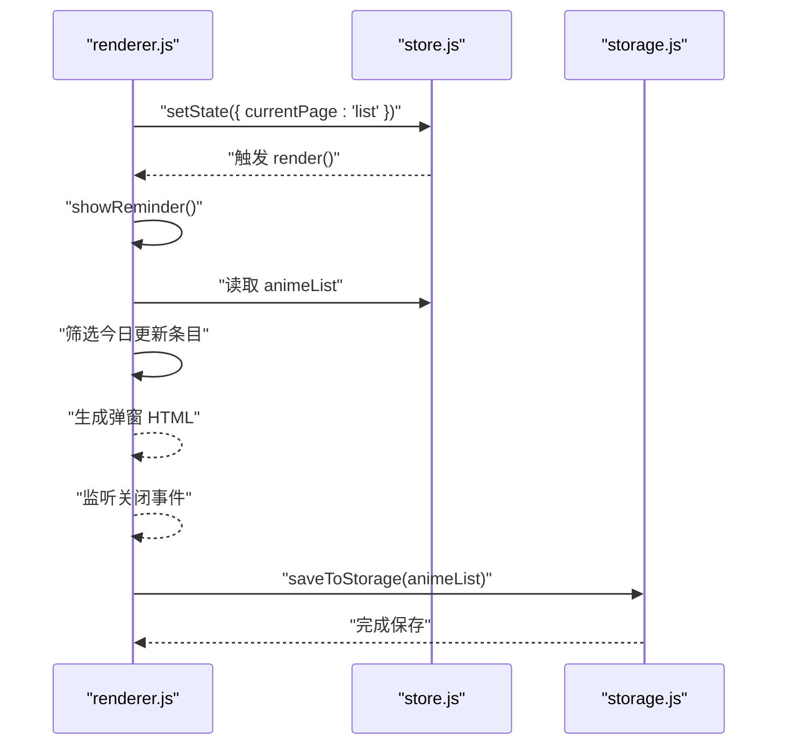
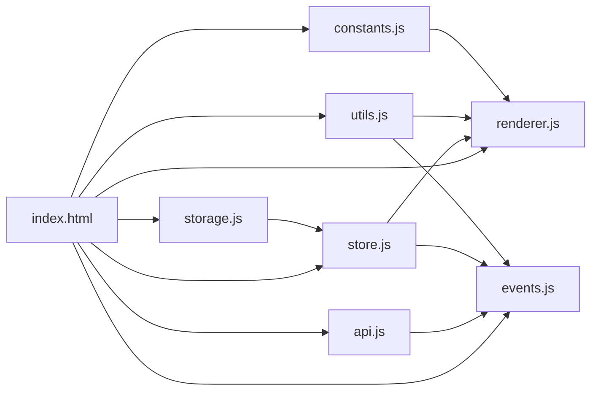

# 提醒系统

<cite>
**本文引用的文件**
- [index.html](file://android/app/src/main/assets/public/index.html)
- [constants.js](file://android/app/src/main/assets/public/js/constants.js)
- [utils.js](file://android/app/src/main/assets/public/js/utils.js)
- [storage.js](file://android/app/src/main/assets/public/js/storage.js)
- [store.js](file://android/app/src/main/assets/public/js/store.js)
- [renderer.js](file://android/app/src/main/assets/public/js/renderer.js)
- [events.js](file://android/app/src/main/assets/public/js/events.js)
- [api.js](file://android/app/src/main/assets/public/js/api.js)
- [_check.js](file://_check.js)
- [_server.js](file://_server.js)
- [package.json](file://package.json)
- [capacitor.config.ts](file://capacitor.config.ts)
</cite>

## 目录
1. [简介](#简介)
2. [项目结构](#项目结构)
3. [核心组件](#核心组件)
4. [架构总览](#架构总览)
5. [详细组件分析](#详细组件分析)
6. [依赖关系分析](#依赖关系分析)
7. [性能考量](#性能考量)
8. [故障排查指南](#故障排查指南)
9. [结论](#结论)
10. [附录](#附录)

## 简介
本文件面向“提醒系统”的实现，重点解释周更新提醒功能的工作机制，包括 getWeekDayFromDate 函数的原理、updateWeekDay 字段的计算与使用、基于放送日期自动推算更新星期的逻辑，以及在界面中的显示与编辑流程。同时提供 UI 组件渲染、用户交互处理与数据存储机制的代码路径指引，并给出扩展思路（自定义提醒间隔、通知推送、提醒历史等）。

## 项目结构
该应用采用前端单页架构，通过模块化 JS 文件组织业务逻辑；提醒系统涉及常量定义、工具函数、状态管理、渲染层、事件绑定与数据持久化等模块。入口页面负责加载各脚本模块并挂载主应用容器。

图表来源
- [index.html:64-72](file://android/app/src/main/assets/public/index.html#L64-L72)
- [constants.js:1-37](file://android/app/src/main/assets/public/js/constants.js#L1-L37)
- [utils.js:1-53](file://android/app/src/main/assets/public/js/utils.js#L1-L53)
- [storage.js:1-40](file://android/app/src/main/assets/public/js/storage.js#L1-L40)
- [store.js:1-71](file://android/app/src/main/assets/public/js/store.js#L1-L71)
- [renderer.js:1-630](file://android/app/src/main/assets/public/js/renderer.js#L1-L630)
- [events.js:1-783](file://android/app/src/main/assets/public/js/events.js#L1-L783)
- [api.js:1-31](file://android/app/src/main/assets/public/js/api.js#L1-L31)

章节来源
- [index.html:1-75](file://android/app/src/main/assets/public/index.html#L1-L75)
- [package.json:1-38](file://package.json#L1-L38)
- [capacitor.config.ts:1-22](file://capacitor.config.ts#L1-L22)

## 核心组件
- 常量与配置：定义状态标签、季度边界、星期映射、类型配置与排序顺序，支撑渲染与分组逻辑。
- 工具函数：提供 getWeekDayFromDate、HTML 转义、ID 生成、星级渲染等通用能力。
- 状态管理：集中维护 animeList、筛选条件、搜索词、当前页面与当前番剧对象。
- 渲染层：负责列表页、详情页、表单页与提醒弹窗的模板渲染与 UI 结构生成。
- 事件处理：绑定交互事件（筛选、搜索、折叠、+1、保存、Bangumi 搜索等），并驱动状态变更。
- 数据持久化：基于 localStorage 的存取封装，保证数据跨会话保留。
- Bangumi API 集成：提供搜索与详情获取能力，辅助表单自动填充。

章节来源
- [constants.js:5-37](file://android/app/src/main/assets/public/js/constants.js#L5-L37)
- [utils.js:17-23](file://android/app/src/main/assets/public/js/utils.js#L17-L23)
- [store.js:5-71](file://android/app/src/main/assets/public/js/store.js#L5-L71)
- [renderer.js:564-630](file://android/app/src/main/assets/public/js/renderer.js#L564-L630)
- [events.js:489-783](file://android/app/src/main/assets/public/js/events.js#L489-L783)
- [storage.js:5-40](file://android/app/src/main/assets/public/js/storage.js#L5-L40)
- [api.js:10-31](file://android/app/src/main/assets/public/js/api.js#L10-L31)

## 架构总览
提醒系统围绕“追番”场景构建，核心流程如下：
- 用户在表单中输入放送日期（追番类型），系统调用 getWeekDayFromDate 计算更新星期并写入 updateWeekDay。
- 列表页按季度分组时，追番条目依据 updateWeekDay 排序，便于识别本周更新。
- 应用启动或进入列表页时，渲染层调用 showReminder 弹窗，筛选今日更新的追番与未完结补番，向用户提示。
- 数据通过 localStorage 持久化，确保刷新后仍能正确显示提醒。

图表来源
- [renderer.js:564-630](file://android/app/src/main/assets/public/js/renderer.js#L564-L630)
- [events.js:489-783](file://android/app/src/main/assets/public/js/events.js#L489-L783)
- [store.js:5-71](file://android/app/src/main/assets/public/js/store.js#L5-L71)
- [utils.js:17-23](file://android/app/src/main/assets/public/js/utils.js#L17-L23)

## 详细组件分析

### getWeekDayFromDate 函数与 updateWeekDay 字段
- 功能定位：将放送日期字符串转换为“星期几”的数值表示（1=周一 … 7=周日），用于标识每周更新日。
- 输入输出：输入为空则返回空字符串；否则解析日期并返回 getDay() 的标准值，将周日映射为 7。
- 使用场景：
  - 表单保存时：根据 airDate 调用 getWeekDayFromDate 写入 updateWeekDay。
  - 渲染排序时：列表页按 updateWeekDay 升序排列追番卡片，0 表示未设置。
  - 提醒弹窗时：对比今日星期与 updateWeekDay，筛选今日更新的条目。

图表来源
- [utils.js:17-23](file://android/app/src/main/assets/public/js/utils.js#L17-L23)
- [renderer.js:564-630](file://android/app/src/main/assets/public/js/renderer.js#L564-L630)
- [events.js:629-641](file://android/app/src/main/assets/public/js/events.js#L629-L641)

章节来源
- [utils.js:17-23](file://android/app/src/main/assets/public/js/utils.js#L17-L23)
- [events.js:629-641](file://android/app/src/main/assets/public/js/events.js#L629-L641)
- [renderer.js:564-630](file://android/app/src/main/assets/public/js/renderer.js#L564-L630)

### 基于放送日期自动推算更新星期
- 触发点：当用户在表单中输入追番放送日期，系统自动计算并显示“将于某周几更新”，同时将 updateWeekDay 写入数据模型。
- 实现要点：
  - 表单保存时调用 getWeekDayFromDate(airDate) 得到 updateWeekDay。
  - 若启用 Bangumi 自动填充，也会根据返回的日期动态更新“更新时间”提示文本。
- 展示位置：
  - 表单中“放送日期”下方显示“📅 星期X更新”提示。
  - 列表卡片上若设置了 updateWeekDay，则显示“周X”徽标。
  - 详情页“更新时间”字段展示对应星期。

章节来源
- [events.js:629-641](file://android/app/src/main/assets/public/js/events.js#L629-L641)
- [events.js:733-748](file://android/app/src/main/assets/public/js/events.js#L733-L748)
- [renderer.js:224-256](file://android/app/src/main/assets/public/js/renderer.js#L224-L256)
- [renderer.js:258-363](file://android/app/src/main/assets/public/js/renderer.js#L258-L363)

### 界面显示与编辑提醒设置
- 列表页：
  - 追番卡片显示“周X”徽标（当 updateWeekDay 存在且类型为 chasing）。
  - 列表按季度分组，追番按 updateWeekDay 升序排列，未设置的排在末尾。
- 详情页：
  - “更新时间”字段展示对应星期；仅在 chasing 类型且已设置 updateWeekDay 时显示。
- 表单页：
  - 追番类型下提供“放送日期”输入框，输入后自动计算并显示“将于某周几更新”。
  - 补番类型提供“放送日期”、“开始观看日期”、“看完日期”等字段。
- 交互：
  - +1 按钮更新进度与状态；评分星标可编辑；状态按钮切换。
  - Bangumi 搜索与详情填充，自动回填标题、总集数与放送日期，联动计算更新星期。

章节来源
- [renderer.js:105-221](file://android/app/src/main/assets/public/js/renderer.js#L105-L221)
- [renderer.js:224-363](file://android/app/src/main/assets/public/js/renderer.js#L224-L363)
- [renderer.js:365-518](file://android/app/src/main/assets/public/js/renderer.js#L365-L518)
- [events.js:489-783](file://android/app/src/main/assets/public/js/events.js#L489-L783)

### 提醒弹窗与数据存储
- 提醒弹窗：
  - 在合适时机（如进入列表页）调用 showReminder，筛选今日更新的追番与未完结补番，生成弹窗内容并显示。
  - 弹窗包含“今天更新的番剧”与“未看完的番剧”两个区域，支持关闭。
- 数据存储：
  - 所有番剧数据保存在 localStorage 中，键名为固定常量。
  - 状态变更（新增、更新、删除）均触发保存，保证数据持久化。

图表来源
- [renderer.js:564-630](file://android/app/src/main/assets/public/js/renderer.js#L564-L630)
- [store.js:38-71](file://android/app/src/main/assets/public/js/store.js#L38-L71)
- [storage.js:15-22](file://android/app/src/main/assets/public/js/storage.js#L15-L22)

章节来源
- [renderer.js:564-630](file://android/app/src/main/assets/public/js/renderer.js#L564-L630)
- [store.js:38-71](file://android/app/src/main/assets/public/js/store.js#L38-L71)
- [storage.js:15-22](file://android/app/src/main/assets/public/js/storage.js#L15-L22)

### Bangumi 集成与自动填充
- 搜索：输入番剧名称后延迟请求 Bangumi API，返回匹配条目列表。
- 详情：点击条目后获取详情，自动填充标题、总集数、放送日期等字段。
- 自动计算：若为追番类型，自动调用 getWeekDayFromDate 并更新“将于某周几更新”的提示文本。

章节来源
- [api.js:10-31](file://android/app/src/main/assets/public/js/api.js#L10-L31)
- [events.js:675-782](file://android/app/src/main/assets/public/js/events.js#L675-L782)

## 依赖关系分析
- 模块耦合：
  - renderer.js 依赖 constants.js（常量）、utils.js（工具）、store.js（状态）、storage.js（持久化）。
  - events.js 依赖 utils.js、store.js、renderer.js（渲染）、api.js（Bangumi）。
  - index.html 作为入口，按依赖顺序加载各模块。
- 外部依赖：
  - 浏览器环境提供 localStorage、fetch、DOM API。
  - Capacitor 插件在移动端提供分享与文件选择能力（可选）。

图表来源
- [index.html:64-72](file://android/app/src/main/assets/public/index.html#L64-L72)
- [constants.js:1-37](file://android/app/src/main/assets/public/js/constants.js#L1-L37)
- [utils.js:1-53](file://android/app/src/main/assets/public/js/utils.js#L1-L53)
- [storage.js:1-40](file://android/app/src/main/assets/public/js/storage.js#L1-L40)
- [store.js:1-71](file://android/app/src/main/assets/public/js/store.js#L1-L71)
- [renderer.js:1-630](file://android/app/src/main/assets/public/js/renderer.js#L1-L630)
- [events.js:1-783](file://android/app/src/main/assets/public/js/events.js#L1-L783)
- [api.js:1-31](file://android/app/src/main/assets/public/js/api.js#L1-L31)

章节来源
- [index.html:64-72](file://android/app/src/main/assets/public/index.html#L64-L72)
- [events.js:489-783](file://android/app/src/main/assets/public/js/events.js#L489-L783)

## 性能考量
- 渲染优化：
  - 列表页按年/季分组与排序，建议在数据量较大时考虑虚拟滚动或分页。
  - 仅在必要时重新渲染（setState 触发 render），避免全量重绘。
- 计算优化：
  - getWeekDayFromDate 为 O(1)，调用频次低，影响有限。
  - 提醒弹窗筛选逻辑在 animeList 上遍历，建议限制每日提醒条目数量或缓存今日筛选结果。
- 存储优化：
  - localStorage 读写为同步阻塞，建议批量更新与去抖（已完成：保存在状态变更处统一触发）。
- 网络优化：
  - Bangumi 搜索使用防抖（500ms），减少请求次数；建议增加缓存策略与错误重试。

## 故障排查指南
- 提醒不显示：
  - 检查是否存在类型为 chasing 且 updateWeekDay 与今日星期一致的条目。
  - 确认 showReminder 是否在合适时机被调用（如进入列表页）。
- 星期显示异常：
  - 确认 airDate 格式为“YYYY-MM-DD”，且非空。
  - 检查 getWeekDayFromDate 的返回值是否为 1-7 或空字符串。
- 数据丢失：
  - 检查 localStorage 是否可用，键名是否为固定常量。
  - 确认保存函数未抛出异常。
- Bangumi 填充失败：
  - 检查网络请求与 API 返回格式，确认防抖逻辑未拦截有效请求。
  - 查看控制台错误与提示信息。

章节来源
- [renderer.js:564-630](file://android/app/src/main/assets/public/js/renderer.js#L564-L630)
- [utils.js:17-23](file://android/app/src/main/assets/public/js/utils.js#L17-L23)
- [storage.js:5-22](file://android/app/src/main/assets/public/js/storage.js#L5-L22)
- [events.js:675-782](file://android/app/src/main/assets/public/js/events.js#L675-L782)

## 结论
该提醒系统以简洁的函数与模块化设计实现了“基于放送日期的周更新提醒”。通过 getWeekDayFromDate 与 updateWeekDay 字段，系统能够在列表与详情页直观展示更新时间，并在合适时机弹窗提醒。结合 Bangumi 自动填充与本地存储，用户体验良好。后续可在此基础上扩展自定义提醒间隔、系统通知与提醒历史等能力。

## 附录
- 服务器开发模式：本地 HTTP 服务器用于静态资源服务，便于开发调试。
- Capacitor 配置：定义了应用 ID、名称、Web 目录与插件配置，支持 Android/iOS 平台集成。

章节来源
- [_server.js:1-32](file://_server.js#L1-L32)
- [capacitor.config.ts:3-18](file://capacitor.config.ts#L3-L18)