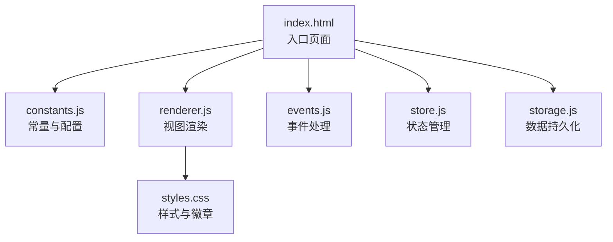
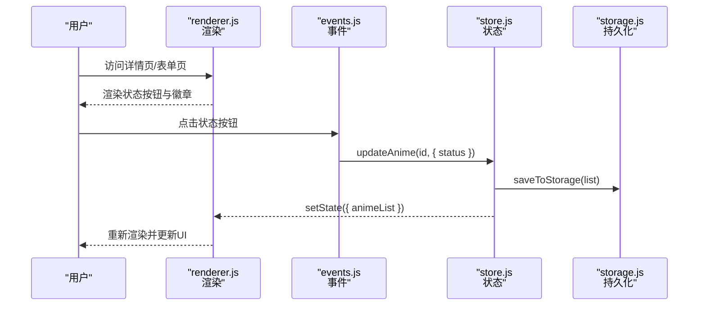
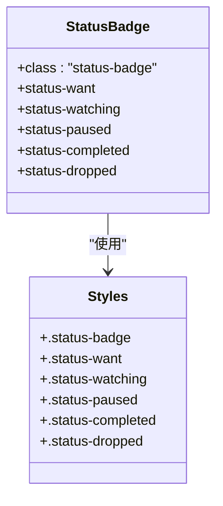
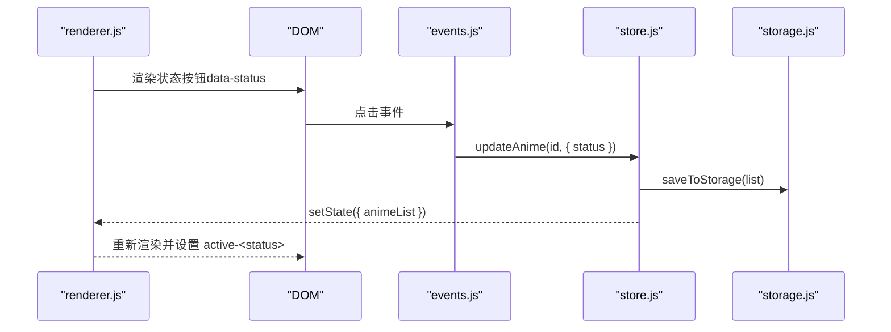
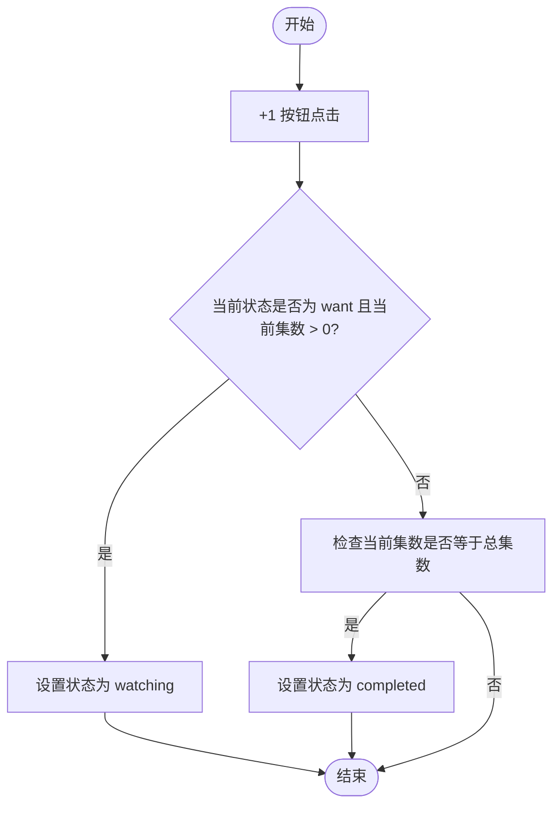
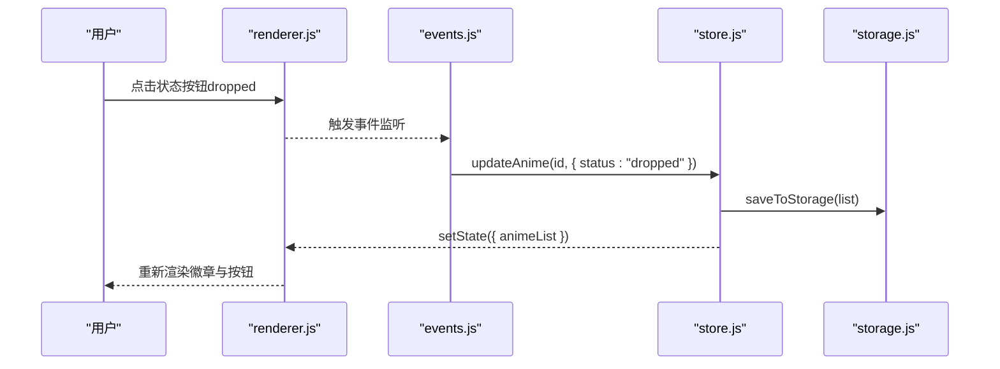
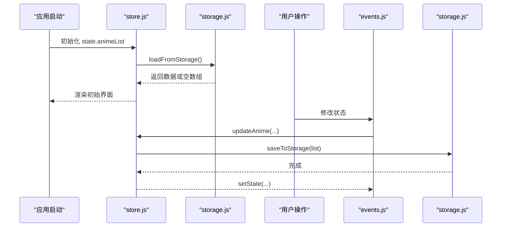
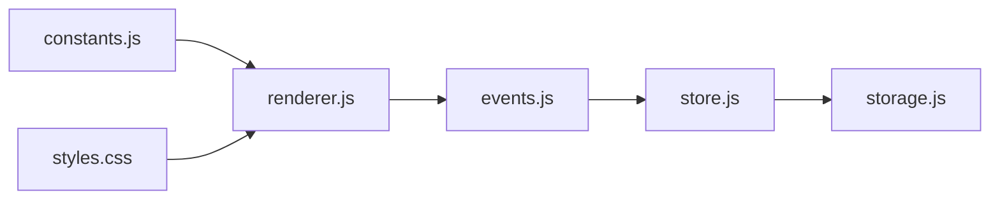

# 状态系统

<cite>
**本文引用的文件**
- [www/js/constants.js](file://www/js/constants.js)
- [www/css/styles.css](file://www/css/styles.css)
- [www/js/renderer.js](file://www/js/renderer.js)
- [www/js/events.js](file://www/js/events.js)
- [www/js/store.js](file://www/js/store.js)
- [www/js/storage.js](file://www/js/storage.js)
- [www/index.html](file://www/index.html)
- [项目解读分析与改进建议.md](file://项目解读分析与改进建议.md)
</cite>

## 目录
1. [简介](#简介)
2. [项目结构](#项目结构)
3. [核心组件](#核心组件)
4. [架构概览](#架构概览)
5. [详细组件分析](#详细组件分析)
6. [依赖关系分析](#依赖关系分析)
7. [性能考虑](#性能考虑)
8. [故障排除指南](#故障排除指南)
9. [结论](#结论)
10. [附录](#附录)

## 简介
本文件系统性地阐述 Anime Tracker 应用中的状态系统设计与实现，重点围绕五种观看状态（想看、在看、搁置、已看完、放弃）的理念、使用场景与交互流程。文档涵盖：
- STATUS_CONFIG 配置对象的结构与用途
- 状态标签样式类的命名规范与视觉反馈机制
- 状态转换规则（自动与手动）
- 状态按钮的渲染逻辑、事件处理与数据持久化
- 状态徽章的样式定制与用户体验优化建议

## 项目结构
该应用采用纯原生 JavaScript 的前端架构，通过模块化脚本组织实现清晰的职责分离：
- constants.js：全局常量与配置（含 STATUS_CONFIG）
- renderer.js：视图渲染与模板生成
- events.js：事件绑定与交互逻辑
- store.js：全局状态管理
- storage.js：本地存储封装
- css/styles.css：样式与状态徽章/按钮样式
- index.html：入口页面与脚本加载顺序



**图表来源**
- [www/index.html:64-72](file://www/index.html#L64-L72)
- [www/js/constants.js:1-37](file://www/js/constants.js#L1-L37)
- [www/js/renderer.js:1-27](file://www/js/renderer.js#L1-L27)
- [www/js/events.js:1-10](file://www/js/events.js#L1-L10)
- [www/js/store.js:1-12](file://www/js/store.js#L1-L12)
- [www/js/storage.js:1-40](file://www/js/storage.js#L1-L40)
- [www/css/styles.css:198-505](file://www/css/styles.css#L198-L505)

**章节来源**
- [www/index.html:64-72](file://www/index.html#L64-L72)
- [项目解读分析与改进建议.md:49-54](file://项目解读分析与改进建议.md#L49-L54)

## 核心组件
- STATUS_CONFIG：定义五种观看状态及其标签文本与样式类名
- 状态徽章样式：基于状态类名的视觉反馈
- 状态按钮：用于在详情页与表单页切换状态
- 状态转换逻辑：自动转换（从“想看”到“在看”，从“在看”到“已看完”）与手动切换（任意状态到“放弃”）

**章节来源**
- [www/js/constants.js:5-12](file://www/js/constants.js#L5-L12)
- [www/css/styles.css:198-505](file://www/css/styles.css#L198-L505)
- [www/js/renderer.js:342-351](file://www/js/renderer.js#L342-L351)
- [www/js/events.js:472-477](file://www/js/events.js#L472-L477)

## 架构概览
状态系统贯穿渲染层、事件层与存储层，形成“渲染-交互-持久化”的闭环。



**图表来源**
- [www/js/renderer.js:258-363](file://www/js/renderer.js#L258-L363)
- [www/js/events.js:414-487](file://www/js/events.js#L414-L487)
- [www/js/store.js:51-60](file://www/js/store.js#L51-L60)
- [www/js/storage.js:15-22](file://www/js/storage.js#L15-L22)

## 详细组件分析

### STATUS_CONFIG 配置对象
- 结构：键为状态标识（want/watching/paused/completed/dropped），值包含 label（显示文本）与 class（样式类名）
- 作用：统一管理状态文案与样式映射，供渲染层与事件层复用

```mermaid
classDiagram
class STATUS_CONFIG {
+want : { label : "想看", class : "status-want" }
+watching : { label : "在看", class : "status-watching" }
+paused : { label : "搁置", class : "status-paused" }
+completed : { label : "已看完", class : "status-completed" }
+dropped : { label : "放弃", class : "status-dropped" }
}
```

**图表来源**
- [www/js/constants.js:5-12](file://www/js/constants.js#L5-L12)

**章节来源**
- [www/js/constants.js:5-12](file://www/js/constants.js#L5-L12)

### 状态徽章样式与命名规范
- 徽章类名：status-<状态标识>（如 status-watching）
- 页面使用：渲染层在卡片与详情页使用徽章类名与标签文本
- 样式类：.status-badge 作为基础样式，配合各状态类名实现颜色与背景



**图表来源**
- [www/css/styles.css:198-210](file://www/css/styles.css#L198-L210)

**章节来源**
- [www/css/styles.css:198-210](file://www/css/styles.css#L198-L210)
- [www/js/renderer.js:239-239](file://www/js/renderer.js#L239-L239)
- [www/js/renderer.js:289-289](file://www/js/renderer.js#L289-L289)

### 状态按钮渲染与交互
- 渲染：详情页与表单页均渲染状态网格，按钮使用 data-status/data-form-status 属性
- 交互：点击按钮时，事件层调用 updateAnime 更新状态并持久化
- UI 更新：渲染层重新渲染，事件层更新按钮激活态（active-<状态>）



**图表来源**
- [www/js/renderer.js:342-351](file://www/js/renderer.js#L342-L351)
- [www/js/renderer.js:449-456](file://www/js/renderer.js#L449-L456)
- [www/js/events.js:472-477](file://www/js/events.js#L472-L477)
- [www/js/events.js:592-598](file://www/js/events.js#L592-L598)
- [www/js/store.js:51-60](file://www/js/store.js#L51-L60)
- [www/js/storage.js:15-22](file://www/js/storage.js#L15-L22)

**章节来源**
- [www/js/renderer.js:342-351](file://www/js/renderer.js#L342-L351)
- [www/js/renderer.js:449-456](file://www/js/renderer.js#L449-L456)
- [www/js/events.js:472-477](file://www/js/events.js#L472-L477)
- [www/js/events.js:592-598](file://www/js/events.js#L592-L598)

### 状态转换规则

#### 自动转换
- 从“想看”到“在看”
  - 触发条件：点击卡片上的“+1”按钮，且当前集数大于 0
  - 转换逻辑：将状态更新为 watching
- 从“在看”到“已看完”
  - 触发条件：将当前集数推进至等于总集数
  - 转换逻辑：将状态更新为 completed



**图表来源**
- [www/js/events.js:110-128](file://www/js/events.js#L110-L128)
- [www/js/events.js:445-461](file://www/js/events.js#L445-L461)

**章节来源**
- [www/js/events.js:110-128](file://www/js/events.js#L110-L128)
- [www/js/events.js:445-461](file://www/js/events.js#L445-L461)

#### 手动切换
- 任意状态到“放弃”
  - 触发方式：点击状态按钮，选择 dropped
  - 影响：立即持久化并更新 UI



**图表来源**
- [www/js/events.js:472-477](file://www/js/events.js#L472-L477)
- [www/js/store.js:51-60](file://www/js/store.js#L51-L60)
- [www/js/storage.js:15-22](file://www/js/storage.js#L15-L22)

**章节来源**
- [www/js/events.js:472-477](file://www/js/events.js#L472-L477)

### 数据持久化与状态同步
- 加载：启动时从 localStorage 读取数据
- 保存：每次状态变更后写回 localStorage
- 关键函数：loadFromStorage/saveToStorage



**图表来源**
- [www/js/store.js:5-12](file://www/js/store.js#L5-L12)
- [www/js/storage.js:5-22](file://www/js/storage.js#L5-L22)
- [www/js/events.js:414-487](file://www/js/events.js#L414-L487)

**章节来源**
- [www/js/store.js:5-12](file://www/js/store.js#L5-L12)
- [www/js/storage.js:5-22](file://www/js/storage.js#L5-L22)

## 依赖关系分析
- 渲染层依赖 STATUS_CONFIG 与样式类名生成徽章与按钮
- 事件层依赖渲染层提供的 data-* 属性与 store 层的数据更新
- 存储层为全局状态提供持久化能力



**图表来源**
- [www/js/constants.js:5-12](file://www/js/constants.js#L5-L12)
- [www/js/renderer.js:224-256](file://www/js/renderer.js#L224-L256)
- [www/js/events.js:414-487](file://www/js/events.js#L414-L487)
- [www/js/store.js:51-60](file://www/js/store.js#L51-L60)
- [www/js/storage.js:15-22](file://www/js/storage.js#L15-L22)
- [www/css/styles.css:198-505](file://www/css/styles.css#L198-L505)

**章节来源**
- [www/js/constants.js:5-12](file://www/js/constants.js#L5-L12)
- [www/js/renderer.js:224-256](file://www/js/renderer.js#L224-L256)
- [www/js/events.js:414-487](file://www/js/events.js#L414-L487)
- [www/js/store.js:51-60](file://www/js/store.js#L51-L60)
- [www/js/storage.js:15-22](file://www/js/storage.js#L15-L22)
- [www/css/styles.css:198-505](file://www/css/styles.css#L198-L505)

## 性能考虑
- 渲染策略：使用模板字符串拼接，避免复杂虚拟 DOM；对大列表可考虑分页或懒加载
- 事件绑定：一次性绑定在容器上，减少重复查询；注意移除不需要的事件监听
- 存储策略：批量更新后统一持久化，避免频繁 IO
- 样式计算：徽章与按钮样式为静态类名，渲染成本低

## 故障排除指南
- 状态不生效
  - 检查事件监听是否正确绑定（data-status/data-form-status）
  - 确认 updateAnime 是否被调用并持久化
- 状态徽章颜色异常
  - 确认徽章类名与样式类名一致（status-<状态>）
  - 检查样式文件是否正确加载
- 数据丢失
  - 确认 localStorage 写入异常捕获与降级处理
  - 检查浏览器隐私模式或存储配额限制

**章节来源**
- [www/js/events.js:472-477](file://www/js/events.js#L472-L477)
- [www/js/renderer.js:541-549](file://www/js/renderer.js#L541-L549)
- [www/js/storage.js:15-22](file://www/js/storage.js#L15-L22)

## 结论
该状态系统以简洁的配置对象与模块化架构实现了稳定的五状态管理，结合自动与手动转换规则，满足追番记录的核心需求。通过明确的样式规范与事件处理流程，保证了良好的用户体验与可维护性。后续可在渲染性能与交互细节方面持续优化。

## 附录

### 状态徽章样式定制清单
- 基础类：status-badge
- 状态类：status-want/status-watching/status-paused/status-completed/status-dropped
- 对应颜色与背景由样式文件定义，便于主题化扩展

**章节来源**
- [www/css/styles.css:198-210](file://www/css/styles.css#L198-L210)

### 状态按钮激活态样式
- 激活态类名：active-<状态>
- 用于高亮当前状态按钮，提升交互反馈

**章节来源**
- [www/css/styles.css:501-505](file://www/css/styles.css#L501-L505)
- [www/js/renderer.js:541-549](file://www/js/renderer.js#L541-L549)