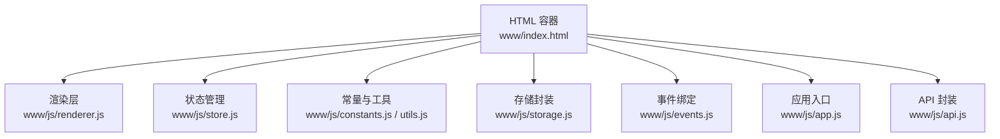
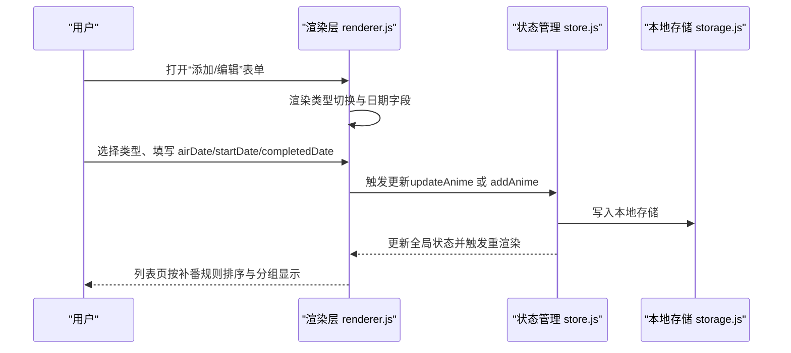
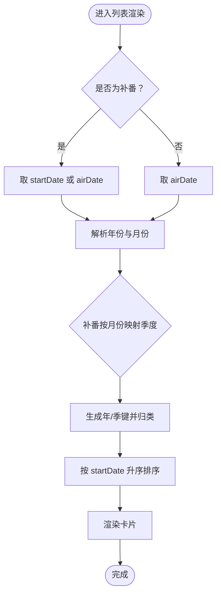
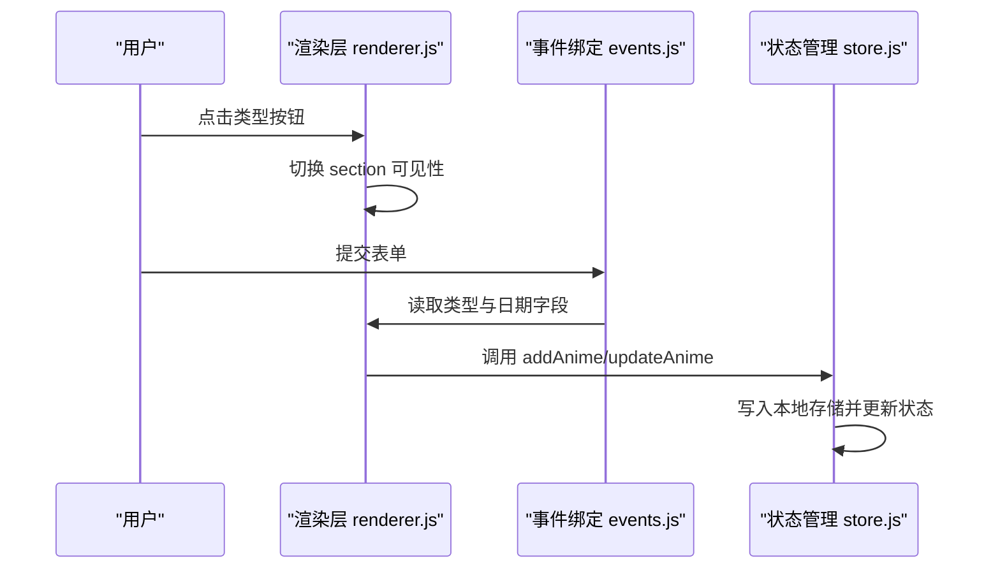
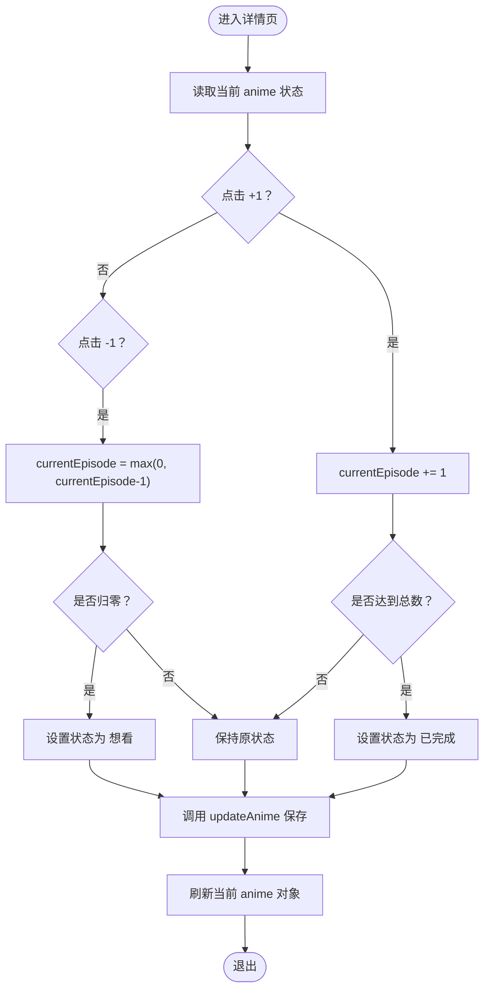
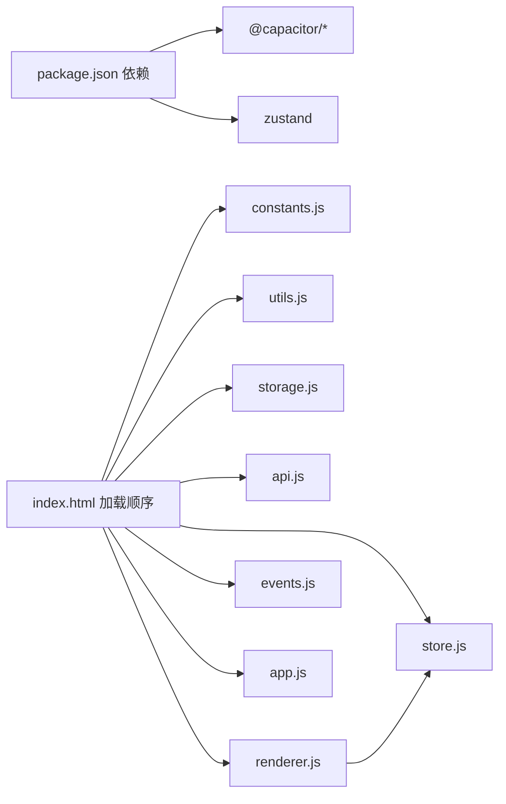

# 补番模式（Binge）

<cite>
**本文引用的文件**
- [www/js/renderer.js](file://www/js/renderer.js)
- [www/js/store.js](file://www/js/store.js)
- [www/index.html](file://www/index.html)
- [_check.js](file://_check.js)
- [android/app/src/main/assets/public/index.html](file://android/app/src/main/assets/public/index.html)
- [capacitor.config.ts](file://capacitor.config.ts)
- [package.json](file://package.json)
</cite>

## 目录
1. [简介](#简介)
2. [项目结构](#项目结构)
3. [核心组件](#核心组件)
4. [架构概览](#架构概览)
5. [详细组件分析](#详细组件分析)
6. [依赖分析](#依赖分析)
7. [性能考虑](#性能考虑)
8. [故障排除指南](#故障排除指南)
9. [结论](#结论)

## 简介
本文件系统性阐述“补番模式（Binge）”的设计理念、使用场景与实现细节，重点覆盖以下方面：
- 补番模式的核心目标：帮助用户高效完成已完结或可回看内容的观看，强调“开始观看日期”“完成日期”“连续观看管理”的闭环体验
- 字段管理机制：startDate、completedDate 的采集、联动与持久化策略
- 与“追番模式（Chasing）”在界面显示与交互上的差异：类型切换、日期字段可见性、排序与分组逻辑
- 数据流与状态管理：从表单到卡片渲染、从事件处理到本地存储的完整链路
- 实现细节：补番卡片渲染、日期选择器、状态切换、进度控制与提醒机制

## 项目结构
该应用采用前端单页架构，核心由渲染层、状态管理层、工具与常量定义组成，并通过 HTML 页面统一加载各模块脚本。

图表来源
- [www/index.html:64-72](file://www/index.html#L64-L72)

章节来源
- [www/index.html:1-75](file://www/index.html#L1-L75)

## 核心组件
- 补番模式字段
  - airDate：放送日期（用于显示与参考）
  - startDate：开始观看日期（补番模式特有）
  - completedDate：完成日期（补番模式特有）
  - type：类型标识，区分“chasing”与“binge”
- 状态管理
  - 全局状态 state：包含 animeList、filter、searchQuery、currentPage、currentAnime
  - CRUD 操作：addAnime、updateAnime、deleteAnime
- 渲染层
  - 列表页渲染：按年/季度分组、类型内排序（补番按 startDate 排序）
  - 卡片渲染：补番卡片显示类型徽标、进度条、评分与日期信息
  - 详情页渲染：补番模式下显示“开始观看”“看完日期”，支持进度增减与状态切换
  - 表单渲染：类型切换时动态显示/隐藏补番专用日期字段

章节来源
- [www/js/renderer.js:105-221](file://www/js/renderer.js#L105-L221)
- [www/js/renderer.js:223-256](file://www/js/renderer.js#L223-L256)
- [www/js/renderer.js:258-363](file://www/js/renderer.js#L258-L363)
- [www/js/renderer.js:365-518](file://www/js/renderer.js#L365-L518)
- [www/js/store.js:5-18](file://www/js/store.js#L5-L18)
- [www/js/store.js:38-71](file://www/js/store.js#L38-L71)

## 架构概览
补番模式的数据流与交互路径如下：

图表来源
- [www/js/renderer.js:365-518](file://www/js/renderer.js#L365-L518)
- [www/js/store.js:38-71](file://www/js/store.js#L38-L71)

## 详细组件分析

### 补番卡片渲染与排序
- 补番卡片渲染要点
  - 显示类型徽标“补番”
  - 展示进度百分比与当前/总计集数
  - 在非“已完成/放弃”状态下显示“+1”按钮
- 列表排序与分组
  - 补番按 startDate 排序；若无 startDate，则退回到 airDate
  - 分组依据：年份与季度（补番按开始观看月份划分季度）

图表来源
- [www/js/renderer.js:105-221](file://www/js/renderer.js#L105-L221)
- [www/js/renderer.js:223-256](file://www/js/renderer.js#L223-L256)

章节来源
- [www/js/renderer.js:105-221](file://www/js/renderer.js#L105-L221)
- [www/js/renderer.js:223-256](file://www/js/renderer.js#L223-L256)

### 补番表单与日期字段管理
- 类型切换
  - 切换至“补番”时，显示“放送日期”“开始观看日期”“看完日期”
  - 切换至“追番”时，隐藏补番专用字段，仅保留“放送日期”
- 字段联动
  - 当表单类型为“补番”时，提交时读取 airDate、startDate、completedDate
  - 当表单类型为“追番”时，提交时读取 airDate 并计算更新星期信息

图表来源
- [www/js/renderer.js:520-538](file://www/js/renderer.js#L520-L538)
- [www/js/renderer.js:2460-2476](file://www/js/renderer.js#L2460-L2476)
- [_check.js:1219-1236](file://_check.js#L1219-L1236)

章节来源
- [www/js/renderer.js:458-499](file://www/js/renderer.js#L458-L499)
- [www/js/renderer.js:520-538](file://www/js/renderer.js#L520-L538)
- [www/js/renderer.js:2460-2476](file://www/js/renderer.js#L2460-L2476)
- [_check.js:1219-1236](file://_check.js#L1219-L1236)

### 详情页进度与状态管理
- 进度控制
  - 支持“+1”“-1”按钮调整 currentEpisode
  - 当 currentEpisode 归零时自动切换状态为“想看”
  - 当从“已完成”降级且仍有剩余集数时切换为“在看”
- 状态切换
  - 详情页提供状态网格，排除“想看”“已完成”，便于快速切换
- 日期展示
  - 补番模式下展示“开始观看”“看完日期”，追番模式展示“更新时间”

图表来源
- [www/js/renderer.js:258-363](file://www/js/renderer.js#L258-L363)
- [www/js/renderer.js:864-874](file://www/js/renderer.js#L864-L874)

章节来源
- [www/js/renderer.js:258-363](file://www/js/renderer.js#L258-L363)
- [www/js/renderer.js:864-874](file://www/js/renderer.js#L864-L874)

### 与追番模式的界面与交互差异
- 字段差异
  - 追番模式：显示 airDate 与更新星期信息
  - 补番模式：显示 airDate、startDate、completedDate
- 排序差异
  - 追番按更新星期排序
  - 补番按开始观看日期排序
- 分组差异
  - 追番按季度边界规则分组
  - 补番按开始观看月份映射季度分组

章节来源
- [www/js/renderer.js:105-221](file://www/js/renderer.js#L105-L221)
- [www/js/renderer.js:458-499](file://www/js/renderer.js#L458-L499)

## 依赖分析
- 外部依赖
  - @capacitor/*：跨平台能力（Android/iOS）
  - zustand：状态管理（声明式 store）
- 内部模块依赖
  - index.html 统一加载 constants.js、utils.js、storage.js、store.js、api.js、renderer.js、events.js、app.js
  - renderer.js 依赖 store.js 提供的状态与更新方法
  - events.js 依赖 renderer.js 的渲染结果与 DOM 结构

图表来源
- [package.json:18-28](file://package.json#L18-L28)
- [www/index.html:64-72](file://www/index.html#L64-L72)

章节来源
- [package.json:1-38](file://package.json#L1-L38)
- [www/index.html:64-72](file://www/index.html#L64-L72)

## 性能考虑
- 渲染优化
  - 列表渲染采用分组与折叠（年/季度），减少一次性渲染节点数量
  - 补番排序基于 startDate，避免复杂计算导致的重排
- 存储与同步
  - 使用本地存储进行数据持久化，避免频繁网络请求
  - 状态变更后统一写入存储，减少重复 IO
- 交互响应
  - 详情页进度与状态切换为轻量 DOM 操作，避免大范围重绘

## 故障排除指南
- 补番日期字段不显示
  - 检查类型切换逻辑是否正确执行
  - 确认表单 section 的可见性类名切换
- 进度无法更新或状态异常
  - 核对“-1/+1”事件绑定与 updateAnime 调用
  - 确保归零与降级逻辑（从“已完成”降级）生效
- 列表排序不符合预期
  - 确认补番按 startDate 排序分支与空值回退逻辑
  - 检查分组月份映射与季度边界

章节来源
- [www/js/renderer.js:520-538](file://www/js/renderer.js#L520-L538)
- [www/js/renderer.js:864-874](file://www/js/renderer.js#L864-L874)
- [www/js/renderer.js:105-221](file://www/js/renderer.js#L105-L221)

## 结论
补番模式通过明确的日期字段（airDate、startDate、completedDate）、清晰的类型切换与排序规则，为用户提供了高效的“补番”体验。配合简洁的进度与状态管理、稳定的本地存储与直观的卡片渲染，实现了从录入到查看的完整闭环。未来可在以下方向持续优化：
- 补番提醒：结合 startDate 与 completedDate 提供“预计完成时间”提示
- 批量操作：支持批量标记“开始观看”“完成观看”，提升效率
- 数据迁移：提供更友好的导入/导出与版本兼容策略