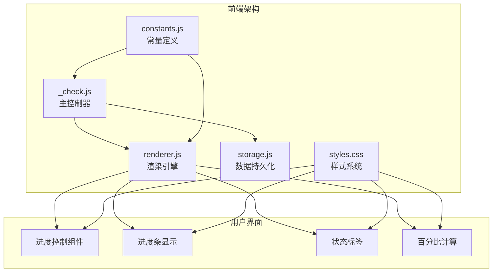
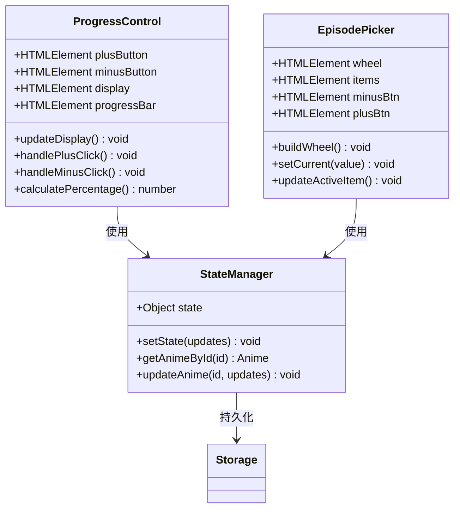
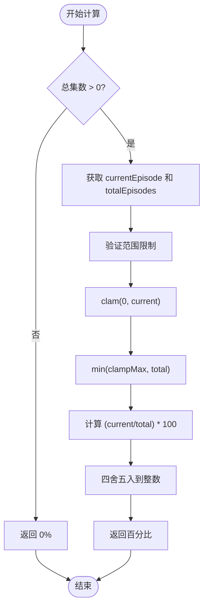
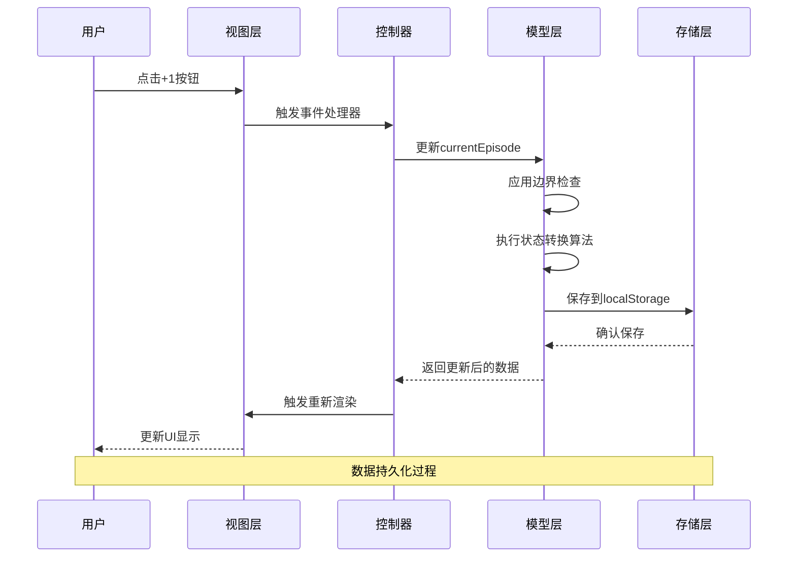
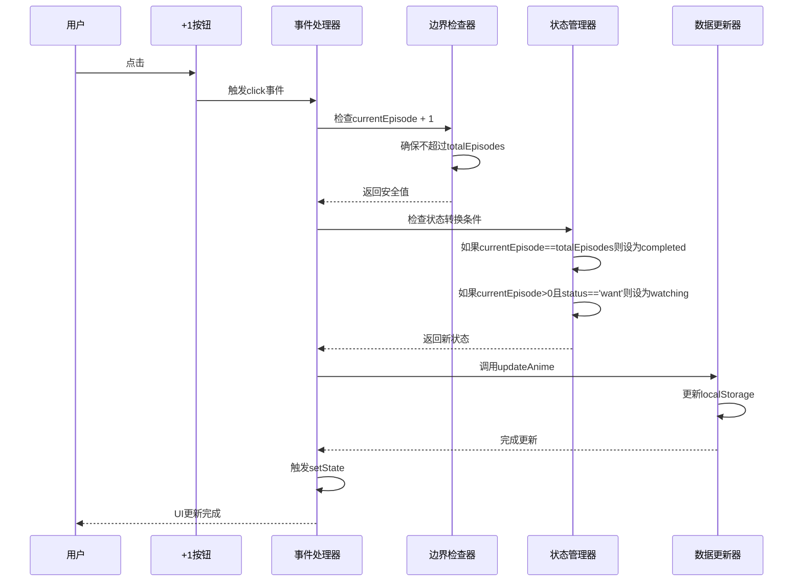
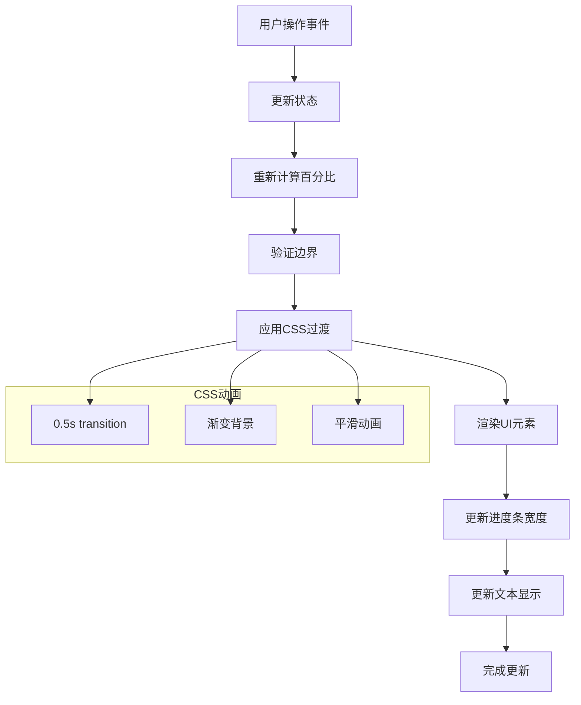
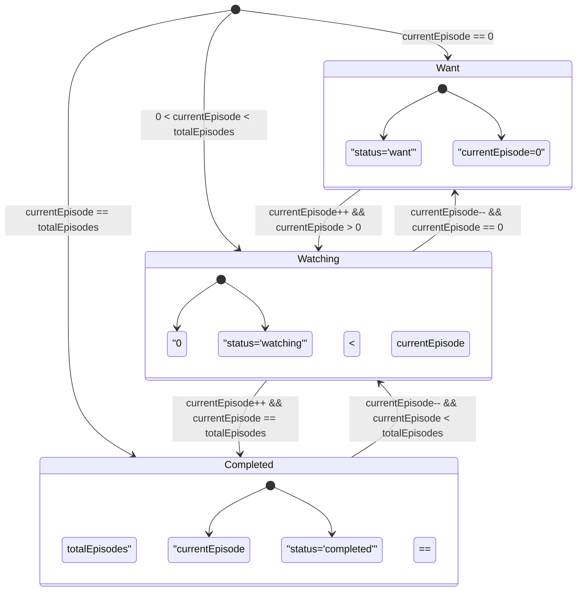
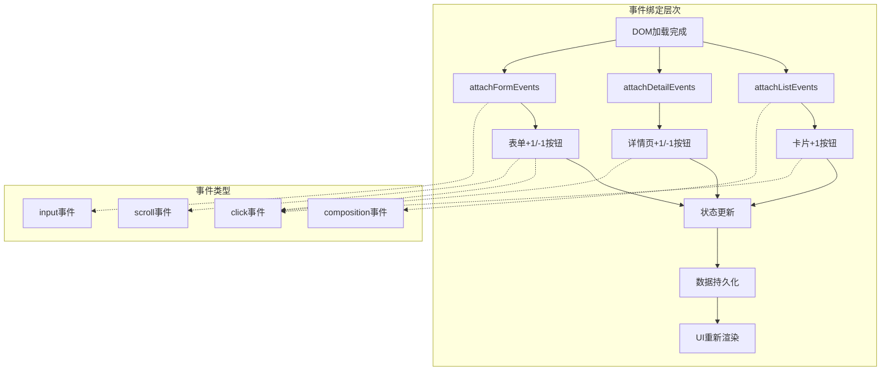
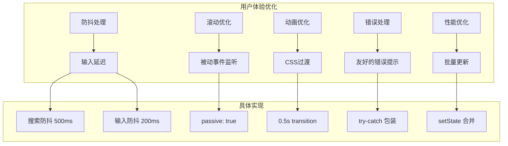
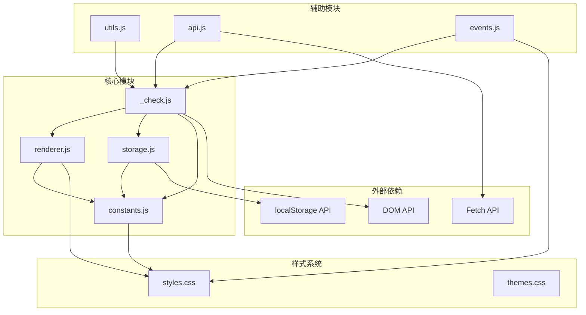

# 进度管理

<cite>
**本文档引用的文件**
- [_check.js](file://_check.js)
- [renderer.js](file://www/js/renderer.js)
- [storage.js](file://www/js/storage.js)
- [constants.js](file://www/js/constants.js)
- [styles.css](file://www/css/styles.css)
- [index.html](file://android/app/src/main/assets/public/index.html)
</cite>

## 目录
1. [简介](#简介)
2. [项目结构](#项目结构)
3. [核心组件](#核心组件)
4. [架构概览](#架构概览)
5. [详细组件分析](#详细组件分析)
6. [依赖关系分析](#依赖关系分析)
7. [性能考虑](#性能考虑)
8. [故障排除指南](#故障排除指南)
9. [结论](#结论)

## 简介

进度管理是动漫追踪应用的核心功能模块，负责管理用户的观看进度、状态转换和数据持久化。该系统提供了直观的用户界面来跟踪动漫观看进度，包括+1按钮事件处理、进度条动态更新和百分比计算逻辑。

## 项目结构

应用程序采用模块化架构设计，将功能划分为多个专门的JavaScript文件：



**图表来源**
- [_check.js:1-1346](file://_check.js#L1-L1346)
- [renderer.js:1-630](file://www/js/renderer.js#L1-L630)
- [storage.js:1-40](file://www/js/storage.js#L1-L40)

**章节来源**
- [_check.js:1-1346](file://_check.js#L1-L1346)
- [renderer.js:1-630](file://www/js/renderer.js#L1-L630)

## 核心组件

### 进度控制组件

进度控制组件提供了用户交互界面，包含+1按钮、-1按钮和进度显示区域：



**图表来源**
- [_check.js:846-918](file://_check.js#L846-L918)
- [_check.js:937-1117](file://_check.js#L937-L1117)

### 百分比计算系统

系统实现了精确的百分比计算逻辑，确保进度显示的准确性：



**图表来源**
- [_check.js:341-343](file://_check.js#L341-L343)
- [_check.js:266-268](file://_check.js#L266-L268)

**章节来源**
- [_check.js:846-918](file://_check.js#L846-L918)
- [_check.js:937-1117](file://_check.js#L937-L1117)

## 架构概览

应用程序采用MVVM（Model-View-ViewModel）架构模式，通过状态管理和事件驱动的方式实现数据绑定：



**图表来源**
- [_check.js:733-751](file://_check.js#L733-L751)
- [_check.js:864-892](file://_check.js#L864-L892)
- [storage.js:5-22](file://www/js/storage.js#L5-L22)

## 详细组件分析

### +1按钮事件处理机制

+1按钮事件处理实现了完整的业务逻辑，包括边界检查和状态转换：



**图表来源**
- [_check.js:733-751](file://_check.js#L733-L751)
- [_check.js:876-892](file://_check.js#L876-L892)

#### 边界检查机制

边界检查确保数据完整性，防止出现无效状态：

| 检查点 | 条件 | 处理方式 |
|--------|------|----------|
| 最小值检查 | currentEpisode < 0 | 设置为0 |
| 最大值检查 | currentEpisode > totalEpisodes | 设置为totalEpisodes |
| 状态重置 | currentEpisode == 0 | 设置状态为'want' |
| 完成检测 | currentEpisode == totalEpisodes | 设置状态为'completed' |

**章节来源**
- [_check.js:864-892](file://_check.js#L864-L892)
- [_check.js:876-892](file://_check.js#L876-L892)

### 进度条动态更新系统

进度条系统实现了响应式的UI更新机制：



**图表来源**
- [_check.js:369-371](file://_check.js#L369-L371)
- [styles.css:369-382](file://www/css/styles.css#L369-L382)

#### 百分比计算逻辑

百分比计算采用精确的数学公式，确保显示的准确性：

```mermaid
flowchart LR
subgraph "计算步骤"
A[currentEpisode] --> B[/ totalEpisodes]
B --> C[* 100]
C --> D[四舍五入]
D --> E[结果百分比]
end
subgraph "边界处理"
F[totalEpisodes == 0] --> G[返回 0%]
H[currentEpisode < 0] --> I[设置为 0]
J[currentEpisode > totalEpisodes] --> K[设置为 totalEpisodes]
end
E --> L[最终显示值]
G --> L
I --> Recalc["重新计算"]
J --> Recalc
Recalc --> E
```

**图表来源**
- [_check.js:341-343](file://_check.js#L341-L343)
- [_check.js:266-268](file://_check.js#L266-L268)

**章节来源**
- [_check.js:341-343](file://_check.js#L341-L343)
- [styles.css:417-475](file://www/css/styles.css#L417-L475)

### currentEpisode字段管理规则

currentEpisode字段遵循严格的数据管理规则：

#### 字段约束
- **数据类型**: 整数(number)
- **有效范围**: [0, totalEpisodes]
- **默认值**: 0
- **最小值**: 0
- **最大值**: totalEpisodes

#### 状态转换算法



**图表来源**
- [_check.js:740-749](file://_check.js#L740-L749)
- [_check.js:867-872](file://_check.js#L867-L872)
- [_check.js:884-888](file://_check.js#L884-L888)

**章节来源**
- [_check.js:740-749](file://_check.js#L740-L749)
- [_check.js:867-872](file://_check.js#L867-L872)

### 事件绑定和用户交互

系统实现了多层次的事件绑定机制：



**图表来源**
- [_check.js:651-844](file://_check.js#L651-L844)
- [_check.js:846-918](file://_check.js#L846-L918)
- [_check.js:937-1217](file://_check.js#L937-L1217)

**章节来源**
- [_check.js:651-844](file://_check.js#L651-L844)
- [_check.js:846-918](file://_check.js#L846-L918)

### 数值验证和用户体验优化

系统实现了多层验证机制来确保数据质量和用户体验：

#### 输入验证机制

| 验证类型 | 实现方式 | 验证规则 |
|----------|----------|----------|
| 类型验证 | parseInt() | 确保数字类型 |
| 范围验证 | Math.min()/Math.max() | 限制有效范围 |
| 必填验证 | 条件检查 | 确保必需字段存在 |
| 格式验证 | 正则表达式 | 验证字符串格式 |

#### 用户体验优化



**图表来源**
- [_check.js:1195-1203](file://_check.js#L1195-L1203)
- [_check.js:1007-1015](file://_check.js#L1007-L1015)
- [styles.css:372](file://www/css/styles.css#L372)

**章节来源**
- [_check.js:1195-1203](file://_check.js#L1195-L1203)
- [_check.js:1007-1015](file://_check.js#L1007-L1015)

## 依赖关系分析

应用程序的模块间依赖关系清晰明确：



**图表来源**
- [_check.js:1-1346](file://_check.js#L1-L1346)
- [renderer.js:1-630](file://www/js/renderer.js#L1-L630)
- [storage.js:1-40](file://www/js/storage.js#L1-L40)

**章节来源**
- [_check.js:1-1346](file://_check.js#L1-L1346)
- [renderer.js:1-630](file://www/js/renderer.js#L1-L630)

## 性能考虑

### 渲染性能优化

系统采用了多种性能优化策略：

1. **虚拟DOM思想**: 通过setState统一触发渲染，避免直接操作DOM
2. **事件委托**: 使用事件冒泡减少事件监听器数量
3. **防抖机制**: 对高频事件进行防抖处理
4. **被动事件监听**: 优化滚动性能

### 内存管理

- **垃圾回收**: 及时清理不再使用的事件监听器
- **状态管理**: 避免状态对象过大导致内存泄漏
- **缓存策略**: 合理使用localStorage避免频繁读写

## 故障排除指南

### 常见问题及解决方案

| 问题类型 | 症状 | 解决方案 |
|----------|------|----------|
| 进度无法更新 | 点击+1无反应 | 检查totalEpisodes是否为0 |
| 百分比显示异常 | 显示NaN或Infinity | 验证totalEpisodes > 0 |
| 状态不正确 | 状态未按预期转换 | 检查currentEpisode边界值 |
| 数据丢失 | 刷新后进度重置 | 检查localStorage权限 |

### 调试技巧

1. **浏览器开发者工具**: 使用断点调试JavaScript代码
2. **控制台日志**: 输出关键变量值进行验证
3. **网络面板**: 检查localStorage读写操作
4. **性能面板**: 分析渲染性能瓶颈

**章节来源**
- [storage.js:16-22](file://www/js/storage.js#L16-L22)
- [_check.js:1260-1266](file://_check.js#L1260-L1266)

## 结论

进度管理系统通过精心设计的架构和实现，提供了稳定可靠的动漫观看进度跟踪功能。系统的关键优势包括：

1. **完整的边界检查**: 确保数据完整性和一致性
2. **智能状态转换**: 自动管理观看状态变化
3. **响应式UI更新**: 提供流畅的用户体验
4. **数据持久化**: 保证用户数据安全存储
5. **性能优化**: 采用多种技术提升系统性能

该系统为用户提供了一个直观、可靠且高效的进度管理解决方案，能够满足动漫追踪应用的各种需求。