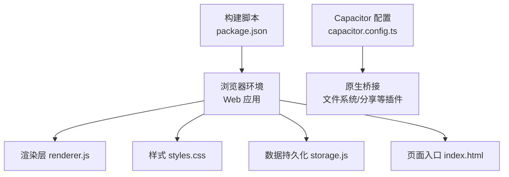
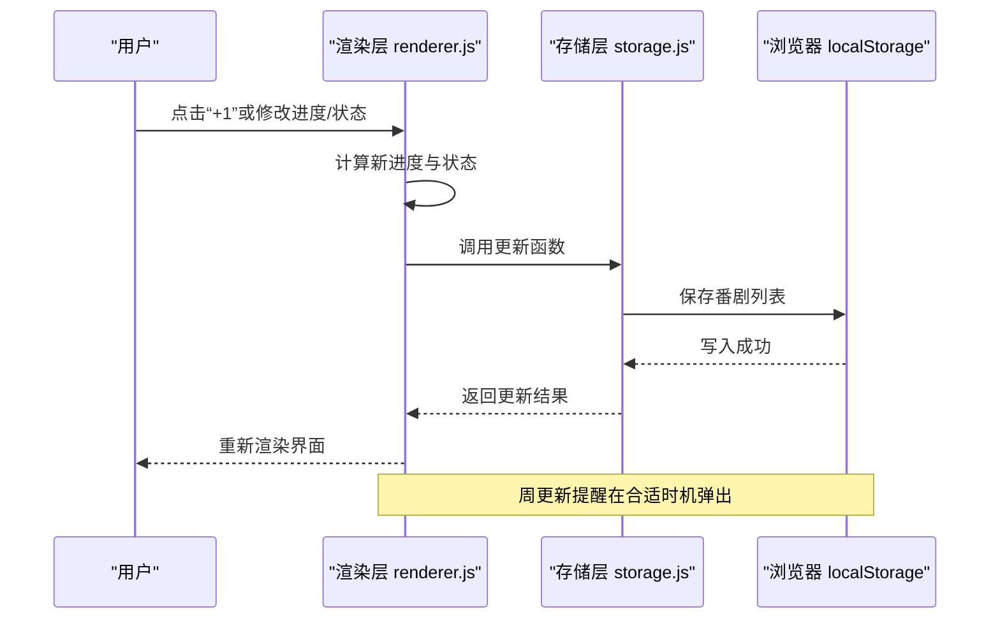
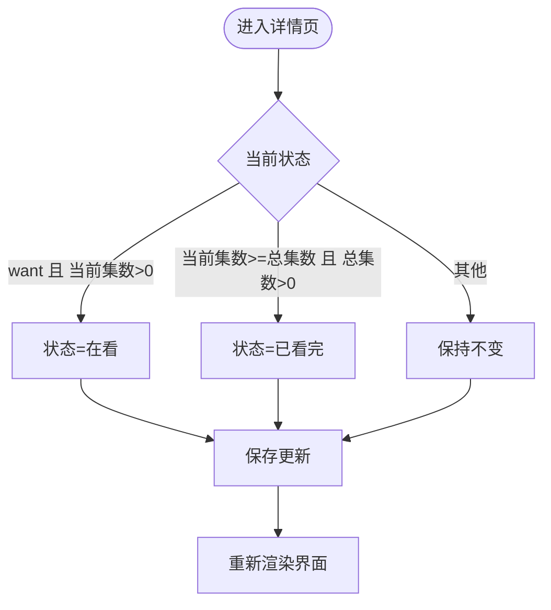
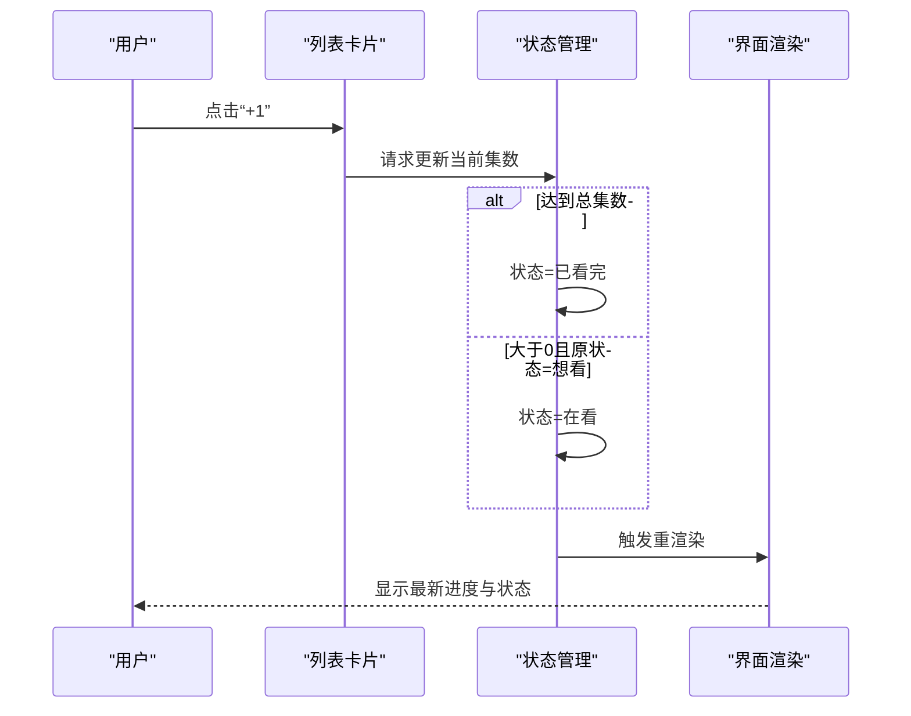
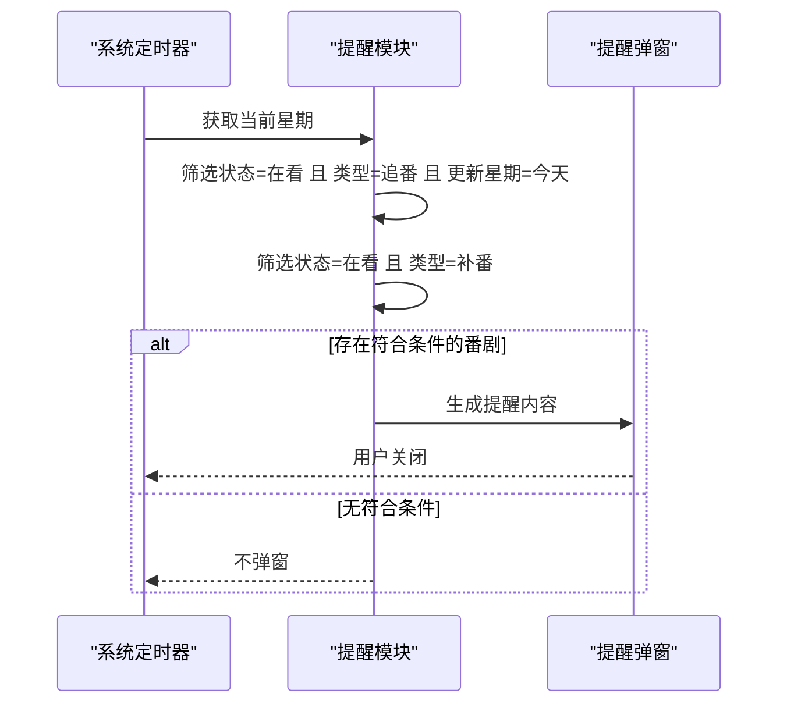
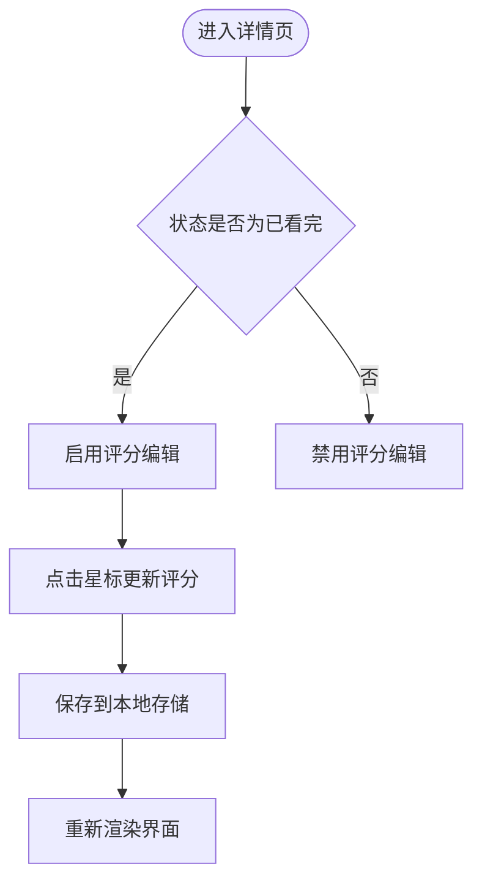
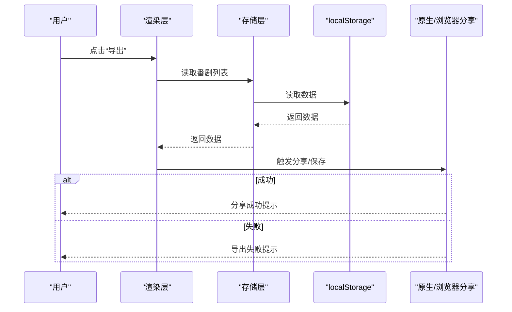
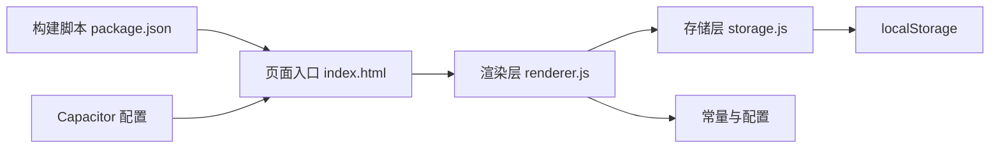

# 进度追踪

<cite>
**本文引用的文件**
- [package.json](file://package.json)
- [capacitor.config.ts](file://capacitor.config.ts)
- [_check.js](file://_check.js)
- [index.html](file://android/app/src/main/assets/public/index.html)
- [styles.css](file://www/css/styles.css)
- [renderer.js](file://www/js/renderer.js)
- [storage.js](file://www/js/storage.js)
- [index.html](file://www/index.html)
</cite>

## 目录
1. [简介](#简介)
2. [项目结构](#项目结构)
3. [核心组件](#核心组件)
4. [架构总览](#架构总览)
5. [详细组件分析](#详细组件分析)
6. [依赖关系分析](#依赖关系分析)
7. [性能考量](#性能考量)
8. [故障排查指南](#故障排查指南)
9. [结论](#结论)
10. [附录](#附录)

## 简介
本文件围绕“进度追踪”功能，系统性梳理追番模式（chasing）与补番模式（binge）的实现差异、进度更新机制、状态自动转换规则、周更新提醒、进度条渲染、评分系统与观后感功能，并给出数据持久化的处理方式与用户交互流程。文档面向不同技术背景的读者，既提供高层概览也包含代码级分析与可视化图表。

## 项目结构
该应用采用前端单页架构，核心逻辑集中在浏览器端通过 localStorage 实现本地数据持久化；同时支持通过 Capacitor 将 Web 应用打包为原生应用。进度追踪相关的关键文件包括：
- 渲染与交互：renderer.js、index.html（页面入口）
- 状态管理与存储：_check.js（旧版）、storage.js（新版）
- 样式与主题：styles.css
- 打包配置：capacitor.config.ts、package.json

**图表来源**
- [renderer.js:1-27](file://www/js/renderer.js#L1-L27)
- [storage.js:1-39](file://www/js/storage.js#L1-L39)
- [index.html:64-74](file://www/index.html#L64-L74)
- [capacitor.config.ts:1-22](file://capacitor.config.ts#L1-L22)
- [package.json:8-16](file://package.json#L8-L16)

**章节来源**
- [package.json:1-38](file://package.json#L1-L38)
- [capacitor.config.ts:1-22](file://capacitor.config.ts#L1-L22)
- [index.html:64-74](file://www/index.html#L64-L74)

## 核心组件
- 状态与数据模型
  - 番剧对象包含标题、类型（chasing/binge）、总集数、当前集数、状态（want/watching/paused/completed/dropped）、评分、观后感、放送日期、更新星期、开始观看日期、完成日期等字段。
  - 状态配置映射用于 UI 展示与筛选。
- 进度追踪核心
  - 列表页按年/季度分组展示，chasing 按更新星期排序，binge 按开始观看日期排序。
  - 卡片内显示进度百分比与进度条，支持“+1”快速推进一集并触发状态自动转换。
  - 详情页提供进度控制按钮、状态切换网格、评分与观后感编辑。
- 提醒机制
  - 周更新提醒：根据当前星期筛选正在追番且更新时间为当天的番剧，生成提醒弹窗。
- 数据持久化
  - 使用 localStorage 存储番剧列表与折叠状态，支持导出/分享数据。

**章节来源**
- [_check.js:2-8](file://_check.js#L2-L8)
- [_check.js:46-85](file://_check.js#L46-L85)
- [renderer.js:106-221](file://www/js/renderer.js#L106-L221)
- [renderer.js:259-363](file://www/js/renderer.js#L259-L363)
- [renderer.js:564-629](file://www/js/renderer.js#L564-L629)
- [storage.js:1-39](file://www/js/storage.js#L1-L39)

## 架构总览
下图展示了从用户操作到数据持久化的完整链路，以及提醒模块的触发时机。

**图表来源**
- [renderer.js:733-751](file://www/js/renderer.js#L733-L751)
- [storage.js:15-22](file://www/js/storage.js#L15-L22)
- [renderer.js:564-629](file://www/js/renderer.js#L564-L629)

## 详细组件分析

### 追番模式（chasing）与补番模式（binge）对比
- 数据字段差异
  - 追番（chasing）：关注放送日期与更新星期，便于生成周更新提醒。
  - 补番（binge）：关注开始观看日期与完成日期，便于统计补番进度与剩余集数。
- 排序策略
  - 追番：按更新星期升序排列，未设置星期的排在末尾。
  - 补番：按开始观看日期升序排列，便于追踪补番节奏。
- 状态转换
  - 追番：当当前集数大于 0 且状态为“想看”时自动转为“在看”；当达到总集数时自动转为“已看完”。

**图表来源**
- [_check.js:740-749](file://_check.js#L740-L749)
- [renderer.js:733-751](file://www/js/renderer.js#L733-L751)

**章节来源**
- [_check.js:313-328](file://_check.js#L313-L328)
- [_check.js:204-211](file://_check.js#L204-L211)
- [renderer.js:106-221](file://www/js/renderer.js#L106-L221)
- [renderer.js:259-363](file://www/js/renderer.js#L259-L363)

### 进度更新机制与状态自动转换
- 列表页“+1”按钮
  - 点击后增加当前集数，若超过总集数则限制为总集数。
  - 若当前集数达到总集数且存在总集数，则状态自动转为“已看完”。
  - 若当前集数大于 0 且状态为“想看”，则转为“在看”。
- 详情页进度控制
  - 支持“-”“+”按钮调整当前集数，实时计算进度百分比与进度条宽度。
- 状态切换
  - 用户可直接在详情页选择“暂停/在看/已看完/放弃”等状态，适用于非自动转换场景。

**图表来源**
- [_check.js:733-751](file://_check.js#L733-L751)
- [renderer.js:329-340](file://www/js/renderer.js#L329-L340)

**章节来源**
- [_check.js:733-751](file://_check.js#L733-L751)
- [renderer.js:329-340](file://www/js/renderer.js#L329-L340)

### 周更新提醒功能
- 触发条件
  - 当前星期与某部“追番”的更新星期一致，且状态为“在看”时，弹出提醒。
- 提醒内容
  - 展示今日更新的番剧清单与当前进度；若存在总集数，显示预计完结日期。
  - 展示所有未完成的“补番”清单与剩余集数。
- 关闭方式
  - 点击遮罩或“知道了”按钮关闭。

**图表来源**
- [renderer.js:564-629](file://www/js/renderer.js#L564-L629)

**章节来源**
- [renderer.js:564-629](file://www/js/renderer.js#L564-L629)

### 进度条渲染与评分系统
- 进度条
  - 列表卡片与详情页均以“当前集数/总集数”与百分比驱动进度条宽度。
  - 列表卡片右侧显示进度文本与进度条，详情页上方集中展示控制与信息。
- 评分系统
  - 支持 1-5 星评分，详情页在“已看完”状态下允许编辑评分。
  - 评分 UI 为可交互星标，点击后更新评分并持久化。

**图表来源**
- [renderer.js:288-295](file://www/js/renderer.js#L288-L295)
- [renderer.js:501-516](file://www/js/renderer.js#L501-L516)

**章节来源**
- [renderer.js:247-255](file://www/js/renderer.js#L247-L255)
- [renderer.js:329-340](file://www/js/renderer.js#L329-L340)
- [renderer.js:501-516](file://www/js/renderer.js#L501-L516)

### 观后感功能
- 编辑位置
  - 详情页提供多行文本框用于撰写观后感。
- 保存策略
  - 修改后由状态更新流程统一保存至本地存储，无需单独提交按钮。

**章节来源**
- [renderer.js:353-361](file://www/js/renderer.js#L353-L361)

### 数据持久化与导出/分享
- 存储键值
  - 番剧列表：STORAGE_KEY
  - 折叠状态：COLLAPSE_KEY
- 写入时机
  - 新增、更新、删除番剧时写入 localStorage。
- 导出/分享
  - 支持通过原生分享或文件选择器导出 JSON 数据；若不支持则回退到浏览器分享接口。

**图表来源**
- [_check.js:754-799](file://_check.js#L754-L799)
- [storage.js:15-22](file://www/js/storage.js#L15-L22)

**章节来源**
- [_check.js:12-27](file://_check.js#L12-L27)
- [_check.js:754-799](file://_check.js#L754-L799)
- [storage.js:1-39](file://www/js/storage.js#L1-L39)

## 依赖关系分析
- 组件耦合
  - 渲染层与存储层松耦合：渲染层仅通过函数调用访问存储层，便于替换实现。
  - 状态管理集中于单一状态对象，避免跨模块状态漂移。
- 外部依赖
  - Capacitor 插件用于原生能力（如文件系统、分享），但进度追踪核心逻辑仍基于浏览器 API。
- 潜在循环依赖
  - 文件间为单向调用关系，未见循环依赖迹象。

**图表来源**
- [renderer.js:1-27](file://www/js/renderer.js#L1-L27)
- [storage.js:1-39](file://www/js/storage.js#L1-L39)
- [index.html:64-74](file://www/index.html#L64-L74)
- [package.json:8-16](file://package.json#L8-L16)
- [capacitor.config.ts:1-22](file://capacitor.config.ts#L1-L22)

**章节来源**
- [renderer.js:1-27](file://www/js/renderer.js#L1-L27)
- [storage.js:1-39](file://www/js/storage.js#L1-L39)
- [index.html:64-74](file://www/index.html#L64-L74)

## 性能考量
- 渲染优化
  - 列表页按年/季度分组并支持折叠，减少一次性渲染节点数量。
  - 进度条宽度使用 CSS 动态计算，避免复杂 JS 动画。
- 事件绑定
  - 使用事件委托与选择器复用，降低重复绑定成本。
- 存储效率
  - localStorage 读写为同步阻塞，建议在批量更新时合并状态变更，减少多次渲染。

## 故障排查指南
- 进度无法保存
  - 检查 localStorage 是否可用；确认保存函数被调用。
  - 参考路径：[storage.js:15-22](file://www/js/storage.js#L15-L22)
- 状态未自动转换
  - 确认“+1”按钮事件是否触发；检查状态转换逻辑边界条件。
  - 参考路径：[_check.js:733-751](file://_check.js#L733-L751)
- 周更新提醒不出现
  - 检查当前星期与番剧更新星期是否匹配；确认筛选条件。
  - 参考路径：[renderer.js:564-629](file://www/js/renderer.js#L564-L629)
- 导出/分享失败
  - 检查原生分享插件是否可用；回退到浏览器分享接口。
  - 参考路径：[_check.js:754-799](file://_check.js#L754-L799)

**章节来源**
- [storage.js:15-22](file://www/js/storage.js#L15-L22)
- [_check.js:733-751](file://_check.js#L733-L751)
- [renderer.js:564-629](file://www/js/renderer.js#L564-L629)
- [_check.js:754-799](file://_check.js#L754-L799)

## 结论
该进度追踪功能以简洁的前端架构实现了追番与补番两类模式的差异化管理，结合自动状态转换、周更新提醒与本地持久化，满足日常使用需求。后续可在以下方面持续优化：引入更细粒度的状态机、增强错误恢复与数据校验、扩展跨设备同步能力。

## 附录
- 关键实现路径参考
  - 进度更新与状态转换：[renderer.js:733-751](file://www/js/renderer.js#L733-L751)
  - 列表分组与排序：[renderer.js:106-221](file://www/js/renderer.js#L106-L221)
  - 详情页进度控制：[renderer.js:329-340](file://www/js/renderer.js#L329-L340)
  - 评分编辑与持久化：[renderer.js:501-516](file://www/js/renderer.js#L501-L516)
  - 周更新提醒：[renderer.js:564-629](file://www/js/renderer.js#L564-L629)
  - 数据持久化：[storage.js:1-39](file://www/js/storage.js#L1-L39)
  - 页面入口与模块加载：[index.html:64-74](file://www/index.html#L64-L74)