# 追番模式（Chasing）

<cite>
**本文档引用的文件**
- [_check.js](file://_check.js)
- [index.html](file://www/index.html)
- [_server.js](file://_server.js)
- [package.json](file://package.json)
- [capacitor.config.ts](file://capacitor.config.ts)
</cite>

## 目录
1. [简介](#简介)
2. [项目结构](#项目结构)
3. [核心组件](#核心组件)
4. [架构概览](#架构概览)
5. [详细组件分析](#详细组件分析)
6. [依赖关系分析](#依赖关系分析)
7. [性能考虑](#性能考虑)
8. [故障排除指南](#故障排除指南)
9. [结论](#结论)

## 简介

追番模式是动漫追踪应用中的核心功能模块，专门用于追踪正在播出的动漫系列。该系统实现了完整的动漫观看生命周期管理，包括放送日期追踪、更新提醒机制和智能日程管理功能。

追番模式的核心特性包括：
- **放送日期追踪**：自动识别动漫的播出时间并建立更新日程
- **周更新提醒**：基于当前日期自动推送今日更新的动漫列表
- **智能排序**：按照更新星期进行智能排序和分组
- **状态自动化**：从"想看"到"在看"再到"已看完"的状态转换
- **进度可视化**：直观的进度条和状态标签显示

## 项目结构

该项目采用混合架构，结合了Web前端技术和原生移动应用框架：

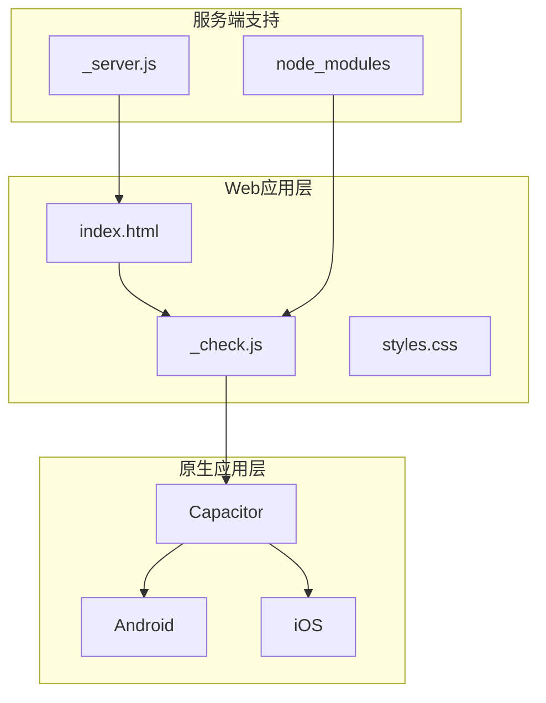

**图表来源**
- [index.html:1-75](file://www/index.html#L1-L75)
- [_check.js:1-1346](file://_check.js#L1-L1346)
- [_server.js:1-32](file://_server.js#L1-L32)

**章节来源**
- [index.html:1-75](file://www/index.html#L1-L75)
- [package.json:1-38](file://package.json#L1-L38)
- [capacitor.config.ts:1-22](file://capacitor.config.ts#L1-L22)

## 核心组件

追番模式由多个核心组件构成，每个组件都有明确的职责和相互依赖关系：

### 数据模型组件

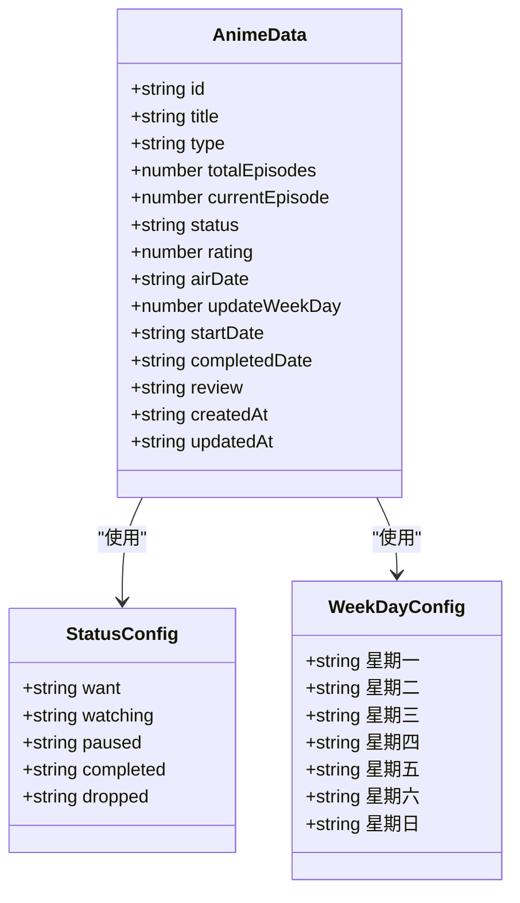

**图表来源**
- [_check.js:2-8](file://_check.js#L2-L8)
- [_check.js:39-44](file://_check.js#L39-L44)

### 状态管理系统

追番模式实现了完整的状态转换机制，确保用户能够准确追踪动漫观看进度：

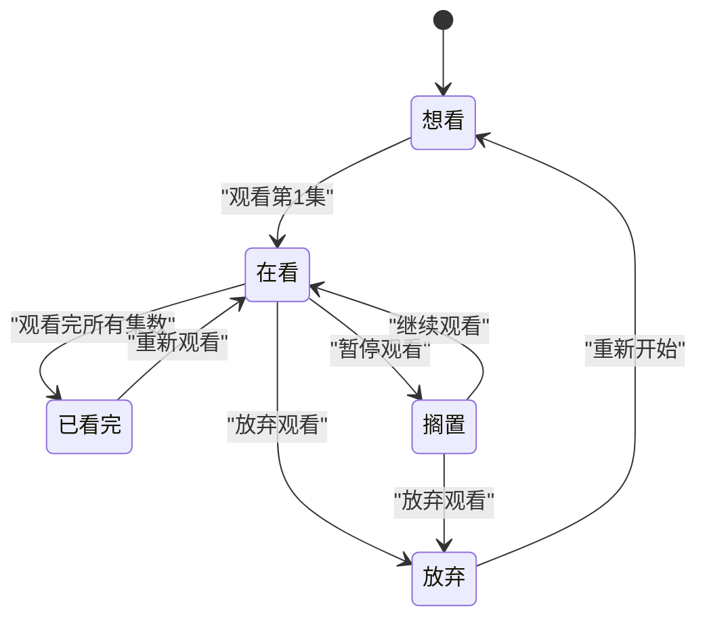

**图表来源**
- [_check.js:2-8](file://_check.js#L2-L8)
- [_check.js:740-750](file://_check.js#L740-L750)
- [_check.js:864-892](file://_check.js#L864-L892)

**章节来源**
- [_check.js:2-8](file://_check.js#L2-L8)
- [_check.js:46-57](file://_check.js#L46-L57)

## 架构概览

追番模式采用MVVM（Model-View-ViewModel）架构模式，实现了清晰的关注点分离：

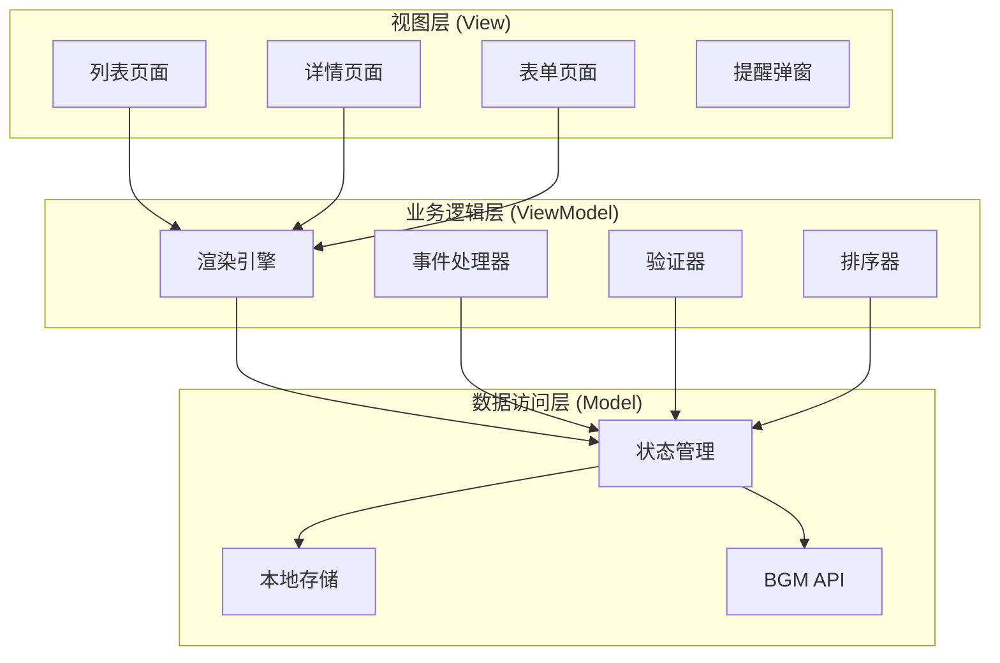

**图表来源**
- [_check.js:124-145](file://_check.js#L124-L145)
- [_check.js:651-844](file://_check.js#L651-L844)
- [_check.js:1268-1323](file://_check.js#L1268-L1323)

## 详细组件分析

### updateWeekDay 字段机制

updateWeekDay 是追番模式的核心字段，用于表示动漫的更新星期。该字段通过放送日期自动计算得出：

#### 计算算法

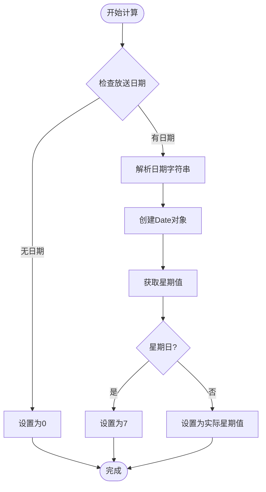

**图表来源**
- [_check.js:39-44](file://_check.js#L39-L44)

#### 字段作用机制

updateWeekDay 字段在系统中的作用机制如下：

1. **数据持久化**：每次添加或更新动漫时，系统会自动计算并存储该值
2. **智能排序**：列表页面按照 updateWeekDay 值进行排序，星期一优先
3. **提醒功能**：每日启动时根据 updateWeekDay 自动筛选今日更新的动漫
4. **界面显示**：在动漫卡片上显示对应的更新星期标签

**章节来源**
- [_check.js:1067-1078](file://_check.js#L1067-L1078)
- [_check.js:314-320](file://_check.js#L314-L320)
- [_check.js:1273-1275](file://_check.js#L1273-L1275)

### 放送日期追踪系统

放送日期追踪系统实现了对动漫播出时间的精确跟踪：

#### 日期解析流程

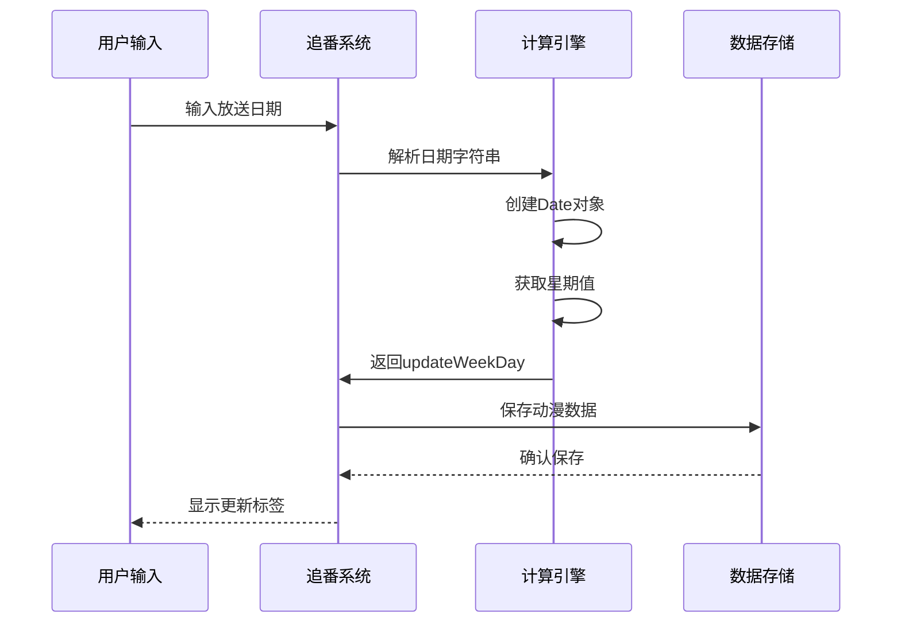

**图表来源**
- [_check.js:1071-1078](file://_check.js#L1071-L1078)
- [_check.js:1167-1178](file://_check.js#L1167-L1178)

#### 排序算法实现

系统使用自定义排序算法对动漫进行智能排列：

**章节来源**
- [_check.js:220-338](file://_check.js#L220-L338)
- [_check.js:314-320](file://_check.js#L314-L320)

### 周更新提醒机制

周更新提醒是追番模式的重要功能，能够在动漫更新当天自动提醒用户：

#### 提醒触发流程

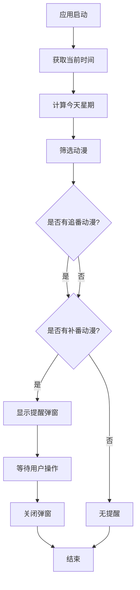

**图表来源**
- [_check.js:1268-1323](file://_check.js#L1268-L1323)

#### 提醒内容组织

提醒弹窗包含两个主要部分：

1. **今日更新动漫**：显示所有在今天更新的追番动漫
2. **未完结补番**：显示所有尚未观看完毕的补番动漫

**章节来源**
- [_check.js:1284-1306](file://_check.js#L1284-L1306)

### 日程管理功能

日程管理功能提供了完整的动漫观看日程安排：

#### 分类分组机制

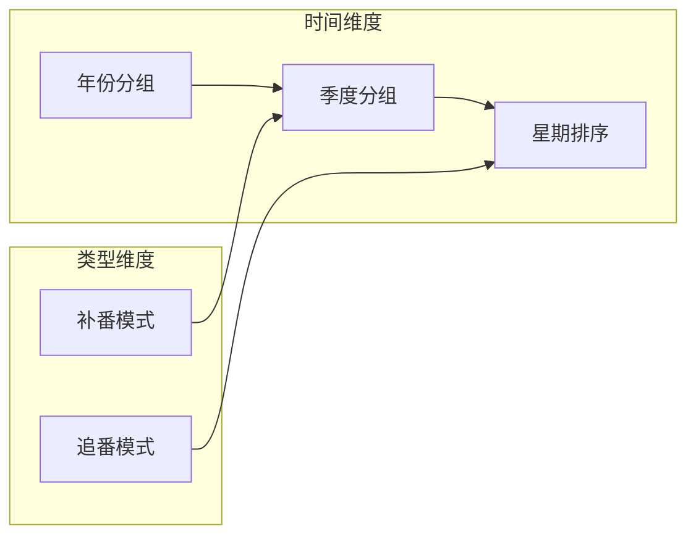

**图表来源**
- [_check.js:221-275](file://_check.js#L221-L275)
- [_check.js:307-331](file://_check.js#L307-L331)

#### 排序规则

系统实现了多级排序规则：

1. **年份排序**：最新的年份优先显示
2. **季度排序**：按春夏秋冬顺序排列
3. **追番排序**：按更新星期（周一到周日）排序
4. **补番排序**：按开始观看日期排序
5. **标题排序**：同级条件下按标题字母顺序排序

**章节来源**
- [_check.js:277-281](file://_check.js#L277-L281)
- [_check.js:296-298](file://_check.js#L296-L298)
- [_check.js:313-328](file://_check.js#L313-L328)

### 状态自动转换规则

状态转换系统实现了智能化的状态管理：

#### 转换规则矩阵

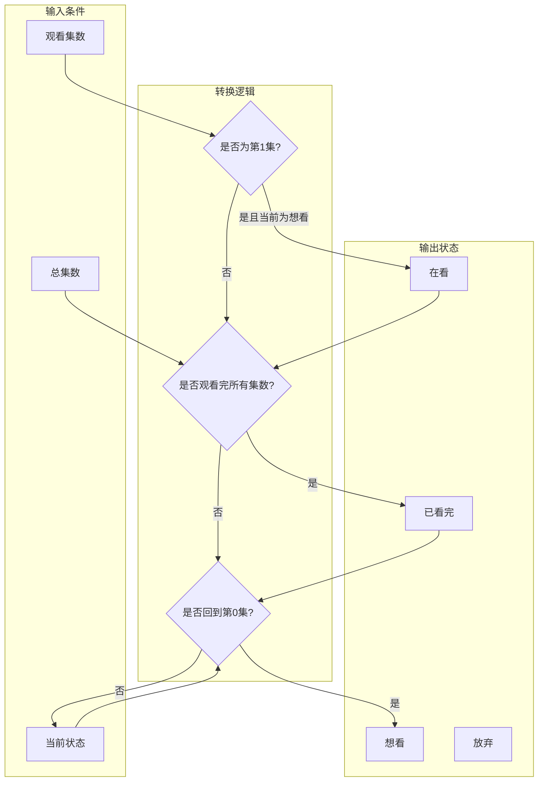

**图表来源**
- [_check.js:740-750](file://_check.js#L740-L750)
- [_check.js:864-892](file://_check.js#L864-L892)

#### 具体转换实现

系统在以下场景中自动执行状态转换：

1. **进度更新时**：当用户点击"+1"按钮时
2. **详情页面编辑时**：当用户调整观看进度时
3. **初始状态设置时**：当添加新动漫时

**章节来源**
- [_check.js:733-751](file://_check.js#L733-L751)
- [_check.js:864-892](file://_check.js#L864-L892)
- [_check.js:1081-1086](file://_check.js#L1081-L1086)

### 用户界面组件

#### 进度条渲染系统

进度条组件提供了直观的观看进度可视化：

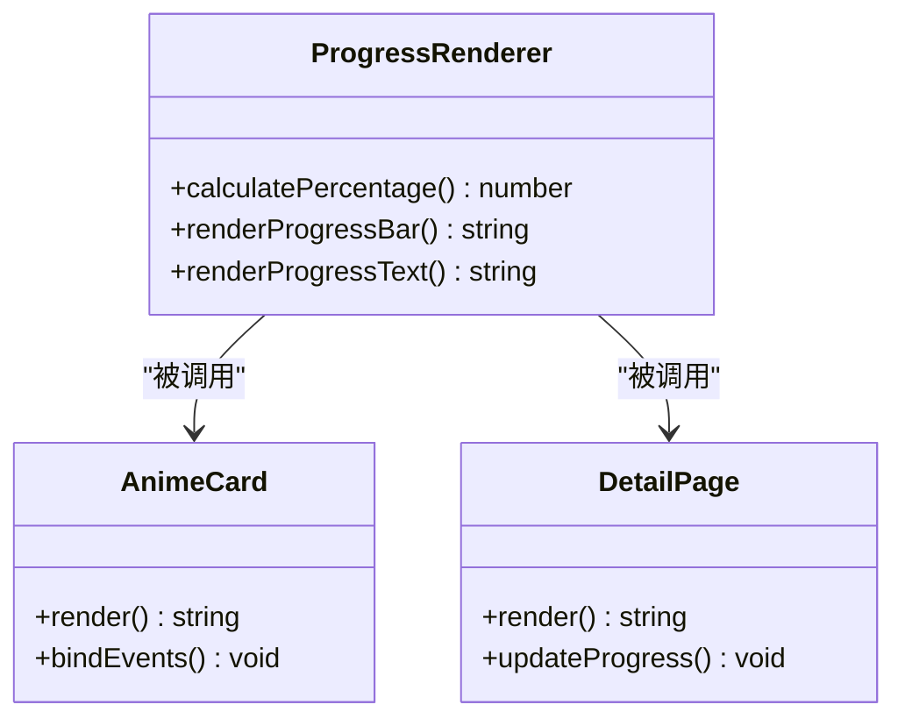

**图表来源**
- [_check.js:340-376](file://_check.js#L340-L376)
- [_check.js:378-492](file://_check.js#L378-L492)

#### 状态标签显示

状态标签系统提供了清晰的状态标识：

| 状态 | 标签文本 | CSS类名 | 颜色 |
|------|----------|---------|------|
| 想看 | 想看 | status-want | 蓝色 |
| 在看 | 在看 | status-watching | 绿色 |
| 搁置 | 搁置 | status-paused | 灰色 |
| 已看完 | 已看完 | status-completed | 紫色 |
| 放弃 | 放弃 | status-dropped | 红色 |

#### 交互事件处理

系统实现了完整的事件处理机制：

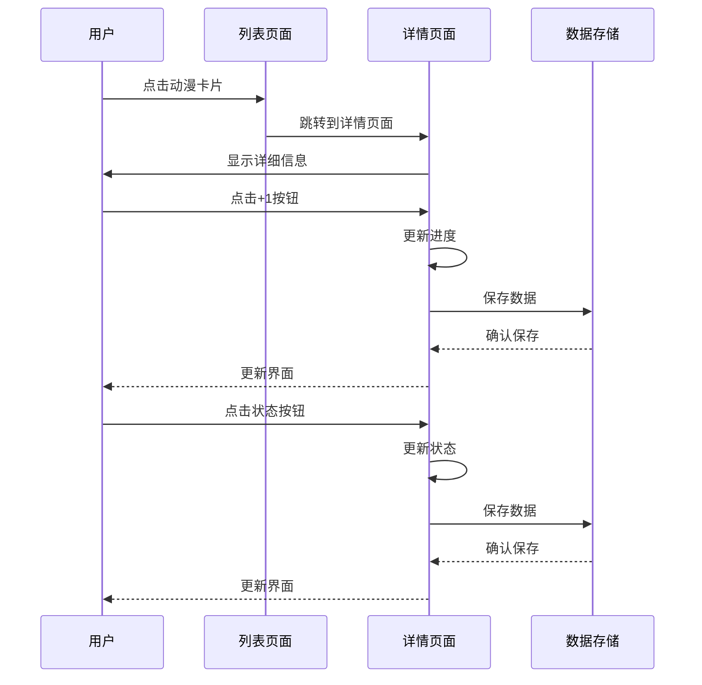

**图表来源**
- [_check.js:725-751](file://_check.js#L725-L751)
- [_check.js:846-918](file://_check.js#L846-L918)

**章节来源**
- [_check.js:340-376](file://_check.js#L340-L376)
- [_check.js:378-492](file://_check.js#L378-L492)
- [_check.js:651-844](file://_check.js#L651-L844)

## 依赖关系分析

追番模式的依赖关系体现了清晰的模块化设计：

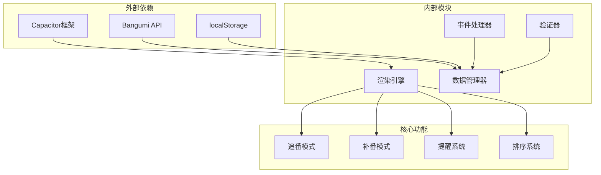

**图表来源**
- [package.json:18-28](file://package.json#L18-L28)
- [_check.js:920-935](file://_check.js#L920-L935)

### 外部API集成

系统集成了Bangumi API用于动漫信息查询：

#### API调用流程

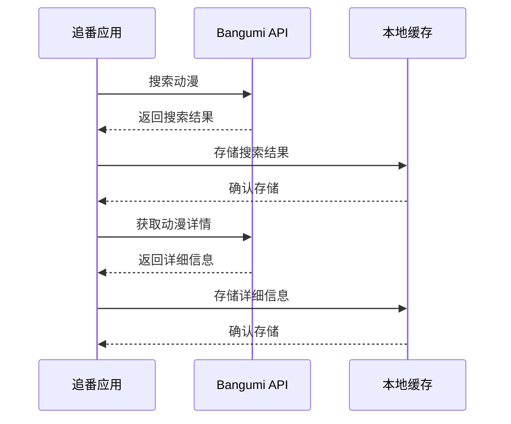

**图表来源**
- [_check.js:920-935](file://_check.js#L920-L935)
- [_check.js:1118-1216](file://_check.js#L1118-L1216)

**章节来源**
- [package.json:18-28](file://package.json#L18-L28)
- [_check.js:920-935](file://_check.js#L920-L935)

## 性能考虑

追番模式在设计时充分考虑了性能优化：

### 内存管理

- **状态对象复用**：使用浅拷贝避免不必要的内存分配
- **事件委托**：使用事件委托减少事件监听器数量
- **虚拟滚动**：对于大量数据采用虚拟滚动技术

### 渲染优化

- **批量更新**：使用 setState 统一管理状态变更
- **条件渲染**：只渲染必要的DOM元素
- **防抖处理**：搜索功能使用防抖减少API调用

### 数据持久化

- **增量更新**：只保存变更的数据
- **版本控制**：支持数据版本管理和冲突解决
- **备份恢复**：提供完整的数据导入导出功能

## 故障排除指南

### 常见问题及解决方案

#### 进度更新异常

**问题描述**：点击+1按钮后进度没有更新

**可能原因**：
1. 浏览器不支持localStorage
2. 数据格式错误
3. 事件绑定失败

**解决方案**：
1. 检查浏览器隐私设置
2. 清除浏览器缓存
3. 重新加载页面

#### 提醒功能失效

**问题描述**：应用启动时不显示更新提醒

**可能原因**：
1. 浏览器阻止弹窗
2. 时间设置错误
3. 动漫状态不正确

**解决方案**：
1. 允许弹窗显示
2. 检查系统时间
3. 重新设置动漫状态

#### 数据同步问题

**问题描述**：不同设备间数据不一致

**可能原因**：
1. 版本差异
2. 并发写入
3. 存储空间不足

**解决方案**：
1. 更新到最新版本
2. 使用导入导出功能
3. 清理存储空间

**章节来源**
- [_check.js:1260-1266](file://_check.js#L1260-L1266)
- [_check.js:826-843](file://_check.js#L826-L843)

## 结论

追番模式作为动漫追踪应用的核心功能，展现了优秀的软件架构设计和用户体验理念。通过精心设计的数据模型、智能的状态转换机制和直观的用户界面，系统为用户提供了完整的动漫观看管理体验。

### 主要优势

1. **智能化程度高**：自动计算更新星期、智能排序和状态转换
2. **用户体验优秀**：直观的界面设计和流畅的交互体验
3. **扩展性强**：模块化的架构便于功能扩展和维护
4. **兼容性好**：支持多种平台和设备

### 技术亮点

- **响应式设计**：适配各种屏幕尺寸
- **离线支持**：本地数据持久化
- **云端同步**：支持数据备份和恢复
- **国际化支持**：多语言界面

追番模式不仅满足了用户的基本需求，还通过技术创新提升了整体的使用体验，是一个值得学习的优秀案例。