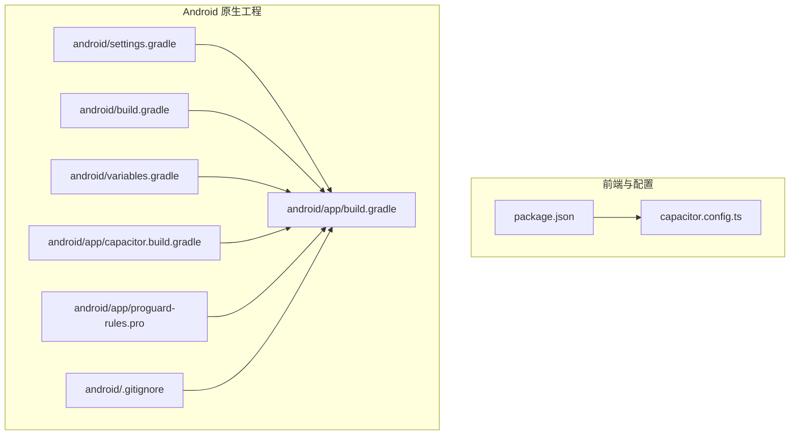
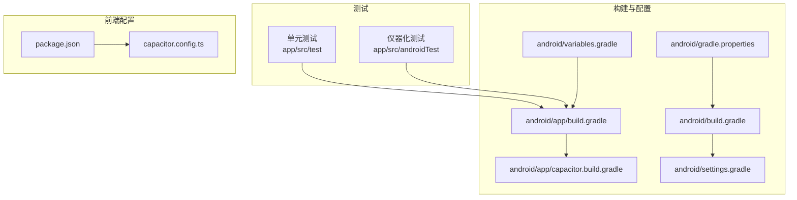
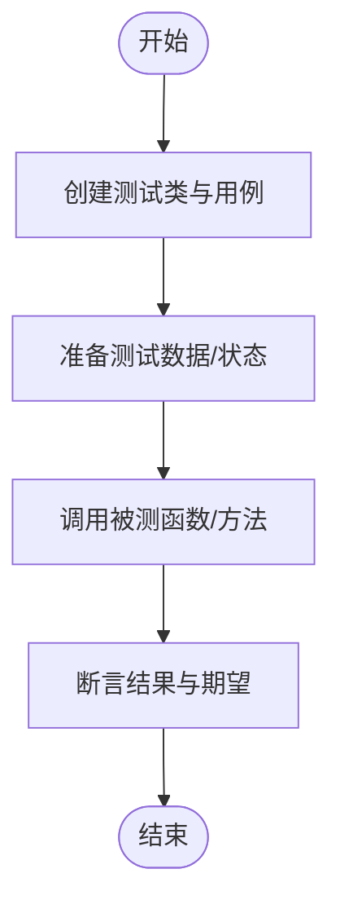
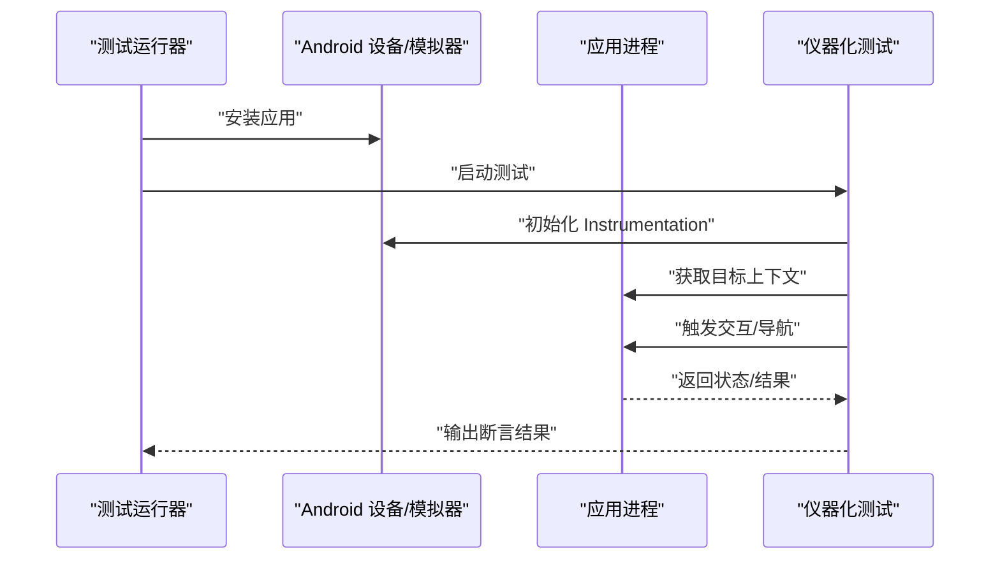
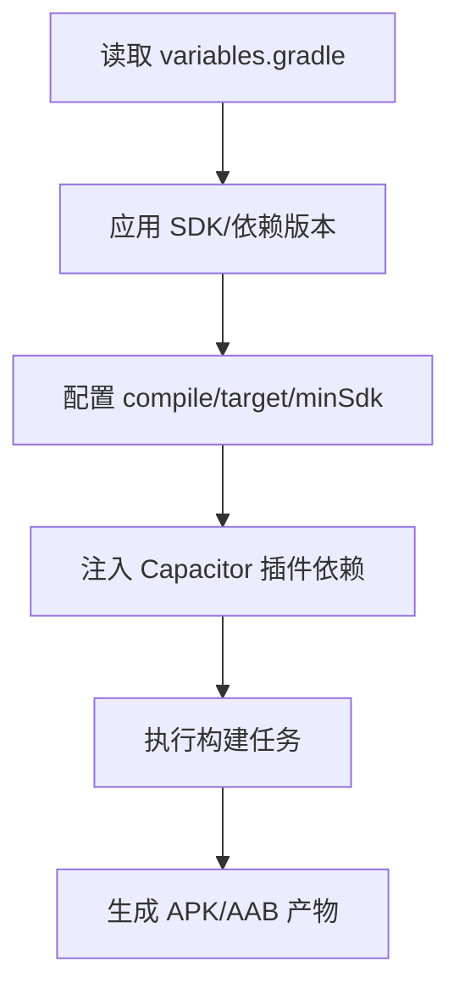
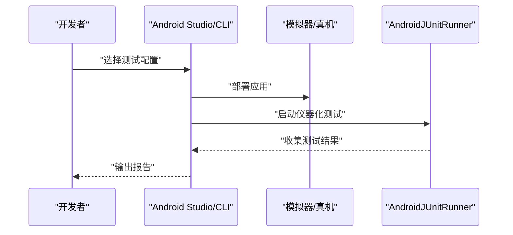
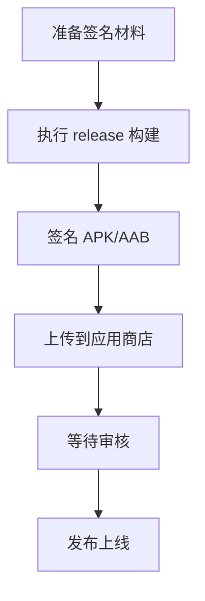
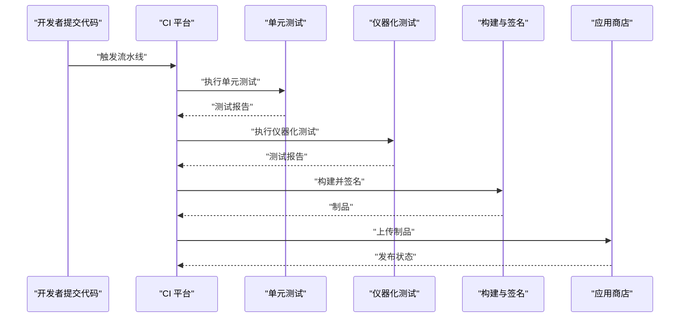
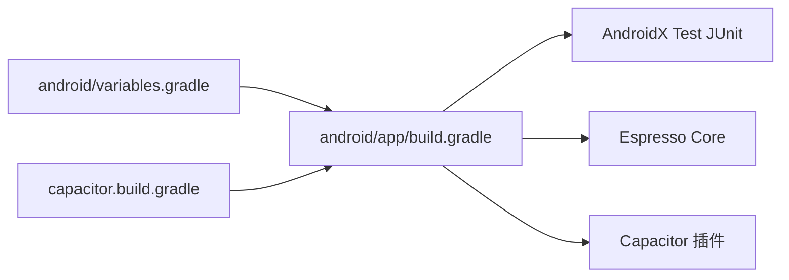

# 测试与部署

<cite>
**本文引用的文件**
- [android\app\src\test\java\com\getcapacitor\myapp\ExampleUnitTest.java](file://android/app/src/test/java/com/getcapacitor/myapp/ExampleUnitTest.java)
- [android\app\src\androidTest\java\com\getcapacitor\myapp\ExampleInstrumentedTest.java](file://android/app/src/androidTest/java/com/getcapacitor/myapp/ExampleInstrumentedTest.java)
- [android\app\build.gradle](file://android/app/build.gradle)
- [android\build.gradle](file://android/build.gradle)
- [android\gradle.properties](file://android/gradle.properties)
- [android\settings.gradle](file://android/settings.gradle)
- [android\variables.gradle](file://android/variables.gradle)
- [android\app\capacitor.build.gradle](file://android/app/capacitor.build.gradle)
- [android\app\proguard-rules.pro](file://android/app/proguard-rules.pro)
- [android\.gitignore](file://android/.gitignore)
- [package.json](file://package.json)
- [capacitor.config.ts](file://capacitor.config.ts)
- [项目解读分析与改进建议.md](file://项目解读分析与改进建议.md)
</cite>

## 目录
1. [引言](#引言)
2. [项目结构](#项目结构)
3. [核心组件](#核心组件)
4. [架构总览](#架构总览)
5. [详细组件分析](#详细组件分析)
6. [依赖分析](#依赖分析)
7. [性能考虑](#性能考虑)
8. [故障排查指南](#故障排查指南)
9. [结论](#结论)
10. [附录](#附录)

## 引言
本文件面向 Anime Tracker 项目，系统化阐述测试与部署策略，覆盖单元测试、集成测试与端到端测试的编写与执行方法；Android 平台的测试配置、模拟器与真机测试流程；构建生产版本、签名发布与应用商店发布流程；以及 CI/CD 集成建议、自动化测试配置与部署最佳实践，并说明不同环境的配置差异与注意事项。

## 项目结构
- 前端与跨平台配置
  - Capacitor 配置文件定义应用 ID、应用名、Web 目录、服务器参数与平台特定配置。
  - package.json 提供前端构建脚本与依赖，包括 Capacitor CLI、Android/iOS 容器与 React 生态。
- Android 原生工程
  - app 模块包含测试入口、构建脚本、依赖与混淆规则。
  - 顶层 Gradle 脚本统一版本与仓库配置。
  - settings.gradle 与 variables.gradle 管理模块与版本常量。
  - .gitignore 控制构建产物与敏感文件的提交行为。

**图示来源**
- [package.json:1-38](file://package.json#L1-L38)
- [capacitor.config.ts:1-22](file://capacitor.config.ts#L1-L22)
- [android\build.gradle:1-30](file://android/build.gradle#L1-L30)
- [android\settings.gradle:1-5](file://android/settings.gradle#L1-L5)
- [android\variables.gradle:1-16](file://android/variables.gradle#L1-L16)
- [android\app\build.gradle:1-55](file://android/app/build.gradle#L1-L55)
- [android\app\capacitor.build.gradle:1-22](file://android/app/capacitor.build.gradle#L1-L22)
- [android\app\proguard-rules.pro:1-22](file://android/app/proguard-rules.pro#L1-L22)
- [android\.gitignore:1-101](file://android/.gitignore#L1-L101)

**章节来源**
- [package.json:1-38](file://package.json#L1-L38)
- [capacitor.config.ts:1-22](file://capacitor.config.ts#L1-L22)
- [android\build.gradle:1-30](file://android/build.gradle#L1-L30)
- [android\settings.gradle:1-5](file://android/settings.gradle#L1-L5)
- [android\variables.gradle:1-16](file://android/variables.gradle#L1-L16)
- [android\app\build.gradle:1-55](file://android/app/build.gradle#L1-L55)
- [android\app\capacitor.build.gradle:1-22](file://android/app/capacitor.build.gradle#L1-L22)
- [android\app\proguard-rules.pro:1-22](file://android/app/proguard-rules.pro#L1-L22)
- [android\.gitignore:1-101](file://android/.gitignore#L1-L101)

## 核心组件
- 测试组件
  - 单元测试：位于 app 模块的 test 目录，使用 JUnit 在本地主机执行。
  - 仪器化测试：位于 app 模块的 androidTest 目录，使用 AndroidX Test 与 Espresso 在设备上执行。
- 构建与打包
  - Gradle 构建脚本定义编译与目标 SDK、最小 SDK、混淆规则与依赖。
  - Capacitor 构建脚本注入源兼容性与插件依赖。
- 配置与版本
  - variables.gradle 统一管理 SDK 版本与依赖版本。
  - gradle.properties 控制 Gradle 运行参数与 AndroidX 开关。
  - .gitignore 屏蔽构建产物与敏感文件。

**章节来源**
- [android\app\src\test\java\com\getcapacitor\myapp\ExampleUnitTest.java:1-19](file://android/app/src/test/java/com/getcapacitor/myapp/ExampleUnitTest.java#L1-L19)
- [android\app\src\androidTest\java\com\getcapacitor\myapp\ExampleInstrumentedTest.java:1-27](file://android/app/src/androidTest/java/com/getcapacitor/myapp/ExampleInstrumentedTest.java#L1-L27)
- [android\app\build.gradle:1-55](file://android/app/build.gradle#L1-L55)
- [android\app\capacitor.build.gradle:1-22](file://android/app/capacitor.build.gradle#L1-L22)
- [android\variables.gradle:1-16](file://android/variables.gradle#L1-L16)
- [android\gradle.properties:1-23](file://android/gradle.properties#L1-L23)
- [android\.gitignore:1-101](file://android/.gitignore#L1-L101)

## 架构总览
下图展示了测试与构建在项目中的位置与关系，以及与 Capacitor 配置的衔接。

**图示来源**
- [android\app\build.gradle:1-55](file://android/app/build.gradle#L1-L55)
- [android\app\capacitor.build.gradle:1-22](file://android/app/capacitor.build.gradle#L1-L22)
- [android\variables.gradle:1-16](file://android/variables.gradle#L1-L16)
- [android\gradle.properties:1-23](file://android/gradle.properties#L1-L23)
- [android\build.gradle:1-30](file://android/build.gradle#L1-L30)
- [android\settings.gradle:1-5](file://android/settings.gradle#L1-L5)
- [package.json:1-38](file://package.json#L1-L38)
- [capacitor.config.ts:1-22](file://capacitor.config.ts#L1-L22)

## 详细组件分析

### 单元测试组件
- 目标与范围
  - 在本地主机执行，验证核心逻辑的正确性，适合快速反馈与回归。
- 当前实现
  - 示例测试覆盖基础运算断言，演示测试命名与断言风格。
- 建议扩展
  - 针对应用的核心 CRUD 逻辑与业务规则编写测试用例，结合前端状态管理与数据模型进行断言。

**章节来源**
- [android\app\src\test\java\com\getcapacitor\myapp\ExampleUnitTest.java:1-19](file://android/app/src/test/java/com/getcapacitor/myapp/ExampleUnitTest.java#L1-L19)

### 仪器化测试组件
- 目标与范围
  - 在真实设备或模拟器上执行，验证应用在 Android 环境下的行为。
- 当前实现
  - 示例测试通过 InstrumentationRegistry 获取目标上下文并断言包名。
- 建议扩展
  - 基于 Espresso 编写页面交互测试，覆盖导航、输入、状态变更与数据持久化等关键路径。

**章节来源**
- [android\app\src\androidTest\java\com\getcapacitor\myapp\ExampleInstrumentedTest.java:1-27](file://android/app/src/androidTest/java/com/getcapacitor/myapp/ExampleInstrumentedTest.java#L1-L27)
- [android\app\build.gradle:12](file://android/app/build.gradle#L12)

### 构建与打包组件
- Gradle 构建脚本
  - 定义命名空间、SDK 版本、版本号与测试运行器。
  - 配置混淆规则与依赖，应用 Capacitor 构建脚本。
- Capacitor 构建脚本
  - 设置 Java 源/目标兼容性，注入 Capacitor 插件依赖。
- 版本与依赖管理
  - variables.gradle 统一管理 SDK 与依赖版本。
  - gradle.properties 控制并开启 AndroidX。
- 混淆与产物
  - proguard-rules.pro 提供混淆规则占位，release 默认关闭混淆。

**图示来源**
- [android\variables.gradle:1-16](file://android/variables.gradle#L1-L16)
- [android\app\build.gradle:1-55](file://android/app/build.gradle#L1-L55)
- [android\app\capacitor.build.gradle:1-22](file://android/app/capacitor.build.gradle#L1-L22)

**章节来源**
- [android\app\build.gradle:1-55](file://android/app/build.gradle#L1-L55)
- [android\app\capacitor.build.gradle:1-22](file://android/app/capacitor.build.gradle#L1-L22)
- [android\variables.gradle:1-16](file://android/variables.gradle#L1-L16)
- [android\gradle.properties:1-23](file://android/gradle.properties#L1-L23)
- [android\app\proguard-rules.pro:1-22](file://android/app/proguard-rules.pro#L1-L22)

### Android 平台测试配置与执行
- 测试运行器
  - build.gradle 中配置了 AndroidX Test 运行器，确保仪器化测试可用。
- 依赖
  - app 模块包含 JUnit、AndroidX Test JUnit 与 Espresso 依赖。
- 执行方式
  - 在 Android Studio 中运行或通过命令行执行 connectedAndroidTest 任务。
- 模拟器与真机
  - 使用 AVD Manager 创建模拟器镜像，或连接真机进行测试。
  - 注意：当前示例测试断言包名，需确保与应用 ID 一致。

**章节来源**
- [android\app\build.gradle:12-42](file://android/app/build.gradle#L12-L42)
- [android\app\src\androidTest\java\com\getcapacitor\myapp\ExampleInstrumentedTest.java:16-26](file://android/app/src/androidTest/java/com/getcapacitor/myapp/ExampleInstrumentedTest.java#L16-L26)

### 构建生产版本、签名与发布
- 构建变体
  - app/build.gradle 定义了 release 变体，默认关闭混淆。
- 签名配置
  - 在 CI/CD 或本地环境中配置密钥库与别名，设置签名参数。
- 生成发布包
  - 使用 assembleRelease 生成 APK/AAB；在 CI 中上传制品。
- 应用商店发布
  - 准备截图、描述与隐私政策；通过 Play Console 提交审核。

**章节来源**
- [android\app\build.gradle:19-24](file://android/app/build.gradle#L19-L24)
- [android\app\proguard-rules.pro:1-22](file://android/app/proguard-rules.pro#L1-L22)

### CI/CD 集成与自动化测试
- 建议流水线
  - Lint → 单元测试 → 仪器化测试 → 构建 → 签名 → 发布。
- 工具链
  - 使用 GitHub Actions 或其他 CI 平台，结合 Gradle Wrapper 与 Capacitor CLI。
- 测试覆盖率
  - 在仪器化测试中加入覆盖率收集与报告上传。
- 环境变量
  - 通过 CI 环境变量传递签名参数与应用商店凭据。

**章节来源**
- [package.json:8-16](file://package.json#L8-L16)
- [android\app\build.gradle:12-42](file://android/app/build.gradle#L12-L42)

## 依赖分析
- 组件耦合
  - app 模块依赖 AndroidX Test 与 Espresso，用于仪器化测试。
  - Capacitor 构建脚本注入插件依赖，保证运行时能力。
- 版本管理
  - variables.gradle 统一版本，避免冲突。
- 外部依赖
  - Capacitor 插件与 AndroidX 库通过 Gradle 依赖树管理。

**图示来源**
- [android\app\build.gradle:33-43](file://android/app/build.gradle#L33-L43)
- [android\variables.gradle:1-16](file://android/variables.gradle#L1-L16)
- [android\app\capacitor.build.gradle:11-16](file://android/app/capacitor.build.gradle#L11-L16)

**章节来源**
- [android\app\build.gradle:33-43](file://android/app/build.gradle#L33-L43)
- [android\variables.gradle:1-16](file://android/variables.gradle#L1-L16)
- [android\app\capacitor.build.gradle:11-16](file://android/app/capacitor.build.gradle#L11-L16)

## 性能考虑
- 测试性能
  - 单元测试在本地执行，速度快；仪器化测试受设备/模拟器性能影响。
- 构建性能
  - Gradle JVM 参数可在 gradle.properties 中调整；AndroidX 开启有助于兼容性与性能。
- 运行性能
  - release 变体默认关闭混淆，便于调试；可根据需要开启以减小体积。

**章节来源**
- [android\gradle.properties:10-22](file://android/gradle.properties#L10-L22)
- [android\app\build.gradle:20-23](file://android/app/build.gradle#L20-L23)

## 故障排查指南
- 测试无法运行
  - 确认测试运行器已在 build.gradle 中配置。
  - 检查设备/模拟器是否可用且已授权。
- 包名断言失败
  - 确保仪器化测试断言的应用包名与应用 ID 一致。
- 构建失败
  - 检查 variables.gradle 中的 SDK 版本与本地 SDK 是否匹配。
  - 清理构建缓存后重试。
- 提交敏感信息
  - .gitignore 已屏蔽构建产物与密钥文件，避免误提交。

**章节来源**
- [android\app\build.gradle:12](file://android/app/build.gradle#L12)
- [android\app\src\androidTest\java\com\getcapacitor\myapp\ExampleInstrumentedTest.java:24](file://android/app/src/androidTest/java/com/getcapacitor/myapp/ExampleInstrumentedTest.java#L24)
- [android\.gitignore:1-101](file://android/.gitignore#L1-L101)

## 结论
本文件基于现有代码库梳理了 Anime Tracker 的测试与部署现状，并提供了可操作的测试与发布建议。建议尽快补充核心业务逻辑的单元测试与组件级测试，完善 CI/CD 流水线，以提升质量与交付效率。同时，结合项目解读文档中的改进建议，逐步推进架构现代化与工程化建设。

## 附录
- 关键配置要点
  - 应用 ID 与应用名：见 Capacitor 配置。
  - 构建变体与混淆：见 app 模块构建脚本。
  - 依赖与版本：见 variables.gradle 与构建脚本。
- 相关文件路径
  - 测试入口与示例：app/src/test 与 app/src/androidTest。
  - 构建脚本：android/app/build.gradle 与 android/build.gradle。
  - 配置文件：capacitor.config.ts 与 package.json。

**章节来源**
- [capacitor.config.ts:1-22](file://capacitor.config.ts#L1-L22)
- [android\app\build.gradle:1-55](file://android/app/build.gradle#L1-L55)
- [android\build.gradle:1-30](file://android/build.gradle#L1-L30)
- [package.json:1-38](file://package.json#L1-L38)
- [android\variables.gradle:1-16](file://android/variables.gradle#L1-L16)