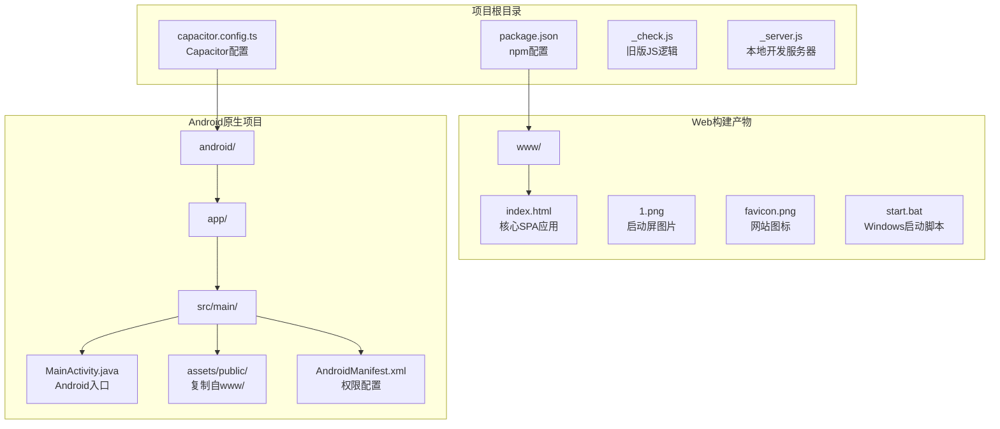
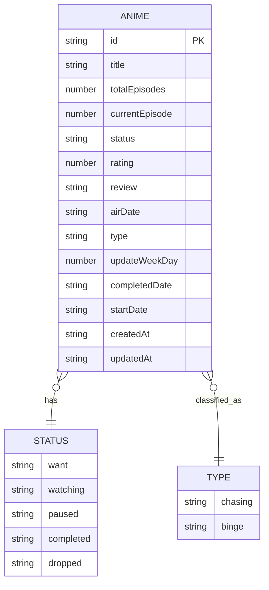

# 项目概述

<cite>
**本文档引用的文件**
- [package.json](file://package.json)
- [capacitor.config.ts](file://capacitor.config.ts)
- [MainActivity.java](file://android/app/src/main/java/com/animetracker/app/MainActivity.java)
- [index.html](file://www/index.html)
- [项目解读分析与改进建议.md](file://项目解读分析与改进建议.md)
</cite>

## 目录
1. [引言](#引言)
2. [项目结构](#项目结构)
3. [核心组件](#核心组件)
4. [架构概览](#架构概览)
5. [详细组件分析](#详细组件分析)
6. [依赖关系分析](#依赖关系分析)
7. [性能考虑](#性能考虑)
8. [故障排除指南](#故障排除指南)
9. [结论](#结论)

## 引言

Anime Tracker（追番记录）是一个基于Capacitor的跨平台移动应用，专为动漫爱好者设计，用于帮助用户管理和追踪动漫观看进度。该项目采用React + Vite + Capacitor技术栈，通过一套代码同时支持Web端、Android和iOS三大平台。

### 项目定位
- **目标用户**：具有追番习惯的动漫爱好者
- **核心价值**：集中管理追番列表、记录观看进度、按放送季分类展示
- **交付形态**：Web端可直接运行，通过Capacitor封装为移动端App

### 主要功能特性
- 番剧管理：添加、编辑、删除、搜索番剧
- 进度追踪：实时记录观看进度，支持追番/补番双模式
- Bangumi API集成：自动填充番剧信息，大幅提升录入效率
- 数据持久化：本地存储，支持导入导出
- 移动端适配：响应式设计，原生体验

## 项目结构

项目采用典型的Capacitor跨平台架构，核心代码集中在单个HTML文件中：



**图表来源**
- [package.json:1-38](file://package.json#L1-L38)
- [capacitor.config.ts:1-22](file://capacitor.config.ts#L1-L22)

**章节来源**
- [项目解读分析与改进建议.md:55-89](file://项目解读分析与改进建议.md#L55-L89)

## 核心组件

### 技术栈分析

| 技术 | 版本 | 用途 |
|------|------|------|
| React | ^18.2.0 | UI框架 |
| Vite | ^5.1.0 | 构建工具 |
| TypeScript | ^5.2.2 | 类型系统 |
| Zustand | ^4.5.0 | 状态管理 |
| @vitejs/plugin-react | ^4.2.1 | Vite的React编译插件 |
| @capacitor/core | ^6.0.0 | Capacitor核心API |
| @capacitor/android | ^6.0.0 | Android原生容器 |
| @capacitor/ios | ^6.0.0 | iOS原生容器 |

### 应用架构

项目采用SPA（单页应用）架构，所有核心逻辑都封装在单个HTML文件中，通过全局状态管理实现页面切换和数据更新。

**章节来源**
- [项目解读分析与改进建议.md:18-48](file://项目解读分析与改进建议.md#L18-L48)

## 架构概览

```mermaid
graph TB
subgraph "用户界面层"
A[Web浏览器]
B[Android WebView]
C[iOS WKWebView]
end
subgraph "应用层"
D[Capacitor Bridge]
E[React组件<br/>(声明式) - 计划中]
F[原生JavaScript<br/>(命令式) - 当前实现]
end
subgraph "数据层"
G[localStorage<br/>本地存储]
H[Bangumi API<br/>外部数据源]
I[IndexedDB<br/>计划中]
end
subgraph "原生功能层"
J[App插件<br/>生命周期管理]
K[Share插件<br/>数据分享]
L[Filesystem插件<br/>文件读写]
end
A --> D
B --> D
C --> D
D --> E
D --> F
E --> G
F --> G
G --> H
D --> J
D --> K
D --> L
```

**图表来源**
- [capacitor.config.ts:3-19](file://capacitor.config.ts#L3-L19)
- [MainActivity.java:1-5](file://android/app/src/main/java/com/animetracker/app/MainActivity.java#L1-L5)

## 详细组件分析

### 页面路由系统

应用通过全局状态变量实现客户端路由，支持四种页面状态：

| 页面 | 状态值 | 功能描述 |
|------|--------|----------|
| 列表页 | 'list' | 显示所有番剧列表，支持筛选、搜索、年度/季度分组 |
| 详情页 | 'detail' | 单部番剧的完整信息，进度控制、状态变更、评分、观后感 |
| 添加页 | 'add' | 添加新番剧表单（支持Bangumi API搜索自动填充） |
| 编辑页 | 'edit' | 编辑已有番剧的信息 |

### 数据模型设计



**图表来源**
- [项目解读分析与改进建议.md:108-127](file://项目解读分析与改进建议.md#L108-L127)

### Bangumi API集成

系统通过Bangumi（bgm.tv）API实现番剧信息的自动填充：

1. `POST /v0/search/subjects` - 搜索关键词，过滤动画类型（type=2）
2. `GET /v0/subjects/{id}` - 获取番剧详情

**章节来源**
- [项目解读分析与改进建议.md:134-141](file://项目解读分析与改进建议.md#L134-L141)

### 数据持久化方案

- **本地存储**：使用localStorage存储所有数据，键名为'anime-tracker-data'
- **折叠状态**：使用'anime-tracker-collapse'键持久化年份/季度的折叠状态
- **容量限制**：localStorage最大5MB，适合中小规模数据存储

**章节来源**
- [项目解读分析与改进建议.md:143-145](file://项目解读分析与改进建议.md#L143-L145)

### 导入/导出功能

- **导出**：支持范围选择（按年/季筛选），使用File System Access API或Capacitor Share API导出JSON
- **导入**：支持文件选择或粘贴JSON，以番剧名称（title）为合并键进行去重合并

**章节来源**
- [项目解读分析与改进建议.md:147-150](file://项目解读分析与改进建议.md#L147-L150)

## 依赖关系分析

```mermaid
graph LR
subgraph "前端依赖"
A[React ^18.2.0]
B[Vite ^5.1.0]
C[Zustand ^4.5.0]
D[@vitejs/plugin-react ^4.2.1]
end
subgraph "Capacitor插件"
E[@capacitor/core ^6.0.0]
F[@capacitor/android ^6.0.0]
G[@capacitor/ios ^6.0.0]
H[@capacitor/app ^6.0.0]
I[@capacitor/filesystem ^6.0.0]
J[@capacitor/share ^6.0.0]
end
subgraph "原生平台"
K[Android SDK 35]
L[iOS平台]
M[Web浏览器]
end
A --> E
B --> E
C --> E
D --> E
E --> F
E --> G
E --> H
E --> I
E --> J
F --> K
G --> L
H --> M
```

**图表来源**
- [package.json:18-36](file://package.json#L18-L36)
- [capacitor.config.ts:3-19](file://capacitor.config.ts#L3-L19)

**章节来源**
- [package.json:18-36](file://package.json#L18-L36)

## 性能考虑

### 当前架构优势
1. **零构建依赖**：核心应用在单个HTML文件中自包含，无需构建即可运行
2. **轻量级**：无外部CSS框架，纯自研样式，体积小
3. **Bangumi API集成**：大幅提升数据录入效率
4. **完善的导入导出**：支持范围选择和多种导入方式
5. **折行状态持久化**：记住用户的折叠偏好

### 潜在性能瓶颈
1. **单文件过大**：2767行代码集中在单个HTML文件中，维护困难
2. **localStorage限制**：5MB容量限制，大数据量时可能出现性能问题
3. **无虚拟滚动**：大量数据时列表渲染可能卡顿
4. **无缓存机制**：Bangumi API请求频繁，网络开销大

## 故障排除指南

### 常见问题及解决方案

**问题1：Capacitor配置错误**
- 检查appId和appName是否正确设置
- 确认webDir指向正确的www目录
- 验证Android/iOS平台配置

**问题2：Bangumi API访问失败**
- 确认网络连接正常
- 检查API接口是否可用
- 查看浏览器控制台错误信息

**问题3：数据无法持久化**
- 检查localStorage是否被禁用
- 确认浏览器隐私设置
- 验证数据格式是否正确

**问题4：移动端适配问题**
- 检查CSS媒体查询
- 验证触摸事件处理
- 确认安全区域处理

**章节来源**
- [capacitor.config.ts:3-19](file://capacitor.config.ts#L3-L19)
- [项目解读分析与改进建议.md:209-217](file://项目解读分析与改进建议.md#L209-L217)

## 结论

Anime Tracker项目展现了优秀的跨平台应用设计理念，通过Capacitor技术实现了Web和原生平台的一致体验。项目的核心功能已经相当完善，涵盖了动漫追番管理的主要需求。

### 项目优势
- 技术栈选择合理，符合跨平台应用需求
- 功能设计贴近用户实际使用场景
- 代码结构简洁，易于理解和扩展
- Bangumi API集成提升了用户体验

### 发展建议
基于项目的现状，建议按照以下优先级进行改进：
1. **代码模块化**：将单文件拆分为模块化架构
2. **架构分层**：引入状态管理、路由和数据层
3. **性能优化**：虚拟滚动、IndexedDB存储
4. **功能增强**：云同步、社交元素、统计分析

项目目前处于原型验证与生产部署之间的过渡阶段，通过合理的架构演进，有望发展成为一个功能完善、用户体验优秀的专业级动漫管理应用。