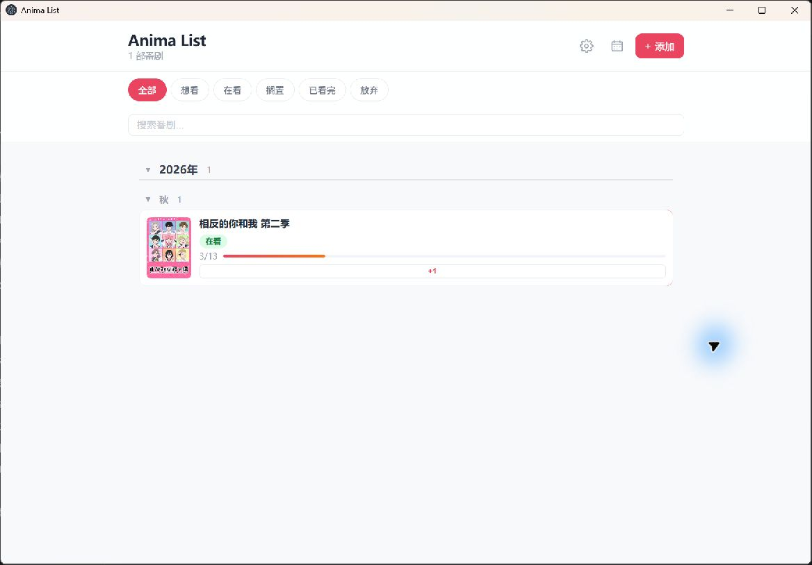
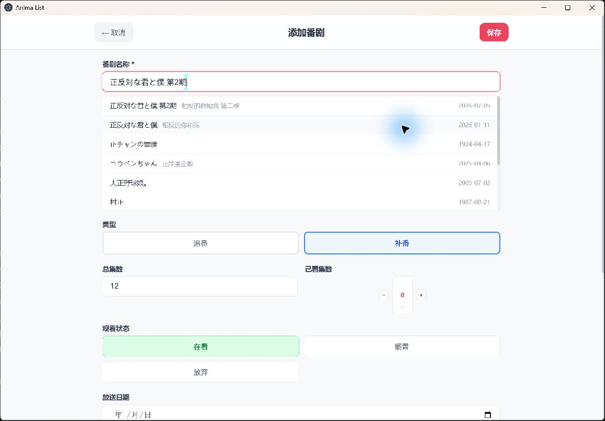
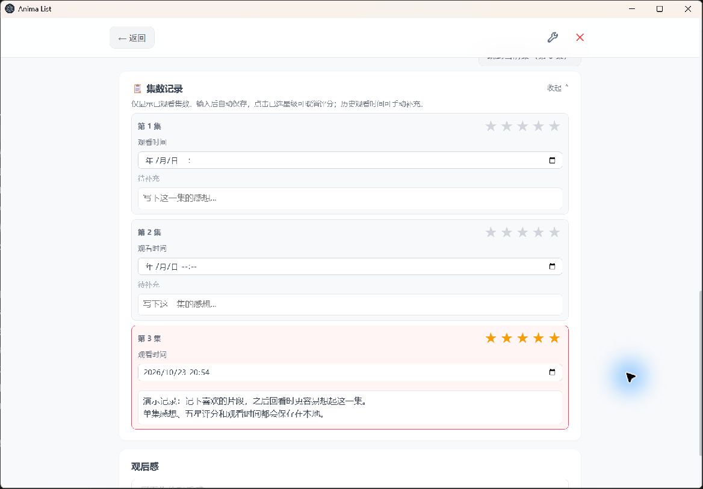

# Anima List

一个给动漫爱好者自用的追番与补番记录工具。把想看的作品、观看进度、单集感想和评分放在一起，在电脑和手机之间延续自己的观看记录。

无需登录即可在本机使用；需要跨端同步时，再注册云同步账号。

[下载 v1.3.1](https://github.com/KAGUYA284/anima-list/releases/tag/v1.3.1) · [完整使用说明](docs/软件使用说明.md) · [项目结构](#项目结构) · [更新记录](docs/工作内容说明.md)

## 可以做什么

- **管理追番与补番**：按年份、季度整理作品，支持想看、在看、搁置、已看完和放弃，并根据观看状态自动调整季度归类。
- **记录每一集**：主页点击 `+1` 更新进度；详情页按集保存感想、星级和观看时间，支持折叠与跳到当前集。
- **浏览季度新番表**：按年份、季度及周一至周日浏览作品，直接加入待看，添加后留在原来的位置。
- **安排更新次序**：按固定星期或最近更新排序，可选择当天、昨天为起点；启动时可显示当日和昨日更新。
- **查看番剧资料**：自动补充封面、简介、制作人员、角色和声优；保存过的资料与缩略图可离线查看。
- **备份与跨端同步**：JSON 导入导出、最近 3 份操作前备份、删除后 15 秒撤销，以及手机与电脑之间的云同步。



## 下载与启动

在 [Releases](https://github.com/KAGUYA284/anima-list/releases) 中选择适合自己的版本：

| 版本 | 使用方法 |
| --- | --- |
| Windows 安装版 | 下载 `Anima-List-Setup-1.3.1.exe`，安装后从桌面或开始菜单打开 |
| Windows 免安装版 | 下载名称带 `Windows-Portable` 的 ZIP，完整解压后运行 `Anima List.exe` |
| Android | 下载并安装 `Anima-List-v1.3.1-signed.apk` |
| 网页版 | 下载名称带 `Web` 的 ZIP，完整解压后双击“启动网页版.cmd”，使用期间保留服务窗口；不需要安装 Node.js |

Windows 免安装版日常重启会保留记录，数据目录是程序旁的 `portable-user-data`。项目发布脚本重新部署该目录时会清空这些数据；更新前请导出 JSON，并将下载包解压到新文件夹。下载包不携带个人记录、登录状态或运行缓存；缓存测试版仅用于本地开发，不上传到 Release。

## 快速上手

下面以 2026 年夏季番《相反的你与我 第二季》为例。Bangumi 对应条目名为 **《相反的你和我 第二季》**，日文名为 `正反対な君と僕 第2期`，首播日期为 2026-07-05。演示截图来自独立本地副本，不包含个人观看记录。

### 1. 添加一部作品

1. 点击主页右上角“添加”，搜索“相反的你和我”或日文标题。
2. 选择带有“第二季／第2期”的条目，核对首播日期和集数。
3. 跟随播出进度观看时选“追番”；像本例这样补看上季度作品时选“补番”，填写开始观看日期。
4. 点击“保存”。如果暂时不看，已看集数保持 0，作品会归入“想看”。



也可以点击主页设置右侧的日历图标打开新番表，选择“2026 年／夏季”，找到作品后点击“加入待看”。软件会先匹配 Bangumi 条目，再补充资料并检查是否已经添加。

### 2. 更新进度，记录单集感想

在主页点击作品卡片上的 `+1`，即可记录又看完一集。点击卡片进入详情，可以用 `−`、`+` 调整进度，也可以点击右上角扳手编辑资料。

本例先保存为已看 2 集，再在主页点击一次 `+1`，进度变为 **3/13**。因为在秋季开始补看夏季作品，当前记录显示在秋季列表中。

在“集数记录”中，为已经看过的集数填写感想、点亮星级，并按需要修改观看时间。内容会自动保存；记录较多时，可以收起整个区域，或用“跳到当前集”直接定位。



主页左滑卡片（电脑端用鼠标向左拖动）可以展开齿轮编辑和删除按钮。删除后提示条保留 15 秒撤销入口。

### 3. 按自己的习惯整理

- **封面或文字列表**：设置 → 列表显示。
- **更新排序**：设置 → 番剧信息 → 展示次序；可从当天或昨天起，优先显示最近更新的作品。
- **启动提醒**：设置 → 启动提醒；当日和昨日可以同时开启。
- **资料不完整**：设置 → 数据管理 → 更新番剧信息 → 更新全部。
- **查看使用说明**：设置页最下方。首次使用且没有番剧时会自动打开，目录默认折叠。

追番在看时随预计播出进度跨季移动，已看完后回到首播季度；补番在看时显示在当前季度，完成后按看完日期归档。想看、搁置和放弃按首播季度归档。

### 4. 备份或换设备

在“设置 → 数据管理”导出 JSON，可在另一台设备导入。导入时可选“仅添加新番”“保留本地”或“使用导入记录”；默认保留本地进度与感想，只补充空缺资料。

需要云同步时，在“设置 → 云同步”用邮箱注册并登录，密码为 8～128 个字符：

1. 首次上传非空本地记录，使用“初始化云端”。
2. 新设备登录同一账号后，使用“从云端恢复”。
3. 日常修改会尝试自动同步，也可点击“立即同步”；出现冲突时，查看云端上次同步时间，再选择使用哪份记录。

普通同步保留空数据保护。导入、清空和云端覆盖等操作前会自动备份，可在设置中恢复最近 3 份非空记录。更多操作见[完整使用说明](docs/软件使用说明.md)。

---

## 项目结构

以下内容面向开发者。项目使用 **Vanilla JavaScript + ES Modules + Vite**，共享前端位于 `www/`，通过 Electron 提供 Windows 应用，通过 Capacitor 提供 Android 应用，同时保留独立网页版。

```text
anima-list/
├─ www/                         共享前端源码
│  ├─ index.html                页面入口和启动兜底
│  ├─ css/styles.css            浅色/深色、响应式布局与组件样式
│  └─ js/
│     ├─ app.js                 启动、提醒、缓存队列与平台返回行为
│     ├─ renderer/              列表、详情、表单、设置、新番表模板
│     ├─ events/                对应页面的交互与事件绑定
│     ├─ store.js               应用状态、增删改和设置
│     ├─ data.js / storage.js   数据规范化、导入导出与本地持久化
│     ├─ grouping.js            追番/补番的动态季度归类
│     ├─ list-order.js          列表展示次序
│     ├─ api.js / yuc.js        数据请求、缓存、季度页解析与作品映射
│     ├─ seasonal-import.js     新番表添加与去重
│     ├─ import-enrichment.js   导入记录的缺失资料补全
│     ├─ metadata-refresh.js    已加入作品的资料刷新
│     ├─ library-cache.js       长期资料与 IndexedDB 缩略图缓存
│     ├─ backups.js             操作前备份
│     ├─ sync-*.js              云同步请求、决策与本地同步状态
│     ├─ secure-storage.js      各平台凭据存储适配
│     └─ user-guide*.js         内置说明弹窗与 Markdown 渲染
├─ electron/                    Windows 外壳、数据目录和受限 IPC
├─ android/                     Capacitor Android 原生工程
├─ cloudflare/                  Hono + D1 云同步服务、迁移与测试
├─ scf_bangumi_proxy.js          腾讯云 Bangumi/图片代理和 yuc 解析
├─ scripts/                     版本同步、检查、构建与发布整理
├─ tests/                       node:test 测试
├─ docs/                        使用说明、工作记录、架构文档与截图
└─ .github/workflows/ci.yml      GitHub Actions 检查
```

`renderer.js` 和 `events.js` 保留为兼容导出入口，具体逻辑分别放在对应子目录。仓库目前提供 Windows、Android 和 Web 产物；iOS 仅保留 Capacitor 依赖与相关命令，尚无原生工程或发布包。

### 页面与数据流

```text
页面交互（events） → 状态修改（store） → 规范化与本地保存（data / storage）
                          ↓
                    页面渲染（renderer）
```

观看记录与设置使用 localStorage；封面缩略图二进制使用 IndexedDB。网络请求负责补充资料，不阻塞已保存记录的离线使用。JSON 导出保留资料文本和封面地址，云同步主要保存观看记录，两者都不携带图片二进制。

### 番剧数据来源

| 来源 | 主要用途 |
| --- | --- |
| [Bangumi](https://bgm.tv/) | 规范标题、条目 ID、集数、封面、简介、角色与声优 |
| [yuc.wiki](https://yuc.wiki/) | 季度新番表、播出日期、每周更新时间与时段、制作人员信息 |

新番表添加优先使用 yuc 日文标题搜索 Bangumi，中文标题兜底，以 Bangumi ID 和作品关联信息去重。yuc 季度页从 `201910` 起支持，早于 2019 年秋季显示“无数据”。

Bangumi 请求按设置选择直连或代理优先，失败后尝试另一条路径。yuc 在 Electron 中由主进程读取固定季度页；Web/移动端先尝试直连，失败时使用腾讯云代理。当前 Electron/SCF 抓取实现使用固定 `yuc.wiki` 主机的 HTTP 页面，客户端与云代理之间使用 HTTPS。

### 云同步与本地数据

`cloudflare/` 使用 Cloudflare Workers、Hono 和 D1，提供注册、登录和按服务端 `revision` 检测冲突的快照同步。客户端共享 `sync-service.js`，不使用设备时钟决定覆盖方向。

Electron 通过系统加密凭据存储保存 Token，Android 使用 Keystore，Web 使用 localStorage。后端部署、D1 迁移、Origin 白名单和 JWT 密钥配置见 [Cloudflare 部署说明](cloudflare/README.md)。

## 本地开发

安装 Node.js 20 或更新版本，然后执行：

```bash
npm ci
npm run dev
```

Vite 默认地址为 `http://localhost:5173`。

| 命令 | 用途 |
| --- | --- |
| `npm run check` | 源码检查、自动化测试、Web 构建和构建产物检查 |
| `npm run build` | 将共享前端构建到 `dist/` |
| `npm run desktop` | 构建并启动 Electron |
| `npm run desktop:preview` | 生成 Windows 免安装目录 `Anima List/` |
| `npm run desktop:installer` | 生成 Windows NSIS 安装程序 |
| `npm run sync` | 构建前端并同步到 Capacitor 原生工程 |
| `npm run android:release` | 构建已签名 Android Release APK |
| `npm run release:package` | 将已有构建产物整理到统一发布目录 |
| `npm run release:all` | 检查、构建并整理 Windows / Android / Web 产物 |
| `npm run cloud:install` | 安装云同步服务依赖 |
| `npm run cloud:check` | 云同步服务 TypeScript 检查与测试 |

Android 构建需要 JDK 17、Android SDK 35，以及本机签名配置。签名格式参考 [android/keystore.properties.example](android/keystore.properties.example)。

## 版本与发布

`package.json` 的 `version` 是应用版本来源。`npm run sync:version` 会同步 `APP_VERSION` 和 Android `versionName`，构建前也会自动执行；Android `versionCode` 需要手动递增。Electron/SCF 请求标识及云服务包版本在发版时同步维护。

构建产物与源码分开：

```text
dist/                          Web 构建结果
Anima List/                    Windows 免安装构建结果
.desktop-build/                Windows 安装程序与中间产物
发布版本/v1.3.1/
├─ Windows/安装版/              NSIS 安装程序
├─ Windows/免安装版/            完整程序目录
├─ Windows/缓存测试版/          独立保存测试数据的完整程序目录
├─ Android/                     已签名 APK
└─ Web/                         启动脚本、本地服务与静态资源
```

修改共享功能后，同步更新 Windows、Android 和 Web 产物。仅修改 README 或截图时不需要重新打包客户端。

生产 `wrangler.toml`、JWT 密钥、Android 签名文件与密码配置、`local.properties`、运行数据和构建目录均不提交到 Git。部署配置使用仓库中的示例文件；Release 仅上传 Windows 安装版、正式免安装版、Android 和 Web，不上传缓存测试版，并排除 `portable-user-data`、`test-user-data` 及其他运行缓存。

腾讯云代理代码有变更时需要单独重新部署，入口为 `scf_bangumi_proxy.main_handler`；部署为 `index.js` 时使用 `index.main_handler`。

更多背景资料：[软件使用说明](docs/软件使用说明.md) · [累计工作内容](docs/工作内容说明.md) · [架构分析](docs/architecture/项目解读分析与改进建议.md)
